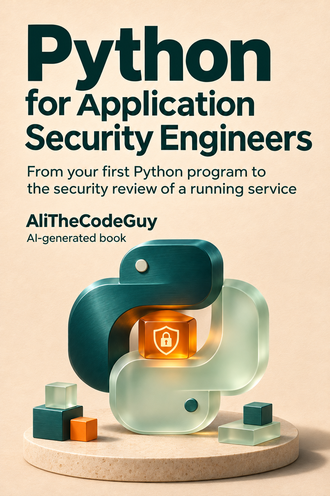

# Python for Application Security Engineers



**From your first Python program to the security review of a running service**

By **[AliTheCodeGuy](https://github.com/alithecodeguy)** · Created with AI assistance  
**Edition:** 27 November 2026 · **44 chapters** · English

Learn Python by building and reviewing **Casebook**, a service for private team notes. Start with your first program, then follow the same workspace permission rule through a web application, background jobs, tests, release decisions and incident recovery.

**[Start reading →](manuscript/chapters/01.md)** · **[Full contents and preface](manuscript/README.md)** · **[Choose a reading route](manuscript/README.md#choose-a-reading-route)**

## Read the book

Everything is readable here on GitHub. Open a chapter in **Preview** to read formatted text, code, tables and Mermaid diagrams. Each chapter has an expandable section list and previous/next links at the top and bottom. No installation is needed to read.

| Part | Chapters | What you learn |
| --- | --- | --- |
| I. First steps in Python | [01](manuscript/chapters/01.md)–[04](manuscript/chapters/04.md) | Programs, tools, values and decisions |
| II. Give data a shape | [05](manuscript/chapters/05.md)–[08](manuscript/chapters/08.md) | Collections, functions, text and files |
| III. Write code another person can trust | [09](manuscript/chapters/09.md)–[12](manuscript/chapters/12.md) | Errors, models, bounded work and tests |
| IV. Python at system boundaries | [13](manuscript/chapters/13.md)–[16](manuscript/chapters/16.md) | Processes, SQL, HTTP and TLS |
| V. Design a small web application | [17](manuscript/chapters/17.md)–[20](manuscript/chapters/20.md) | Trust boundaries, requirements, Django and APIs |
| VI. Identity, permissions and the browser | [21](manuscript/chapters/21.md)–[24](manuscript/chapters/24.md) | Accounts, sessions, tenant isolation and browser controls |
| VII. Files, services and concurrent work | [25](manuscript/chapters/25.md)–[28](manuscript/chapters/28.md) | Uploads, integrations, cryptography and queues |
| VIII. Review, verification and release | [29](manuscript/chapters/29.md)–[32](manuscript/chapters/32.md) | Code review, testing, dependencies and CI |
| IX. Operate and recover a service | [33](manuscript/chapters/33.md)–[36](manuscript/chapters/36.md) | Logs, observability, deployment and incidents |
| X. Build tools and lead reviews | [37](manuscript/chapters/37.md)–[40](manuscript/chapters/40.md) | Review tools, findings, cloud identity and AppSec programs |
| XI. Capstone: a private workspace export | [41](manuscript/chapters/41.md)–[44](manuscript/chapters/44.md) | Design, implementation, review and recovery |

New to programming? Start at [chapter 01](manuscript/chapters/01.md); [chapter 02](manuscript/chapters/02.md) sets up your workbench. Already write Python? Use the [reading routes](manuscript/README.md#choose-a-reading-route) to choose a starting point.

## Find a topic

- [Glossary](manuscript/indexes.md#glossary), [subject index](manuscript/indexes.md#subject-index) and [Python API and tools index](manuscript/indexes.md#python-api-and-tools-index)
- [Figures and Mermaid diagrams](manuscript/exhibits.md#list-of-figures), [tables](manuscript/exhibits.md#list-of-tables) and [listings](manuscript/exhibits.md#list-of-listings)
- [Appendices and exercise answers](manuscript/appendices.md)
- [References and edition records](manuscript/references.md)
- [Runnable examples](examples/README.md) and [tested versions](tested-versions.md)

## Work through the examples

To keep a local copy:

```shell
git clone https://github.com/alithecodeguy/appsec-python.git
cd appsec-python
```

Follow [chapter 02](manuscript/chapters/02.md) for Python installation and an exercise workspace. The tested edition uses **CPython 3.12.14** and **Django 6.1.3**. For the companion files, follow the [examples guide](examples/README.md) and [reproduction commands](tested-versions.md); each lab names its working directory and dependencies.

Some listings are exercises to create yourself, and some deliberately show a bug before its correction. The companion directories contain selected runnable examples, rather than one application containing every chapter. The [recorded verification](examples/verification/current.json) states which checks ran and their limits. The capstone includes a worked production **HOLD** decision; a passing local lab is not production approval.

## Corrections and contributions

Found a confusing explanation, broken link or incorrect result? [Open an issue](https://github.com/alithecodeguy/appsec-python/issues/new/choose) or send a focused pull request. Include the chapter, section and the result you expected. See [CONTRIBUTING.md](CONTRIBUTING.md) for local checks and conventions.

The [syllabus](python-appsec-syllabus.md), [writing guide](book-context.md) and [prompt pack](book-prompts.md) document how the book was developed. The manuscript is the reader's starting point.
