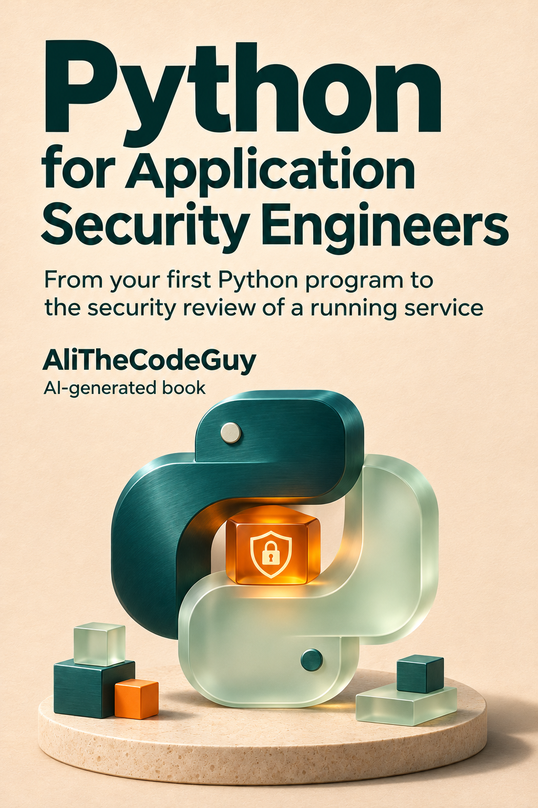

# Python for Application Security Engineers

**From your first Python program to the security review of a running service**

By **AliTheCodeGuy** · Created with AI assistance

**Edition:** 27 November 2026 · **CPython 3.12.14** · **Django 6.1.3**

[Repository](../README.md) · [Preface](#preface) · [Choose a reading route](#choose-a-reading-route) · [Contents](#contents) · [Figures](#list-of-figures) · [Tables](#list-of-tables) · [Listings](#list-of-listings) · [Back matter](#back-matter)

Read directly on GitHub using each chapter's section list and previous/next links. The [examples guide](../examples/README.md) explains which companion files are included and how to run them.

## Preface

A private note belongs to Alpha. Mina can read it today. If Lee removes her membership while an export waits in a queue, may that export still release the note tomorrow? What would count as evidence that the answer is correct?

This book teaches Python through those questions. Application security, or **AppSec**, means making software protect the people and data that depend on it. You will start with text and a few instructions, then learn to turn a rule into code, a test, a design decision and an operational check. You do not need previous programming experience to begin chapter 01.

The running project is **Casebook**, a service for private team notes. Mina belongs to **Alpha**. Ravi belongs to **Beta**. Lee manages **Alpha only**. An anonymous visitor has no account. The names, notes, credentials, partner events and incidents are fictional. A reader needs current active membership in the note's stored workspace at the time of a read. Manager status does not cross a workspace boundary. A stored export also needs the correct requester and current release authority.

The examples develop that rule in stages. An early pure function receives supplied facts; a later service loads trusted account and membership records. Some chapters use separate small laboratories rather than extending one installed application. Keep the filenames, starting state and working directory named by each chapter. Passing a value such as `user_id=1` in a fixture is not a replacement for browser authentication.

Read each example with a prediction. Write down the input, expected result and final state; run the stated command; then explain the line or boundary that determined the result. For a refused write, retry or cleanup failure, inspect what remains in storage. Try the independent practice before following the worked answer. The [lab notebook and solution directory](appendices.md#appendix-c-lab-notebook-and-answer-key) gives a repeatable way to keep that evidence.

The prose uses short explanations and keeps API names in their original spelling. If English is a second language, explain an example in your own words and keep the exact English term beside your translation. Use the [glossary](indexes.md#glossary) when a word is new, the [subject index](indexes.md#subject-index) for a security question, and the [Python API and tools index](indexes.md#python-api-and-tools-index) for a code name.

## Choose a reading route

| Reader | Route | Check before moving on |
| --- | --- | --- |
| First program, or little confidence with code | Read chapters [01](chapters/01.md)–[12](chapters/12.md) in order. Chapter 01 can be traced on paper; [02](chapters/02.md) sets up the interpreter. Continue through Parts IV–XI. | [Trace three access decisions](chapters/04.md#practice-check-print-three-decisions), [convert the two file fixtures](chapters/08.md#practice-check-preserve-and-explain), then [produce a correction with a repeatable test](chapters/12.md#practice-check-submit-a-quota-regression-diff). |
| Experienced in another language | Try the checkpoints in [04](chapters/04.md), [08](chapters/08.md) and [12](chapters/12.md). Use [05](chapters/05.md)–[11](chapters/11.md) for missed Python details, then continue at [13](chapters/13.md). | Explain truth values, aliasing, mutable defaults, imports, text/bytes and exception cleanup. A familiar syntax is not evidence that these decisions match your first language. |
| Comfortable with Python, new to AppSec | Start at [13](chapters/13.md). Read the design in [17](chapters/17.md)–[18](chapters/18.md) before the service and controls in [19](chapters/19.md)–[28](chapters/28.md). Continue through verification, operations and the capstone. | Trace one identity and one private object across each boundary. State where current membership, limits and release authority are checked. |
| Already reviewing Python services | Use the [subject index](indexes.md#subject-index), [verification chapter](chapters/30.md) and [standards map](appendices.md#appendix-d-standards-and-verification-map) to locate a question. Attempt [41](chapters/41.md#the-learners-private-export-brief) before reading the worked capstone. | Check the exact implementation/report subject and its limits. Use the preceding chapters when a capstone dependency or assumption is unfamiliar. |

For self-study, use a chapter as two sessions: first understand and predict; then rebuild or change one case and check it independently. A design chapter produces a concrete matrix, diagram or decision record instead of requiring a running server. Each part's last chapter has a checkpoint. The capstone asks for a complete evidence handover rather than a claim based on a green test total.

## Before running the examples

Use the [tested versions and reproduction guide](../tested-versions.md) and [pinned learning requirements](../requirements-tested.txt). Chapter 02 explains interpreter selection and virtual environments. Follow the chapter's command location; separate Django settings laboratories need separate Python processes. A paid cloud account is not required for the policy/model exercises.

The verification records distinguish executed local checks from authored inputs, expected procedures and untested environments. Browser-engine enforcement, hosted identity exchange, provider permissions and production key/storage controls need their own evidence. The capstone's local tests pass, while its [production decision remains HOLD](chapters/43.md#apply-the-mandatory-gates-without-averaging-them) for the controls named in that review. Treat the examples as learning services with synthetic data.

## Contents

Read the chapters below in this order unless you have used the route checks above. Each part introduces the result you will build or inspect; each link uses the title in the completed chapter.

### Part I. First steps in Python

Begin with a short program and a prediction. Learn what runs the file, how names refer to values, and how branches and loops turn facts into decisions. Finish by tracing an allowed member, another workspace and an anonymous visitor.

- [01. Your first program](chapters/01.md)
- [02. Set up a workbench you can rebuild](chapters/02.md)
- [03. Values, names and expressions](chapters/03.md)
- [04. Decisions and repetition](chapters/04.md)

### Part II. Give data a shape

Choose collections, separate reusable functions from printing, and follow text across an encoding boundary. Read CSV and JSON into one checked record shape. Shared mutable objects, missing fields and byte limits become observable behavior rather than surprising output.

- [05. Collections and shared state](chapters/05.md)
- [06. Functions, modules and interfaces](chapters/06.md)
- [07. Text, bytes and patterns](chapters/07.md)
- [08. Files and structured records](chapters/08.md)

### Part III. Write code another person can trust

Read errors, give cleanup an owner, model data and consume streams within clear budgets. Then turn a product rule into a failing test, correct it and retain the regression. This part ends with a focused change another reader can inspect.

- [09. Errors, debugging and cleanup](chapters/09.md)
- [10. Types, classes and domain models](chapters/10.md)
- [11. Iteration, decorators and bounded work](chapters/11.md)
- [12. Repeatable tests and a reviewable change](chapters/12.md)

### Part IV. Python at system boundaries

Take Python across process, configuration, command-line, database and network boundaries. Separate strings from settings, arguments from shell syntax, SQL values from identifiers, and transport protection from permission. Inspect exit codes, stored rows and bounded response handling.

- [13. Processes, settings and secrets](chapters/13.md)
- [14. Command-line tools and child processes](chapters/14.md)
- [15. Relational data and transactions](chapters/15.md)
- [16. Networks, HTTP and TLS](chapters/16.md)

### Part V. Design a small web application

Draw the private-data paths and assign each check to an owner before adding web routes. Turn privacy and retention into testable requirements. Build the smallest Django service, then specify accepted fields, state changes, failures and repeated API operations.

- [17. Draw the system and its trust boundaries](chapters/17.md)
- [18. Security requirements and private data](chapters/18.md)
- [19. Build the Casebook web service](chapters/19.md)
- [20. API contracts and business rules](chapters/20.md)

### Part VI. Identity, permissions and the browser

Follow Mina through password verification, recovery, sessions and token validation. Carry the same Alpha/Beta matrix through each private read. Follow a note from template to response, and separate rendering, cookies, CSRF, CORS and CSP by what each actually controls.

- [21. Accounts, passwords and recovery](chapters/21.md)
- [22. Sessions, tokens and federated identity](chapters/22.md)
- [23. Authorization and tenant isolation](chapters/23.md)
- [24. Templates, cookies and the browser](chapters/24.md)

### Part VII. Files, services and concurrent work

Accept attachments under bounded content/storage rules, and treat partner requests and webhook deliveries as separate trust decisions. Choose cryptographic operations for named jobs. Coordinate workers and use database constraints to preserve one committed effect despite retries or overlapping work.

- [25. Uploads, archives and serialization](chapters/25.md)
- [26. Outbound requests and integrations](chapters/26.md)
- [27. Cryptographic choices and key management](chapters/27.md)
- [28. Concurrency, queues and resource limits](chapters/28.md)

### Part VIII. Review, verification and release

Trace a change from input to data use, interpret findings and check the claim at the right boundary. Use integration and generated tests, inspect installed dependencies, and bind required checks to the artifact being considered. Missing evidence stays visible at the release gate.

- [29. Review Python changes and interpret static findings](chapters/29.md)
- [30. Verify controls in running code](chapters/30.md)
- [31. Dependencies and the software supply chain](chapters/31.md)
- [32. CI checks and release evidence](chapters/32.md)

### Part IX. Operate and recover a service

Record useful audit facts without copying private content. Interpret rates, traces and alerts with their populations and limits. Review deployment authority, then preserve evidence, contain an incident and verify that recovery restores the intended protections.

- [33. Security logs and audit history](chapters/33.md)
- [34. Metrics, traces and alert triage](chapters/34.md)
- [35. Deployment, containers and infrastructure settings](chapters/35.md)
- [36. Incident response, disclosure and recovery](chapters/36.md)

### Part X. Build tools and lead reviews

Package a small source-review tool and explain what its syntax rule can and cannot establish. Normalize findings without losing their origins, separate workload authority from requester authority, and give requirements, risk decisions and improvement work clear owners.

- [37. Build a Python source-review tool](chapters/37.md)
- [38. Normalize findings and prioritize work](chapters/38.md)
- [39. Cloud identity and service boundaries](chapters/39.md)
- [40. Run an application security program](chapters/40.md)

### Part XI. Capstone. A private workspace export

Attempt the export brief before reading the worked design. Implement request, worker, collection and expiry controls; test current permission, duplicate delivery and final state. Review the actual candidate, then rehearse a retention incident and a handover another engineer can repeat.

- [41. Capstone I. Define a private export](chapters/41.md)
- [42. Capstone II. Implement the controls](chapters/42.md)
- [43. Capstone III. Review and release](chapters/43.md)
- [44. Capstone IV. Operate, respond and hand over](chapters/44.md)

### Back matter

- [Appendix A. A small rule, three ways to read it](appendices.md#appendix-a-a-small-rule-three-ways-to-read-it) — comparison, named function and a check after changed facts.
- [Appendix B. A reference shelf for Python](appendices.md#appendix-b-a-reference-shelf-for-python) — find the language, API or tool explanation by the task.
- [Appendix C. Lab notebook and answer key](appendices.md#appendix-c-lab-notebook-and-answer-key) — a worked stored-revocation run and links to all chapter solutions.
- [Appendix D. Standards and verification map](appendices.md#appendix-d-standards-and-verification-map) — versioned standard identifiers, controls and bounded evidence.
- [Glossary](indexes.md#glossary) — alphabetical plain-English meanings.
- [Subject index](indexes.md#subject-index) — security and engineering topics across the book.
- [Python API and tools index](indexes.md#python-api-and-tools-index) — exact code and tool names.
- [Bibliography and edition records](references.md) — primary sources grouped by subject and the versions used for examples.

## Using the exhibit lists

The complete catalog has moved to [Figures, tables and listings](exhibits.md). Each entry links to the section containing the exhibit.

## List of figures

[Open the figure catalog and Mermaid diagram directory →](exhibits.md#list-of-figures)

## List of tables

[Open the table catalog →](exhibits.md#list-of-tables)

## List of listings

[Open the code and data listing catalog →](exhibits.md#list-of-listings)

---

[Start chapter 01 →](chapters/01.md) · [Repository](../README.md)
