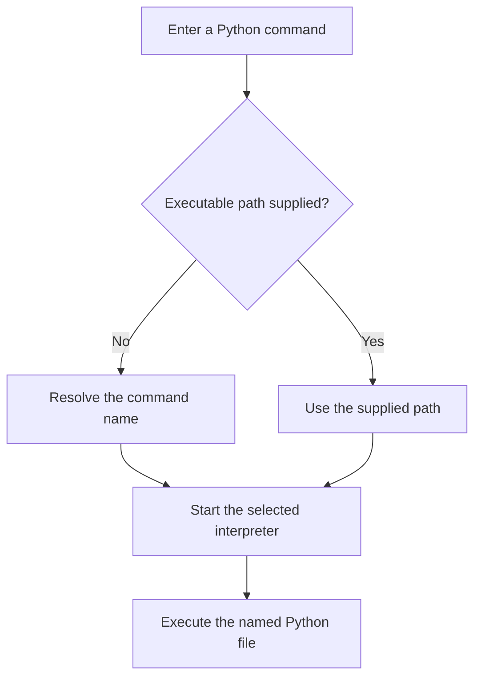

# 02. Set up a workbench you can rebuild

When you run a Python file, how can you prove which Python ran it? Can you close your terminal, return tomorrow and run the same file with the same interpreter?

In chapter 01, you predicted the output of `first_note.py` on paper. This chapter turns that prediction into a real run. You will install or locate Python, make a folder for the Casebook exercises and save your first scripts. You will also keep a local history of the files you write.

By the end, you will be able to do four things.

- Select an installed CPython 3.15 interpreter deliberately.
- Distinguish the terminal, shell, editor and Python prompt.
- Create a project environment and identify its executable from inside a script.
- Reopen the project, repeat the run and record a clean Git commit.

You need internet access for installation and permission to install software on your computer. Use the setup instructions for your operating system. The Windows commands use PowerShell. The macOS and Linux commands use a shell such as zsh or Bash.

## 1. Install Python and locate its launcher

An **executable** is a program your operating system can start. The Python interpreter is an executable. A **launcher** helps select and start an installed interpreter. On Windows, this chapter uses the `py` launcher. On macOS and Linux, it selects the executable named `python3.15`.

The book's language baseline is CPython 3.15. Its original patch baseline is 3.15.2. A **patch version**, such as the final `2`, identifies a maintenance release. Install the latest stable patch in the 3.15 series and record the exact version you receive. Check for output beginning with `Python 3.15.` at the end of your platform's setup.

### Windows setup with PowerShell

Open the Start menu and search for **PowerShell**. Start it. A line ending with a prompt appears, and the cursor waits for a command. Type each command from the blocks below and press Enter. The prompt itself is omitted from the book's command blocks.

Download and install the **Python install manager** from Python's Windows downloads page. Follow its setup instructions, then close and reopen PowerShell so the commands it installs become available. [Python for Windows](https://www.python.org/downloads/windows/)

Install a runtime from the 3.15 series, list what the manager can launch and check the selected version.

```powershell
py install 3.15
py list
py -V:3.15 --version
```

`install 3.15` asks the manager to obtain that runtime series. `-V:3.15` selects it explicitly for a run. `--version` asks the interpreter to display its version and stop.

If an older `py` launcher handles the command and treats `install` as a filename, use `pymanager install 3.15` and `pymanager list` for the manager operations. Then check `py -V:3.15 --version` again. The Windows guide explains how the manager and older launcher can coexist. [Python's Windows setup guide](https://docs.python.org/3.15/using/windows.html)

### macOS setup with Terminal

Open **Terminal** from Applications, Utilities. Download the macOS installer for a stable Python 3.15 patch from Python's downloads page. Run the `.pkg` installer and follow its prompts. [Python for macOS](https://www.python.org/downloads/macos/)

Complete the installer's certificate setup by opening `Install Certificates.command` in the `Python 3.15` folder under Applications. You can open it with this command too.

```shell
open "/Applications/Python 3.15/Install Certificates.command"
```

Let that window finish. Open a fresh Terminal window, then locate and check the executable.

```shell
command -v python3.15
python3.15 --version
```

`command -v` shows how the shell resolves the name. Its output is a path, such as `/usr/local/bin/python3.15`. A path is the location of a file or folder. Your installed Python can coexist with versions used by macOS or other software. [Python's macOS setup guide](https://docs.python.org/3.15/using/mac.html)

### Linux setup with a terminal

Linux distributions provide different Python versions through their package managers. For a consistent 3.15 route, this chapter uses **uv**, a tool that can install a CPython build for your user account. uv obtains these builds from the `python-build-standalone` project. [uv's Python installation guide](https://docs.astral.sh/uv/guides/install-python/)

Open your distribution's terminal application. First install the download tools and Git, which you will use in section 4. Choose the commands for your distribution.

On Ubuntu or Debian, run the following.

```shell
sudo apt update
sudo apt install curl ca-certificates git
```

On Fedora, run the following.

```shell
sudo dnf install curl ca-certificates git
```

`sudo` asks to run a command with administrator privileges. The package manager may ask for your password and confirmation. On another distribution, use its package manager to install the same tools.

Install uv using its published installer. This command downloads and executes the installer's shell script. Use the default installation location for the commands in this chapter.

```shell
curl -LsSf https://astral.sh/uv/install.sh | sh
```

Then use the installed tool to obtain Python and check its executable.

```shell
"$HOME/.local/bin/uv" python install 3.15
"$HOME/.local/bin/python3.15" --version
```

`$HOME` expands to your home folder. These commands give the executable's path directly, so they work even before a new shell picks up the installer's command-search settings. If you already configured uv to use another location, use the executable paths its installer reports. [uv installation instructions](https://docs.astral.sh/uv/getting-started/installation/)

### Check the result before continuing

For all three routes, the final version check should report the 3.15 series. An example result for the book's original patch is the following.

```text
Python 3.15.2
```

A newer stable 3.15 patch will have a different final number. If you see an older series or a command error, resolve the installation or executable selection before creating the project environment. Keep the platform-specific command that produced the correct result. You will use it again in section 3.

## 2. Tell the tools and prompts apart

There are four tools or interfaces to recognize before creating files.

**Table T02-01. Where to perform each action**

| Tool or interface | Its job | An action you perform there |
| --- | --- | --- |
| Terminal | Hosts a text session with input and output | Open a window and read command results |
| Shell | Interprets operating-system commands | Change folder or start Python |
| Editor | Creates and changes source files | Save three Python instructions as `first_note.py` |
| Interactive Python prompt | Accepts Python code for immediate execution | Try `print("Alpha")` and inspect its output |

A **shell prompt** means the shell is waiting for a command. PowerShell often shows something like `PS C:\Users\Mina>`. Bash or zsh may show a folder name followed by `$` or `%`. Yours can look different.

A **Python prompt** normally contains `>>>`. It appears if you start Python without supplying a script to run.

You can try it now. Use your platform's interpreter command from section 1, with the `--version` option removed. For example, on macOS enter `python3.15`. After Python's startup message, enter the following at its prompt.

```python
print("Alpha")
```

The expected output is `Alpha`, followed by a newline. Leave interactive Python by entering the following.

```python
exit()
```

The shell prompt returns. Shell commands such as `cd` belong there. If you see `>>>` when you intend to run a shell command, use `exit()` first.

### Follow a command to the script it runs

An executable's full path identifies a particular program. A short command name asks the shell to resolve that name. For installed external programs, this commonly involves searching the folders in **PATH**, a shell setting listing command locations.

**Figure F01. How the shell reaches a saved script**



Notice where selection happens. Two terminal sessions can resolve the short name `python` differently. In the main exercises below, you will give the project interpreter's path directly.

### Make the exercise folder

Use a new folder named `casebook-learning` in your home folder. The book manuscript and your runnable learning files have separate purposes. These instructions create your learning files in that new folder.

In Windows PowerShell, run the following.

```powershell
Set-Location $HOME
New-Item -ItemType Directory -Path casebook-learning
Set-Location casebook-learning
Get-Location
```

On macOS or Linux, run the following.

```shell
cd "$HOME"
mkdir casebook-learning
cd casebook-learning
pwd
```

If the folder already exists, enter it and inspect its contents before adding files. A directory is another name for a folder. The **working directory** is the folder against which the shell interprets relative paths. `Get-Location` or `pwd` shows it.

Record the displayed location. It might be `C:\Users\Mina\casebook-learning` on Windows, `/Users/mina/casebook-learning` on macOS or `/home/mina/casebook-learning` on Linux.

### Save and run the first script

Use a code editor you already have, or install one such as Visual Studio Code. Open `casebook-learning` as a folder in the editor. Create `first_note.py` there and save this listing from chapter 01.

**Listing L02-01. The first script saved on your computer**

```python
print("Release plan")
print("Alpha")
print("Deny")
```

Use a plain-text file with the exact name `first_note.py`. On Windows, enable filename extensions in File Explorer if needed to confirm that the file's name ends in `.py`. Save all three lines before returning to the terminal.

From the exercise folder, run the script using the interpreter you selected.

Windows PowerShell uses the following.

```powershell
py -V:3.15 first_note.py
```

macOS uses the following.

```shell
python3.15 first_note.py
```

The Linux uv route uses the following.

```shell
"$HOME/.local/bin/python3.15" first_note.py
```

The expected output matches your paper trace.

```text
Release plan
Alpha
Deny
```

If Python says it cannot open the file, check the working directory and filename. List the folder's contents with `Get-ChildItem` on PowerShell or `ls` on macOS and Linux. A message saying a file cannot be found gives you a location problem to investigate before changing the Python code.

## 3. Create a project environment and inspect it

A **virtual environment** is a directory that holds a project interpreter entry point and a separate place for installed Python packages. A **package** supplies reusable Python code. Separate environments let projects use different package sets.

We will name this environment `.venv`. The dot is part of the name. An environment is created from an installed **base interpreter**. Keep your source files beside the environment directory so that you can recreate the environment independently. [Python's virtual-environment documentation](https://docs.python.org/3.15/library/venv.html)

### Create it once

Check that you are in `casebook-learning`. Then use the command for your platform.

Windows PowerShell uses the following.

```powershell
py -V:3.15 -m venv .venv
```

macOS uses the following.

```shell
python3.15 -m venv .venv
```

The Linux uv route uses the following.

```shell
"$HOME/.local/bin/python3.15" -m venv .venv
```

`-m` asks the selected interpreter to run a Python **module**, a named unit of code. Here the module is `venv`, and `.venv` is the folder it creates. Successful creation may produce no output. Wait until the shell prompt returns, then check the new executable.

Windows PowerShell uses the following.

```powershell
.\.venv\Scripts\python.exe --version
.\.venv\Scripts\python.exe first_note.py
```

macOS and Linux use the following.

```shell
./.venv/bin/python --version
./.venv/bin/python first_note.py
```

The version should match the base interpreter used to create the environment. The script should produce the same three lines as before.

The initial `.` in `./.venv` or `.\.venv` means “start from the working directory.” `bin` and `Scripts` are platform-specific folder names inside the environment. Keep this path convention for the exercises that follow.

### Worked example 1. Ask the running interpreter to identify itself

Create `show_runtime.py` beside `first_note.py`.

**Listing L02-02. Inspecting the interpreter from inside a script**

```python
import sys

print(sys.executable)
print(sys.version)
```

`import sys` makes Python's `sys` module available in this file. It supplies information about the running interpreter. The dot in `sys.executable` means “get the value named `executable` from `sys`.” `sys.version` supplies version and build information. You will study imports and attribute access further in later chapters. [Python's `sys` reference](https://docs.python.org/3.15/library/sys.html)

Run the script through your project environment.

```powershell
.\.venv\Scripts\python.exe show_runtime.py
```

```shell
./.venv/bin/python show_runtime.py
```

Use the first block on Windows and the second on macOS or Linux. The first output line should name the Python executable inside this project's `.venv`. The second should identify Python 3.15 and its build.

For example, the first line on Mina's Windows computer might be the following.

```text
C:\Users\Mina\casebook-learning\.venv\Scripts\python.exe
```

On Mina's macOS computer it might instead be the following.

```text
/Users/mina/casebook-learning/.venv/bin/python
```

Your home folder and build information will differ. Copy your actual two output lines into a new file named `setup-notes.md`. Label them **Before closing the terminal**. Add the working directory and the command you ran. Save the notes in `casebook-learning`.

### Activation is a convenience

**Activating** an environment adjusts the current shell so its short commands prefer that environment. On PowerShell the activation command is the following.

```powershell
.\.venv\Scripts\Activate.ps1
```

On macOS and Linux it is the following.

```shell
source .venv/bin/activate
```

After activation, `python show_runtime.py` should identify the project interpreter. Enter `deactivate` to restore the shell's previous environment settings. If PowerShell's policy blocks the activation script, continue using `.\.venv\Scripts\python.exe` directly. Its path already selects the intended executable.

Activation applies to a shell session. Opening a new terminal starts a new session. The commands used in this chapter select `.venv` explicitly, so you can repeat them in either session. [Creating and using virtual environments](https://packaging.python.org/en/latest/guides/installing-using-pip-and-virtual-environments/)

### Worked example 2. A package seems to be missing

Imagine that a later exercise reports the following error when importing `httpx`, an HTTP client package.

```text
ModuleNotFoundError: No module named 'httpx'
```

This is a diagnostic scenario for later use. The two scripts in this chapter require only Python's standard library, the modules included with Python.

The error tells you the running interpreter could not find that module. First identify that interpreter using `show_runtime.py`. Then compare it with the project's interpreter.

For example, compare these two Windows commands.

```powershell
py -V:3.15 show_runtime.py
.\.venv\Scripts\python.exe show_runtime.py
```

On macOS, compare the following.

```shell
python3.15 show_runtime.py
./.venv/bin/python show_runtime.py
```

On the Linux uv route, compare the following.

```shell
"$HOME/.local/bin/python3.15" show_runtime.py
./.venv/bin/python show_runtime.py
```

**Table T02-02. An illustrative comparison on macOS**

| Command | Reported executable | Interpretation |
| --- | --- | --- |
| `python3.15 show_runtime.py` | `/Library/Frameworks/Python.framework/Versions/3.15/bin/python3.15` | A base installation |
| `./.venv/bin/python show_runtime.py` | `/Users/mina/casebook-learning/.venv/bin/python` | The project environment |

The reported versions can match while the package sets differ. A package installed for the base interpreter can be absent from the project environment.

**pip** is a package installation tool. Ask the project's interpreter to run pip when inspecting its packages. Use the appropriate command below.

```powershell
.\.venv\Scripts\python.exe -m pip --version
```

```shell
./.venv/bin/python -m pip --version
```

The result includes pip's version and installed location. Its package location should be inside `.venv`. In a later exercise that requires `httpx`, replacing `--version` with `show httpx` would inspect that package in this same environment. Install required packages using the instructions of the chapter that introduces them.

### Close the terminal and repeat the evidence

Save both scripts and `setup-notes.md`. Close the terminal window. Open a new PowerShell or Terminal window.

On Windows, return to the project and run the same files.

```powershell
Set-Location "$HOME\casebook-learning"
Get-Location
.\.venv\Scripts\python.exe show_runtime.py
.\.venv\Scripts\python.exe first_note.py
```

On macOS or Linux, use the following.

```shell
cd "$HOME/casebook-learning"
pwd
./.venv/bin/python show_runtime.py
./.venv/bin/python first_note.py
```

Compare the new interpreter output with **Before closing the terminal** in your notes. With no installation changes between runs, the executable path and version/build text should match exactly. The note script should still display `Release plan`, `Alpha` and `Deny` on separate lines.

Add a section named **After reopening the terminal** to `setup-notes.md`. Record the command and actual results. If there is a difference, check the working directory, executable path and saved source before continuing. The existing `.venv` remains on disk between terminal sessions.

## 4. Save a local history with Git

**Git** records versions of project files. A **repository** is the project history and the working files associated with it. A **commit** is a recorded snapshot with an identifier and message. You can keep this history locally on your computer.

### Install or locate Git

First try the following in your shell.

```shell
git --version
```

If the command reports a version, continue to repository setup. Otherwise, follow your platform's route.

| Platform | Installation route |
| --- | --- |
| Windows | Install Git for Windows from Git's installation page, then reopen PowerShell. |
| macOS | Run `xcode-select --install`, complete Apple's Command Line Tools installer, then reopen Terminal. |
| Ubuntu or Debian | Run `sudo apt update`, then `sudo apt install git`. |
| Fedora | Run `sudo dnf install git`. |

The Linux setup earlier included Git. After any installation, check `git --version` again. [Git installation guide](https://git-scm.com/book/en/v2/Getting-Started-Installing-Git)

### Initialize the learning repository

Return to `casebook-learning`. Run these commands one at a time.

```shell
git init -b main
git config user.name "Mina Learner"
git config user.email "mina@example.com"
```

Replace the example name and email with the identity you want recorded in commits. These settings apply to this repository. They identify an author in history and require no online sign-in. `main` is the name given to the initial **branch**, a named line of development. [Git initialization](https://git-scm.com/docs/git-init) · [Git author settings](https://git-scm.com/book/en/v2/Getting-Started-First-Time-Git-Setup)

### Decide which files belong in history

You write the scripts and notes. Tools generate the environment and temporary Python files. A `.gitignore` file tells Git which untracked files to leave out of ordinary staging operations.

Create a file named `.gitignore` in the exercise folder. Include the leading dot in its filename. Save the following content.

**Listing L02-03. Ignore patterns for the learning repository**

```gitignore
.venv/
__pycache__/
*.py[cod]
.env
```

`.venv/` excludes the project environment. `__pycache__/` and `*.py[cod]` cover common generated Python files. `.env` reserves a filename commonly used for local configuration values. A tracked file remains tracked even if a new ignore pattern matches it, so set these patterns before staging files. [Git's ignore rules](https://git-scm.com/docs/gitignore)

Check that the environment's configuration file is ignored.

```shell
git check-ignore .venv/pyvenv.cfg
```

The expected output is the following.

```text
.venv/pyvenv.cfg
```

Now stage the four files you created. **Stage** means select the current contents for the next commit.

```shell
git add first_note.py show_runtime.py setup-notes.md .gitignore
git diff --cached
```

`git diff --cached` displays the staged changes. Read them before committing. You should see the two scripts, your setup notes and the ignore rules. If the display opens in a scrolling viewer, press `q` to return to the prompt when you finish reading.

Record the snapshot and inspect its state.

```shell
git commit -m "Add first scripts and setup evidence"
git status --short
git log -1 --oneline
```

After a successful commit, `git status --short` should produce no output in this exercise folder. That means the working files match the recorded state, with no additional untracked files to report under the current ignore rules. `git log -1 --oneline` shows the latest commit's abbreviated identifier and message. Copy that identifier into your paper notebook so the recorded project files stay clean. [Recording changes with Git](https://git-scm.com/book/en/v2/Git-Basics-Recording-Changes-to-the-Repository)

At this point, Git records the material needed to understand the exercise. Recreating the environment on another computer uses the Python version recorded in your notes and the environment-creation command. Later chapters add dependency records when third-party packages become necessary.

## Guided lab. Prove you can return to the same workbench

Begin with the three instructions from chapter 01 and the installation route for your operating system. This lab consolidates the steps above.

1. Check the selected base interpreter's version. Confirm the 3.15 series.
2. Create or enter `casebook-learning` and save `first_note.py`.
3. Run it and compare its three output lines with your paper prediction.
4. Create `.venv` using the selected interpreter. Run the same file through the environment's executable.
5. Save `show_runtime.py`. Record its output and the working directory in `setup-notes.md`.
6. Close the terminal window completely and open a new one.
7. Return to the folder and run both scripts through `.venv` again. Record and compare the results.
8. Initialize Git, save `.gitignore`, inspect the staged changes and commit the four files.
9. Check that Git reports a clean working directory and note the commit identifier.

To repeat the lab in the same folder, begin by running the existing scripts. To practice environment creation afresh, use a new learning folder with the same source files and create a new `.venv` there. Environments depend on their location and base installation, so recreate them at their intended location. [Virtual-environment portability](https://docs.python.org/3.15/library/venv.html)

## Troubleshooting by observation

| Observation | What to inspect next |
| --- | --- |
| `>>>` appears while you try to enter `cd` | Enter `exit()` to return to the shell. |
| The shell cannot find `py`, `python3.15` or `git` | Check the installation and open a fresh shell. For Linux's uv route, use the explicit paths shown earlier. |
| Python cannot open `first_note.py` | Display the working directory and list its files. Check for an accidental `.txt` extension. |
| `.venv` has no Python executable | Check the output from environment creation and retry from the intended base interpreter. |
| The version is correct but the package seems absent | Compare `sys.executable` and run pip through the project interpreter. |
| An editor's Run button uses another interpreter | Select the executable in this project's `.venv` in the editor's Python settings, then check `show_runtime.py` there too. |
| Git asks who you are | Set this repository's `user.name` and `user.email`, then retry the commit. |
| Git lists `.venv` files as staged | Inspect the staged paths. If this is the exercise's first commit, use `git rm -r --cached .venv` to remove that folder from staging, then check the ignore file and staged diff again. |
| The working directory is still dirty after a commit | Read `git status --short`, inspect the listed changes and decide which belong in the snapshot. |

In the Git recovery command, `--cached` targets Git's index, the staging area. The environment files remain in the learning folder. Inspect each result before taking another action.

## Independent practice

### Exercise 1. Recognize the interface

You see `>>>` and want to run `git --version`. Explain what to enter first and where the Git command belongs.

### Exercise 2. Diagnose matching version numbers

Two runs report Python 3.15.2. One reports an executable under a base installation. The other reports an executable inside `casebook-learning/.venv`. Only the base installation contains a package required by a later exercise.

Explain why the matching version numbers cannot establish package availability in the project. Give the command you would use to inspect the project's pip location on your operating system.

### Exercise 3. Return from another folder

You open a new terminal in your home folder. Write the commands to enter the learning folder, identify its interpreter and run `first_note.py`. Predict which part of `show_runtime.py` output should match your saved evidence.

### Exercise 4. Choose what to commit

The folder contains `first_note.py`, `show_runtime.py`, `setup-notes.md`, `.gitignore` and `.venv`. Identify the four files to stage and explain how to verify that the environment is ignored.

### Practice check. Run twice and keep the evidence

Close the terminal, reopen the project and run the file again. Record the executable path, version and one clean Git commit. Your evidence must let another reader answer these questions.

- Which working directory did you return to?
- Which Python executable ran the file before and after closing the terminal?
- Did both runs report the same version and build text?
- Did both runs of `first_note.py` match the chapter 01 prediction?
- Which commit contains the two scripts, setup notes and ignore rules?

## Hints

| Task | First hint |
| --- | --- |
| Exercise 1 | `>>>` belongs to interactive Python. |
| Exercise 2 | Look at the executable's location as well as its version. |
| Exercise 3 | A relative executable path is interpreted from your working directory. |
| Exercise 4 | Separate the files you wrote from the environment the tools created. |
| Practice check | Save the first run's actual output before closing the terminal. |

## Worked answers

### Exercise 1

Enter `exit()` at the Python prompt. When the shell prompt returns, enter `git --version`. The first is Python code. The second is a shell command that starts Git.

### Exercise 2

Each environment has its own package location. A version number identifies the Python release, while the executable path helps identify the environment used by that run. Inspect the project environment with the following command on Windows.

```powershell
.\.venv\Scripts\python.exe -m pip --version
```

On macOS and Linux, use the following.

```shell
./.venv/bin/python -m pip --version
```

The pip location should be inside the project's `.venv`. Installing a required package later through that same executable ties the installation to the interpreter that runs the exercise.

### Exercise 3

On Windows, use the following.

```powershell
Set-Location "$HOME\casebook-learning"
.\.venv\Scripts\python.exe show_runtime.py
.\.venv\Scripts\python.exe first_note.py
```

On macOS or Linux, use the following.

```shell
cd "$HOME/casebook-learning"
./.venv/bin/python show_runtime.py
./.venv/bin/python first_note.py
```

Both the absolute executable path and the version/build text should match your first run when no installation changes occurred. The three-line note output should match too.

### Exercise 4

Stage `first_note.py`, `show_runtime.py`, `setup-notes.md` and `.gitignore`. Check the exclusion with `git check-ignore .venv/pyvenv.cfg`. It should print that path. Then inspect `git diff --cached` to confirm which contents will be recorded.

### Practice check

A successful record shows the same project path and version/build text from both runs. It includes two identical note outputs and the identifier of the commit containing the source and notes. Immediately after that commit, `git status --short` produces no output in the exercise repository.

If your executable path differs between the runs, repeat the reopening steps using the environment's explicit executable path. Keep the corrected observation in your notes and record any changes you make afterward in Git.

## What you can now do

You have a saved script, a deliberately selected project interpreter and a local record of your work. You can leave the terminal and return with enough evidence to check the next run.

Chapter 03 begins in `casebook-learning` with `.venv` available. You will reuse the same environment to explore values, names and expressions. Keep `first_note.py`, `show_runtime.py` and the setup notes as your starting state.

## Glossary

| Term | Meaning in this chapter |
| --- | --- |
| Activate | Adjust a shell session so commands prefer a particular environment |
| Base interpreter | The installed Python used to create an environment |
| Branch | A named line of development in Git |
| Commit | A recorded snapshot of selected file contents in Git |
| Executable | A program the operating system can start |
| Launcher | A tool that selects and starts an interpreter |
| Module | A named unit of Python code |
| Package | Reusable Python code available to a program |
| Patch version | A maintenance-release number within a Python series |
| PATH | A list of folders used to find commands |
| Repository | A project's recorded history and associated working files |
| Shell | The program that interprets terminal commands |
| Stage | Select file contents for the next Git commit |
| Standard library | The modules supplied with Python |
| Terminal | The text interface hosting a command session |
| Virtual environment | A directory providing a project interpreter entry point and separate package storage |
| Working directory | The current folder used to interpret relative paths |

## Further reading

The platform guides document Python's Windows install manager and macOS installer, including interpreter selection and certificates. [Windows guide](https://docs.python.org/3.15/using/windows.html) · [macOS guide](https://docs.python.org/3.15/using/mac.html)

uv's guides explain its installer and the CPython distributions it manages for the Linux route used here. [uv installation](https://docs.astral.sh/uv/getting-started/installation/) · [Installing Python with uv](https://docs.astral.sh/uv/guides/install-python/)

The environment and system references explain creation, activation, executable paths and version information. [Python `venv`](https://docs.python.org/3.15/library/venv.html) · [Python `sys`](https://docs.python.org/3.15/library/sys.html) · [Python Packaging User Guide](https://packaging.python.org/en/latest/guides/installing-using-pip-and-virtual-environments/)

The Git guides explain installation, author identity, ignored files and commits. [Installing Git](https://git-scm.com/book/en/v2/Getting-Started-Installing-Git) · [First-time setup](https://git-scm.com/book/en/v2/Getting-Started-First-Time-Git-Setup) · [Ignore rules](https://git-scm.com/docs/gitignore) · [Recording changes](https://git-scm.com/book/en/v2/Git-Basics-Recording-Changes-to-the-Repository)
