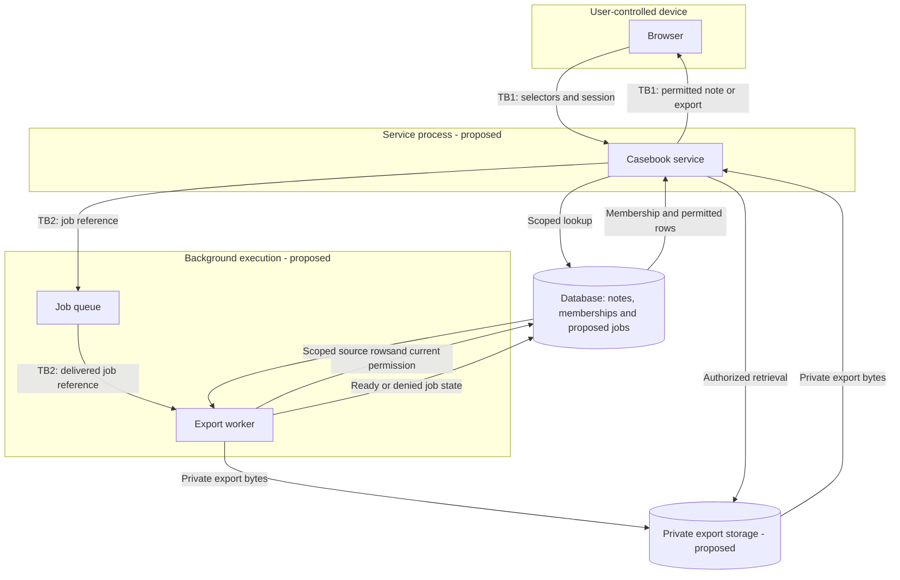
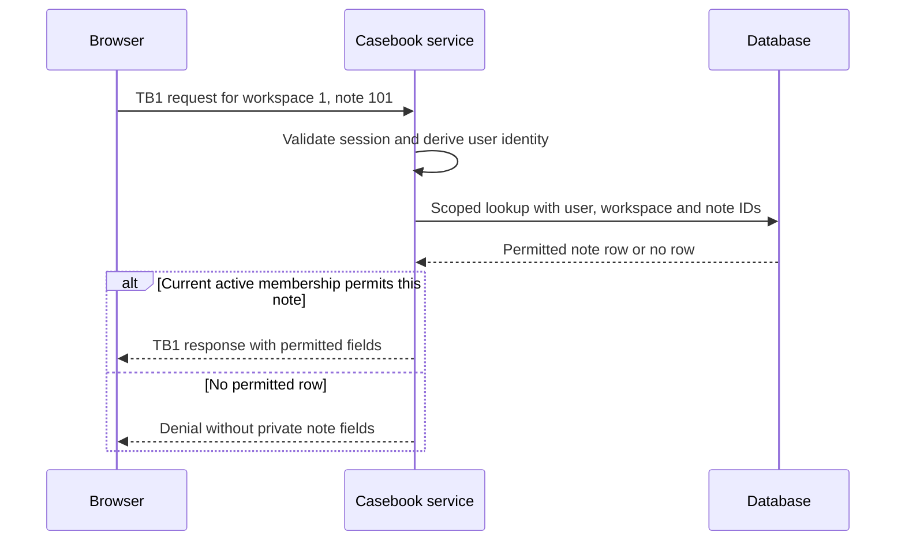
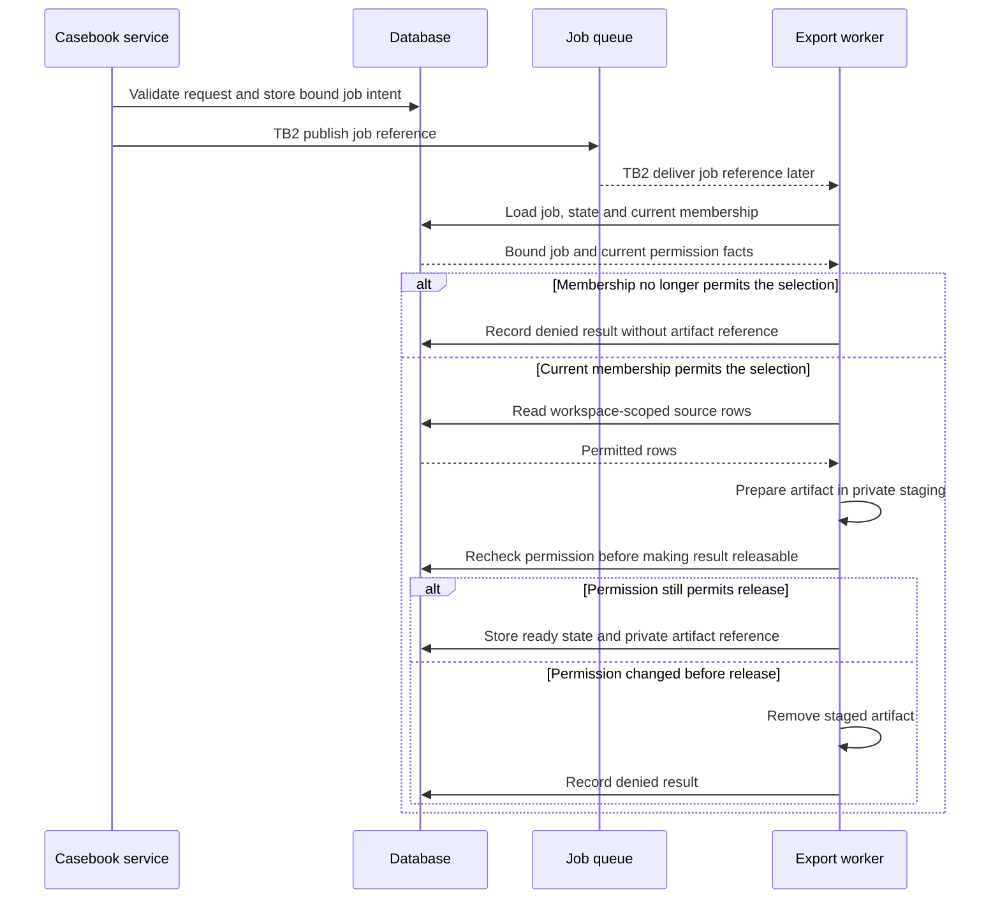

# 17. Draw the system and its trust boundaries

<!-- book:header:start -->
[← Chapter 16](16.md) · [Contents](../README.md#contents) · [Repository](../../README.md) · [Chapter 18 →](18.md)

<details>
<summary>In this chapter</summary>

- [1. Assets, actors, data stores and entry points](#1-assets-actors-data-stores-and-entry-points)
- [2. Data-flow diagrams and trust boundaries](#2-data-flow-diagrams-and-trust-boundaries)
- [3. Threat modeling, assumptions and ordinary failure scenarios](#3-threat-modeling-assumptions-and-ordinary-failure-scenarios)
- [4. Compare design options and record the owner of each control](#4-compare-design-options-and-record-the-owner-of-each-control)
- [Guided lab: conduct a boundary review](#guided-lab-conduct-a-boundary-review)
- [Independent practice](#independent-practice)
- [Hints](#hints)
- [Worked answers](#worked-answers)
- [Verification record](#verification-record)
- [What you can now explain](#what-you-can-now-explain)
- [Primary sources](#primary-sources)

</details>
<!-- book:header:end -->

Mina can read an Alpha note in the browser. What must remain true if another process prepares an export for her ten minutes later? Where could a changed identifier, an old permission decision or an ordinary outage expose that note?

This chapter makes the system visible before adding web routes. You will follow one private note through the browser, service and database, then extend the drawing with a queue and export worker. Each important assumption gets an owner and a way to check it.

You need chapter 15's distinction between a requested workspace and stored membership, and chapter 16's distinction between protected transport and application authorization. No server, queue or worker must be installed for this chapter. The deliverable is a reviewable design record with diagrams and filled-in decisions.

By the end, you will be able to:

- Name the assets, actors, stores and entry points in a small system.
- Draw data movement and label where authority must be checked.
- Turn an assumption into a concrete failure scenario and verification task.
- Compare synchronous and background work while assigning an owner to each control.

## 1. Assets, actors, data stores and entry points

An **asset** is something the system must protect. A private note body is an asset. So are the accuracy of its workspace association, the current membership records and the ability of legitimate members to use the service.

An **actor** is a person or system that interacts with the design. An actor can behave correctly, make a mistake or try to misuse access. A **data store** retains information after one request finishes. An **entry point** is a place where data or an action enters a component.

Start with the product rule, rather than a list of technologies:

> At the time of each read, the reader must be an active member of the note's workspace. Lee manages only Alpha. A background export checks current permission again before it releases private data.

A successful sign-in establishes a user's identity: **authentication**. A decision about that user's access to note `101` is **authorization**. Neither a guessed note ID nor a manager label supplied by a browser establishes authority.

### Keep the established fixture

**Table T17-01. People, workspaces and records used in this chapter**

| Fixture | Stored facts | Decision to preserve |
| --- | --- | --- |
| Mina, user `1` | Active member of Alpha, workspace `1` | May read Alpha note `101` |
| Ravi, user `2` | Active member of Beta, workspace `2` | May read Beta note `202`; may not read Alpha note `101` |
| Lee, user `3` | Active manager of Alpha | May read Alpha; manager status gives no Beta authority |
| Visitor | No authenticated user identity | Receives no private note content |
| Note `101` | Alpha; title `Release plan`; body `Alpha private fixture` | Its workspace comes from storage |
| Note `202` | Beta; title `Pricing review`; body `Beta private fixture` | Must not enter an Alpha response or export |

These are the seed records in chapter 15's `casebook_db.py`. Its repository exposes `get_note(connection, *, user_id, workspace_id, note_id)` and `list_notes(connection, *, user_id, workspace_id, sort="id", limit=20)`. Both query stored memberships. Keep those interfaces unchanged.

The later web service must supply the authenticated `user_id` through trusted server-side processing. Chapter 15's tests supply fixture identities directly; that does not implement browser authentication.

### Inventory what needs protection

**Table T17-02. Asset and store inventory**

| Asset | Intended location | Who may change it? | What could go wrong? |
| --- | --- | --- | --- |
| Note title and body | Database; authorized response; private export copy when needed | Authorized application operations under a defined write policy | Another workspace receives it; an export contains extra fields |
| Note's workspace association | Database | Controlled application operation | A client-selected workspace substitutes for the stored association |
| Current membership and role | Database | Authorized membership-management operation | An old or forged membership grants access |
| Authentication material | Browser/session mechanism and server-side validation state | Authentication components | A request impersonates another user |
| Export intent | Planned durable job record | Service after validating the request | Queue data replaces the requester or workspace |
| Export bytes and metadata | Planned private artifact storage and job records | Worker through controlled writes | A public location or another user's download exposes a copy |
| Audit and operational records | Existing creation audit table; future export events | Defined application paths and protected operators | Note bodies or credentials appear in logs; evidence is missing |

The export is another copy of private data. Moving bytes out of the notes table does not remove the privacy rule. It adds storage, retrieval and cleanup responsibilities. Chapter 18 will specify the fields, purpose and retention of those copies.

### Name the entry points

**Table T17-03. Entry point inventory**

| Entry point | Information received | Required authority check | Status |
| --- | --- | --- | --- |
| Browser list/detail request | Session material and resource selectors | Validated identity plus current membership for each returned note | Proposed web integration around the existing repository |
| Export request | Selection requested by the browser | Service binds the requester and validates every selected note | Proposed |
| Queue delivery | Job reference | Authorized delivery source, valid message shape, durable job binding and current permission | Proposed |
| Export retrieval request | Session material and job selector | Current requester identity and active workspace membership before private-byte release | Proposed |
| Membership change | Target user, workspace and requested change | Actor has management authority in that workspace; Lee has none in Beta | Proposed management operation |
| Database or artifact maintenance | Privileged local or deployment access | Restricted operator identity and approved maintenance procedure | Outside ordinary reader interfaces; deployment controls still need evidence |

These entry points can reach the same asset through different paths. A check at a browser detail route does not automatically protect queue consumption, export retrieval or privileged maintenance.

### Separate existing code from planned components

**Table T17-04. Design status at the start of Part V**

| Component or behavior | Current status | Evidence or next step |
| --- | --- | --- |
| SQLite schema and scoped repository reads | Local implementation from chapter 15 | Existing two-workspace and revocation tests |
| Note creation plus required audit row | Local implementation from chapter 15 | Committed-row and rollback tests |
| Fixed-destination public HTTP client | Local exercise from chapter 16 | Fake transport and response-contract tests; no private-note access |
| Browser routes and server identity handling | Proposed | First Django routes in chapter 19; identity mechanisms in chapters 21–22 |
| Export job table, queue and worker | Proposed | Concurrency and queue controls in chapter 28; feature developed in chapters 41–44 |
| Private export retrieval and deletion | Proposed | Requirements and acceptance tests must accompany implementation |

A diagram can contain proposed components. Label their status so a reviewer does not mistake a planned check for an existing control. No live web request or background export has run merely because we can draw it.

## 2. Data-flow diagrams and trust boundaries

A **data-flow diagram** shows components, stores and the information moving between them. A **trust boundary** marks a change in the assumptions under which information or an action is accepted.

Trust is specific to a task. The service can use its validated identity mechanism to establish who made a request. It must still treat the request's note selector as untrusted input. A worker can accept a delivery from a configured queue while still loading the job and current permission from trusted records.

Two boundaries receive special attention in this design:

- **TB1: browser ↔ service.** A user-controlled device sends selectors and authentication material. The service must establish identity and current object access before returning private bytes.
- **TB2: service → worker through the queue.** An immediate request becomes work performed by another process later. Queue delivery must not turn an earlier permission result into permanent authority.

The arrows in the overview are logical data access. They do not all represent network sockets. Chapter 15's SQLite database is a local file; this drawing does not make SQLite a database server or choose a future distributed deployment.

A fenced `mermaid` block tells a compatible Markdown preview to draw the code. `flowchart TD` arranges a flowchart from top to bottom. `B["Browser"]` defines node `B` with a displayed label; `-->` draws an arrow and `|"label"|` names the information it carries. `subgraph` and its closing `end` group components. The cylinder shape marks a data store. A group is not automatically a trust boundary: the TB1/TB2 labels and boundary records explain the change in authority.

**Figure F02. The path of a note through Casebook's trust boundaries**

The database-backed repository exists locally. The service, queue, worker, job records and export storage shown here are the proposed web-and-export design.



Notice the worker's return to the database. It does not receive a note body and an `authorized=true` flag that it may trust forever. Notice also that private artifact storage has no direct arrow to the browser. Retrieval goes through a service check in this proposed design.

TB1 and TB2 are the two focus boundaries, not a claim that the system has only two security boundaries. Database file access, artifact-store credentials and operator access also change authority assumptions. They need controls even when processes share a machine or a private network.

### Worked example 1: follow one browser read

Begin with the smallest useful request: Mina asks for Alpha note `101`. Predict what changes if the same selectors arrive from Ravi's authenticated session.

`sequenceDiagram` shows events in order from top to bottom. `participant` names a component. `->>` shows a message, and `-->>` shows a reply in these figures. `alt`, `else` and `end` mark alternative outcomes. Read one branch at a time; both outcomes do not occur in one request.

**Figure F17-01. A private-note read with an authorization branch**



This sequence describes the intended web integration around the existing repository. It does not claim the browser route already exists.

**Table T17-05. Trace the values and their sources**

| Step | Mina's request | Ravi's changed case | Who owns the decision? |
| --- | --- | --- | --- |
| Choose resource | Requested workspace `1`, note `101` | Same selectors | Browser supplies a request, not authority |
| Establish identity | Service derives user `1` | Service derives user `2` | Authentication boundary |
| Load relevant facts | Stored note belongs to workspace `1`; Mina has active membership there | Same note; Ravi's active membership is only in workspace `2` | Scoped database query |
| Apply rule | Matching active membership permits the read | No matching active Alpha membership | Service/repository authorization boundary |
| Release result | Permitted title/body fields | No title, body or export content | Response construction |

The decisive query in chapter 15 joins a note's stored workspace to the current user's active membership. Supplying `workspace_id=1` alone does not make Ravi an Alpha member. Changing a browser field named `user_id` must not change the identity derived by the service.

For a second boundary case, Lee requests Beta note `202`. Lee's Alpha manager role is attached to Alpha's membership row. There is no matching Beta membership, so the query returns no permitted row. A visitor has no validated identity and receives no private content.

The HTTP status for a denied request belongs to the later endpoint contract. This chapter fixes the privacy result: the denied response contains no private title or body. It does not invent a working route or a response code before that contract exists.

### Record boundary assumptions where they can be challenged

An **assumption** is a statement the design relies on. A **control** is a measure intended to keep the rule true. A **verification check** produces evidence about whether the assumption or control holds. “The internal network is safe” is too broad to direct a useful check.

**Table T17-06. Two boundary records with concrete checks**

| Field | TB1: browser ↔ service | TB2: service → worker |
| --- | --- | --- |
| Assumption | The service derives identity from validated authentication state; request selectors cannot change that identity or replace stored membership. | Only authorized producers submit jobs, and durable server-created job records bind the requester, workspace and selection; delivery does not preserve old permission. |
| Risk if false | Ravi changes a selector or identity field and receives Alpha content. | A forged or stale job releases private data for a different requester or a revoked member. |
| Control | Derive identity on the server; apply scoped membership checks to list, detail and export retrieval; return only permitted fields. | Restrict queue producers; accept a small job-reference schema; reload the durable job; check current membership before reading and again before releasing the export. |
| Check of the assumption | Use Ravi's session and change note/workspace selectors plus any submitted identity field. Observe that the service still uses Ravi and releases no Alpha content. Inspect the identity adapter and membership query. | Attempt publication with an unauthorized test identity and expect rejection. With a valid fixture producer, deliver extra identity/permission fields and a nonexistent job reference; expect rejection without private reads. Inspect the durable job binding. |
| Check of the control | Mina can read Alpha, Ravi cannot read Alpha, Ravi can read Beta, Lee cannot read Beta, and revoking Mina blocks her next read. Check both result and absence of private fields. | Queue Mina's valid Alpha job, commit revocation, then run the worker. Expect denied state, no releasable artifact and no private-byte response. Also revoke after readiness and verify retrieval denies. |
| Owner | Web maintainer for identity and response checks; storage maintainer for scoped queries. | Worker maintainer for job validation and permission gates; platform maintainer for producer access. |
| Present evidence | Local repository checks exist. Web session, routing and full response checks are planned. | Design scenarios only. Queue, worker and retrieval checks are planned. |

These checks challenge both the source of authority and the result of the decision. A test that submits `authorized=false` and observes refusal would miss a service that wrongly trusts `authorized=true` from the browser or queue.

## 3. Threat modeling, assumptions and ordinary failure scenarios

**Threat modeling** is a structured examination of what can go wrong, why it matters and how the design responds. A **threat** is a possible harmful event. A **risk** connects that event to its possible consequence and the uncertainty about it.

Start with the diagram and ask four questions: what are we building, what can go wrong, what will we do about it, and what evidence will show whether that worked? Use concrete paths through the model rather than assigning a security label to each box.

### Worked example 2: move an export to a worker

A **background worker** performs a task outside the original request. A **queue** holds deliveries until workers can process them. A **job** is the durable record of intended work. These have different responsibilities: a delivery can be delayed or repeated while one job remains the same intended operation.

For this design exercise, the service stores the following synthetic job intent. It is a proposed record, not a new chapter 15 table or a runnable API request.

**Exhibit D17-01. A filled-in export intent**

```json
{
  "job_id": "export-alpha-001",
  "requested_by": 1,
  "workspace_id": 1,
  "note_ids": [101],
  "state": "queued"
}
```

The browser may request a selection, but the service establishes `requested_by` from validated identity and validates the selection against stored workspace membership. The job record retains that binding. A note ID is a selector, not evidence that the note belongs to the job's workspace.

The queue payload contains only a reference:

```json
{"job_id": "export-alpha-001"}
```

This keeps the private note body and a permission snapshot out of the queue. It does not make the job ID a credential. Knowing or guessing it must not grant download rights. The worker still validates the message schema, loads the record, checks its state and applies current authorization.

**Figure F17-02. Recheck authority after the job has waited**



Private artifact storage is omitted from this sequence to keep the authority decisions readable; its data flow appears in F02. A later browser retrieval passes through TB1 and must check current download permission again. A `ready` state describes prepared work, not an irrevocable grant to whoever presents its identifier.

### Predict the result at each point in time

**Table T17-07. Export scenarios and required observable outcomes**

| Scenario | Change to the smallest fixture | Expected outcome | State or output to inspect |
| --- | --- | --- | --- |
| E17-01: permitted Alpha export | Mina remains active; selection is `[101]` | Worker may prepare Alpha data; authorized Mina may retrieve it | Artifact contains only selected Alpha fields; ready job identifies its requester and private artifact |
| E17-02: Beta reader requests Alpha | Ravi requests workspace `1`, note `101` | Service denies before accepting export work | No accepted job, no artifact and no Alpha fields in response |
| E17-03: mixed selection | Mina requests Alpha with selection `[101, 202]` | Reject the request under this design's all-or-nothing selection policy | No accepted job or artifact; no Beta content in response |
| E17-04: revoked before worker read | Queue the valid Mina job; then commit membership revocation | Worker records denial and releases no private data | No ready artifact reference, no retrievable bytes, safe failure event |
| E17-05: revoked while preparing | Permission passes initially, then revocation commits before the release check | Worker withholds readiness and cleans staging | Denied state; no staged artifact remains after handled failure |
| E17-06: revoked after readiness | Prepare while Mina is active; revoke before her later retrieval check | Retrieval denies despite ready state | No private-byte response; stored artifact remains subject to deletion policy |
| E17-07: another user guesses the job ID | Ravi requests Mina's ready export | Retrieval denies under the requester-bound contract | No title, body or artifact bytes |
| E17-08: unexpected queue fields | Add `requested_by`, `note_ids` or `authorized` to the delivery | Reject the delivery schema; do not treat fields as authority | No private read or artifact creation from that delivery |

The proposed retrieval contract permits only the job's requester, with current membership in its workspace. Sharing an export with another member would be a separate feature needing its own rule and evidence. Lee's manager role does not automatically grant access to another requester's export.

For the mixed selection, rejection is intentional. The service must compare the validated requested selection with the IDs returned by workspace-scoped authorization checks; any missing or disallowed selection prevents acceptance. It must not use an unscoped read to explain private missing records. Silently exporting only the permitted subset could mislead the caller about completeness. Another product could choose a clearly reported partial-result contract; this chapter records one choice so it can be checked.

These are acceptance scenarios, not recorded worker results. The local SQLite tests establish only the existing repository behavior. A completed export implementation must inspect its final job rows, artifact references, staged files and response bytes for each applicable failure.

### Make the timing assumption explicit

“Check current permission” needs an observation point. In these scenarios, revocation commits before the next stated authorization check. The check must then deny. An old database snapshot, cached membership or copied `allowed` flag must not preserve access.

A check immediately before release does not by itself settle a revocation racing with that release. The implementation must define an ordering guarantee for those concurrent operations and test it under the chosen database and storage design. That remains open for the concurrency and capstone work. The diagram does not prove an atomic transaction across the database and artifact store.

Nor can revocation recover bytes already downloaded while access was permitted. The system can control future reads and future retrieval decisions. It must describe that limit honestly when setting export policy.

### Include ordinary failures

An outage can break the privacy rule even without an attacker. For example, a worker might treat a failed membership lookup as permission to continue. Or an upload might finish just before a process dies, leaving an untracked private copy.

**Table T17-08. Failure review**

| Failure or misuse | Harmful shortcut | Required response | Check and owner |
| --- | --- | --- | --- |
| Membership database unavailable | Reuse an old successful decision | Do not release private bytes; report a retryable failure under the later job contract | Inject lookup failure and inspect no ready result; worker maintainer |
| Database commits job but queue publication fails | Report completion or lose the job silently | Preserve visible pending work and support controlled delivery recovery | Fail publication after commit and inspect durable job/delivery state; service and worker maintainers |
| Queue repeats a delivery | Create multiple artifacts or duplicate business effects | Recognize the same logical job and apply the documented state/retry rule | Deliver the same reference twice; inspect final job and artifact set; worker maintainer |
| Worker crashes after private upload | Leave an untracked artifact forever | Reconcile orphaned artifacts and clean them under a bounded retention policy | Stop a fixture between upload and state update; inspect storage after recovery; storage maintainer |
| Artifact store becomes public | Assume an obscure path protects the export | Block direct anonymous reads and keep retrieval controlled | Attempt unauthenticated artifact retrieval; inspect access policy; platform maintainer |
| Diagnostic records full queue or note data | Use logs as an accidental private-data store | Record identifiers and safe outcomes, excluding bodies and credentials | Inspect failure event samples; service/worker maintainers |
| Export takes excessive work | Keep one job running without a resource policy | Enforce agreed item, byte, time and attempt limits | Exercise each boundary and cleanup path; worker maintainer with product owner |

Database commit and queue publication are different operations. Putting them next to each other does not make them atomic. A durable delivery record and recovery mechanism may be needed; chapter 28 develops the relevant worker and retry reasoning. “Retry” here is a requirement to define, not a claim that sending every failed action again is safe.

Do not treat “inside the private network” as permission to skip these checks. Different processes can have different credentials, deployment histories and failure modes. Message delivery establishes that work arrived, not that its requester is still authorized.

## 4. Compare design options and record the owner of each control

A design comparison asks which option fits the workload and which responsibilities it creates. It must preserve the product rule in either case.

**Table T17-09. Synchronous and background export options**

| Question | Export inside the request | Export through a worker |
| --- | --- | --- |
| Where does it run? | Service process handling the request | Separately scheduled worker process |
| When is permission evaluated? | At the private read and release decision | At request acceptance, worker read/release and later retrieval |
| How does the user wait? | Request remains open | Request returns a job reference; later retrieval is separate |
| Which new state exists? | Possibly temporary output and request outcome | Durable job, deliveries, worker state, staged artifact and retrieval metadata |
| Which failures matter? | Request timeout, disconnect, interrupted cleanup | Those failures plus delayed/repeated delivery, worker restart and orphaned storage |
| What may become easier? | Fewer moving parts for small bounded work | Independent capacity and recovery for long work |
| What does not change? | Current workspace authority must gate private reads | Current workspace authority must gate private reads |

For the early service, keep ordinary note reads synchronous. Record the worker export as a proposed extension to develop when its requirements and controls are ready. This comparison does not authorize adding a production queue now or claim that background work is inherently safer.

### Write a short decision record

A **decision record** captures the chosen direction, reasons, consequences and unresolved checks. It prevents a diagram from losing its meaning when implementation changes.

**Exhibit D17-02. Casebook design record**

| Field | Recorded decision |
| --- | --- |
| ID | `CB-DESIGN-17` |
| Scope | Ordinary private-note reads and the proposed request/worker/retrieval path for a requester-bound export |
| Status | Design for later implementation; not deployment approval |
| Existing base | Chapter 15's SQLite schema and scoped repository interfaces |
| Rule | Current active membership in the stored workspace is required at each private read; worker and retrieval cannot rely solely on request-time permission |
| Identity source | Service-validated authentication state, never a browser or queue `user_id` field |
| Job handoff | Queue carries a job reference; durable intent binds requester, workspace and selection |
| Artifact exposure | Private storage; controlled service retrieval; no direct public artifact path |
| Selection policy | Reject a requested export if any selected note is outside the permitted workspace |
| Initial direction | Keep normal note reads in the request; defer worker implementation to the planned chapters |
| Consequence | Every entry point, background consumer and retrieval path needs its own check of current authority |
| Open decisions | Export fields and retention; precise job states and retries; concurrent revocation/release ordering; deployment identities and storage permissions |
| Revisit triggers | New download path, new worker, cached membership, shared storage, changed export audience or changed retention |

An open decision has an owner and a future evidence requirement. It must not be hidden behind an optimistic label such as “secure worker.”

### Assign each control and check its status

**Table T17-10. Control ownership and evidence register**

| Control ID | Control and accountable owner role | Check or artifact | Status in this chapter |
| --- | --- | --- | --- |
| C17-01 | Validated identity at TB1 — web maintainer | Session-to-user mapping review; changed identity-field integration test | Planned for the web identity boundary |
| C17-02 | Current workspace-scoped list/detail reads — storage maintainer | Chapter 15's permitted, cross-workspace, manager and revocation tests | Local repository evidence exists; web integration still required |
| C17-03 | Bound durable job intent and narrow queue schema — worker maintainer | E17-02, E17-03 and E17-08; inspect accepted job records and rejected deliveries | Proposed |
| C17-04 | Queue producer and consumer access — platform maintainer | Unauthorized publication/consumption checks using deployment test identities | Proposed; no queue provisioned |
| C17-05 | Worker read and release permission gates — worker maintainer | E17-04 and E17-05; inspect final state and staging cleanup | Proposed; concurrent ordering remains to be defined |
| C17-06 | Requester-bound retrieval and private storage — web maintainer, with platform maintainer owning storage access | E17-06, E17-07 and anonymous direct-storage refusal | Proposed |
| C17-07 | Fields, retention and deletion policy — product data owner, implemented by storage maintainer | Data inventory and observable deletion check in chapter 18, then implementation evidence | Open requirements |
| C17-08 | Duplicate delivery, publication recovery and bounded work — worker maintainer | Failure cases from T17-08, including final rows and artifact counts | Proposed for worker design |

These are accountable project roles, distinct from user roles such as Alpha manager. Before implementation, the project should assign each role to an actual maintainer in its work tracker. A platform access policy cannot replace a web authorization test, and a passing repository test cannot replace a worker release check.

### Keep an honest evidence note

A useful review separates three states:

| Evidence state | Example | Meaning |
| --- | --- | --- |
| Observed locally | Chapter 15's repository denies Ravi an Alpha note | The named local implementation passed that check |
| Planned verification | Revoke Mina after queueing and inspect no releasable artifact | A test and expected result are specified; no result is claimed |
| Unresolved design | Ordering of revocation racing final release | A decision and corresponding verification method are still needed |

A drawing and a threat scenario are evidence that the design has been examined. They are not evidence that every control is implemented. Keep the model with the code review, and update it when a new route, data copy or authority source changes an arrow.

## Guided lab: conduct a boundary review

1. Copy F02 into a Markdown file with Mermaid preview support, keeping its caption and implementation-status note. Locate the note body, membership data and private export copy.
2. Trace Mina's note `101` read using F17-01 and T17-05. Repeat with Ravi's identity while keeping the request selectors unchanged. State which lookup changes the outcome.
3. Read both boundary records in T17-06 aloud as specific claims. For each one, point to the control owner and the observation that could disprove the assumption.
4. Use D17-01 as the only accepted job intent. Give the queue just its job reference. Revoke Mina before the worker starts, then walk through the denial branch in F17-02.
5. Move revocation to after the artifact is ready. Explain why readiness does not grant permanent retrieval rights. Identify the separate retrieval test.
6. Choose one ordinary failure from T17-08. Mark where it happens and describe the final database, job and artifact state you would inspect.
7. Put `observed`, `planned` or `unresolved` beside every evidence claim. Do not upgrade a proposed control because its name appears in a diagram.

The lab can be completed with paper and a Mermaid-capable Markdown preview. It uses synthetic selectors and records. It needs no real note, credential or deployment.

## Independent practice

### Exercise 1: browser-controlled authority

A service accepts `{ "user_id": 1, "workspace_id": 1, "note_id": 101 }` from Ravi's browser and uses every field directly. Identify the crossed boundary, the false assumption and the test that reveals the problem. Give the permitted and denied cases.

### Exercise 2: hidden export path

A worker writes an artifact to a public location with a long random filename. Add the missing arrow to the model. Explain which existing control it bypasses and what a direct retrieval check must observe.

### Exercise 3: a trustworthy queue with an old decision

Only the service can publish jobs. It includes `authorized_at_request: true`. Mina is revoked before delivery. Explain why producer restrictions alone do not preserve the rule, and choose the required worker outcome.

### Exercise 4: ordinary outage

A job exists in the database, but the queue was unavailable when the service tried to publish its reference. Write a safe state description and one recovery check. Explain why another database transaction around the queue call is not, by itself, a complete solution.

### Exercise 5: compare two designs

A team proposes direct downloads from private storage using a time-limited link instead of service-mediated retrieval. Compare it with D17-02. State the new authority assumption, how revocation could affect an issued link and the evidence required before choosing the option.

### Practice check

Draw the current design. Mark two boundaries and give each one an assumption, a risk, a control and a way to check the control.

Submit a diagram with the browser, service, database and proposed export worker; two complete boundary records; one permitted and one cross-workspace denied trace; a revocation-after-queueing scenario; and a control ownership register. Label existing implementation, proposed behavior and unresolved questions separately.

## Hints

- An identifier selects a record; it does not establish the requester's identity or rights.
- A trusted delivery channel does not make a permission result current.
- Look for paths that send bytes without passing through the intended retrieval check.
- A recovery check must inspect durable state, not only the presence of an error message.

## Worked answers

### Exercise 1

TB1 is crossed when browser data becomes service instructions. The false assumption is that the browser's `user_id` is an authenticated identity. The service must derive Ravi's identity from validated authentication state and treat the requested workspace and note as selectors.

Use Mina's valid session with Alpha note `101` as the permitted case. Use Ravi's valid session with the same selectors and a forged `user_id=1` field as the denied case. The outcome must remain denial with no Alpha title or body. Inspect the identity passed to the repository as well as the final response. A visitor must also receive no private content.

### Exercise 2

The new arrow runs from artifact storage directly to the browser. It bypasses C17-06's current requester and membership check. A long filename makes guessing harder but does not enforce who may retrieve bytes after obtaining the location.

Under this chapter's chosen design, direct anonymous retrieval must fail and storage remains private. The service must validate the current requester and workspace membership before returning the bytes. Check with an anonymous client and with Ravi using the known artifact reference; both must receive no Alpha export content.

### Exercise 3

The service may have made a correct decision when it published the job. The queue delay changes the time at which the next private read occurs. The old flag cannot establish current membership. The worker must load the durable intent and current membership, deny the revoked Mina job and leave no releasable artifact. Producer access controls and current authorization solve different problems.

### Exercise 4

Keep a durable pending job and visible delivery state, rather than claiming completion or silently losing the work. In the recovery fixture, fail publication after the database commit, restore the queue, run the recovery mechanism and inspect that the same logical job is delivered and processed under the duplicate-delivery policy.

A local database transaction does not automatically enlist an external queue. Either side can succeed while the other fails. The design needs a documented delivery/reconciliation mechanism and tests at that failure point. Its implementation belongs to the later queue work.

### Exercise 5

The new option gives possession of a link some retrieval authority. A link can remain usable after the service would deny a new request, depending on the storage mechanism and how it validates the grant. A short expiry reduces the interval but does not prove immediate revocation.

Before choosing it, define which identity, workspace, object, expiry and revocation checks the download actually performs. Test a link obtained before revocation after revocation commits, and test whether Ravi can use Mina's link. Record any period during which the link remains valid. If the mechanism cannot meet the current-membership rule, retain service-mediated retrieval or explicitly redesign the requirement with the data owner. The present decision record retains service-mediated retrieval.

### Practice check

F02 supplies the component and data-flow view. T17-06 supplies the two boundary assumptions, risks, controls, owners and checks. T17-05 proves that a permitted and cross-workspace denied trace reach different decisions under the same resource selectors. E17-04 carries the rule across a delayed job, while T17-10 identifies who must implement and verify each control.

An acceptable submission makes the rejection observable: no private fields in a denied response, no ready artifact for a denied job, and inspected final state after a handled failure. It also states that the web and worker checks remain planned until their implementation is exercised.

## Verification record

This chapter is a design artifact. Its filled-in traces, boundary register and decision record are the concrete outputs. All three Mermaid blocks passed syntax parsing with Mermaid 12.3.0. The local parser check used a test substitute for browser-only label sanitization; it did not render HTML or images. The source was also reviewed for consistent components, TB1/TB2 labels and agreement with the scenario tables. Browser rendering was attempted but could not complete because the local browser process could not launch; visual layout remains unverified.

All 28 chapter 15 repository tests, including its worked-answer cases, passed when rerun locally on macOS with CPython 3.12.14, SQLite 3.53.1 and pytest 9.2.0. They provide local evidence for scoped reads, revocation and transaction behavior. They do not execute the proposed web routes, authentication boundary, queue, export worker or artifact retrieval. Those acceptance checks remain planned. No private production data or external system was used.

The edition baseline remains CPython 3.12.14. The proposed service and worker architecture is not a running deployment, and no claim of concurrent revocation/release correctness follows from the sequential traces.

## What you can now explain

A private note can leave the database through several paths. Each path needs an authority source, a current permission decision and an observable result. A queue adds time, identity and failure assumptions; it does not carry permanent permission. A useful model records who owns each control and which evidence still needs to be collected.

Keep F02, `CB-DESIGN-17`, the boundary records and the evidence register as the starting design for chapter 18. That chapter turns the decisions into measurable security and private-data requirements, including the purpose and retention of exported copies. No running worker or new Python module is required to continue.

## Primary sources

- OWASP's [Threat Modeling overview](https://owasp.org/www-community/Threat_Modeling) describes models, assumptions, controls and validation. The [Threat Modeling project](https://owasp.org/www-project-threat-modeling/) provides the broader workflow.
- The [OWASP Authorization Cheat Sheet](https://cheatsheetseries.owasp.org/cheatsheets/Authorization_Cheat_Sheet.html) discusses least privilege, authorization on each request, enforcement locations and unit/integration checks.
- Mermaid documents [flowcharts and subgraphs](https://mermaid.js.org/syntax/flowchart.html) and [sequence diagrams with alternatives](https://mermaid.js.org/syntax/sequenceDiagram.html), the two forms used here.

<!-- book:footer:start -->
---

[← Chapter 16](16.md) · [Contents](../README.md#contents) · [Repository](../../README.md) · [Chapter 18 →](18.md)

[Back to top](#17-draw-the-system-and-its-trust-boundaries)
<!-- book:footer:end -->
