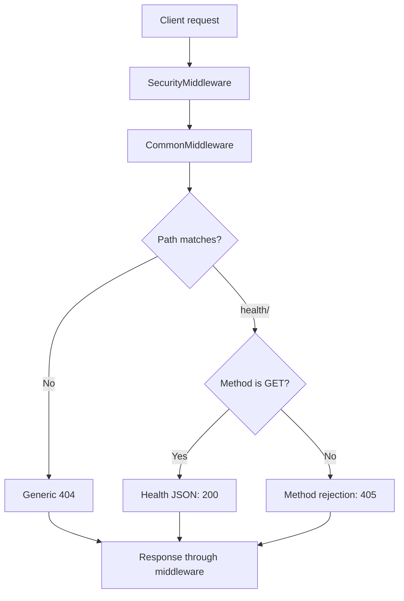

# 19. Build the Casebook web service

How can an anonymous visitor check that Casebook is running without gaining a route to its private notes?

This chapter builds the first Django service. A visitor can request a small health response. Alpha and Beta notes exist in a database, but no HTTP route returns them. You will follow a request through settings, middleware, URL matching and a view, then check the boundary with Django's test client.

You need Python modules, classes, exceptions and tests from chapters 06, 09, 10 and 12; database keys and transactions from chapter 15; and HTTP methods, status codes and media types from chapter 16. Keep chapter 17's design record `CB-DESIGN-17` and chapter 18's requirement `CB-READ-01` beside this work. No earlier Python module or database file is imported here.

By the end, you will be able to:

- Explain how a Django project connects settings, an application, routes and views.
- Trace request and response objects through middleware and identify validation points.
- Define two models, apply a migration and store synthetic notes through the ORM.
- Prove that an anonymous visitor receives health status and cannot retrieve stored note content through the supplied HTTP surface.

The edition targets CPython **3.12.14** and this example pins **Django 6.1.3**. Django 6.1 supports Python 3.12; the local framework checks use the pinned 6.1.3 patch. The verification record below distinguishes the edition target from the local checks that were possible. Do not interpret an expected output block as a recorded execution.

## 1. Project, application, settings, URL routes and views

**Django** is a Python web framework. It supplies common parts of a web service, including request handling, routing, database models and testing tools. Installing Django does not decide who may read a note. That remains an application rule.

A **project** is the configuration for one service. Our project package is `casebook`. An **application**, often shortened to **app**, is a Python package containing one area of behavior. Our app is `notes`. A Django app is not a separately running server. The same Python process loads both packages.

**Settings** are named values that configure Django. A **URL route** connects a path to a Python callable. A **view** is that callable: it receives a request object and returns a response object. Here, the word view does not mean an HTML page or a database view.

### Establish the smallest starting state

The runnable companion is in `examples/ch19/` in the book repository. If you are building it yourself, create a fresh folder named `casebook-service` inside your `casebook-learning` workbench. Put every file below inside that folder. All service-relative filenames and commands in this chapter use that folder as their working directory. If you use the companion, run `cd examples/ch19` from the repository root instead.

This is a new Django prototype with its own `casebook.sqlite3`. It preserves Alpha `1`, Beta `2`, and notes `101` and `202`. It does **not** migrate or replace chapter 15's database, membership joins or note-plus-audit transaction. Those earlier modules remain separate learning artifacts. This first web service has no account, membership, author or audit model. Do not move real data into it.

**Table T19-01. Files and responsibilities**

| Service-relative path | Responsibility |
| --- | --- |
| `requirements.txt` | Pin the Django patch for this example |
| `manage.py` | Select settings and run a Django command |
| `casebook/__init__.py` | Mark the project package; empty |
| `casebook/settings.py` | Configure apps, middleware, hosts and SQLite |
| `casebook/urls.py` | Declare the complete public route surface |
| `notes/__init__.py` | Mark the app package; empty |
| `notes/views.py` | Return the public health response |
| `notes/models.py` | Define Workspace and Note |
| `notes/migrations/__init__.py` | Mark the migration package; empty |
| `notes/migrations/0001_initial.py` | Create the two database tables |
| `notes/fixtures/demo.json` | Supply two workspaces and two private notes |
| `notes/tests.py` | Check the public response, private default and stored state |
| `orm_demo.py` | Store and reload a multilingual note locally |

Create the three empty `__init__.py` files as well as the directories shown in the table. They contain no code. We do not generate a larger starter project: no admin, template, login, API package, worker, or separate WSGI/ASGI entry file is needed by `runserver` here. Deployment is a later chapter.

**Listing L19-01. The dependency and command entry point**

Filename: `requirements.txt`.

```text
Django==6.1.3
```

Filename: `manage.py`.

```python
import os
import sys

from django.core.management import execute_from_command_line


if __name__ == "__main__":
    os.environ.setdefault("DJANGO_SETTINGS_MODULE", "casebook.settings")
    execute_from_command_line(sys.argv)
```

`os.environ` is the process environment. `setdefault` selects `casebook.settings` if the caller has not already selected settings. `sys.argv` contains the command-line arguments, including `migrate` or `test`. `execute_from_command_line` dispatches that command. The `if` block runs when Python executes this file as a program.

Create an isolated environment on macOS or Linux:

```shell
"$HOME/.local/bin/python3.12" -m venv .venv
./.venv/bin/python -m pip install -r requirements.txt
./.venv/bin/python -c "import sys, django; print(sys.version); print(django.get_version())"
```

Use the CPython 3.12.14 installation from chapter 02. The first command chooses the managed interpreter at the explicit path from chapter 02; the version command confirms its actual patch. The expected Django line is `6.1.3`. An import failure means the dependency has not been installed into this interpreter. Resolve that before trying to start the service.

On Windows PowerShell:

```powershell
& $CasebookPython -m venv .venv
.\.venv\Scripts\python.exe -m pip install -r requirements.txt
.\.venv\Scripts\python.exe -c "import sys, django; print(sys.version); print(django.get_version())"
```

For later commands, replace `./.venv/bin/python` with `.\.venv\Scripts\python.exe`. Using the environment's Python directly avoids depending on shell activation.

### Settings are executable Python

**Listing L19-02. Local development configuration with generic errors**

Filename: `casebook/settings.py`.

```python
from pathlib import Path


BASE_DIR = Path(__file__).resolve().parent.parent

# Synthetic local exercise only. Deployment needs its own secret and settings.
SECRET_KEY = "casebook-ch19-local-exercise-only-do-not-deploy"
DEBUG = False
ALLOWED_HOSTS = ["127.0.0.1", "localhost"]

INSTALLED_APPS = ["notes"]
MIDDLEWARE = [
    "django.middleware.security.SecurityMiddleware",
    "django.middleware.common.CommonMiddleware",
]
ROOT_URLCONF = "casebook.urls"
DATABASES = {
    "default": {
        "ENGINE": "django.db.backends.sqlite3",
        "NAME": BASE_DIR / "casebook.sqlite3",
    }
}
DEFAULT_AUTO_FIELD = "django.db.models.BigAutoField"
USE_TZ = True
TIME_ZONE = "UTC"
```

`Path(__file__).resolve().parent.parent` finds the service folder from this settings file's location. The SQLite filename is therefore stable even if another tool starts Python from elsewhere. `INSTALLED_APPS` tells Django to load the `notes` app and its models. `ROOT_URLCONF` names the module containing the root route list. `DATABASES` is a dictionary of connection settings, with `default` naming this example's only database.

`DEBUG=False` gives generic error responses rather than development tracebacks. That setting is useful even in this local exercise: a missing path must not display source listings or local variables. It does not turn the development server into a deployment server.

`ALLOWED_HOSTS` lists accepted host names, without schemes or ports. The browser connects to `127.0.0.1:8000`; the allowed name is `127.0.0.1`. Do not replace this list with `['*']` to fix an unfamiliar-host error. Use the documented local address and inspect the actual request host.

`SECRET_KEY` participates in Django's signing features. The literal here is a deliberately public, synthetic exercise value. A deployed service needs an independently generated secret delivered through trusted settings, as discussed in chapter 13 and revisited in chapter 35. This service has no sign-in or session feature.

`DEFAULT_AUTO_FIELD` selects the type for model IDs that we do not declare explicitly. `USE_TZ` and `TIME_ZONE` establish consistent time handling for later models. Our current models contain no time field.

### Worked example 1: a public health response

Predict the response to `GET /health/`. Should it include a workspace name, note count or database password? Our contract needs only one fixed status field.

**Listing L19-03. The only public route and its view**

Filename: `casebook/urls.py`.

```python
from django.urls import path

from notes.views import health


urlpatterns = [path("health/", health, name="health")]
```

Filename: `notes/views.py`.

```python
from django.http import JsonResponse
from django.views.decorators.http import require_GET


@require_GET
def health(request):
    response = JsonResponse({"status": "ok"})
    response["Cache-Control"] = "no-store"
    return response
```

`path` receives a route string without the leading slash. The incoming path `/health/` matches `health/`. `name='health'` gives the route a stable internal name for later URL generation. Importing `health` supplies the function itself; writing `health()` here would incorrectly call it while loading routes.

A **decorator**, introduced in chapter 11, wraps a function. `@require_GET` checks the HTTP method before running the view. This endpoint accepts GET only, including rejecting HEAD in this deliberately small contract. An unsupported method produces `405 Method Not Allowed` and an `Allow: GET` header. Later APIs must choose their method contracts explicitly too.

`JsonResponse` turns a Python dictionary into JSON bytes and sets the media type to `application/json`. A **media type** tells the recipient how to interpret the response representation. A body that merely looks like JSON is not enough; inspect the header too. This dictionary gives a successful response its default status `200`.

The `Cache-Control: no-store` response header asks caches not to store the health response. It is not an authorization mechanism. The view returns no private information and performs no database query. Health here means **liveness**: the service process can handle this request. It does not mean **readiness** to serve database-backed requests, nor that migrations have run successfully.

Finish the model and fixture files in section 3 before following the complete startup sequence in section 4. The expected HTTP result will be:

```text
status: 200
Content-Type: application/json
Cache-Control: no-store
body: {"status": "ok"}
```

This is a selected-field expectation. Headers such as date and content length may also be present. The exact JSON whitespace is not the contract; the parsed object is.

A boundary case changes the result:

```shell
curl -i -X POST http://127.0.0.1:8000/health/
```

Expected: `405 Method Not Allowed`, with `Allow: GET`. The health function does not run for this request. We have no write operation hidden behind a health check.

## 2. Request and response objects, middleware order and validation points

An **HTTP request object** holds information about one incoming request. Django provides an `HttpRequest` with attributes such as `method`, `path`, `GET` and `body`. Here, `request.GET` is the parsed query-parameter collection; its name does not mean it establishes the caller's identity. All values supplied by the browser remain untrusted input.

An **HTTP response object** holds the status, headers and content sent back to the client. `JsonResponse` is a kind of `HttpResponse`. In `response['Cache-Control'] = 'no-store'`, the brackets address a response header, not a field inside its JSON body.

**Middleware** is code around request handling. It may inspect or change a request, return an early response, or inspect the response on its way out. For middleware that continues processing, requests pass through the configured list from top to bottom; responses unwind from bottom to top. An early return can prevent inner middleware and the view from running.

**Figure F19-01. Request handling with a route decision**



The branch to a missing-route response never reaches a note lookup. Each box shows logical work inside the Django process; the diagram does not create a separate network hop for middleware.

### Know which middleware exists

Our first layer is `SecurityMiddleware`, which applies the security-related response behavior configured by Django settings. It does not grant note access. `CommonMiddleware` performs common HTTP handling, including host inspection and configured URL normalization. With Django's usual `APPEND_SLASH` default, `/health` can redirect to `/health/` because the slash form exists. Use `/health/` when checking the 200 contract, and test redirects separately if your client depends on them.

There is no `SessionMiddleware` or `AuthenticationMiddleware` here. In this starting state, do not write code that assumes `request.user` exists. Sending a query parameter such as `?user_id=1`, a cookie named `user`, or an `X-User-ID` header does not authenticate Mina.

When sessions are introduced, Django's session middleware must run before authentication middleware because the latter uses session state. Cookie-authenticated writes will also need Django's CSRF protection. CSRF means **cross-site request forgery**, where another site causes a browser to send an unwanted authenticated action. We have no state-changing HTTP route in this chapter, so session and CSRF middleware are not configured. Add the relevant controls and tests when that surface is introduced; do not infer that `SecurityMiddleware` supplies them.

### Place checks where their facts become available

**Table T19-02. Validation points and their limits**

| Point | Available fact | Decision | What it does not prove |
| --- | --- | --- | --- |
| Host handling | Requested host name | Accept a configured service host | The visitor is a workspace member |
| URL resolver | Requested path | Select a registered route or return 404 | A valid numeric selector belongs to the requester |
| Method decorator | Request method | GET may reach health; POST receives 405 | The request body is valid for a future API |
| Future input boundary | Parsed fields and trusted identity | Check types, lengths, allowed fields and intended operation | Stored membership is still active |
| Future permission-scoped query | Stored note and current membership | Release only an authorized note | An earlier permission decision remains valid forever |
| Model validation | Candidate model fields | Reject an invalid local candidate before saving | The caller is authorized to create it |
| Database | Constraints and relationships | Enforce schema rules | All product rules or access decisions were checked |

A route with `<int:note_id>` would check that the path has an integer shape. It would not authorize the note. We intentionally register no such route yet.

Try predicting `GET /health/?workspace_id=2&user_id=1`. It still returns only `{'status': 'ok'}`. The health function does not consume those parameters. Query parameters do not silently become ORM filters or permission grants.

## 3. Models, migrations, the ORM and request-scoped queries

A **model** is a Python class describing stored data. The **object-relational mapper**, or **ORM**, translates model operations into database operations. A `Workspace` instance represents one workspace row. A `Note` instance represents one note row.

**Listing L19-04. Store notes without publishing them**

Filename: `notes/models.py`.

```python
from django.db import models


class Workspace(models.Model):
    name = models.CharField(max_length=80, unique=True)


class Note(models.Model):
    workspace = models.ForeignKey(Workspace, on_delete=models.PROTECT)
    title = models.CharField(max_length=200)
    body = models.TextField(max_length=4000)
```

Both classes inherit from `models.Model`. Each field describes a column or relationship. `CharField` stores bounded text, and `TextField` stores text that may be longer. `ForeignKey` relates each note to one workspace. Django exposes the stored key through `note.workspace_id`; `note.workspace` retrieves the related model when needed.

`on_delete=models.PROTECT` makes Django refuse an ORM deletion of a workspace that still has related notes. It is not a complete deletion policy. Chapter 18's retention requirement still needs its own implementation, and the Django deletion behavior should not be confused with a direct SQL `ON DELETE PROTECT` clause.

`unique=True` on the workspace name creates a database uniqueness rule. By contrast, a field's `max_length` does not mean every database backend enforces that limit for every write. SQLite is especially important here: do not rely on it to enforce these text lengths. Django's `full_clean()` applies model field validation, but ordinary `save()` does **not** call `full_clean()` automatically. The local example calls it explicitly.

There is no field named `public` that changes routing. Creating a model does not automatically generate an HTTP API. The entire current HTTP surface remains the one route in `casebook/urls.py`.

### Apply schema changes with migrations

A **migration** is a versioned description of a schema change. A model describes the desired Python-facing shape; a migration records how to create or change its database representation. Merely saving `models.py` does not create the tables.

**Listing L19-05. The initial migration**

Filename: `notes/migrations/0001_initial.py`.

```python
import django.db.models.deletion
from django.db import migrations, models


class Migration(migrations.Migration):
    initial = True
    dependencies = []

    operations = [
        migrations.CreateModel(
            name="Workspace",
            fields=[
                ("id", models.BigAutoField(auto_created=True, primary_key=True,
                                           serialize=False, verbose_name="ID")),
                ("name", models.CharField(max_length=80, unique=True)),
            ],
        ),
        migrations.CreateModel(
            name="Note",
            fields=[
                ("id", models.BigAutoField(auto_created=True, primary_key=True,
                                           serialize=False, verbose_name="ID")),
                ("title", models.CharField(max_length=200)),
                ("body", models.TextField(max_length=4000)),
                ("workspace", models.ForeignKey(
                    on_delete=django.db.models.deletion.PROTECT, to="notes.workspace")),
            ],
        ),
    ]
```

`initial=True` marks this app's first migration. The empty dependency list means it has no earlier migration to wait for. Each `CreateModel` operation describes fields in the new table. The implicit `id` fields from our model definitions appear explicitly in the migration.

Normally you write or edit a model, then run:

```shell
./.venv/bin/python manage.py makemigrations notes
```

For this chapter, copy the supplied initial migration, or generate it from the models, rather than creating two different initial migrations. To check that models and the supplied migration describe the same state without writing another file:

```shell
./.venv/bin/python manage.py makemigrations --check --dry-run
```

Expected: no changes detected. Then `migrate` applies unapplied migrations and records them in Django's migration history table. Repeating `migrate` should report no remaining migration to apply. Keep the migration in version control; do not commit the local SQLite database or virtual environment.

The companion's `.gitignore` contains:

```text
.venv/
__pycache__/
*.py[cod]
*.sqlite3
*.sqlite3-*
```

### Seed two workspaces

A **fixture** is a file of known records used to prepare an exercise or test. The following data is synthetic. It preserves the identifiers from chapters 15–18.

**Listing L19-06. Two workspaces and their private notes**

Filename: `notes/fixtures/demo.json`.

```json
[
  {"model": "notes.workspace", "pk": 1, "fields": {"name": "Alpha"}},
  {"model": "notes.workspace", "pk": 2, "fields": {"name": "Beta"}},
  {
    "model": "notes.note", "pk": 101,
    "fields": {
      "workspace": 1, "title": "Release plan", "body": "Alpha private fixture"
    }
  },
  {
    "model": "notes.note", "pk": 202,
    "fields": {
      "workspace": 2, "title": "Pricing review", "body": "Beta private fixture"
    }
  }
]
```

The `model` value names an app and model. `pk` is the **primary key**, the row's identifier. The note's `workspace` field stores the related workspace's key. The fixture path allows Django to find it by the name `demo`.

Run after saving all files:

```shell
./.venv/bin/python manage.py check
./.venv/bin/python manage.py migrate
./.venv/bin/python manage.py loaddata demo
```

Expected results: the system check reports no issues, migration `notes.0001_initial` applies on a fresh database, and the fixture loader reports four installed objects. Its wording and progress formatting may vary. These four objects are two workspaces plus two notes.

Loading `demo` again addresses the same primary keys. It restores their fixture field values rather than making new copies, and it can overwrite local edits to these four records. It does not delete other notes you created. This is an exercise setup operation for a synthetic database, not a production reset command. Keep fixture files under the same review as code; `loaddata` is not a public-input validation endpoint.

### Worked example 2: store a note through the ORM, then check the HTTP boundary

Predict two lookups. Does workspace `1`, note `101` match? Does workspace `2`, note `101` match? The first should return Alpha's note; the second should return no row even though the note ID exists elsewhere.

Then create a new Alpha note with a Persian title, `برنامه انتشار`. Its body is another synthetic string. This checks storage and text handling without changing the established seed titles.

**Listing L19-07. A trusted local storage exercise**

Filename: `orm_demo.py`.

```python
"""Run with: python manage.py shell < orm_demo.py (synthetic database only)."""
from django.db import transaction

from notes.models import Note, Workspace


print("workspaces:", list(Workspace.objects.order_by("id").values_list("id", "name")))
print("Alpha seed:", list(
    Note.objects.filter(workspace_id=1, pk=101).values_list("id", "title")
))
print("wrong workspace:", list(
    Note.objects.filter(workspace_id=2, pk=101).values_list("id", "title")
))

with transaction.atomic():
    note = Note(id=103, workspace_id=1, title="برنامه انتشار", body="Alpha encoding fixture")
    note.full_clean()
    note.save(force_insert=True)

stored = Note.objects.get(workspace_id=1, pk=103)
print("stored:", stored.id, stored.workspace_id, stored.title, stored.body)
```

Run once after loading the seed, on macOS or Linux:

```shell
./.venv/bin/python manage.py shell < orm_demo.py
```

On Windows PowerShell:

```powershell
Get-Content -Encoding utf8 orm_demo.py | .\.venv\Scripts\python.exe manage.py shell
```

The command starts Django's shell environment before executing the file, so model imports have configured settings and an application registry. Running `python orm_demo.py` directly does not perform that setup.

Expected application output, apart from any Django shell startup message:

```text
workspaces: [(1, 'Alpha'), (2, 'Beta')]
Alpha seed: [(101, 'Release plan')]
wrong workspace: []
stored: 103 1 برنامه انتشار Alpha encoding fixture
```

`Workspace.objects` and `Note.objects` are **managers**, interfaces for constructing database operations. `filter` builds a **QuerySet**, a description of a selection. A QuerySet usually waits until evaluation to execute its query. `list(...)`, iteration and `exists()` are examples of operations that request results. `values_list` chooses columns and returns tuples instead of complete model instances. `order_by('id')` makes display order explicit.

`get(workspace_id=1, pk=103)` expects exactly one matching object. A missing match raises `Note.DoesNotExist`; it does not return `None`. The two-filter lookup keeps the workspace association part of the selection. It does not decide which person is allowed to choose workspace `1`.

The `with transaction.atomic():` block commits the insert when the block succeeds and rolls it back if an exception escapes. `full_clean()` validates the candidate before `save(force_insert=True)` requests an insert. The later `get` loads the stored row again rather than printing only the unsaved object. Inspecting saved state matters when making a claim about a successful write.

The explicit ID `103` makes the exercise easy to inspect. A second run reaches the existing primary key and fails model uniqueness validation. It does not silently replace the note. For one controlled repeat, first inspect the existing note, then remove only that synthetic record:

```shell
./.venv/bin/python manage.py shell -c "from notes.models import Note; print(list(Note.objects.filter(pk=103).values())); Note.objects.filter(pk=103, workspace_id=1, body='Alpha encoding fixture').delete(); print(Note.objects.filter(pk=103).exists())"
./.venv/bin/python manage.py shell < orm_demo.py
```

Expected after cleanup: the inspection shows the exercise row and the existence check prints `False`; the next demo run can insert it again. If the selector no longer matches the synthetic body, investigate instead of broadening the delete. Application-created notes normally use generated IDs; an explicit fixture key is for this demonstration.

Now request the stored note while the server is running:

```shell
curl -i http://127.0.0.1:8000/notes/103/
```

Expected: `404 Not Found`, with a generic HTML error body and no title or body from note `103`. The database contains the note. The URL resolver has no route that retrieves it. That is this chapter's **private default**: introducing storage does not introduce a public read path.

### Keep future queries local to a request

A **request-scoped query** is constructed for the current request using its trusted identity and current authorization facts. Do not keep an evaluated list of private notes or a prior user's permission decision in a module-level variable for reuse by later requests.

Our local ORM demonstration selects by workspace and note ID. It is not a permission implementation and must not be copied into a public note view as if the workspace selector proved membership. Chapter 15 already showed the stronger rule with stored memberships. The web version will need validated identity, current active membership and a query that cannot return another workspace's notes. Chapters 21–23 add those pieces.

**Table T19-03. Product rule versus this chapter's implemented HTTP surface**

| Reader and target | Required result once private reads exist | Current chapter 19 result |
| --- | --- | --- |
| Anonymous visitor → health | Public status only | GET returns 200 with one fixed field |
| Anonymous visitor → Alpha or Beta note | Deny without private fields | No registered note route; 404 |
| Mina, active Alpha member → Alpha note | Permit after identity and current membership checks | No private read feature yet; 404 |
| Ravi, active Beta member → Alpha note | Deny without Alpha fields | No private read feature yet; 404 |
| Ravi, active Beta member → Beta note | Permit after identity and current membership checks | No private read feature yet; 404 |
| Lee, Alpha manager → Beta note | Deny; management is workspace-local | No private read feature yet; 404 |

The future permitted cases remain acceptance work. Denying everyone is a safe initial boundary for an unimplemented feature, but it is not a finished implementation of `CB-READ-01`. A later read feature must prove permitted access as well as cross-workspace denial and revocation behavior.

## 4. Development settings, the test client and a private default

A browser is useful for exploration. A repeatable test makes the boundary reviewable after a change. Django's **test client** sends simulated requests through Django inside the test process. It uses URL routing and configured middleware without opening a network port.

Django's `TestCase` integrates with its test runner and isolates test database work. This class uses an automatically prepared test database and loads `demo.json`. It does not need you to populate the development database first. Its `self.client` has no authenticated session here.

**Listing L19-08. Evidence for public health and anonymous refusal**

Filename: `notes/tests.py`.

```python
from io import StringIO

from django.core.exceptions import ValidationError
from django.core.management import call_command
from django.db.models.deletion import ProtectedError
from django.test import TestCase
from django.urls import Resolver404, resolve

from notes.models import Note, Workspace


class ServiceTests(TestCase):
    fixtures = ["demo.json"]

    def test_seed_has_two_workspaces_and_private_notes(self):
        self.assertEqual(
            list(Workspace.objects.order_by("id").values_list("id", "name")),
            [(1, "Alpha"), (2, "Beta")],
        )
        self.assertEqual(
            list(Note.objects.order_by("id").values_list("id", "workspace_id")),
            [(101, 1), (202, 2)],
        )

    def test_anonymous_health_is_public_and_contains_no_note_data(self):
        # No login, cookies or fixture identity is supplied.
        with self.assertNumQueries(0):
            response = self.client.get("/health/")
        self.assertEqual(response.status_code, 200)
        self.assertEqual(response["Content-Type"], "application/json")
        self.assertEqual(response.json(), {"status": "ok"})
        self.assertEqual(response["Cache-Control"], "no-store")

    def test_health_rejects_post(self):
        response = self.client.post("/health/", data={})
        self.assertEqual(response.status_code, 405)
        self.assertEqual(response["Allow"], "GET")

    def test_anonymous_cannot_read_note_content(self):
        # Prove the private data exists before checking HTTP denial.
        notes = list(Note.objects.all())
        self.assertEqual(len(notes), 2)
        private_values = [value for note in notes for value in (note.title, note.body)]
        for path in (
            "/notes/", "/notes/101/", "/notes/202/",
            "/workspaces/1/notes/101/", "/workspaces/2/notes/202/",
            "/admin/",
        ):
            with self.subTest(path=path):
                with self.assertRaises(Resolver404):
                    resolve(path)
                with self.assertNumQueries(0):
                    response = self.client.get(path)
                self.assertEqual(response.status_code, 404)
                for value in private_values:
                    self.assertNotIn(value.encode("utf-8"), response.content)

    def test_workspace_filter_requires_both_identifiers(self):
        self.assertTrue(Note.objects.filter(workspace_id=1, pk=101).exists())
        self.assertFalse(Note.objects.filter(workspace_id=2, pk=101).exists())
        self.assertTrue(Note.objects.filter(workspace_id=2, pk=202).exists())

    def test_unicode_note_round_trip_and_private_default(self):
        note = Note(id=103, workspace_id=1, title="برنامه انتشار", body="Alpha encoding fixture")
        note.full_clean()
        note.save(force_insert=True)
        stored = Note.objects.get(workspace_id=1, pk=103)
        self.assertEqual((stored.title, stored.body), (note.title, note.body))
        response = self.client.get("/notes/103/")
        self.assertEqual(response.status_code, 404)
        self.assertNotIn(stored.title.encode("utf-8"), response.content)
        self.assertNotIn(stored.body.encode("utf-8"), response.content)

    def test_validation_rejects_an_empty_title_before_write(self):
        before = list(Note.objects.order_by("id").values())
        note = Note(id=103, workspace_id=1, title="", body="Rejected fixture")
        with self.assertRaises(ValidationError):
            note.full_clean()
        self.assertEqual(list(Note.objects.order_by("id").values()), before)

    def test_workspace_with_notes_cannot_be_deleted(self):
        with self.assertRaises(ProtectedError):
            Workspace.objects.get(pk=1).delete()
        self.assertTrue(Workspace.objects.filter(pk=1).exists())
        self.assertTrue(Note.objects.filter(workspace_id=1, pk=101).exists())

    def test_reloading_seed_preserves_fixture_state(self):
        before = list(Note.objects.order_by("id").values())
        call_command("loaddata", "demo", stdout=StringIO())
        self.assertEqual(Workspace.objects.count(), 2)
        self.assertEqual(list(Note.objects.order_by("id").values()), before)
```

### Read the assertions before running them

The fixture test proves the denial checks are not testing an empty database. The health test checks the status, the exact media type, the parsed JSON object and the cache header. Checking the entire object rejects additions such as a private note title, not just a wrong status. `assertNumQueries(0)` also makes the liveness choice observable.

The anonymous note test first loads the stored titles and bodies. It then checks both the resolver and HTTP response for representative list, detail, workspace and admin paths. `Resolver404` means no route matched. A 404 from an existing view would be a different implementation decision, even if its external status were the same.

Each response must be a generic 404, must make no database query, and must contain none of the stored private strings. This is stronger evidence than merely observing a hidden navigation link. `subTest` names each path so that one failure is easy to locate.

The path list is a regression set, not a mathematical enumeration of every possible URL. Inspecting the complete root `urlpatterns` is part of the review: it has exactly one health route, with no `include`, catch-all route, static-file publishing or admin route. The health function itself must also stay free of private data.

The workspace-filter test checks selectors at the ORM boundary. It deliberately does not claim to authenticate Mina or Ravi. The Unicode test stores another note and verifies that adding a database row did not create a route. The invalid-title test calls `full_clean()` on a bad candidate and compares every stored note field before and after rejection. The protected-delete test checks that both the workspace and its note remain after the failed operation. The seed-reload test checks the note rows after repeated setup.

Django's ordinary test client disables CSRF enforcement by default. These tests do not establish CSRF protection, and this service has no cookie-authenticated write route. A later browser-form test must use `Client(enforce_csrf_checks=True)` and the real session and CSRF configuration. The current method test exercises `require_GET`; it is not a CSRF test.

### Run the tests and the local server

From the service folder:

```shell
./.venv/bin/python manage.py check
./.venv/bin/python manage.py makemigrations --check --dry-run
./.venv/bin/python manage.py test notes -v 2
```

Expected: nine passing test methods, with a final `OK`. Timings and progress output vary. A failing privacy assertion is a reason to inspect the route and response, not to remove the assertion.

Then, for the development database, run:

```shell
./.venv/bin/python manage.py migrate
./.venv/bin/python manage.py loaddata demo
./.venv/bin/python manage.py runserver 127.0.0.1:8000 --noreload
```

`runserver` is Django's development server. Binding to loopback keeps this exercise on the local machine. `--noreload` avoids a second process watching files; restart manually after changes. Stop it with Ctrl+C when finished.

In a second terminal:

```shell
curl -i http://127.0.0.1:8000/health/
curl -i http://127.0.0.1:8000/notes/101/
curl -i http://127.0.0.1:8000/notes/202/
```

Expected: health is `200` and `application/json`; both notes are generic `404` responses with neither private title nor body. Use `curl.exe` on Windows PowerShell where `curl` is an alias for another command.

A network check covers the listening server path that the in-process client does not exercise. Neither check establishes deployment readiness, TLS configuration or a proxy's caching behavior. The fixed exercise key, loopback HTTP and development server are starting conditions, not production settings.

### Common failures and what they mean

**Table T19-04. Diagnose a failed first run**

| Observation | Likely cause | Check |
| --- | --- | --- |
| `ModuleNotFoundError: No module named 'django'` | A different interpreter or missing install | Run pip and manage.py through the same environment's Python |
| `no such table: notes_note` | Models exist but migration was not applied to this database | Run `migrate`; inspect `DATABASES['default']['NAME']` |
| No fixture named `demo` is found | Fixture path or app loading is wrong | Check `notes/fixtures/demo.json` and `INSTALLED_APPS` |
| Request receives 400 for its host | The host is not in the configured list | Use `127.0.0.1` or `localhost`; inspect the actual host |
| `/health` redirects | The canonical route includes a slash | Request `/health/` directly |
| POST to health receives 405 | The method gate is working | Use GET for this contract |
| A note URL receives 404 | No private route exists | This is the intended current behavior |
| The ORM demo fails on a repeated ID | Note `103` already exists | Inspect it and use the narrow synthetic cleanup above |

## Guided lab: demonstrate the boundary from a fresh start

Use only this chapter's synthetic database.

1. Create the service files, including the three empty package files and the migration. Install the pinned dependency in a new environment. Record `sys.version` and `django.get_version()`.
2. Run the system check and the migration drift check. Apply migrations, then load `demo`. Inspect the two workspace IDs and names through `manage.py shell` or the ORM demo's first print.
3. Before starting the server, predict the status and media type for GET health, POST health and GET Alpha note `101`.
4. Run all nine tests. Read the anonymous-denial assertions and identify which line proves that private records actually exist.
5. Start the loopback server and perform the three curl requests. Record the observed status, media type and whether any private fixture string appeared. Compare with your predictions.
6. Run `orm_demo.py` once. Confirm that the stored Persian title comes back unchanged. Request `/notes/103/` and confirm a 404 with no stored title or body.
7. Run the demo a second time. Inspect note `103` with `manage.py shell -c "from notes.models import Note; print(list(Note.objects.filter(pk=103).values()))"`. Check that the first stored row remains unchanged after the rejected repeat.
8. Load `demo` again, then inspect note IDs. Expect the two seeded notes **and** note `103`; reloading fixtures is not whole-database cleanup. Run the tests again only if you changed code; their isolated database does not inherit this extra development row.

Record actual observations rather than copying the expected output into an evidence report. If dependencies cannot be installed, record that blocker and leave runtime claims unverified.

**Exhibit D19-01. A small evidence record to fill**

| Check | Expected | Your observation |
| --- | --- | --- |
| Exact runtime | CPython and Django patch recorded | Fill after running version command |
| Seeded workspaces | `(1, Alpha)`, `(2, Beta)` | Fill after database inspection |
| GET health | 200, JSON, only `status=ok` | Fill after HTTP request |
| POST health | 405, `Allow: GET` | Fill after HTTP request |
| Anonymous Alpha/Beta requests | 404, no private strings | Fill after tests and HTTP requests |
| ORM-created note | `103`, workspace `1`, unchanged Unicode title | Fill after database reload |
| Rejected repeated insert | Error; original row unchanged | Fill after final-state inspection |
| Test suite | Nine passing test methods | Fill from test runner |

## Independent practice

### Exercise 1: trace one request

Trace `GET /health/` through the configured middleware, URL resolver, method decorator and view. Name the object entering the view and the object it returns. Where is the JSON media type set? Does this request require the notes table?

### Exercise 2: distinguish storage from publication

A colleague says, “We added a Note model, so Django must now expose `/notes/101/`.” Explain the mistake. Identify the file that determines the current HTTP surface and the test that would detect an accidental note-detail route.

### Exercise 3: check failed validation

Create a candidate note with ID `104` and a title of 201 `A` characters. Call `full_clean()` before saving. Predict the exception category and inspect the stored rows after rejection. Explain what would be unsafe about assuming `save()` always performs this validation.

### Exercise 4: avoid false health confidence

The health response is 200 while a database-backed maintenance command reports a missing table. Is health lying under this chapter's contract? State what a separately designed readiness check would need to test, and one detail it must avoid returning publicly.

### Exercise 5: prepare the next private read

A proposed view takes `workspace_id=1` from a query parameter and runs `Note.objects.filter(workspace_id=1)`. What is still missing before it may return titles? Give one permitted-reader case and one cross-workspace denied-reader case that chapter 23 must implement. Include what should happen after committed membership revocation.

### Practice check

Create the health endpoint and seed two workspaces. Prove that an anonymous visitor can see health status and cannot read note content.

Submit the runnable service, its initial migration and fixture, the anonymous-access test, and an evidence record that separates results you ran from expected results. A response status alone is insufficient: include media type and JSON shape for health, the presence of stored private fixtures, and absence of private fields in refused responses.

## Hints

- A route selects behavior; a model defines storage. One does not automatically create the other.
- `request.GET` is untrusted request data, even if its value matches a known user ID.
- Model validation, database constraints and authorization answer different questions.
- No-note-route evidence is enough for this starting surface; it is not evidence that a later member-only view is correct.
- QuerySets and permission results can outlive their intended request if stored and reused carelessly.

## Worked answers

### Exercise 1

The request passes through `SecurityMiddleware`, then `CommonMiddleware`. The resolver finds `health/`, and `require_GET` permits GET. The function receives an `HttpRequest` and returns a `JsonResponse`, a response object whose constructor sets `application/json`. The configured middleware processes the outgoing response in reverse order. No note query runs. The zero-query health test checks that property inside Django; it does not test database connectivity.

### Exercise 2

`models.py` describes database records. `casebook/urls.py` has only the health route, so `/notes/101/` cannot reach a note view. `test_anonymous_cannot_read_note_content` checks `resolve('/notes/101/')` raises `Resolver404` and that the request returns 404 without private fields. If a new private route is intentionally introduced later, replace this initial routing expectation with real permitted/denied/revoked-member tests rather than simply deleting the privacy evidence.

### Exercise 3

From the service folder, start an interactive Django shell:

```shell
./.venv/bin/python manage.py shell
```

Then enter this complete block. It prints booleans rather than private note contents:

```python
from django.core.exceptions import ValidationError
from notes.models import Note

before = list(Note.objects.order_by('id').values())
candidate = Note(id=104, workspace_id=1, title='A' * 201, body='Rejected fixture')
try:
    candidate.full_clean()
except ValidationError as exc:
    print('title rejected:', 'title' in exc.message_dict)
else:
    raise AssertionError('Expected a title validation error')

print('same rows:', list(Note.objects.order_by('id').values()) == before)
print('candidate exists:', Note.objects.filter(pk=104).exists())
```

Expected on the chapter fixture:

```text
title rejected: True
same rows: True
candidate exists: False
```

`full_clean()` raises `ValidationError` for the overlong title. No `save()` is called, so comparing every selected field confirms unchanged note state. On SQLite, a later direct `save()` could store text exceeding this model limit. A future input boundary must validate accepted fields, and consequential database invariants need explicit database constraints too. Successful model validation still does not authorize the writer.

### Exercise 4

The fixed liveness endpoint reports that this request can be handled; it does not report database readiness. A separate readiness contract could check required database connectivity and schema availability with bounded work. It must define how a dependency failure affects its status, and avoid exposing SQL errors, credentials, private row counts or note text. Adding such a check changes the contract and requires tests; it should not quietly make this zero-query health test meaningless.

### Exercise 5

The query parameter is a requested selector, not proof of membership. A future view needs a trusted requester identity and a selection tied to current active membership in the note's stored workspace. Mina should receive Alpha note `101`; Ravi, who belongs only to Beta, should receive no Alpha title or body for that same note. Ravi should still be able to read Beta note `202`, so a deny-everything implementation fails the product's permitted case. Once Mina's Alpha membership is revoked and committed before the next authorization check, the next read must deny even if an earlier one succeeded. A stale global list or cached permission flag cannot supply that check.

### Practice check

The implementation is `health` plus the single root route, models, initial migration and `demo.json`. `test_seed_has_two_workspaces_and_private_notes` establishes the stored starting state. `test_anonymous_health_is_public_and_contains_no_note_data` proves the positive public case. `test_anonymous_cannot_read_note_content` proves refusal of representative private selectors with nonempty stored data. The Unicode test extends the same boundary to a newly created note. Run those checks on a configured runtime and retain their actual output before marking the checkpoint passed.

## Verification record

The service ran on macOS with **CPython 3.12.14**, **Django 6.1.3** and **SQLite 3.53.1**. The system check passed, `makemigrations --check --dry-run` reported no changes, and all **nine Django test methods** passed. They exercised stored fixture records, anonymous health, private-route denial, Unicode and model relationships.

A separate disposable copy applied migrations, loaded `demo`, ran `orm_demo.py` and inspected stored workspace names and note IDs. It contained Alpha/Beta and notes `101`, `103` and `202`. A real loopback WSGI request returned **200** and `{"status":"ok"}` for `/health/`; anonymous `/notes/101/` returned **404** without the private title/body. The copied database and server were cleaned up. The [current verification report](../../examples/verification/current.json) retains the commands, transcripts and safe summary.

These checks establish the documented local prototype on the selected baseline. Windows commands, deployed TLS/proxy behavior, browser enforcement, production authentication and the later export/retention controls are outside this chapter's run. The public fixture key is not production configuration.

## What you can now explain

A Django request follows configuration, middleware and a matching route to a view. The view returns a response with an explicit representation. Models and migrations make private data available to trusted service code; they do not publish it automatically. A useful first privacy boundary has a positive public case and a negative private-data case with records actually present.

Keep the complete service folder, migration, fixture and tests. Chapter 20 starts from these two workspaces and stored notes to specify API fields, ownership and business rules before exposing write behavior. Its fixture identities must remain explicit test inputs until real identity and membership controls are added. Do not attach a public note read route as an undocumented shortcut.

## Primary sources

- The [Django 6.1.3 release notes](https://docs.djangoproject.com/en/6.1/releases/6.1.3/) identify the selected framework patch. The [Python 3.12.14 release record](https://www.python.org/downloads/release/python-31214/) identifies the edition's language patch.
- Django's [first application tutorial](https://docs.djangoproject.com/en/6.1/intro/tutorial01/) introduces project configuration, routes, views and the development server. The [request and response reference](https://docs.djangoproject.com/en/6.1/ref/request-response/) describes `HttpRequest`, `HttpResponse` and `JsonResponse`.
- The [middleware guide](https://docs.djangoproject.com/en/6.1/topics/http/middleware/) explains ordering and early responses. The [HTTP view-decorator reference](https://docs.djangoproject.com/en/6.1/topics/http/decorators/) describes method restrictions.
- The [model guide](https://docs.djangoproject.com/en/6.1/topics/db/models/), [model-instance validation reference](https://docs.djangoproject.com/en/6.1/ref/models/instances/#validating-objects) and [query guide](https://docs.djangoproject.com/en/6.1/topics/db/queries/) explain storage operations, validation limits and QuerySet evaluation. The [migration guide](https://docs.djangoproject.com/en/6.1/topics/migrations/) explains schema history.
- Django documents [fixture loading](https://docs.djangoproject.com/en/6.1/howto/initial-data/), [test-client behavior and test databases](https://docs.djangoproject.com/en/6.1/topics/testing/tools/), and [deployment checks](https://docs.djangoproject.com/en/6.1/howto/deployment/checklist/). These distinguish local evidence from production configuration.
