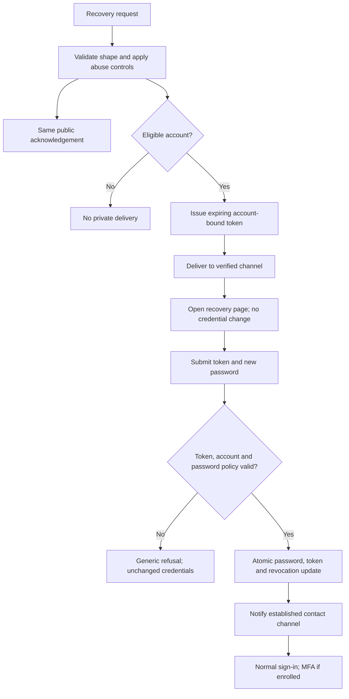

# 21. Accounts, passwords and recovery

<!-- book:header:start -->
[← Chapter 20](20.md) · [Contents](../README.md#contents) · [Repository](../../README.md) · [Chapter 22 →](22.md)

[Runnable companion](../../examples/ch21/README.md)

<details>
<summary>In this chapter</summary>

- [1. Registration, identity proofing assumptions and enumeration-resistant responses](#1-registration-identity-proofing-assumptions-and-enumeration-resistant-responses)
- [2. Password hashing, salts, work factors and library-managed upgrades](#2-password-hashing-salts-work-factors-and-library-managed-upgrades)
- [3. Multi-factor authentication, passkeys and recovery options](#3-multi-factor-authentication-passkeys-and-recovery-options)
- [4. Reauthentication, throttling, reset tokens and revocation](#4-reauthentication-throttling-reset-tokens-and-revocation)
- [Guided lab: follow Mina and test the boundaries](#guided-lab-follow-mina-and-test-the-boundaries)
- [Independent practice](#independent-practice)
- [Hints](#hints)
- [Worked answers](#worked-answers)
- [Verification record](#verification-record)
- [What you can now explain](#what-you-can-now-explain)
- [Primary sources](#primary-sources)

</details>
<!-- book:header:end -->

Mina can sign in to Casebook, but she forgets her password tomorrow. How can the service help her recover without telling a stranger that her account exists, accepting an expired link, or letting the same link change her password twice?

This chapter follows one fictional account from registration to sign-in and recovery. You will use Django's password API, compare recovery responses for known and unknown accounts, draw the recovery flow, and test its time and state boundaries with a controlled clock.

You need chapter 13's separation of secrets from ordinary settings, chapter 15's transactions, chapter 19's private-default service and chapter 20's distinction between client-supplied fields and trusted identity. Keep chapter 17's identity-boundary control `C17-01` and chapter 18's privacy requirement `CB-READ-01`. The established people remain Mina in Alpha, Ravi in Beta and Lee managing Alpha only.

By the end, you will be able to:

- Separate account registration, mailbox control, authentication and workspace authorization.
- Explain password hashes, salts, work factors and maintained-library upgrades.
- Compare MFA, passkeys and recovery options without treating a fallback as stronger than it is.
- Specify reauthentication, throttling, token expiry, single use and revocation, then inspect stored state after refusal.

The edition targets **CPython 3.12.14** and **Django 6.1.3**. The verification record identifies what ran and what remains untested.

### Two small laboratories, one fictional account

Chapter 19's service still has only a public health route. This chapter does not add browser login or recovery routes to it. Chapter 20's integer actor IDs remain local test fixtures, not a browser authentication mechanism.

The companion files are in `examples/ch21/`. To copy the listings independently, create `accounts-lab` in your learning workbench and put every filename below in that folder.

- `django_passwords.py` uses Django's real password API and an isolated in-memory Django database. It needs the pinned framework. It does not establish a browser session.
- `recovery_lab.py`, `recovery_demo.py` and `test_recovery.py` use only Python's standard library. They model recovery state in fresh SQLite databases and require Python 3.12 or later for explicit `autocommit` configuration.

Both examples use fictional Mina, account `1`, with `mina@example.test`. They do not share a database or migrate earlier chapter files. The recovery tests store clearly named opaque password sentinels. Those sentinels are **not usable password hashes**, and the recovery model cannot authenticate a user. Its job is to prove token and transaction decisions independently from the password library. The Django listing teaches password handling; the SQLite tests do not substitute for executing it.

## 1. Registration, identity proofing assumptions and enumeration-resistant responses

An **account** is the service's durable record of a user. A **credential** is material used to establish control of that account, such as a password or a passkey. An **authenticator** is the means used to prove that control. An account can remain the same while its password, devices or verified contact methods change.

**Registration** creates or begins creating an account. **Identity proofing** establishes claims about a person under an explicit process. Verifying that Mina controls an email inbox does not prove her civil identity, employment or right to join Alpha. State what evidence the product actually needs.

For this exercise, Casebook is a private team-note service. Its proposed registration policy verifies a delivery address and separately processes an authorized workspace invitation. An email address is a contact and lookup value, not a workspace permission grant. The registration and invitation process is specified here, not implemented by the laboratories.

**Authentication** establishes who is acting. **Authorization** decides which action that identity may perform on a particular object. A correct password does not let Mina read Beta's note, and recovering her account must not add a Beta membership.

**Table T21-01. Mina's account lifecycle and the evidence behind each step**

| Step | Evidence or trusted change | Permitted consequence | What it does not establish |
| --- | --- | --- | --- |
| Begin registration | Mina submits a candidate address and password | Create a pending registration under the registration contract | The address is controlled, or Alpha membership exists |
| Verify contact address | A fresh verification challenge reaches the intended mailbox and is completed | Record verified mailbox control | Legal identity, employment or ownership of all workspaces |
| Accept Alpha invitation | Trusted invitation and workspace-membership operation pass their checks | Store Mina's active Alpha membership | Beta authority or global management |
| Sign in | Credential check succeeds and account policy permits it | Establish Mina's identity; complete MFA if required | Permission for every note |
| Request recovery | Anyone submits a valid-shaped address | Same public acknowledgement; privately evaluate eligibility | Permission to change credentials or disable the account |
| Complete recovery | A valid unexpired unused recovery credential is presented and new-password policy passes | Atomically replace the credential and invalidate recovery/session authority as specified | Removal of existing MFA or a new workspace membership |
| Disable account | An authorized account-management decision changes status | Refuse future authentication and enforce the revocation policy | Deletion of notes or automatic later reactivation |
| Delete account | A separate approved deletion process runs | Follow the data inventory and retention decisions from chapter 18 | That all backups, logs and workspace records disappear immediately |

Our recovery seed starts after mailbox verification. Its `verified=1` value is a fixture assumption. No verification email or invitation is sent by that seed.

### Do not turn failures into an account directory

**Account enumeration** means learning whether an account exists through the service's behavior. An attacker can compare a known address with a guessed address. Different messages are an obvious signal. Status codes, redirects, response fields, rate-limit headers and timing can provide signals too.

For a valid-shaped recovery request, Casebook's proposed public response is always:

```text
status: 202
```

```json
{"message":"If the account is eligible, recovery instructions will be sent."}
```

This applies to a known eligible account, an unknown address, an inactive account and an unverified account. Only an eligible account receives private recovery delivery. A public `202` is an acknowledgement, not a promise that a specific account exists or an email was sent.

Reject malformed request shapes consistently before lookup, as chapter 20 taught. A malformed email field may receive a validation error regardless of account existence. A valid-shaped but unknown address receives the same acknowledgement as Mina's address.

The same principle applies to sign-in failures: use a general failure such as “Sign-in failed” instead of distinguishing “unknown user,” “wrong password,” and “account disabled.” The private audit reason can differ. Do not add a public email-verification flag or a different retry link that restores the distinction.

### A stable body is one part of the control

Our tests compare the public status and body exactly. They do not prove equal HTTP headers, redirects, delivery timing or response-time distributions. The local known-account path does more database work than the unknown-account path, so do not call it timing-resistant.

Before exposing a real endpoint, design a bounded common acknowledgement path with private delivery work outside the critical response path. Test known, unknown and ineligible cases under realistic load. A queue can help separate delivery latency, but different enqueue paths can still leak information. An arbitrary `sleep` is neither a test of timing behavior nor an abuse-control policy.

Django's built-in password-reset views and forms are a starting point for maintained account behavior. Their documented account-eligibility rules, mail behavior and timing must be reviewed against the product's policy. Do not assume that our fixture's verified-contact flag is a field provided by Django's default user model.

## 2. Password hashing, salts, work factors and library-managed upgrades

A service must not store Mina's plaintext password. It also must not use a fast general-purpose digest such as a single SHA-256 computation as its password-storage scheme.

A **password hash** is an encoded result produced by a password-hashing algorithm intended to make guessing costly. During verification, the maintained library uses the stored parameters to check a candidate password. It does not decrypt the old password.

A **salt** is a fresh random input used when encoding a password. It makes two encodings of the same password differ and prevents useful reuse of one precomputed guess table across accounts. The salt is not a second secret; it can be stored with the encoded hash.

A **work factor** controls the cost of one check. PBKDF2 uses an iteration count; other schemes can include memory and parallelism parameters. Higher cost can slow offline guesses, but also increases the service's sign-in workload. Choose and measure maintained-library settings on the intended environment rather than inventing a fixed number from an old article.

Django stores the algorithm identity and parameters with the encoded value. Its configured preferred hasher creates new encodings. Retaining supported older hashers allows successful checks of older records and upgrades through the maintained user/password path. Removing an old hasher before its users migrate can prevent their passwords from being checked.

### Separate password policy from encoding

A **password policy** decides which new passwords are accepted. Hashing does not enforce that policy by itself. In Django, `set_password()` encodes a password and changes the object's field; it does not automatically call all configured password validators or save the user. Custom code must validate the new password and save the encoded result through the supported API.

For this password-only exercise, the example's minimum is 15 characters. Encourage long unique passwords and password-manager use, allow spaces and paste, and check common or compromised choices. Do not require a ritual mixture of uppercase, digits and punctuation or force periodic changes without a reason such as compromise. NIST's current guidance distinguishes single-factor passwords from passwords used as part of MFA; the value here is aligned with its single-factor minimum, not a claim that every product has the same assurance requirements.

Django's included common-password validator checks its supplied common-password list. It is not proof of a complete current breach-password screening service. A released product needs its own documented policy, suitable input-size bounds, and validation on registration, ordinary password change and recovery. Do not trim or silently truncate a password before checking it.

### Worked example 1: set and verify one synthetic password with Django

Predict these results before running the listing:

1. Mina's fixture password passes the password check; a wrong candidate fails.
2. Encoding the same password again produces a different stored value because a fresh salt is used.
3. `authenticate` permits an active account with correct credentials through the default backend, then refuses the disabled account.

Filename: `requirements.txt`.

```text
Django==6.1.3
```

From the laboratory folder, using the environment from chapter 02:

```shell
python -m pip install -r requirements.txt
python django_passwords.py
```

For the edition interpreter on Windows PowerShell:

```powershell
& $CasebookPython -m pip install -r requirements.txt
& $CasebookPython django_passwords.py
```

**Listing L21-01. Real Django password APIs in a separate in-memory database**

Filename: `django_passwords.py`.

```python
"""Isolated Django password API example; all passwords below are public fixtures."""
import django
from django.conf import settings


settings.configure(
    SECRET_KEY="casebook-ch21-local-only-do-not-deploy",
    INSTALLED_APPS=["django.contrib.auth", "django.contrib.contenttypes"],
    DATABASES={"default": {"ENGINE": "django.db.backends.sqlite3", "NAME": ":memory:"}},
    AUTH_PASSWORD_VALIDATORS=[
        {"NAME": "django.contrib.auth.password_validation.MinimumLengthValidator",
         "OPTIONS": {"min_length": 15}},
        {"NAME": "django.contrib.auth.password_validation.UserAttributeSimilarityValidator"},
        {"NAME": "django.contrib.auth.password_validation.CommonPasswordValidator"},
        {"NAME": "django.contrib.auth.password_validation.NumericPasswordValidator"},
    ],
    USE_TZ=True,
)
django.setup()

from django.contrib.auth import authenticate, get_user_model
from django.contrib.auth.hashers import identify_hasher
from django.contrib.auth.password_validation import validate_password
from django.core.management import call_command


# An in-memory demonstration database, unrelated to chapter 19's service file.
call_command("migrate", verbosity=0)
User = get_user_model()
mina = User(username="mina", email="mina@example.test")
password = "Fictional lanterns cross quiet rivers 21!"
validate_password(password, user=mina)
mina.set_password(password)
mina.save()
print("Django:", django.get_version())
print("correct password:", mina.check_password(password))
print("wrong password:", mina.check_password("wrong public fixture"))
first_encoding = mina.password
mina.set_password(password)
mina.save()
print("same password, different encoding:", first_encoding != mina.password)
hasher = identify_hasher(mina.password)
print("algorithm:", hasher.algorithm)
print("work factor:", hasher.decode(mina.password)["iterations"])
print("successful sign-in:", authenticate(username="mina", password=password) is not None)
mina.is_active = False
mina.save(update_fields=["is_active"])
print("disabled account denied:", authenticate(username="mina", password=password) is None)
```

`settings.configure` supplies an isolated configuration before `django.setup()` loads the apps. The in-memory database is unrelated to chapter 19's database file. `migrate` creates Django's authentication tables for this one process. `get_user_model()` uses the configured user model instead of hard-coding one class.

The four validator settings check length, similarity to account attributes, a supplied common-password list and entirely numeric choices. The password in the source is deliberately a public fictional fixture. It must never become a real credential.

`validate_password(password, user=mina)` checks the new-password policy. `mina.set_password(password)` performs maintained encoding. `mina.save()` persists it. `mina.check_password(candidate)` returns a Boolean; inspecting the password field as plaintext or assigning `mina.password = candidate` is not an equivalent operation.

`authenticate` invokes the configured authentication backend, which evaluates the active-account policy as well as credentials. A successful password check alone is not the whole sign-in decision. Neither `authenticate` nor `check_password` establishes a browser session in this script. Chapter 22 covers the session step.

Expected output, also recorded on the pinned baseline:

```text
Django: 6.1.3
correct password: True
wrong password: False
same password, different encoding: True
algorithm: pbkdf2_sha256
work factor: 1500000
successful sign-in: True
disabled account denied: True
```

The recorded default PBKDF2 work factor for Django 6.1.3 is 1,500,000 iterations. Record the selected hasher and work factor after any dependency/configuration change. We do not lower that value for this demonstration or print either encoded hash.

### Upgrades need a persistence path

When a stored encoding uses an older supported algorithm or cost, the user model's password-check path can regenerate and persist an encoding after a successful check. Use the maintained authentication flow and review its storage behavior. A failed password check cannot magically recover the user's correct password for an upgrade.

If you use the lower-level `django.contrib.auth.hashers.check_password(password, encoded)` directly, returning a Boolean is not the same as saving a new encoding. That helper supports a `setter` callback for regeneration; custom code must provide and persist it when appropriate. Do not write an independent password algorithm or compare encoded strings for equality.

**Table T21-02. Authentication is still followed by authorization**

| Established identity | Target | Required next decision |
| --- | --- | --- |
| Mina after valid sign-in | Alpha note `101` | Permit only if current stored Alpha membership remains active |
| Ravi after valid sign-in | Alpha note `101` | Deny; Beta identity does not grant Alpha membership |
| Mina after valid sign-in | Beta note `202` | Deny; Alpha identity does not grant Beta membership |
| Lee after valid sign-in | Beta note `202` | Deny; Alpha management is not global |
| Anonymous visitor | Either note | Deny; health remains the only public chapter 19 route |

This table is a required integration rule, not an authorization implementation inside the password demo. Chapter 20 already tested synthetic membership decisions. Chapter 23 must connect those decisions to the real identity boundary.

## 3. Multi-factor authentication, passkeys and recovery options

**Multi-factor authentication**, or **MFA**, combines distinct types of evidence. Common categories are something you know, something you have and something you are. Two passwords are two secrets of the same kind, not two independent factors.

A **one-time password**, or **OTP**, is a short-lived or single-use code. A time-based authenticator app commonly produces a code from a shared secret and time. Correct implementation must bound attempts, apply the expected time window and prevent replay as required by the chosen mechanism. The service must protect that shared secret. An OTP entered into a fake sign-in site can be relayed, so ordinary manually entered codes are not phishing-resistant.

A **passkey** is a public-key credential used through a mechanism such as WebAuthn. The service stores a public key; an authenticator proves control of the corresponding private key. It signs a fresh challenge in the context of the relying party. The **relying party** is the service relying on that proof.

Correct WebAuthn verification checks the expected challenge, origin, relying-party identity and required user-presence/user-verification policy through a maintained implementation. **User verification** can involve a device PIN or biometric check; it is different from merely touching a device to show presence. Do not declare that every public-key credential automatically meets the same MFA assurance level. Synced and device-bound credentials also have different recovery and portability properties.

WebAuthn's origin/relying-party binding supports resistance to credential phishing when the ceremony is correctly implemented. It does not replace account eligibility, session handling or workspace authorization. We implement no WebAuthn ceremony or MFA secret storage in this chapter.

### Choose the fallback while choosing the primary authenticator

A **recovery option** restores account access after a user loses an authenticator. An attacker will try the easiest accepted path. A strong passkey login followed by an unrestricted “email support to remove MFA” fallback does not preserve the same assurance.

**Table T21-03. Options for a future Mina account with MFA**

| Option | What it can establish | Required controls and remaining risk |
| --- | --- | --- |
| A second enrolled passkey | Control of another previously bound credential | Protect enrollment and removal with reauthentication; track and revoke lost credentials |
| Recovery codes | Possession of previously issued high-entropy one-use secrets | Deliver through a trusted enrollment flow, store verifiers securely, consume atomically and replace the set after recovery |
| Authenticator-app OTP | Control of a previously bound shared-secret authenticator | Protect the secret, bound attempts and handle replay/time windows; codes can be phished |
| Email recovery link | Access to the verified mailbox plus the fresh link | Mailbox takeover becomes a recovery threat; this does not by itself recover a lost second factor under our proposed MFA policy |
| SMS or voice fallback | Control of a phone delivery path at that time | Consider number reassignment and account takeover at the carrier; it is not phishing-resistant |
| Human-assisted recovery | Evidence evaluated under a separately approved procedure | Defined proof, escalation, dual review where warranted, user notifications and an audit record; no informal bypass |
| Security questions | Knowledge of an answer that may be public or guessable | Do not use them as Casebook's sole recovery proof |

For the running password-only fixture, Mina has one verified email and a password. Our code models that limited recovery path. If MFA is later enrolled, password recovery must not clear it. Losing a password and losing every second factor are different recovery cases. The latter needs its own approved proof and risk decision.

Enrollment is itself a sensitive operation. Require recent appropriate authentication before adding a new passkey, replacing a phone, generating replacement recovery codes or changing the verified email. Notify the established contact channel of consequential changes. Possessing an already stolen browser session should not be enough to bind an attacker's new recovery method.

## 4. Reauthentication, throttling, reset tokens and revocation

**Reauthentication** asks an already signed-in person to prove control again before a sensitive action. A session may be old or stolen. The relevant proof should be recent and suitable for the action's risk. Changing a password, recovery address or MFA binding needs more than trusting a user ID in a browser field.

Recovery is different: Mina may have no usable session. The recovery credential authorizes a narrow password-reset operation under a stated policy, not a normal all-purpose login and not a workspace permission change.

### Define abuse controls before exposing recovery

**Throttling** bounds how frequently work or guesses may occur. Use multiple signals rather than only source IP: a shared network can contain many legitimate users, and a distributed attacker can use many IPs. Account-target limits, source limits, total capacity and delivery budgets address different failure modes.

**Exhibit D21-01. Abuse-control acceptance decisions; not implemented in the laboratories**

| Surface | Required behavior | Evidence before release |
| --- | --- | --- |
| Sign-in guesses | Bound repeated failed attempts and expensive verification work; generic failure | Known/unknown failure cases, distributed sources, recovery from temporary limits and measured capacity |
| Reset requests | Bound submissions and email volume without disclosing account existence | Same public response policy for known/unknown targets; delivery budget tests |
| Reset-token submissions | Bound guesses independently from issuing new links | Malformed, unknown, expired and replayed token cases plus limiter tests |
| Authenticator enrollment/recovery | Require suitable recent proof and stricter review for high-impact changes | Stolen-session and unauthorized-support-change cases |

Choose actual limits from the product's threat model, measured cost and accessibility needs, then document them. Do not permanently set `is_active=False` merely because an anonymous attacker caused several wrong attempts; that would give the attacker an account-disabling operation. A public rate-limit response must not become a reliable account-existence oracle.

The SQLite laboratory does not implement throttling, an HTTP server or an email queue. It must not be deployed as a forgot-password service. These missing controls are part of the integration work, not implied by the passing token tests.

### A recovery token is a credential

A **reset token** is a temporary bearer secret: possession of it can authorize the defined recovery action. Generate it with a cryptographically suitable randomness source. Never derive it from a username, a timestamp alone or a short predictable counter.

The model uses `secrets.token_urlsafe(32)`: 32 random bytes, represented as 43 URL-safe characters. It stores only a SHA-256 digest of that high-entropy token. This is a token lookup verifier, not a password-storage algorithm. Random high-entropy tokens and human-chosen passwords have different guessing properties. Do not copy the token digest choice into password storage.

The raw token goes only to a private delivery fixture. It is never a field of the public request-reset response. In a real service, generate recovery URLs from a configured trusted origin, use HTTPS and avoid deriving the link's host from an unchecked request header. Keep tokens out of ordinary logs, analytics, support tickets and third-party page resources. A recovery page should use an appropriate `Referrer-Policy: no-referrer` and no-store policy. Opening the link with GET must not itself change the password or consume the credential; mail scanners can follow links. A validated confirmation action completes the change.

**Exhibit D21-02. Recovery token and completion policy**

| Property | Local rule |
| --- | --- |
| Eligibility | Account is active and has the verified fixture delivery address |
| Purpose | Replace this account's password; not a login token, invitation or MFA-removal credential |
| Lifetime | 15 minutes from issue; a local exercise choice |
| Valid interval | `issued_at <= now < expires_at`; exact expiry is refused |
| Binding | Stored account ID and credential revision at issue |
| Single use | Mark the selected token used in the same transaction as the password change |
| Other links | A successful reset revokes every other outstanding link for that account |
| Ordinary credential change | A changed credential revision invalidates old links even if their used marker is empty |
| Recovery request alone | No password, active-state or session-epoch change |
| Successful completion | Replace the already validated library-generated password hash, advance credential revision and session epoch, mark/revoke links atomically |
| Subsequent action | Sign in normally again; complete MFA if enrolled; do not automatically create a logged-in session |
| Public completion failure | Same `400` and `invalid_or_expired` for malformed, unknown, expired, used, revoked or ineligible links |

The proposed HTTP request and confirmation actions would be POST operations with bounded input and appropriate browser protections. Their real method, CSRF, header and redirect behavior is not implemented by this local model. Chapter 24 covers browser-form protections.

The password must pass policy and be encoded by the maintained password library before the trusted completion operation commits it. A bad replacement must not burn a valid token. The parameter named `encoded_password` below is an internal value, never a client-writable JSON field. Do not accept a browser-submitted hash as a new password verifier or pass an encoded value into `set_password()` as though it were plaintext.

Django's maintained reset forms, views and token generator provide framework behavior to build on. This laboratory is deliberately a stored opaque-token model for checking explicit state transitions. It is not Django's built-in token format, expiry implementation or a drop-in reset backend. Test the actual framework integration's boundaries rather than assuming its exact comparisons match the local 15-minute policy.

### Draw the whole recovery path

**Figure F21-01. Proposed recovery flow, including controls still awaiting integration**



Notice the two different outcomes at issuance: everyone receives the same public acknowledgement, while only an eligible account receives private delivery. The second branch checks the credential at the time of completion. Requesting a link never grants a session. The diagram includes planned throttling, web pages, notifications and MFA; the local code implements only the documented state-model subset.

### Revocation must reach actual consumers

**Revocation** withdraws previously usable authority. The model increments `session_epoch`, a per-account version marker. A future session issued at epoch 1 must be refused when the account requires epoch 2. That works only if every session consumer checks the marker or an equivalent maintained-framework validity condition.

Writing `session_epoch=2` in a table does not revoke a real browser cookie by itself. Django sessions have their own authentication/session-hash behavior, and external tokens or other services need their own revocation path. Chapter 22 must implement and test the chosen mechanism. After recovery, also consider remembered-device grants, application tokens and pending privileged operations according to their contracts. Do not claim that changing one password removes every credential everywhere.

Recovery must not reset workspace memberships, account eligibility or enrolled MFA. The local seed has no membership table because this laboratory does not release notes or grant workspace access. The authorization requirement continues to apply when the user later reads Alpha or requests an export.

### Worked example 2: known versus unknown, then expiry and reuse

Predict three observations:

1. Requesting recovery for Mina and for `missing@example.test` returns the same status and body, but only Mina's private mailbox receives a token.
2. A token succeeds at 899 seconds after issue and fails when repeated, with no second credential or epoch change.
3. A newly issued token fails at exactly 900 seconds, leaving stored state unchanged.

A **controlled clock** is a time source the test can advance directly. It avoids waiting fifteen minutes and makes the exact boundary repeatable. The fixed UTC timestamp is a synthetic fixture, not the current wall-clock time.

**Listing L21-02. Recovery state, a private mailbox and an injected clock**

Filename: `recovery_lab.py`.

```python
"""Synthetic recovery-state laboratory; no public routes or real mail delivery."""
from contextlib import closing, contextmanager
from dataclasses import dataclass
from datetime import datetime, timedelta, timezone
import hashlib
import re
import secrets
import sqlite3


TTL_SECONDS = 15 * 60
PUBLIC_BODY = {"message": "If the account is eligible, recovery instructions will be sent."}
INVALID_BODY = {"error": "invalid_or_expired"}


@dataclass
class Clock:
    instant: datetime

    def now(self):
        if self.instant.tzinfo is None or self.instant.utcoffset() != timedelta(0):
            raise ValueError("Use an aware UTC clock")
        return int(self.instant.timestamp())

    def advance(self, seconds):
        if type(seconds) is not int or seconds < 0:
            raise ValueError("Advance by nonnegative whole seconds")
        self.instant += timedelta(seconds=seconds)


@dataclass(frozen=True)
class Delivery:
    account_id: int
    token: str


def token_digest(raw):
    return hashlib.sha256(raw.encode("ascii")).hexdigest()


@contextmanager
def transaction(path):
    with closing(sqlite3.connect(path, autocommit=True, timeout=2)) as db:
        db.row_factory = sqlite3.Row
        db.execute("PRAGMA foreign_keys = ON")
        db.execute("BEGIN IMMEDIATE")
        try:
            yield db
        except BaseException:
            db.execute("ROLLBACK")
            raise
        else:
            db.execute("COMMIT")


def seed(path, encoded_password="opaque-fixture-password-v1"):
    # The default is a test sentinel, not a usable password hash.
    with transaction(path) as db:
        db.execute("""CREATE TABLE accounts (
            id INTEGER PRIMARY KEY, email TEXT UNIQUE NOT NULL,
            active INTEGER NOT NULL CHECK(active IN (0, 1)),
            verified INTEGER NOT NULL CHECK(verified IN (0, 1)),
            password_hash TEXT NOT NULL, credential_revision INTEGER NOT NULL,
            session_epoch INTEGER NOT NULL)""")
        db.execute("""CREATE TABLE resets (
            digest TEXT PRIMARY KEY, account_id INTEGER NOT NULL REFERENCES accounts(id),
            issued_at INTEGER NOT NULL, expires_at INTEGER NOT NULL,
            issued_revision INTEGER NOT NULL, used_at INTEGER, revoked_at INTEGER)""")
        db.execute("INSERT INTO accounts VALUES (1, ?, 1, 1, ?, 1, 1)",
                   ("mina@example.test", encoded_password))


def request_reset(path, email, clock, outbox):
    # Fixture emails use exact ASCII spelling; this is not an email-normalization library.
    delivery = None
    with transaction(path) as db:
        row = db.execute("SELECT * FROM accounts WHERE email = ? AND active = 1 AND verified = 1",
                         (email,)).fetchone()
        if row is not None:
            raw = secrets.token_urlsafe(32)
            now = clock.now()
            db.execute("INSERT INTO resets VALUES (?, ?, ?, ?, ?, NULL, NULL)",
                       (token_digest(raw), row["id"], now, now + TTL_SECONDS,
                        row["credential_revision"]))
            delivery = Delivery(row["id"], raw)
    # A private local mailbox, not a field in the public response.
    if delivery is not None:
        outbox.append(delivery)
    return 202, dict(PUBLIC_BODY)


def complete_reset(path, raw, encoded_password, clock):
    # Trusted caller must validate the new password and obtain a library-produced hash first.
    # Tests pass an opaque sentinel. This function does not hash or check passwords.
    if not isinstance(encoded_password, str) or not encoded_password:
        raise ValueError("A validated replacement hash is required")
    if not isinstance(raw, str) or re.fullmatch(r"[A-Za-z0-9_-]{43}", raw) is None:
        return 400, dict(INVALID_BODY)
    with transaction(path) as db:
        now = clock.now()
        row = db.execute("""SELECT resets.*, accounts.active, accounts.verified,
                            accounts.credential_revision FROM resets
                            JOIN accounts ON accounts.id = resets.account_id
                            WHERE digest = ?""", (token_digest(raw),)).fetchone()
        if (row is None or not row["active"] or not row["verified"]
                or row["used_at"] is not None or row["revoked_at"] is not None
                or row["issued_revision"] != row["credential_revision"]
                or not row["issued_at"] <= now < row["expires_at"]):
            return 400, dict(INVALID_BODY)
        db.execute("""UPDATE accounts SET password_hash = ?,
                      credential_revision = credential_revision + 1,
                      session_epoch = session_epoch + 1 WHERE id = ?""",
                   (encoded_password, row["account_id"]))
        db.execute("UPDATE resets SET used_at = ? WHERE digest = ?", (now, row["digest"]))
        db.execute("""UPDATE resets SET revoked_at = ? WHERE account_id = ? AND digest != ?
                      AND used_at IS NULL AND revoked_at IS NULL""",
                   (now, row["account_id"], row["digest"]))
    return 200, {"message": "Password changed. Sign in again."}


def snapshot(path):
    # Privileged local evidence; never expose password hashes or token digests to support/public UI.
    with closing(sqlite3.connect(path, autocommit=True)) as db:
        db.row_factory = sqlite3.Row
        return {
            "accounts": [dict(row) for row in db.execute("SELECT * FROM accounts ORDER BY id")],
            "resets": [dict(row) for row in db.execute("SELECT * FROM resets ORDER BY digest")],
        }


def fresh_clock():
    return Clock(datetime(2026, 11, 26, 9, 0, 0, tzinfo=timezone.utc))
```

`Clock.now()` requires an aware UTC time and returns whole seconds. `advance` moves the test clock without sleeping. Application code gets its current time through this injected object rather than calling the real clock in several places.

`Delivery` is an immutable fixture record. The `outbox` list is a privileged local mailbox; only tests and the demo read it. A real mail-delivery boundary needs protected storage and access controls. If delivery fails after the token transaction commits, the password is still unchanged; reliability requires a durable delivery design. This list is not such a delivery system.

`BEGIN IMMEDIATE` starts SQLite's write transaction before reading mutable recovery state. Completion checks expiry, account flags, revision and use/revocation markers inside that transaction. The selected token's used marker, the password field, revision, epoch and other-link revocations commit together. `closing` separately closes each connection. The model's sequential SQLite tests do not establish a different database's concurrency behavior or a race-free distributed implementation.

`seed` creates a fresh database and fails rather than overwriting an existing schema. Its default password value says `opaque-fixture-password-v1` to make the boundary explicit. Supplying a trusted Django-generated hash is possible through that internal argument, but these tests use sentinels and do not authenticate them.

`snapshot` opens a new connection to inspect committed rows after each operation. It contains private credential verifiers and token digests. Never return this structure from an endpoint or show it to ordinary support users.

**Listing L21-03. A recovery walkthrough without printing secrets**

Filename: `recovery_demo.py`.

```python
from pathlib import Path
from tempfile import TemporaryDirectory

from recovery_lab import complete_reset, fresh_clock, request_reset, seed, snapshot


with TemporaryDirectory(prefix="casebook-recovery-") as folder:
    path = Path(folder) / "recovery.sqlite3"
    seed(path)
    clock = fresh_clock()
    outbox = []
    known = request_reset(path, "mina@example.test", clock, outbox)
    token = outbox[-1].token
    unknown = request_reset(path, "missing@example.test", clock, outbox)
    print("same public response:", known == unknown)
    print("public status:", known[0])
    print("private deliveries:", len(outbox))
    before = snapshot(path)
    print("before:", before["accounts"][0]["credential_revision"],
          before["accounts"][0]["session_epoch"])
    clock.advance(899)
    print("before expiry:", complete_reset(path, token, "opaque-fixture-password-v2", clock)[0])
    accepted = snapshot(path)
    account = accepted["accounts"][0]
    print("after:", account["credential_revision"], account["session_epoch"])
    print("token consumed:", accepted["resets"][0]["used_at"] == clock.now())
    print("replay:", complete_reset(path, token, "must-not-be-stored", clock))
    print("unchanged after replay:", snapshot(path) == accepted)
    request_reset(path, "mina@example.test", clock, outbox)
    expires = outbox[-1].token
    clock.advance(900)
    boundary = snapshot(path)
    print("exact expiry:", complete_reset(path, expires, "must-not-be-stored", clock))
    print("unchanged at expiry:", snapshot(path) == boundary)
```

Run from the laboratory folder with your learning environment's Python:

```shell
python recovery_demo.py
```

On Windows PowerShell, use `& $CasebookPython recovery_demo.py` for the edition interpreter.

Expected output, also observed in the local verification run:

```text
same public response: True
public status: 202
private deliveries: 1
before: 1 1
before expiry: 200
after: 2 2
token consumed: True
replay: (400, {'error': 'invalid_or_expired'})
unchanged after replay: True
exact expiry: (400, {'error': 'invalid_or_expired'})
unchanged at expiry: True
```

The two numbers after `before` and `after` are credential revision and session epoch. Neither token nor password verifier is printed. A token issued at the fixed fixture time 09:00:00 UTC expires at 09:15:00 UTC. In this model it is valid at 09:14:59 UTC and invalid at 09:15:00 UTC. The demo's second token is issued after the first reset, at its own later issue time; it has its own 900-second interval.

**Table T21-04. Stored state after the important boundaries**

| Operation | Password field | Credential revision | Session epoch | Reset state |
| --- | --- | --- | --- | --- |
| Fresh seed | Original opaque fixture | 1 | 1 | No token |
| Recovery request for Mina | Original opaque fixture | 1 | 1 | Digest and fixed expiry stored; unused |
| Recovery request for unknown address | Unchanged | Unchanged | Unchanged | No new token for an unknown account |
| Valid completion just before expiry | Replacement opaque fixture | 2 | 2 | Selected token marked used; other outstanding links revoked |
| Same token submitted again | Unchanged replacement | 2 | 2 | Entire stored snapshot unchanged |
| A later token submitted at its exact expiry | Unchanged replacement | 2 | 2 | Entire stored snapshot unchanged |
| Failure while recording token use | Original state from before the attempted completion | Unchanged | Unchanged | Transaction rollback; no partial password change |

The epoch change is a modeled revocation requirement, not an observed browser logout. The last row is exercised by the regression suite's injected storage failure.

### Prove the refusal does not hide a write

**Listing L21-04. Controlled-clock and final-state tests**

Filename: `test_recovery.py`.

```python
from pathlib import Path
from tempfile import TemporaryDirectory
import sqlite3
import unittest

from recovery_lab import complete_reset, fresh_clock, request_reset, seed, snapshot, token_digest


class RecoveryTests(unittest.TestCase):
    def setUp(self):
        self.folder = TemporaryDirectory(prefix="casebook-recovery-test-")
        self.addCleanup(self.folder.cleanup)
        self.path = Path(self.folder.name) / "recovery.sqlite3"
        seed(self.path)
        self.clock = fresh_clock()
        self.outbox = []

    def issue(self):
        request_reset(self.path, "mina@example.test", self.clock, self.outbox)
        return self.outbox[-1].token

    def assert_invalid_unchanged(self, token):
        before = snapshot(self.path)
        result = complete_reset(self.path, token, "must-not-be-stored", self.clock)
        self.assertEqual(result, (400, {"error": "invalid_or_expired"}))
        self.assertEqual(snapshot(self.path), before)

    def test_known_unknown_and_ineligible_have_same_public_response(self):
        known = request_reset(self.path, "mina@example.test", self.clock, self.outbox)
        unknown = request_reset(self.path, "missing@example.test", self.clock, self.outbox)
        self.assertEqual(known, unknown)
        self.assertEqual(known[0], 202)
        self.assertEqual(len(self.outbox), 1)
        for field in ("active", "verified"):
            with sqlite3.connect(self.path) as db:
                db.execute("UPDATE accounts SET active = 1, verified = 1")
                db.execute(f"UPDATE accounts SET {field} = 0")  # Fixed test-owned identifiers only.
            self.assertEqual(request_reset(self.path, "mina@example.test", self.clock, self.outbox), known)
        self.assertEqual(len(self.outbox), 1)
        self.assertEqual(len(snapshot(self.path)["resets"]), 1)

    def test_request_does_not_change_password_or_session_epoch(self):
        before = snapshot(self.path)["accounts"]
        token = self.issue()
        after = snapshot(self.path)
        self.assertEqual(after["accounts"], before)
        self.assertEqual(after["resets"][0]["digest"], token_digest(token))
        self.assertNotIn(token, repr(after))

    def test_just_before_expiry_succeeds_and_replay_does_not_write(self):
        token = self.issue()
        self.clock.advance(899)
        result = complete_reset(self.path, token, "opaque-fixture-password-v2", self.clock)
        self.assertEqual(result[0], 200)
        saved = snapshot(self.path)
        account = saved["accounts"][0]
        self.assertEqual((account["password_hash"], account["credential_revision"], account["session_epoch"]),
                         ("opaque-fixture-password-v2", 2, 2))
        self.assertEqual(saved["resets"][0]["used_at"], self.clock.now())
        self.assert_invalid_unchanged(token)

    def test_exact_expiry_and_after_expiry_refuse_without_writes(self):
        for elapsed in (900, 901):
            with self.subTest(elapsed=elapsed):
                token = self.issue()
                self.clock.advance(elapsed)
                self.assert_invalid_unchanged(token)

    def test_malformed_and_unknown_tokens_have_same_failure(self):
        for token in (None, "", "invalid", "A" * 43):
            with self.subTest(token=token):
                self.assert_invalid_unchanged(token)

    def test_success_revokes_other_outstanding_links(self):
        first = self.issue()
        second = self.issue()
        self.assertNotEqual(first, second)
        self.assertEqual(complete_reset(self.path, first, "opaque-v2", self.clock)[0], 200)
        saved = snapshot(self.path)
        other = next(row for row in saved["resets"] if row["digest"] == token_digest(second))
        self.assertEqual(other["revoked_at"], self.clock.now())
        self.assert_invalid_unchanged(second)

    def test_changed_credential_or_disabled_account_invalidates_old_link(self):
        token = self.issue()
        with sqlite3.connect(self.path) as db:
            db.execute("UPDATE accounts SET credential_revision = credential_revision + 1")
        self.assert_invalid_unchanged(token)
        token = self.issue()
        with sqlite3.connect(self.path) as db:
            db.execute("UPDATE accounts SET active = 0")
        self.assert_invalid_unchanged(token)

    def test_missing_validated_replacement_does_not_consume_link(self):
        token = self.issue()
        before = snapshot(self.path)
        with self.assertRaises(ValueError):
            complete_reset(self.path, token, "", self.clock)
        self.assertEqual(snapshot(self.path), before)
        self.assertEqual(complete_reset(self.path, token, "opaque-v2", self.clock)[0], 200)

    def test_storage_failure_rolls_back_password_and_token_state(self):
        token = self.issue()
        with sqlite3.connect(self.path) as db:
            db.execute("""CREATE TRIGGER fail_use BEFORE UPDATE OF used_at ON resets
                          BEGIN SELECT RAISE(ABORT, 'synthetic failure'); END""")
        before = snapshot(self.path)
        with self.assertRaises(sqlite3.IntegrityError):
            complete_reset(self.path, token, "must-not-be-stored", self.clock)
        self.assertEqual(snapshot(self.path), before)


if __name__ == "__main__":
    unittest.main()
```

Run:

```shell
python -m unittest -v test_recovery
```

Expected: nine passing test methods ending in `OK`. The expiry method contains separate exact-expiry and after-expiry subcases. The failure-trigger test raises an error after the password update has been attempted but before token use can finish, then compares all stored account and reset fields. It proves rollback rather than merely catching an exception.

The fixed f-string SQL identifier in the eligibility test comes from the local tuple `('active', 'verified')`, never from request data. All externally meaningful values in the laboratory's SQL use bound parameters. Do not generalize that test fixture into accepting arbitrary column names.

### What may support staff observe?

Support must help a legitimate user without gaining a password-reset bypass or a directory of account existence. Separate public responses, ticket-level troubleshooting and privileged security investigation.

**Exhibit D21-03. Proposed observation and authority policy**

| Observer | May observe | Must not receive or do |
| --- | --- | --- |
| Anonymous requester | Generic acknowledgement or generic invalid/expired result | Account existence, active/verified flags, token, password hash or detailed failure reason |
| Ordinary support agent | An authorized ticket reference, coarse request/delivery status where the workflow permits it, safe timestamps and escalation instructions | Raw tokens, reset URLs, password values/hashes, token digests, arbitrary account lookup or credential replacement |
| Authorized security investigator | Purpose-limited protected account/event references, reason categories such as used/expired/throttled and relevant delivery anomalies | Use credentials as a troubleshooting shortcut, disclose verifier material, or reset accounts outside the approved recovery process |
| Delivery system | Only the information necessary to deliver the approved recovery message | Private notes or workspace membership data unrelated to delivery |
| Account holder through the verified channel | Recovery instructions and a later change notification | The new password in email or a promise that existing MFA was removed |

A delivery status such as “accepted by the mail provider” does not prove that Mina read the message. A completed reset event does not prove that every external token has been revoked. Record only the evidence actually available.

Support visibility needs protected access, auditability and a purpose-limited retention policy. For this exercise, those are design requirements; no support interface, audit pipeline or log-retention cleanup is implemented. The privileged `snapshot` helper is test evidence, not a proposed support screen.

## Guided lab: follow Mina and test the boundaries

1. Read T21-01 and identify which assumptions establish mailbox control and Alpha membership. Mark the steps that remain design-only.
2. If the pinned Django dependency is available, run `django_passwords.py`. Record Python/Django versions, the configured algorithm/work factor and each Boolean result. If it is unavailable, record that blocker without calling the example executed.
3. Predict the public results for Mina, an unknown address, an inactive account and an unverified account. Run the standard-library demo and tests. Compare both status and body.
4. Explain why the private outbox has one delivery while both public acknowledgements are identical. Confirm that the demo never prints a token or verifier.
5. Trace the first token to 899 seconds. After completion, inspect revision, epoch and the used marker through the assertions. Repeat the token and compare the entire stored snapshot.
6. Trace a new token to exactly 900 seconds and then beyond expiry. Explain why `< expires_at` makes the boundary deterministic.
7. Read the two-link test. Verify that successful completion using one link revokes the other. Read the credential-change and disabled-account checks; a valid-looking old token cannot reactivate the account.
8. Read the failure-trigger test. Identify the earlier attempted password write and the later failure, then explain why the reopened snapshot must equal the original state.
9. Annotate F21-01 with what the local tests exercise and what still needs integration: web parsing, timing, throttling, real delivery, notifications, password policy, session consumers and MFA.
10. Write a short support note using D21-03. Include safe observations and escalation instructions, with no reset URL or secret.

## Independent practice

### Exercise 1: what did verification prove?

Mina follows a registration email link. A developer immediately creates memberships in every workspace whose name appears in the same request. Explain the trust error. Which separate stored decision should authorize Alpha membership?

### Exercise 2: move the clock

For a token issued at the fixture time, predict outcomes at offsets 899, 900 and 901 seconds. Then explain why a test that sleeps one second cannot reliably establish the fifteen-minute boundary. What should happen if a token has an issue time later than the service's current time?

### Exercise 3: two links and a stolen old session

Mina requests two links, completes recovery with the first and then submits the second. State the required stored credential/token result. An old browser session still opens her Alpha page. Which unimplemented consumer check is missing, and why do the local token tests not prove it?

### Exercise 4: library behavior

A custom reset handler writes `user.password = new_password` and saves it. Another calls `set_password()` but skips policy validation. Explain both mistakes. What does a lower-level `check_password` call need if it is meant to persist an upgraded encoding?

### Exercise 5: support and MFA

A caller asks support to read out a reset token and remove Mina's MFA because the caller knows her Alpha note title. Explain why neither action is justified. Give safe support observations and an appropriate escalation path.

### Practice check

Draw the recovery flow. Test expiry, single use and a stable public response, then describe what support staff may observe.

Submit a diagram, the known/unknown and ineligible-account response comparison, just-before/exact/after-expiry cases, a used-token replay case, unchanged final-state evidence after refusals and a support-visibility policy. Keep the Django execution record separate from the standard-library token-state results. Name the authentication, session and delivery integration that remains untested.

## Hints

- A contact method proves a narrower fact than a workspace invitation or identity-proofing process.
- A response can have the same words and still differ in timing, headers or delivery behavior.
- The reset request is not the reset completion; neither is automatically a normal session.
- A hash string used as a test sentinel is not evidence of password hashing.
- A revocation marker matters only when every relevant consumer enforces it.

## Worked answers

### Exercise 1

The email challenge establishes control of that address under the verification process. Workspace names in a request are untrusted selectors. They cannot authorize creating memberships. Alpha membership requires a separate authorized invitation or membership-management decision loaded from trusted stored records. Verifying the email must not create Beta authority or global management.

### Exercise 2

The model accepts at 899 seconds and refuses at 900 and 901. A token with an issue time later than `now` also fails the `issued_at <= now` condition. A test should control time directly rather than depend on scheduling, machine load or a real wait. Production systems need a trusted, monitored clock and integration tests of their actual expiry implementation.

For a direct future-issue check, save this optional answer program as `future_clock_answer.py` beside `recovery_lab.py`:

```python
from datetime import timedelta
from pathlib import Path
from tempfile import TemporaryDirectory
from recovery_lab import complete_reset, fresh_clock, request_reset, seed, snapshot

with TemporaryDirectory() as folder:
    path = Path(folder) / 'answer.sqlite3'
    seed(path)
    clock = fresh_clock()
    outbox = []
    request_reset(path, 'mina@example.test', clock, outbox)
    clock.instant -= timedelta(seconds=1)
    before = snapshot(path)
    result = complete_reset(path, outbox[0].token, 'must-not-be-stored', clock)
    print(result)
    print('unchanged:', snapshot(path) == before)
```

Run `python future_clock_answer.py`. Expected output, also observed during verification:

```text
(400, {'error': 'invalid_or_expired'})
unchanged: True
```

The code moves the fixture time backwards deliberately; it is a negative test, not a suggested production clock policy.

### Exercise 3

The first valid completion stores one replacement credential, advances revision and epoch once, marks its token used and revokes the second link. The second submission receives the same generic invalid/expired refusal and changes nothing. If an old browser session still works, the session validity/revocation mechanism is not enforcing the post-reset policy. The model changes an epoch but has no browser sessions or session middleware. Chapter 22 must connect and test that consumer behavior; other token types may need separate invalidation too.

### Exercise 4

Direct assignment stores plaintext rather than a maintained password encoding. `set_password()` performs encoding, but custom flows must also call the configured new-password validators and save the user. The policy should apply to registration, ordinary change and recovery. A lower-level hash check needs an appropriate `setter`/persistence path when it is expected to regenerate and save an upgraded encoding; a Boolean result alone does not save anything.

### Exercise 5

A note title is private application data, not reliable proof of account control. It could be copied, disclosed or guessed. Support must not reveal reset credentials or disable MFA through an informal exception. It can use an authorized ticket reference, coarse delivery/request observations and safe timestamps, then escalate to the approved recovery procedure. That process must establish the required evidence, record the decision, notify the account holder and preserve workspace/MFA policy. Knowing someone else's data is not a recovery factor.

### Practice check

F21-01 supplies the flow and names the planned integration controls. `test_known_unknown_and_ineligible_have_same_public_response` compares the stable public tuple and private delivery count. The before-expiry, exact/after-expiry and replay tests check the time boundary and single use. `assert_invalid_unchanged` reopens storage and compares all account/reset rows after refusal. The trigger test verifies that a failure rolls back both credential and token changes. D21-03 states the observation policy and excludes secret material from support.

These are scoped local results, not evidence that real email, browser sessions, MFA or response timing have been verified.

## Verification record

The password demonstration ran with **CPython 3.12.14** and **Django 6.1.3**. Correct-password verification and active-account sign-in succeeded; wrong-password and disabled-account cases were refused. Re-encoding the same password produced a different stored encoding. The default reported algorithm was `pbkdf2_sha256` with **1,500,000 iterations**. These are real maintained-framework results against an isolated in-memory database.

The standard-library recovery suite passed all **nine methods** on **SQLite 3.53.1**. It checks expiry with a controlled clock, atomic single use, invalidation, unchanged refusal state and rollback. Its opaque password sentinels do not themselves authenticate a user. The [current verification report](../../examples/verification/current.json) keeps the recovery and password-library results separate.

No real mail, notification, registration/contact proofing, MFA/WebAuthn authenticator, browser recovery journey, response-latency defense, concurrent completion or production issuer was exercised. A local epoch update does not prove revocation in every credential consumer.

## What you can now explain

An account lives through registration, authentication, credential changes and recovery. Each step needs a stated proof and a limited consequence. A maintained password library handles encoding and verification, while the application still owns eligibility, new-password policy, abuse controls and authorization. Recovery must have an explicit lifetime, atomic single use, a stable public result and revocation that reaches actual consumers.

Keep the lifecycle and support policies, F21-01, the Django password listing and the controlled-clock recovery checks. Chapter 22 starts from Mina's account and the post-reset revocation requirement to choose and verify session/token behavior. Chapter 19's HTTP surface remains private by default; account, session and reset integration still need explicit implementation rather than a fixture identity header.

## Primary sources

- Django's [password-management guide](https://docs.djangoproject.com/en/6.1/topics/auth/passwords/) documents hashers, password validation and the lower-level helper APIs. Its [authentication guide](https://docs.djangoproject.com/en/6.1/topics/auth/default/) describes user methods, backend behavior and built-in reset views/forms. These are framework references, not evidence that the Django listing ran here.
- [NIST SP 800-63B-4](https://pages.nist.gov/800-63-4/sp800-63b.html) describes password, authenticator, phishing-resistance and recovery requirements within its assurance framework. The account lifecycle, 15-minute reset lifetime and support policy here are Casebook exercise decisions, not a claim of NIST conformance.
- OWASP's [Authentication Cheat Sheet](https://cheatsheetseries.owasp.org/cheatsheets/Authentication_Cheat_Sheet.html), [Forgot Password Cheat Sheet](https://cheatsheetseries.owasp.org/cheatsheets/Forgot_Password_Cheat_Sheet.html) and [Multifactor Authentication Cheat Sheet](https://cheatsheetseries.owasp.org/cheatsheets/Multifactor_Authentication_Cheat_Sheet.html) discuss generic responses, reauthentication, recovery and fallback risks.
- The W3C [Web Authentication specification](https://www.w3.org/TR/webauthn-3/) defines the public-key authentication ceremony and verification context. Use a maintained implementation rather than constructing a signature-verification protocol from this chapter's prose.
- Python documents [`secrets`](https://docs.python.org/3.12/library/secrets.html), [`hashlib`](https://docs.python.org/3.12/library/hashlib.html), [aware datetimes](https://docs.python.org/3.12/library/datetime.html), [`sqlite3` transaction control](https://docs.python.org/3.12/library/sqlite3.html) and [`unittest`](https://docs.python.org/3.12/library/unittest.html). These support the local state laboratory, not a custom password-hashing scheme.

<!-- book:footer:start -->
---

[← Chapter 20](20.md) · [Contents](../README.md#contents) · [Repository](../../README.md) · [Chapter 22 →](22.md)

[Back to top](#21-accounts-passwords-and-recovery)
<!-- book:footer:end -->
