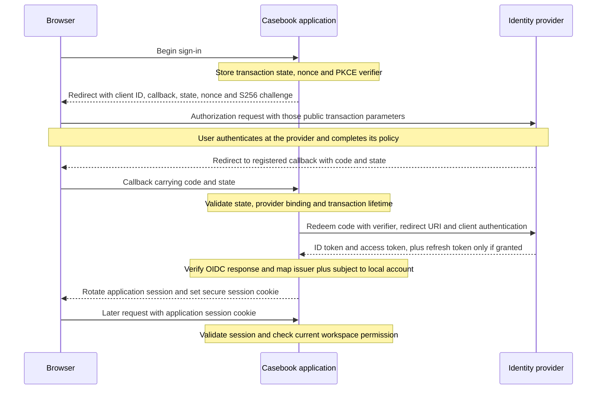

# 22. Sessions, tokens and federated identity

<!-- book:header:start -->
[← Chapter 21](21.md) · [Contents](../README.md#contents) · [Repository](../../README.md) · [Chapter 23 →](23.md)

[Runnable companion](../../examples/ch22/README.md)

<details>
<summary>In this chapter</summary>

- [1. Server-side sessions, cookie flags, rotation and logout](#1-server-side-sessions-cookie-flags-rotation-and-logout)
- [2. Opaque tokens, token storage and lifetime](#2-opaque-tokens-token-storage-and-lifetime)
- [3. OAuth 2.0 authorization and OpenID Connect identity, code flow and PKCE](#3-oauth-20-authorization-and-openid-connect-identity-code-flow-and-pkce)
- [4. JWT validation with maintained libraries, issuer, audience, expiry and key rotation](#4-jwt-validation-with-maintained-libraries-issuer-audience-expiry-and-key-rotation)
- [Decision record: browser sessions and a partner integration](#decision-record-browser-sessions-and-a-partner-integration)
- [Guided lab: separate policy evidence from protocol evidence](#guided-lab-separate-policy-evidence-from-protocol-evidence)
- [Independent practice](#independent-practice)
- [Hints](#hints)
- [Worked answers](#worked-answers)
- [Verification record](#verification-record)
- [What you can now explain](#what-you-can-now-explain)
- [Primary sources](#primary-sources)

</details>
<!-- book:header:end -->

Mina has proved who she is. What should her browser send on the next request, and why must Casebook refuse a correctly signed token intended for another service?

This chapter chooses how identity continues across requests. You will trace a browser login through session rotation, follow an OpenID Connect code exchange, and evaluate token claims against fixed issuer, audience and time rules. You will also distinguish a successful signature check from authorization to read a private note.

You need chapter 16's HTTP and TLS boundaries, chapter 19's request/middleware model, chapter 20's API contracts and chapter 21's account lifecycle. Keep chapter 21's post-recovery revocation requirement: old session authority must stop working after credentials change. Mina is still an Alpha member, Ravi a Beta member and Lee an Alpha manager only.

By the end, you will be able to:

- Explain server-side sessions, cookie flags, session rotation and logout.
- Compare opaque tokens with signed token formats and define their lifetimes and storage.
- Trace OAuth authorization and OpenID Connect identity through code flow and PKCE.
- Configure maintained JWT verification with fixed trust, issuer, audience, time and key-selection rules.

The edition targets **CPython 3.12.14** and **Django 6.1.3**. The local JWT example pins **PyJWT 2.15.1** and **cryptography 50.0.2**. The verification record distinguishes local signed-token/session checks from unexecuted provider and browser integration.

### Starting state and scope

Chapter 19's service still exposes only health. Chapters 20 and 21 supplied local contract and recovery models; they did not add public authentication routes. We preserve that boundary here. Do not turn a JSON user ID, an email address or a decoded token dictionary into a trusted identity.

The new companion folder is `examples/ch22/`. If copying the listings, use a fresh `identity-lab` folder in your learning workbench and save every filename below there. No earlier Python file or database is imported. The account/session example creates an isolated in-memory Django database for fictional Mina. The token fixtures use fictional provider and API names and ephemeral signing keys. No real identity-provider account, client secret or external token is needed.

There are three evidence levels:

1. The standard-library claim-policy tests evaluate supplied dictionaries. They check application rules, not cryptographic authenticity.
2. The signed-token suite uses PyJWT and local RSA keys to verify signatures and claims together. It requires the pinned dependencies.
3. The Django listing uses real session/authentication APIs. It requires Django and does not run a browser or expose a login endpoint.

Passing the first level is not evidence that the second or third ran. The chapter records their separate results.

## 1. Server-side sessions, cookie flags, rotation and logout

A **session** connects several requests to ongoing server-managed state. With a **server-side session**, the browser normally stores only an unpredictable session identifier. The application uses it to find session data in a database or another configured store.

A **cookie** is a browser-managed name/value item attached to requests under its matching rules. A session cookie is a credential: someone who steals a usable identifier may be able to use the session. Keeping user data on the server does not make theft of the identifier harmless.

For Casebook's browser application, choose Django's database session backend. The browser sends the session cookie; the application loads and validates its authentication state, then performs current account and workspace checks. Do not put a private note body or a cached permanent membership decision in the cookie.

### Make cookie behavior explicit

**Table T22-01. Proposed session-cookie settings over HTTPS**

| Setting or attribute | Value | Meaning and limit |
| --- | --- | --- |
| Name | `__Host-casebook-session` | Uses the browser's host-prefix rules with the attributes below |
| `Secure` | True | Send over secure transport; it does not prevent all credential theft |
| `HttpOnly` | True | Prevent ordinary script access through cookie APIs; an XSS payload can still act through the browser |
| `SameSite` | Lax | Limit cross-site cookie sending; test the selected sign-in callback method; this is not the complete CSRF control |
| `Path` | `/` | Cookie applies across this host's paths |
| `Domain` | Omitted | Host-only scope; required for the `__Host-` prefix |
| Backend age in the API example | 900 seconds | Backend/cookie lifetime configuration; not a complete idle-plus-absolute timeout implementation |

These are explicit Casebook choices. A `__Host-` cookie requires Secure, Path `/` and no Domain. A real deployment must use trusted HTTPS and the correct proxy/host configuration. The example's test requests model HTTPS; they do not establish deployed TLS behavior.

**CSRF**, or cross-site request forgery, causes a browser to send an unwanted authenticated action. Cookie-authenticated state changes need Django's relevant CSRF controls, not only SameSite. Chapter 24 covers that browser boundary. A cross-site OIDC callback using a top-level GET and a callback using a form POST can interact differently with SameSite; choose and test the actual response mode rather than weakening flags to make an unexplained failure disappear.

### Rotate at the change in authority

**Session fixation** occurs when an identifier known before sign-in remains useful as the authenticated session identifier. **Rotation** gives the authenticated session a fresh identifier at the authority change. Preserving harmless anonymous preferences such as language does not require preserving the old identifier.

A useful trace is:

**Table T22-02. Expected session state across Mina's sign-in**

| Event | Browser/session state | Required server observation |
| --- | --- | --- |
| Anonymous visit | Session A, perhaps with `locale=en` | No authenticated account |
| Valid credentials and account checks | Authentication succeeds | Establish Mina's account identity, not a workspace grant |
| Login | New session B | A is no longer the authenticated handle; B contains framework-managed authentication state |
| Next request with B | Application loads B | Validate account/session authority, then check the requested note's current membership |
| Password reset | Old authentication binding becomes stale | A later request with B must be refused under the reset policy |
| Fresh sign-in and logout | Session C then logout | Remove C's server-side authority and expire the browser cookie through the HTTP response path |

Django's maintained `login` and `logout` functions manage session state. Do not replace them with assigning a user ID to a dictionary. `SessionMiddleware` must run before `AuthenticationMiddleware`, because authentication uses the loaded session. A public login action also needs its real method, CSRF, throttling and reauthentication policy; calling the functions in a fixture does not implement those boundaries.

### Worked example 1: trace login, rotation, recovery invalidation and logout

Predict whether the anonymous key and authenticated key will match. Then predict what happens when Mina's stored password changes before another request uses the authenticated key. Finally, ask whether deleting only a cookie would be enough for server-side logout.

Filename: `requirements.txt`.

```text
Django==6.1.3
PyJWT[crypto]==2.15.1
cryptography==50.0.2
```

From the laboratory folder, using the environment from chapter 02:

```shell
python -m pip install -r requirements.txt
python django_sessions.py
```

On Windows PowerShell use `& $CasebookPython` in place of `python` for the edition interpreter. Record the actual Python and package patches. This example needs no live identity provider.

**Listing L22-01. Django session APIs with an isolated database**

Filename: `django_sessions.py`.

```python
"""Django session APIs in an isolated fixture; no public login routes."""
import django
from django.conf import settings

settings.configure(
    SECRET_KEY="casebook-ch22-local-only-do-not-deploy",
    INSTALLED_APPS=["django.contrib.auth", "django.contrib.contenttypes", "django.contrib.sessions"],
    DATABASES={"default": {"ENGINE": "django.db.backends.sqlite3", "NAME": ":memory:"}},
    SESSION_ENGINE="django.contrib.sessions.backends.db",
    SESSION_COOKIE_SECURE=True,
    SESSION_COOKIE_HTTPONLY=True,
    SESSION_COOKIE_SAMESITE="Lax",
    SESSION_COOKIE_NAME="__Host-casebook-session",
    SESSION_COOKIE_PATH="/",
    SESSION_COOKIE_DOMAIN=None,
    SESSION_COOKIE_AGE=900,
    SESSION_SAVE_EVERY_REQUEST=False,
    USE_TZ=True,
)
django.setup()

from django.contrib.auth import authenticate, get_user_model, login, logout
from django.contrib.auth.middleware import AuthenticationMiddleware
from django.contrib.sessions.backends.db import SessionStore
from django.contrib.sessions.middleware import SessionMiddleware
from django.core.management import call_command
from django.http import HttpResponse
from django.test import RequestFactory

call_command("migrate", verbosity=0)
User = get_user_model()
password = "Fictional sessions cross quiet rivers 22!"
mina = User.objects.create_user(username="mina", password=password)
factory = RequestFactory()
sessions = SessionMiddleware(lambda request: HttpResponse("ok"))
authentication = AuthenticationMiddleware(lambda request: HttpResponse("ok"))


def request_for(key=None):
    request = factory.get("/", secure=True)
    if key is not None:
        request.COOKIES[settings.SESSION_COOKIE_NAME] = key
    sessions.process_request(request)
    authentication.process_request(request)
    return request


request = request_for()
request.session["locale"] = "en"
request.session.save()
anonymous_key = request.session.session_key
user = authenticate(username="mina", password=password)
assert user is not None
login(request, user)
response = sessions.process_response(request, HttpResponse("ok"))
authenticated_key = request.session.session_key
print("Django:", django.get_version())
print("session rotated:", authenticated_key != anonymous_key)
print("old session removed:", not SessionStore(session_key=anonymous_key).exists(anonymous_key))
print("new session authenticated:", request_for(authenticated_key).user.is_authenticated)
cookie = response.cookies[settings.SESSION_COOKIE_NAME]
print("cookie flags:", bool(cookie["secure"]), bool(cookie["httponly"]), cookie["samesite"])

# Simulate the password change that chapter 21 requires after recovery.
# Do not preserve the old session with update_session_auth_hash in this reset policy.
mina.set_password("Replacement fictional session password 22!")
mina.save()
print("old session refused after password change:", not request_for(authenticated_key).user.is_authenticated)
new_request = request_for()
user = authenticate(username="mina", password="Replacement fictional session password 22!")
assert user is not None
login(new_request, user)
sessions.process_response(new_request, HttpResponse("ok"))
logout_key = new_request.session.session_key
logout(new_request)
print("logout removed server session:", not SessionStore(session_key=logout_key).exists(logout_key))
print("logged-out session refused:", not request_for(logout_key).user.is_authenticated)
```

`RequestFactory` constructs request objects inside the process. The helper applies session middleware, then authentication middleware. The fixture calls the login API directly; its GET request is not a proposed public GET-login route.

An anonymous session is saved before authentication, so there is a real old key to compare. `sessions.process_response` saves changed session state and creates the configured cookie. The code compares identifiers without printing them and inspects the persisted backend, not only a browser flag.

Django's user authentication session hash is bound to the stored password field. With the normal user model and authentication middleware, changing that field makes old authentication state fail the next request's check. This is a maintained-framework mechanism corresponding to chapter 21's revocation requirement; Django does not automatically enforce that laboratory's separate `session_epoch` column.

The fixture deliberately does not call `update_session_auth_hash` to preserve the old session after the simulated reset. A normal, already authenticated password-change flow can choose to preserve the current session using that maintained API, while rotating it. That is a different policy from recovering a lost credential and refusing old sessions.

Expected output, also recorded on the pinned baseline:

```text
Django: 6.1.3
session rotated: True
old session removed: True
new session authenticated: True
cookie flags: True True Lax
old session refused after password change: True
logout removed server session: True
logged-out session refused: True
```

The last two checks inspect the server store and simulate another request with the old handle. A real browser integration must additionally check the logout method, CSRF enforcement and expired Set-Cookie response. Deleting only a local cookie would leave an attacker-held copy usable if server authority remained.

### Define lifetime and revocation separately

**Idle timeout** limits inactivity. **Absolute timeout** limits total age even during activity. `SESSION_COOKIE_AGE=900` and `SESSION_SAVE_EVERY_REQUEST=False` configure this fixture's backend/cookie lifetime, but do not independently implement both policies. Session writes can affect expiry. Specify and test any absolute deadline and renewal behavior before release.

Expired records can remain physically stored until cleanup. Authorization must refuse expired authority even before cleanup removes the row. Conversely, physically deleting a session record can revoke it before its expiry.

Local logout, provider logout and grant revocation have different scopes. Logging out of Casebook need not sign the user out of their identity provider. Changing a Django password does not automatically revoke every partner refresh token. A revoked workspace membership must affect the next note read even when the login session remains valid.

## 2. Opaque tokens, token storage and lifetime

A **token** is a value a component accepts as evidence under a defined protocol. **Opaque** means the recipient does not obtain trusted claims merely by reading its contents. A random session identifier is one example. An API access token can also be opaque.

A **bearer token** can normally be used by whoever possesses it. **Access tokens** authorize access to a resource server under the grant and the resource server's checks. A **resource server** is the API receiving those tokens. Possession must not replace current Casebook authorization.

For an opaque access token, the API can look up trusted server records or use a configured **introspection** endpoint to ask the authorization server about active state and token context. A response saying `active=true` is not the complete decision: validate the expected resource, expiry, subject/client and scope, then apply local account and workspace policy.

**Table T22-03. Token forms and validation ownership**

| Credential | Typical holder and recipient | Required validation path |
| --- | --- | --- |
| Browser session ID | Browser sends to Casebook | Trusted backend lookup, expiry/account/authentication binding, then current authorization |
| Opaque partner access token | Partner sends to Casebook API | Trusted lookup/introspection with protected transport, resource/scope/time checks, then current authorization |
| Signed JWT access token | Partner sends to Casebook API | Maintained signature verification with trusted keys and the correct token profile, then current authorization |
| OIDC ID token | Provider sends to the OIDC client | OIDC-specific identity validation for that client and login transaction; not a general API bearer credential |
| Refresh token | Client presents to authorization server | Client/grant binding, expiry/revocation and the provider's reuse policy; not sent to the notes API |
| Chapter 21 reset token | User presents to recovery completion | Purpose, account binding, expiry and atomic single use; not a sign-in or API token |

**Scope** names permissions requested or granted within a protocol. `notes:read` limits what a token may be used for, but does not prove that Mina currently belongs to Alpha. Both restrictions must hold.

### Store only what the component needs

Use the browser session cookie for the first-party browser application. In a backend-mediated federation flow, keep provider tokens on the server only when the application needs them, and protect that store. Do not give browser JavaScript access to provider tokens merely because the provider returned them to the server.

For a partner client, access and refresh tokens belong in its protected credential storage, not URLs, source control, analytics or routine logs. The API should accept bearer access tokens only in the defined authentication channel over HTTPS, not from a query-string fallback.

If issuing a random high-entropy opaque token, storing a verifier rather than the raw value can reduce exposure from the lookup database, as chapter 21 illustrated for reset tokens. This does not make a fast digest appropriate for human passwords. The component that must later send a refresh token to a provider cannot replace it with an irreversible digest and still redeem it; its storage requirements differ.

### A short lifetime is not immediate revocation

Expiry bounds a token's maximum usable time under its validation policy. It does not immediately withdraw a stolen token. For bearer tokens, the API must choose how revocation reaches it: a trusted lookup, sufficiently fresh introspection, a checked revocation/account state, or a deliberately accepted bounded validity window.

Refresh-token rotation can issue a replacement when one is redeemed. Reuse detection and grant-family revocation depend on the authorization server's implementation and client behavior. They do not make every JWT access token single-use. A `jti` claim is an identifier; it prevents replay only when a protocol and enforced state use it that way.

Casebook's recurring membership rule remains current even with a five-minute signed access token. If Mina leaves Alpha after issuance, the next Alpha note read must query current permission and refuse. Do not copy a membership list from a long-lived token into permanent authority.

## 3. OAuth 2.0 authorization and OpenID Connect identity, code flow and PKCE

**OAuth 2.0** is an authorization framework. It lets a client obtain constrained access under an authorization grant. OAuth alone is not a complete statement of how an application authenticates a human user.

**OpenID Connect**, or **OIDC**, adds an identity protocol on top of OAuth. An **identity provider** authenticates the user and supplies identity information under that protocol. The OIDC client is also called the relying party. In the proposed browser SSO flow, Casebook's backend is that client.

**Federated identity** lets Casebook rely on a configured provider's authentication without collecting the provider password. It does not mean trusting every token bearing an email address. Configure the provider, registered redirect URI, client identity, expected issuer and key source through trusted application settings.

### Know which token is for which recipient

An **issuer** identifies the entity that issued a token. An **audience** identifies its intended recipient. A **subject** identifies the principal being described within the issuer's context.

For OIDC sign-in, the ID token's audience includes the application's registered client identifier under the OIDC rules. For a Casebook API access token, the intended audience is the API. These are different recipients even when the same organization operates them.

Map the verified pair `(issuer, subject)` to a local account through a reviewed binding. Do not automatically link accounts only because an untrusted or differently issued token contains the same email. Address verification, account linking, MFA requirements and workspace invitation rules remain separate decisions.

### Use the authorization code flow

An **authorization code** is a short-lived credential returned through the browser and redeemed at the provider's token endpoint. The code flow keeps the token response on the backend channel for this server-side client.

**PKCE**, pronounced “pixy,” stands for Proof Key for Code Exchange. The client creates a random **code verifier**, retains it for the transaction, and sends a derived **code challenge** in the authorization request. With the `S256` method, the challenge is derived using SHA-256 and URL-safe encoding. The provider later checks the verifier when the code is redeemed.

Use a maintained OAuth/OIDC client to create and validate the transaction. For a confidential server-side client, PKCE does not replace configured client authentication at the token endpoint. It binds the authorization request to the later exchange and helps prevent a captured code from being redeemed by someone without the verifier.

Two other transaction values have different roles:

- **State** binds the browser callback to the login transaction the application started. Match it to protected transaction state and reject unsolicited or replayed callbacks.
- **Nonce** binds the ID token to the authentication transaction when sent in the OIDC request. Casebook's proposed flow sends and validates it.

Neither value is a substitute for validating the token's issuer, audience, signature and time. Bind the callback to the expected provider too; multi-provider clients must resist mixing one provider's response into another provider's transaction.

### Follow what each component receives

**Figure F03. The separate browser, application and identity provider in sign-in**



The browser carries the code and state in the selected redirect response; it does not receive provider tokens from the backend token response in this proposed flow. The application does not receive the user's provider password. The provider does not receive the Casebook session cookie or private note body from these messages.

**Table T22-04. Information visible in this proposed flow**

| Item | Browser | Casebook backend | Provider |
| --- | --- | --- | --- |
| Client ID and redirect URI | Sees authorization request parameters | Configures and validates them | Validates registration and request |
| State and nonce | Carries them in the authorization request; state returns in the callback | Stores expected values and checks bindings | Receives them; returns state and binds nonce into the ID token |
| PKCE challenge | Carries it | Generates it from retained verifier | Stores/uses its binding to the code |
| PKCE verifier | Not sent through the browser in this backend flow | Retains and sends in token exchange | Receives it at token endpoint |
| Client secret or private client-authentication material | Must not receive it | Protects and uses it | Validates the client authentication |
| Provider authentication credential | User interacts with the provider's origin | Must not collect it | Handles its authentication policy |
| Authorization code | Carries it to the callback | Validates transaction and redeems it | Issues and validates its redemption |
| ID/access token response | Does not receive the backend response | Receives and validates/uses it for the intended purpose | Issues it |
| Casebook session cookie | Stores and sends it under cookie rules | Issues, loads and validates it | Does not receive it from these exchanges |

The diagram is a design trace, not an executed provider integration. The actual client must validate callback errors, registered redirect behavior, transaction expiry and single use, nonce, issuer/key discovery and the provider's configured ID-token rules. If it uses UserInfo, bind that response's subject to the validated ID token as specified by OIDC. Do not treat the access-token verifier later in this chapter as a full OIDC client.

Avoid implicit token delivery to browser URLs and password-grant shortcuts in a new design. Follow current OAuth security practice and provider support rather than assuming every older grant type remains appropriate. Any post-login `next` destination also needs an approved same-origin/allowlisted redirect policy.

## 4. JWT validation with maintained libraries, issuer, audience, expiry and key rotation

A **JSON Web Token**, or **JWT**, represents claims in a token format. A common signed compact JWT has three encoded parts: a header, a payload and a signature. Base64url encoding is not encryption; a signed token's claims can usually be read by anyone holding it. Do not put private notes, passwords or unnecessary personal data into them.

A **claim** is an asserted fact such as issuer, subject or expiry. Decoding the payload produces asserted values, not trusted identity. **Signature verification** checks that the signed bytes match a trusted verification key under an allowed algorithm. It still does not prove that this token is intended for this application, currently usable or sufficient for a particular workspace action.

### Fix the verification policy before reading a token

Our local token example is a deliberately narrow **partner access-token profile**. A profile chooses exact required claims, token type and validation rules for this use. It is not a generic verifier for every JWT and is not an ID-token validator.

**Exhibit D22-01. Partner API token profile**

| Decision | Fixed local policy |
| --- | --- |
| Issuer | Exactly `https://idp.casebook.example/` |
| Audience | Exactly the single string `https://api.casebook.example/` |
| Authorized client | `client_id=casebook-partner` |
| Token type | Header `typ=at+jwt`; wrong type refused |
| Algorithm | Only RS256; never selected from arbitrary incoming policy |
| Verification keys | A trusted local mapping of known `kid` values to RSA public keys |
| Other header fields | Refused by this narrow profile, including token-supplied key URLs |
| Sender binding | Refuse a `cnf` claim; this bearer-only profile implements no sender-proof protocol |
| Required claims | `iss`, `aud`, `sub`, `iat`, `nbf`, `exp`, `jti`, `client_id`, `scope` |
| Subject and token ID | Nonempty strings of at most 200 characters |
| Scope | Exactly `notes:read`; broader scope is not accepted by this small profile |
| Time shape | Integer seconds for iat/nbf/exp; reject booleans, floats and strings |
| Time order | `iat <= nbf < exp`; no future issue/not-before time |
| Maximum lifetime | 300 seconds from issue; local exercise choice |
| Usable interval | `nbf <= now < exp`; zero leeway in these controlled tests |
| Local identity | Verified issuer/subject must map to a stored local account; no email-only linking |
| Note access | Account/client/grant policy plus current stored workspace permission; not implemented by the token verifier |

A JWT standard can allow audience arrays; this profile intentionally accepts a single audience string only. An OIDC ID token can have different audience and authorized-party rules. Do not weaken one verifier until it accepts both token types.

**NumericDate** represents time in seconds since the Unix epoch in JWT claims. A production verifier uses its trusted current clock, with a small documented allowance for clock differences only if the policy needs one. A caller must not supply `now` to extend its own token. The standalone claim-policy tests inject time to make boundaries repeatable; the real-token wrapper obtains system time and its tests freeze the relevant clocks locally.

### Worked example 2: a fixed recipient and a fixed clock

Predict three outcomes for otherwise identical fixture claims:

1. Correct issuer/audience and time: accept the claim policy.
2. `aud=another-api`: refuse, even if a later signed fixture has a valid signature.
3. Current time equal to `exp`: refuse; expiry is exclusive.

First test these application decisions without third-party dependencies. This separates policy mistakes from cryptographic integration failures, but does not replace that integration.

**Listing L22-02. Application claim policy and synthetic claims**

Filename: `claims_policy.py`.

```python
"""Application claim policy. This module does NOT verify JWT signatures."""
ISSUER = "https://idp.casebook.example/"
AUDIENCE = "https://api.casebook.example/"
CLIENT_ID = "casebook-partner"
MAX_LIFETIME = 300
FIXTURE_NOW = 1795683600  # 2026-11-26 09:00:00 UTC, synthetic time only.


class ClaimError(ValueError):
    pass


def check_claims(claims, now):
    # Only the maintained JWT verifier may treat a successful result as authenticated.
    if not isinstance(claims, dict):
        raise ClaimError("invalid_claims")
    if "cnf" in claims:
        raise ClaimError("unsupported_token_binding")
    if claims.get("iss") != ISSUER:
        raise ClaimError("wrong_issuer")
    if claims.get("aud") != AUDIENCE:
        raise ClaimError("wrong_audience")
    if claims.get("client_id") != CLIENT_ID:
        raise ClaimError("wrong_client")
    for name in ("sub", "jti"):
        if not isinstance(claims.get(name), str) or not 1 <= len(claims[name]) <= 200:
            raise ClaimError("invalid_subject_or_id")
    if claims.get("scope") != "notes:read":
        raise ClaimError("invalid_scope")
    for name in ("iat", "nbf", "exp"):
        if type(claims.get(name)) is not int:
            raise ClaimError("invalid_time_type")
    if not claims["iat"] <= claims["nbf"] < claims["exp"]:
        raise ClaimError("invalid_time_order")
    if claims["exp"] - claims["iat"] > MAX_LIFETIME:
        raise ClaimError("lifetime_too_long")
    if claims["iat"] > now or claims["nbf"] > now:
        raise ClaimError("not_yet_valid")
    if now >= claims["exp"]:
        raise ClaimError("expired")
    return claims["sub"]


def fixture_claims(**changes):
    # A dictionary fixture is not a signed token and authenticates nobody.
    claims = {
        "iss": ISSUER, "aud": AUDIENCE, "sub": "idp-mina-101",
        "client_id": CLIENT_ID, "scope": "notes:read", "jti": "fixture-access-001",
        "iat": FIXTURE_NOW - 10, "nbf": FIXTURE_NOW - 10, "exp": FIXTURE_NOW + 290,
    }
    claims.update(changes)
    return claims
```

`fixture_claims` returns an ordinary dictionary. Its subject string `idp-mina-101` is a fictional provider identifier, not a local database ID. In a real integration, only a reviewed mapping of the verified issuer/subject pair may connect it to Mina's local account `1`.

The same policy is applied after maintained signature verification in the wrapper below. Calling `check_claims` alone on a browser-supplied dictionary authenticates nobody. Its returned subject is useful as local policy-test output only until the cryptographic and identity binding steps have succeeded.

**Listing L22-03. Local wrong-audience and expiry cases**

Filename: `test_claims.py`.

```python
import unittest

from claims_policy import ClaimError, FIXTURE_NOW, check_claims, fixture_claims


class ClaimPolicyTests(unittest.TestCase):
    def test_valid_fixture(self):
        self.assertEqual(check_claims(fixture_claims(), FIXTURE_NOW), "idp-mina-101")

    def assert_refused(self, reason, claims, now=FIXTURE_NOW):
        with self.assertRaises(ClaimError) as caught:
            check_claims(claims, now)
        self.assertEqual(str(caught.exception), reason)

    def test_wrong_audience(self):
        self.assert_refused("wrong_audience", fixture_claims(aud="another-api"))
        self.assert_refused("wrong_audience", fixture_claims(aud=["https://api.casebook.example/"]))

    def test_expiry_boundary_with_controlled_time(self):
        claims = fixture_claims()
        self.assertEqual(check_claims(claims, claims["exp"] - 1), "idp-mina-101")
        self.assert_refused("expired", claims, claims["exp"])
        self.assert_refused("expired", claims, claims["exp"] + 1)
        self.assert_refused("expired", fixture_claims(iat=FIXTURE_NOW - 100,
                            nbf=FIXTURE_NOW - 100, exp=FIXTURE_NOW - 1))

    def test_issuer_and_client_are_fixed(self):
        self.assert_refused("wrong_issuer", fixture_claims(iss="https://other.example/"))
        self.assert_refused("wrong_client", fixture_claims(client_id="other-client"))

    def test_future_time_and_long_lifetime(self):
        self.assert_refused("not_yet_valid", fixture_claims(iat=FIXTURE_NOW + 1,
                            nbf=FIXTURE_NOW + 1, exp=FIXTURE_NOW + 301))
        self.assert_refused("lifetime_too_long", fixture_claims(exp=FIXTURE_NOW + 291))
        self.assert_refused("invalid_time_order", fixture_claims(exp=FIXTURE_NOW - 20))

    def test_time_types_are_strict_and_expiry_is_required(self):
        for value in (True, "1795683600", 1795683600.0, None):
            self.assert_refused("invalid_time_type", fixture_claims(exp=value))
        claims = fixture_claims()
        del claims["exp"]
        self.assert_refused("invalid_time_type", claims)

    def test_subject_and_scope_do_not_expand(self):
        self.assert_refused("invalid_subject_or_id", fixture_claims(sub=""))
        self.assert_refused("invalid_scope", fixture_claims(scope="notes:read notes:write"))
        self.assert_refused("invalid_subject_or_id", fixture_claims(jti=None))
        self.assert_refused("unsupported_token_binding", fixture_claims(cnf={"jkt": "fixture"}))


if __name__ == "__main__":
    unittest.main()
```

Run from the laboratory folder:

```shell
python -m unittest -v test_claims
```

Expected and observed locally: seven passing test methods ending in `OK`. The fixed fixture clock is `2026-11-26 09:00:00 UTC`, an exercise timestamp rather than the real current time. The expiry test explicitly checks one second before, exactly at and after the boundary. It also supplies an already expired fixture at that fixed time.

**Table T22-05. Claim-policy observations**

| Fixture or controlled time | Result | Scope of evidence |
| --- | --- | --- |
| Valid fixed claims | Subject `idp-mina-101` returned | Application claim policy only |
| Wrong audience | `wrong_audience` | Application recipient check only |
| One second before expiry | Subject returned | Exclusive expiry boundary only |
| Exactly at or after expiry | `expired` | Exclusive expiry boundary only |
| Wrong issuer or client | Refused | Fixed configured claim rules |
| Missing/invalid time value or excessive lifetime | Refused | Required/type/lifetime rules |

These observations do not claim that a signed token was verified. The next listing is the maintained-library boundary required before a token may establish identity.

### Verify the signed bytes and required claims together

The wrapper uses **PyJWT**, a maintained JWT library, with a fixed issuer, audience and algorithm list. The `require` option requires claims to exist; it does not by itself validate their values. The library's signature, issuer, audience and time checks remain enabled, then our stricter profile checks apply.

A **key identifier**, or `kid`, selects among already trusted keys. It is not a key and is not a URL to fetch. The unverified header may be inspected only to constrain processing and choose an approved local key. It must not define a new issuer, algorithm policy, file path or network destination.

**Listing L22-04. A configured access-token verifier**

Filename: `jwt_verifier.py`.

```python
"""Local partner access-token verifier, not a complete OIDC login client."""
import time

import jwt

from claims_policy import AUDIENCE, ISSUER, ClaimError, check_claims


class TokenRejected(Exception):
    pass


def verify_access_token(encoded, trusted_keys):
    if not isinstance(encoded, str) or len(encoded) > 8192:
        raise TokenRejected("invalid_token")
    try:
        header = jwt.get_unverified_header(encoded)
        # Header data is untrusted. It may select only an already trusted local key.
        if (set(header) - {"alg", "typ", "kid"}
                or header.get("alg") != "RS256" or header.get("typ") != "at+jwt"):
            raise TokenRejected("invalid_token")
        kid = header.get("kid")
        if not isinstance(kid, str) or kid not in trusted_keys:
            raise TokenRejected("invalid_token")
        claims = jwt.decode(
            encoded, trusted_keys[kid], algorithms=["RS256"],
            issuer=ISSUER, audience=AUDIENCE, leeway=0,
            options={"require": ["iss", "aud", "sub", "iat", "nbf", "exp", "jti",
                                 "client_id", "scope"], "strict_aud": True},
        )
        return check_claims(claims, int(time.time()))
    except (jwt.InvalidTokenError, ClaimError) as exc:
        raise TokenRejected("invalid_token") from exc
```

The wrapper returns a subject only after both layers succeed. It intentionally does not return arbitrary claims as local roles or memberships. A future API integration must map the trusted subject, enforce current account/client/grant eligibility and query current note authorization. The local `notes:read` scope is a necessary constraint, not a workspace grant.

`TokenRejected('invalid_token')` is a safe generic failure category for callers; underlying exceptions can inform protected diagnostics without logging token contents. The wrapper does not implement an HTTP status or a `WWW-Authenticate` header. An API adapter must define the proper bearer-authentication response separately. Storage/configuration failures must remain failures rather than fallback acceptance.

This profile supports ordinary bearer access tokens only. Sender-constrained tokens require the matching proof-validation protocol and cannot be supported by merely accepting a new claim name. Similarly, this code does not validate OIDC nonce, authorization response state or ID-token authorized-party rules and must not be pasted into the browser callback as the complete sign-in verifier.

### Test real local signatures when the dependency is available

The signed suite uses `cryptography` to generate two ephemeral RSA key pairs and PyJWT to sign and verify. Private keys remain in memory. No token or key is printed, no external provider is contacted, and there is no untrusted key download.

A **test patch** temporarily substitutes a value during a test. `unittest.mock.patch` freezes PyJWT's clock and the wrapper's policy clock at the same fixture time. It does not disable signature, issuer, audience or time verification. The PyJWT internal clock location is version-specific; the pin and this test setup must be reviewed when upgrading the dependency. Never install these test clock patches into the running service.

**Listing L22-05. Signed-token verification cases and key overlap**

Filename: `test_jwt.py`.

```python
from datetime import datetime, timezone
import unittest
from unittest.mock import patch

import jwt
from cryptography.hazmat.primitives.asymmetric import rsa

from claims_policy import FIXTURE_NOW, fixture_claims
from jwt_verifier import TokenRejected, verify_access_token


class FrozenDateTime(datetime):
    @classmethod
    def now(cls, tz=None):
        return datetime.fromtimestamp(FIXTURE_NOW, tz=tz or timezone.utc)


class JWTTests(unittest.TestCase):
    @classmethod
    def setUpClass(cls):
        # Ephemeral private keys remain in this test process; no provider is contacted.
        cls.old_private = rsa.generate_private_key(public_exponent=65537, key_size=2048)
        cls.new_private = rsa.generate_private_key(public_exponent=65537, key_size=2048)
        cls.keys = {"old": cls.old_private.public_key(), "new": cls.new_private.public_key()}

    def setUp(self):
        # Freeze only test clocks; all library signature/issuer/audience/time checks stay enabled.
        self.library_clock = patch("jwt.api_jwt.datetime", FrozenDateTime)
        self.policy_clock = patch("jwt_verifier.time.time", return_value=FIXTURE_NOW)
        self.library_clock.start()
        self.policy_clock.start()
        self.addCleanup(self.library_clock.stop)
        self.addCleanup(self.policy_clock.stop)

    def signed(self, claims=None, private=None, kid="old", typ="at+jwt"):
        return jwt.encode(fixture_claims() if claims is None else claims,
                          self.old_private if private is None else private, algorithm="RS256",
                          headers={"kid": kid, "typ": typ})

    def test_valid_signature_and_claims(self):
        self.assertEqual(verify_access_token(self.signed(), self.keys), "idp-mina-101")

    def test_signed_wrong_audience_is_refused(self):
        with self.assertRaises(TokenRejected):
            verify_access_token(self.signed(fixture_claims(aud="another-api")), self.keys)

    def test_signed_expired_and_exact_expiry_are_refused(self):
        for expiry in (FIXTURE_NOW - 1, FIXTURE_NOW):
            claims = fixture_claims(iat=FIXTURE_NOW - 100, nbf=FIXTURE_NOW - 100, exp=expiry)
            with self.subTest(expiry=expiry), self.assertRaises(TokenRejected):
                verify_access_token(self.signed(claims), self.keys)

    def test_wrong_signature_and_unknown_key_are_refused(self):
        with self.assertRaises(TokenRejected):
            verify_access_token(self.signed(private=self.new_private), self.keys)
        with self.assertRaises(TokenRejected):
            verify_access_token(self.signed(kid="unknown"), self.keys)

    def test_key_rotation_accepts_overlap_then_refuses_retired_key(self):
        old_token = self.signed()
        new_token = self.signed(private=self.new_private, kid="new")
        self.assertEqual(verify_access_token(old_token, self.keys), "idp-mina-101")
        self.assertEqual(verify_access_token(new_token, self.keys), "idp-mina-101")
        retired = {"new": self.new_private.public_key()}
        with self.assertRaises(TokenRejected):
            verify_access_token(old_token, retired)
        self.assertEqual(verify_access_token(new_token, retired), "idp-mina-101")

    def test_wrong_type_issuer_and_missing_expiry_are_refused(self):
        bad_claims = fixture_claims()
        del bad_claims["exp"]
        for token in (self.signed(typ="JWT"),
                      self.signed(fixture_claims(iss="https://other.example/")),
                      self.signed(bad_claims),
                      jwt.encode(fixture_claims(), self.old_private, algorithm="RS256",
                                 headers={"kid": "old", "typ": "at+jwt",
                                          "jku": "https://untrusted.example/keys"})):
            with self.assertRaises(TokenRejected):
                verify_access_token(token, self.keys)


if __name__ == "__main__":
    unittest.main()
```

With the pinned dependencies installed, run:

```shell
python -m unittest -v test_jwt
```

Expected and recorded on the pinned baseline: **six passing signed-token methods**, ending in `OK`. The wrong-audience and expired fixtures are signed with the trusted private fixture key. Refusing them therefore cannot be explained away as a bad-signature case. The different-private-key case separately checks signature rejection. The required-expiry case keeps absence distinct from an expired value.

A local key-overlap test does not implement network key rotation. It checks the acceptance rule when both keys are trusted and the refusal rule when the old key is removed. Real key distribution, cache refresh and compromise response need their own evidence.

### Rotate trust through a configured source

**Key rotation** changes signing keys over time. A planned process can publish a new public key before issuing tokens with it, retain old verification keys for an approved overlap window, then remove old trust after the required lifetime window. Compromise can require earlier removal and broader invalidation.

A real client can retrieve an issuer's **JSON Web Key Set**, or **JWKS**, through its trusted provider configuration and maintained library. A JWKS is a set of verification keys, not proof that any host advertising keys is a trusted provider.

Configure allowed issuer endpoints and transport validation. Bound key refreshes and cache lifetimes. On an unknown `kid`, a real integration may perform a bounded refresh from the configured issuer source, then refuse if no approved key matches. Do not follow token-supplied `jku` URLs or trust embedded arbitrary keys. The local wrapper has no refresh path: unknown IDs are refused.

Cached JWT verification can remain unaware of revoked grants or disabled accounts unless the application checks their current state. Removing a signing key can reject a whole class of tokens; it is not a precise substitute for per-user membership revocation. Chapter 23 must preserve current authorization independently from the signature's validity period.

## Decision record: browser sessions and a partner integration

**Exhibit D22-02. Decision `CB-IDENTITY-22`**

| Decision field | First-party browser | Partner integration acting for a user |
| --- | --- | --- |
| Mechanism | Django database session after the approved authentication flow | OAuth authorization-code grant with PKCE for delegated access; access-token profile configured for Casebook API |
| Current implementation scope | Prepared local session-API fixture; no public login route | Prepared local JWT verifier and fixture suite; no deployed OAuth client |
| Browser/provider sign-in | Continue local account behavior from chapter 21; organizational OIDC SSO is the proposed federation option in F03 | Partner's client follows its registered provider/grant flow; it must not collect the user's Casebook password |
| Credential sent to Casebook | Host-only secure HttpOnly application session cookie | API access token through the defined bearer-authentication channel |
| Token exposure | Provider tokens stay backend-side when needed; browser uses the application session | Partner protects its access/refresh credentials; no query-string or log disclosure |
| Validation | Server-side session and account binding; correct middleware order; rotation at login | Fixed issuer, API audience, client, token profile, approved verification keys and time checks |
| Lifetime | 900-second backend age in the fixture; explicit idle/absolute policy remains deployment work | At most 300 seconds for this signed access-token profile; refresh/grant lifetime is a separate provider policy |
| Logout/revocation | Flush server session; expire cookie; enforce password-change/session binding | Stop using/revoke grants as specified; enforce account/grant state and current membership at API; local browser logout alone is insufficient |
| Local identity | Framework-authenticated account ID | Reviewed `(issuer, subject)` mapping; never an email-only or client-submitted ID mapping |
| Resource permission | Current active membership for every returned note; Lee manages Alpha only | Same current workspace rule plus client/grant/scope restrictions |
| Evidence before enabling public routes | Executed Django suite, browser cookie/CSRF/logout/recovery tests, timeout tests | Executed signed-token suite, configured provider/grant tests, key-refresh/revocation tests and authorization integration |
| Owner/review trigger | Web maintainer; review when auth, cookie scope, session store or recovery policy changes | Integration maintainer; review when issuer, client, resource audience, keys, grant or token format changes |

The fixtures do not implement an OAuth client, consent screen, session timeout service or private read endpoint. This record is concrete enough to guide those implementations without claiming they already exist.

**Table T22-06. Identity success is followed by current workspace checks**

| Identity established | Requested read | Required decision |
| --- | --- | --- |
| Mina via a current session or valid mapped access token | Alpha note `101` | Permit only while her stored Alpha membership is active |
| Ravi via a current session or valid token | The same Alpha note | Deny with no Alpha fields |
| Ravi via a current session or valid token | Beta note `202` | Permit while Beta membership is active |
| Lee, Alpha manager | Beta note `202` | Deny; authentication does not make management global |
| Mina with an unexpired token after committed Alpha revocation | Alpha note `101` | Deny at the next current authorization check |
| Anonymous visitor or rejected credential | Either private note | Deny; health remains public |

These permission outcomes carry forward the requirements from chapters 18–21. They are integration acceptance cases for chapter 23, not results established by decoding a JWT subject.

## Guided lab: separate policy evidence from protocol evidence

1. Save all five Python files and `requirements.txt` in the laboratory folder. Record Python and installed dependency versions. Do not supply real credentials or tokens.
2. Before running anything, predict what a browser, Casebook backend and provider receive in F03. Find the message carrying the authorization code and the different message carrying tokens.
3. Run `test_claims`. Locate the wrong-audience test and all three expiry-boundary checks. State why these passing tests do not verify a signature.
4. If the pinned dependencies are available, run `test_jwt`. Confirm that the wrong-audience and expired fixtures are signed by a trusted key. Keep a failed import as a dependency blocker, not a skipped success.
5. Inspect the wrapper's key selection and algorithm list. Explain why an incoming `kid` can choose only among configured keys and cannot redirect a network fetch.
6. Run `django_sessions.py` where Django is available. Confirm session-key rotation, removal of the anonymous key, correct cookie flags, stale-session refusal after password change and server-side logout. Mark browser-level checks separately pending.
7. Fill `CB-IDENTITY-22` with the intended issuer/client settings for an authorized future environment before enabling integration. The `.example` names in the laboratory are fictional fixtures, not provider discovery targets.
8. Trace a valid Mina identity to the still-required Alpha membership check. Repeat with Ravi and after committed Mina revocation. State which later layer must decide those outcomes.

**Exhibit D22-03. Evidence sheet**

| Claim | Expected | Record after running |
| --- | --- | --- |
| Claim policy | Seven passing methods | Actual local result and runtime |
| Signed verification | Six passing methods, including signed wrong-audience/expired cases | Actual result, or concrete dependency blocker |
| Session rotation | Old key removed and fresh authenticated key | Actual Django output, or blocker |
| Recovery invalidation | Old authenticated handle refused after password change | Actual next-request result; browser integration still separate |
| Logout | Server authority removed and browser cookie expired | Distinguish API fixture from real HTTP/browser test |
| OIDC transaction | State, provider, nonce, code/verifier and ID-token policy verified | Pending until provider integration runs |
| Current authorization | Correct Alpha/Beta permit/deny and revocation | Pending integration with chapter 23 |

## Independent practice

### Exercise 1: decode versus verify

A program Base64-decodes a JWT, finds `sub=idp-mina-101` and immediately loads Mina's account. Identify the missing checks. Why would even a valid signature be insufficient if the token's audience names another application?

### Exercise 2: trace the browser

In F03, identify who receives the PKCE verifier, the provider password, the ID token and the Casebook session cookie. A developer proposes sending the backend's refresh token to browser JavaScript to simplify later API calls. Explain the change in exposure and state the chosen design instead.

### Exercise 3: a stolen pre-login key

An attacker knows anonymous session A. Mina signs in. What must happen to the session identifier and old server record? After password recovery, what must a later request with the authenticated key observe? Why is changing chapter 21's local epoch alone insufficient for Django sessions?

### Exercise 4: time and key changes

For the claim fixture, predict acceptance one second before expiry and at exact expiry. Then predict what happens when a signed token uses a retired `kid`. Explain why retaining old public keys for planned overlap and refusing a compromised key are different operational decisions.

### Exercise 5: token purpose

An ID token names Casebook's browser client as its audience. The notes API accepts it because the issuer signature is valid. Explain the token-confusion error. State which token profile the API should accept and which current permission facts it must still load.

### Practice check

Write a decision record for browser sessions and a partner integration. Test expiry and the wrong audience using local fixtures and a configured verifier.

Submit `CB-IDENTITY-22` or an equivalent filled decision record, F03 or an annotated version, the local claim and signed-token cases, and a verification record. Include both a permitted reader and a reader from another workspace in the required authorization handoff. Separate claim-only results, maintained-library verification and unexecuted provider/browser integration.

## Hints

- A token's subject is meaningful only within its verified issuer and protocol context.
- An ID token and an access token can both be JWTs while having different recipients and validation rules.
- A fixed algorithm allowlist is configuration; an incoming `alg` value is untrusted input.
- A short token lifetime bounds a window; it does not make membership checks current.
- A passing policy test is useful without being a signature-verification test.

## Worked answers

### Exercise 1

Base64url decoding checks no signature or authority. A complete access-token path must constrain size/format, verify the signature using an approved key and algorithm, require and validate the expected issuer, audience, time and profile claims, then map the trusted subject and perform local authorization. A signature can be valid for a token issued to another resource. Accepting that token would let credentials intended for one recipient cross into another recipient's authority.

### Exercise 2

In this backend-mediated flow, Casebook and the provider receive the verifier; the browser carries only the challenge. The user authenticates at the provider's origin, so Casebook does not collect that credential. The token endpoint sends the ID token to Casebook's backend, while the Casebook session cookie stays between the browser and Casebook. Sending a refresh token to JavaScript gives more browser code access to a long-lived credential and changes the threat model. The chosen design retains provider credentials in protected backend storage when required and uses the application session for browser requests.

### Exercise 3

Login must replace A with a fresh authenticated identifier and prevent A from serving as the authenticated handle. The Django fixture checks both a changed key and removal of the earlier record. After the reset-like password change, the next request using the old authenticated session must fail the framework's authentication binding check. Chapter 21's epoch was a model; Django's ordinary middleware checks its maintained authentication session hash instead. A custom epoch field would need an explicit consumer check if the design used it.

### Exercise 4

At `exp - 1`, the valid claim fixture is accepted. At `exp`, it is refused with `expired`. A retired or unknown `kid` is refused by this local wrapper even before it could establish an authenticated subject. Planned rotation can retain trust during a defined overlap while old tokens expire; a key compromise may require refusing affected signatures sooner. Neither operation checks that Mina is still a workspace member.

For a small independent boundary observation, save this optional answer beside `claims_policy.py` as `boundary_answer.py`:

```python
from claims_policy import ClaimError, check_claims, fixture_claims

claims = fixture_claims()
for offset in (-1, 0, 1):
    try:
        subject = check_claims(claims, claims['exp'] + offset)
    except ClaimError as exc:
        print(offset, str(exc))
    else:
        print(offset, subject)
```

Run `python boundary_answer.py`. Expected and observed locally:

```text
-1 idp-mina-101
0 expired
1 expired
```

This is intentionally claim-policy output. It does not verify a signature or create an application session.

### Exercise 5

The API accepted identity evidence meant for a different recipient and purpose. Its access-token profile must require the API audience and correct token type, along with maintained signature, issuer and time checks. OIDC login separately checks its ID-token/client/transaction rules. After accepting an access token, the API still needs the mapped local account, current account/client/grant eligibility and current membership in each returned note's stored workspace. Ravi's valid credentials must not expose Alpha; Mina's old token must not preserve revoked Alpha access.

### Practice check

D22-02 supplies the decision record. `test_wrong_audience` and `test_expiry_boundary_with_controlled_time` exercise the local policy, while `test_signed_wrong_audience_is_refused` and `test_signed_expired_and_exact_expiry_are_refused` are the corresponding configured PyJWT cases with local signatures. The session fixture covers real framework APIs once its dependency is installed. T22-06 supplies the current-authorization handoff. Retain actual execution results for each layer before treating it as verified.

## Verification record

The **seven claim-policy methods**, **six signed-token methods** and Django session demonstration ran on **CPython 3.12.14**, **Django 6.1.3**, **PyJWT 2.15.1** and **cryptography 50.0.2**. All test methods passed. The signed fixtures include valid signatures with the wrong audience and expired/exact-expiry claims, plus separate wrong-signature/unknown-key checks. Both the library clock and policy clock were controlled; cryptographic verification stayed enabled.

The real Django session APIs rotated the identifier, removed the old session, refused the old authentication binding after the password change, and removed/refused the logged-out session. The [current verification report](../../examples/verification/current.json) retains the observed Boolean output and exact test transcripts. Each standalone settings example ran in a separate process.

The dictionary-only policy suite is still not cryptographic verification. The local session fixture is still not an OIDC provider exchange or browser journey. Windows, real browser cookie transport, callback transaction validation, discovery/key refresh, code exchange, external token revocation, complete idle/absolute timeout behavior and deployed identity mapping remain unexecuted. F03 and `CB-IDENTITY-22` are design artifacts.

## What you can now explain

A session continues validated identity through a server-managed credential; its rotation, expiry and revocation need explicit checks. Federation separates the browser, application and provider, with different information crossing each boundary. A token becomes useful evidence only after verification under the correct recipient and purpose policy. Current workspace authorization still decides whether a private note may be returned.

Keep the session fixture, F03, the claim policy, configured verifier, local tests and `CB-IDENTITY-22`. Chapter 23 starts from the established Alpha/Beta fixtures and requires a trusted local account identity plus current membership checks across list, detail and export. A decoded dictionary or a fixture `actor_id` is not the production identity adapter. The public service remains unchanged until those integrations are deliberately implemented and tested.

## Primary sources

- Django's [session guide](https://docs.djangoproject.com/en/6.1/topics/http/sessions/) documents backends, cookie behavior and session APIs. The [authentication guide](https://docs.djangoproject.com/en/6.1/topics/auth/default/) documents login/logout and authentication session hashes. These references do not establish that the prepared Django fixture ran.
- [OpenID Connect Core](https://openid.net/specs/openid-connect-core-1_0.html) defines identity and code-flow validation. [RFC 7636](https://www.rfc-editor.org/rfc/rfc7636.html) defines PKCE, and [RFC 9700](https://www.rfc-editor.org/rfc/rfc9700.html) gives current OAuth security practice. Use a maintained OIDC client for the complete protocol.
- [RFC 7519](https://www.rfc-editor.org/rfc/rfc7519.html) defines JWT claims, while [RFC 8725](https://www.rfc-editor.org/rfc/rfc8725.html) gives JWT verification guidance. The exact 300-second lifetime, required fields and single-string audience here are local profile choices.
- The [PyJWT 2.15.1 API reference](https://pyjwt.readthedocs.io/en/2.15.1/api.html) documents `decode`, required claims, allowed algorithms and strict audience validation. The [`cryptography` RSA guide](https://cryptography.io/en/50.0.2/hazmat/primitives/asymmetric/rsa/) describes the local key-generation API used by the prepared signed fixtures.
- [RFC 7662](https://www.rfc-editor.org/rfc/rfc7662.html) defines token introspection and [RFC 7009](https://www.rfc-editor.org/rfc/rfc7009.html) defines token revocation. Their mechanisms require actual integration and do not make an offline verifier observe every state change immediately.

<!-- book:footer:start -->
---

[← Chapter 21](21.md) · [Contents](../README.md#contents) · [Repository](../../README.md) · [Chapter 23 →](23.md)

[Back to top](#22-sessions-tokens-and-federated-identity)
<!-- book:footer:end -->
