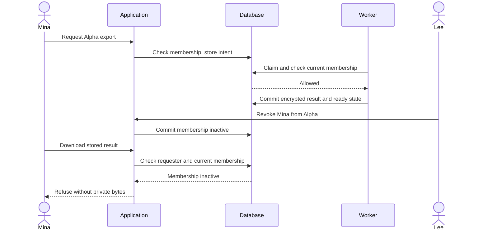

# 28. Concurrency, queues and resource limits

Two Casebook workers receive the same export request. Both look in the database and see no result. Can they still leave exactly one committed export? If Mina loses Alpha membership while the work is waiting, who stops the export from reaching her?

This chapter makes those questions testable. We will coordinate two workers, give each its own database connection, and inspect the final request, claim, encrypted artifact and nonce rows. We will also cancel a separate long-running fixture task and verify that it removes its temporary file.

You need chapter 12's assertions, chapter 15's transactions, chapter 23's current membership and requester-bound export rules, chapter 26's duplicate-event contract, and chapter 27's authenticated export storage. Mina `1` belongs to Alpha `1`. Ravi `2` belongs to Beta `2`. Lee `3` manages Alpha only. A visitor is anonymous.

By the end, you will be able to:

- Choose between threads, processes and cooperative asynchronous tasks.
- Force a dangerous check/write schedule without relying on sleeps.
- Separate Python coordination from database uniqueness and atomicity.
- Describe queue redelivery, bounded retries, backpressure and cleanup ownership.
- Apply limits at admission, execution and private-data release.

The edition targets **CPython 3.15.2** and **Django 6.1.3** for the web service. The local laboratory runs on Python 3.12 or later and reuses **cryptography 50.0.2**. It introduces a background-work model without adding a live broker or Django route. The exact executed runtime and verification gaps appear at the end.

### Starting state and files

Keep these modules unchanged:

- `examples/ch23/authorization_service.py`: trusted users/workspaces, active memberships, note `101` in Alpha, note `202` in Beta, selection validation and SQLite transaction helper `unit`.
- `examples/ch27/export_crypto.py`: `Keyring`, the 4,096-byte plaintext limit, AES-GCM record format, authenticated context, nonce ledger, permission helper and decryption helper.

The new `initialize` creates a fresh temporary database containing those tables plus export requests and result slots. Do not run this teaching initializer against an existing service database. Keys are generated only for the disposable run and never printed or saved.

Save the five Python listings below under `examples/ch28/`. Run commands from the repository root inside your learning virtual environment. Use `python3` in place of `python` if that is your environment's launcher.

Filename: `examples/ch28/requirements.txt`.

```text
cryptography==50.0.2
```

```shell
python -m pip install -r examples/ch28/requirements.txt
python -m examples.ch28.queue_demo
python -m examples.ch28.cancellation
python -m unittest -v examples.ch28.test_queue
```

The pin records the library version used here, not a permanent maintenance decision. Chapter 31 covers dependency updates and their evidence.

## 1. Threads, processes, asyncio, await and cancellation

**Concurrency** means several tasks have overlapping lifetimes. **Parallelism** means work executes at the same time. Correctness must not depend on whether the scheduler happens to run one task first.

A **thread** executes within a process and shares its memory. A **process** has a separate address space. Process workers communicate through explicit messages or shared external systems. `asyncio` schedules **coroutines**, functions declared with `async def`, as tasks within an event loop. `await` suspends a coroutine while it waits for an awaitable operation; it does not automatically make ordinary blocking code nonblocking.

**Table T28-01. Execution choices and their boundaries**

| Choice | Useful for | Shared coordination | Important limit |
| --- | --- | --- | --- |
| Threads | Overlapping blocking I/O with a supported driver | A `threading.Lock` or barrier within that process | Other processes do not share an ordinary Python thread lock |
| Processes | CPU work or isolation requirements | Messages, explicit multiprocessing tools and external state | Do not treat an inherited live database connection as each worker's connection |
| `asyncio` tasks | Many waits using cooperative async APIs | Event-loop primitives such as `asyncio.Event` | Blocking SQL, file operations or CPU loops still block that event loop |
| Database clients | Coordinating durable shared business state | Constraints, transactions and the database's concurrency protocol | Correctness depends on the actual database/schema/isolation, not the caller's Python model |

On a conventional CPython build, the **Global Interpreter Lock**, or GIL, limits simultaneous execution of Python bytecode. Optional free-threaded builds change that execution model. Neither arrangement makes a multi-step business operation atomic. A thread may wait in a database call, another process may write the same record, and the database has its own state. Do not use “Python has a GIL” as the proof for one export per request.

Our first example uses two thread workers and independent SQLite connections. The threads share only trusted configuration and a test barrier. A **barrier** waits until a fixed number of participants arrive. We use it to force both workers to finish their diagnostic read before either starts its write transaction.

### Cancellation is a request, not a rollback

`Task.cancel()` requests cancellation of an asyncio task. The task normally receives `CancelledError` at a suspension point. Cleanup belongs in `finally` blocks or context managers, and cancellation should normally propagate after cleanup. Cancelling a coroutine does not undo a committed database operation or retract bytes already sent.

A running executor thread is different. Cancelling its future or timing out while waiting does not forcibly stop that thread. An executor context may wait for running work during shutdown. Blocking work needs its own bounded operations and, where supported, a cooperative stop protocol. A hard-killed process cannot be relied on to run Python cleanup.

The second worked example will cancel at a controlled `await`, after a private partial file exists. It demonstrates cooperative cleanup, not termination of arbitrary blocking code.

## 2. Races, locks, database constraints and transaction boundaries

A **race** occurs when an outcome depends on the ordering of operations that can overlap. Here is the dangerous schedule. Each row is a step, not an implementation to copy.

**Table T28-02. Why a preliminary read is not a claim**

| Step | Worker A | Worker B | Stored result slots |
| --- | --- | --- | --- |
| 1 | Reads: no result | | 0 |
| 2 | | Reads: no result | 0 |
| 3 | Decides it should create | Decides it should create | 0 |
| 4 | Attempts database claim | Attempts database claim | Database must choose at most one claim for this request |

A `threading.Lock` can serialize cooperating threads in one process. It does not protect another independently started worker process. A database **constraint** rejects a stored state that violates a declared rule, regardless of which participating client attempted it.

The relevant business identity is a server-created export request ID. In `export_slots`, `request_id` is a non-null primary key. That means at most one slot can exist for the request. `export_id` is also unique, so one encrypted artifact cannot be linked to several requests through this table.

The processor attempts an insert with `ON CONFLICT(request_id) DO NOTHING RETURNING request_id`. A returned row means this transaction inserted the slot. No returned row means the slot already exists. It does not decide from the earlier read. The conflict target names this precise uniqueness rule; it does not suppress unrelated foreign-key, check or storage errors.

### What the transaction adds

Chapter 23's `unit(..., write=True)` opens a connection, enables foreign keys and begins `BEGIN IMMEDIATE`. SQLite serializes writers; a competing writer waits within its configured timeout or receives a busy error. Each worker opens its own connection. We do not disable the connection's same-thread check or share a live connection across threads.

The processor performs one short write unit: claim the request, check current authority, serialize a bounded selection, encrypt, link the artifact and mark the request ready. It commits those changes together. If an unexpected error occurs, the helper rolls back the unit. A duplicate sees the winner's committed slot rather than an exposed half-written result.

The claim is held within the transaction, not committed as a permanent “running” row before doing this tiny job. No network call, barrier or long wait happens inside it. This intentionally small workload makes the model practical for a local SQLite lesson. A large export should not hold a database-wide writer lock while doing expensive work; it needs a different claim/lease and publication protocol.

### Worked example 1: two observers, one committed export

Before running anything, predict the results:

1. Both workers pass the barrier after observing no result.
2. One claim inserts; the other conflicts after the winner commits.
3. The final request is ready, with one result slot, one encrypted artifact and one committed nonce pair.
4. Redelivery returns `duplicate` without changing those rows.

Which worker wins is deliberately unspecified. The test sorts the two outcome labels. “Deterministic” here means the dangerous read-before-write schedule and asserted final invariant are controlled; it does not mean the scheduler chooses the same winner.

**Listing L05. An idempotent job with a database constraint**

Filename: `examples/ch28/export_queue.py`.

```python
"""Bounded local queue laboratory; all caller identities and keyrings are trusted inputs."""
import json
import re
import sqlite3
import time

from examples.ch23.authorization_service import (
    AccessDenied, export_selection, selected_rows, unit,
)
from examples.ch27.export_crypto import (
    MAX_PLAINTEXT, authorize_record, decrypt, encrypt,
    initialize as initialize_crypto,
)

MAX_PENDING = 2
MAX_TENANT_PENDING = 1
LIFETIME = 60


class QueueFull(ValueError):
    pass


class IntentConflict(ValueError):
    pass


def initialize(database):
    initialize_crypto(database)
    with unit(database, write=True) as db:
        db.execute("""CREATE TABLE export_requests (
            id INTEGER PRIMARY KEY,
            requested_by INTEGER NOT NULL REFERENCES users(id),
            workspace_id INTEGER NOT NULL REFERENCES workspaces(id),
            client_key TEXT NOT NULL, note_ids TEXT NOT NULL,
            expires_at INTEGER NOT NULL,
            state TEXT NOT NULL CHECK(state IN ('queued','ready','denied','expired','failed')),
            error TEXT,
            UNIQUE(requested_by,workspace_id,client_key))""")
        db.execute("""CREATE TABLE export_slots (
            request_id INTEGER NOT NULL PRIMARY KEY REFERENCES export_requests(id),
            export_id INTEGER UNIQUE REFERENCES encrypted_exports(id))""")


def enqueue(database, *, user_id, workspace_id, note_ids, client_key, now):
    ids = export_selection(note_ids)
    if not isinstance(client_key, str) or re.fullmatch(r"[A-Za-z0-9_-]{1,40}", client_key) is None:
        raise ValueError("invalid_request_key")
    encoded = json.dumps(ids)
    with unit(database, write=True) as db:
        selected_rows(db, user_id=user_id, workspace_id=workspace_id, note_ids=ids)
        prior = db.execute("""SELECT * FROM export_requests
            WHERE requested_by=? AND workspace_id=? AND client_key=?""",
            (user_id, workspace_id, client_key)).fetchone()
        if prior is not None:
            if prior["note_ids"] != encoded:
                raise IntentConflict("request_key_reused_with_different_selection")
            return prior["id"]  # Retry keeps the original deadline and state.
        total = db.execute("SELECT count(*) FROM export_requests WHERE state='queued'").fetchone()[0]
        tenant = db.execute("""SELECT count(*) FROM export_requests
            WHERE state='queued' AND workspace_id=?""", (workspace_id,)).fetchone()[0]
        if total >= MAX_PENDING or tenant >= MAX_TENANT_PENDING:
            raise QueueFull("queue_full")
        return db.execute("""INSERT INTO export_requests
            (requested_by,workspace_id,client_key,note_ids,expires_at,state)
            VALUES (?,?,?,?,?,'queued')""",
            (user_id, workspace_id, client_key, encoded, now + LIFETIME)).lastrowid


def probe(database, request_id):
    # Diagnostic only. This observation is deliberately NOT used as a claim.
    with unit(database) as db:
        return db.execute("SELECT 1 FROM export_slots WHERE request_id=?", (request_id,)).fetchone() is None


def process_request(database, *, request_id, keyring, now, after_probe=None):
    missing = probe(database, request_id)  # Connection/transaction closes before the test barrier.
    if after_probe is not None:
        after_probe(missing)  # Trusted test coordination only; never run under the write lock.
    with unit(database, write=True) as db:
        row = db.execute("SELECT * FROM export_requests WHERE id=?", (request_id,)).fetchone()
        if row is None:
            raise ValueError("unknown_request")
        request = dict(row)
        if request["state"] in ("denied", "expired", "failed"):
            return request["state"]
        won = db.execute("""INSERT INTO export_slots (request_id) VALUES (?)
            ON CONFLICT(request_id) DO NOTHING RETURNING request_id""", (request_id,)).fetchone()
        if won is None:
            return "duplicate"  # The winning transaction committed slot, artifact and ready state together.
        def refuse(state, error):
            db.execute("DELETE FROM export_slots WHERE request_id=?", (request_id,))
            db.execute("UPDATE export_requests SET state=?,error=? WHERE id=?", (state, error, request_id))
            return state
        if now >= request["expires_at"]:
            return refuse("expired", "deadline_reached")
        try:
            rows = selected_rows(db, user_id=request["requested_by"], workspace_id=request["workspace_id"],
                                 note_ids=json.loads(request["note_ids"]))
        except AccessDenied:
            return refuse("denied", "access_denied")
        payload = json.dumps({"workspace_id":request["workspace_id"], "notes":rows},
                             ensure_ascii=False, separators=(",", ":")).encode("utf-8")
        if len(payload) > MAX_PLAINTEXT:
            return refuse("failed", "export_too_large")
        cursor = db.execute("""INSERT INTO encrypted_exports
            (workspace_id,requested_by,note_ids,format_version,generation,key_id,nonce,ciphertext)
            VALUES (?,?,?,1,1,?,X'',X'')""",
            (request["workspace_id"], request["requested_by"], request["note_ids"], keyring.active))
        record = dict(db.execute("SELECT * FROM encrypted_exports WHERE id=?", (cursor.lastrowid,)).fetchone())
        kid, nonce, ciphertext = encrypt(db, record, payload, keyring)
        db.execute("UPDATE encrypted_exports SET key_id=?,nonce=?,ciphertext=? WHERE id=?",
                   (kid, nonce, ciphertext, record["id"]))
        db.execute("UPDATE export_slots SET export_id=? WHERE request_id=?", (record["id"], request_id))
        db.execute("UPDATE export_requests SET state='ready',error=NULL WHERE id=?", (request_id,))
        return "created"


def download(database, *, user_id, request_id, keyring, now):
    with unit(database) as db:
        request = db.execute("SELECT * FROM export_requests WHERE id=?", (request_id,)).fetchone()
        if (request is None or user_id is None or user_id != request["requested_by"]
                or request["state"] != "ready" or now >= request["expires_at"]):
            raise AccessDenied()
        row = db.execute("""SELECT e.* FROM encrypted_exports AS e
            JOIN export_slots AS s ON s.export_id=e.id WHERE s.request_id=?""", (request_id,)).fetchone()
        if row is None:
            raise AccessDenied()
        record = dict(row)
        authorize_record(db, record, user_id)  # Fresh membership/visibility check at release.
        return decrypt(record, keyring)


def run_with_retry(operation, *, pause=time.sleep):
    # One delivery: at most three attempts. Persistent scheduling/dead-letter ownership is external.
    for attempt in range(3):
        try:
            return operation()
        except sqlite3.OperationalError as exc:
            if (getattr(exc, "sqlite_errorcode", -1) & 255) != sqlite3.SQLITE_BUSY or attempt == 2:
                raise
            pause(0.01 * (attempt + 1))


def inventory(database):
    # Privileged test snapshot, never an API or a log payload.
    with unit(database) as db:
        names = ("export_requests", "export_slots", "encrypted_exports", "used_nonces")
        return {name:[dict(row) for row in db.execute(f"SELECT * FROM {name} ORDER BY 1")]
                for name in names}
```

The `probe` observation is diagnostic. `after_probe` is trusted test instrumentation and runs after its read connection closes. It is not a request callback, external hook or authorization check.

`export_slots.export_id` is temporarily null only inside this processor's uncommitted success transaction. The processor either fills it and marks the request ready, or removes the reservation and records a terminal refusal. An unexpected exception rolls the whole unit back. The schema's uniqueness rule alone does not enforce every relationship between a ready state and an artifact: the service transaction supplies that publication protocol. Restrict direct writers and test the entire unit.

The processor reuses chapter 27's crypto helpers in its existing transaction. Calling chapter 27's standalone `create_export` here would open a separate transaction and break this unit's atomic publication. The stored format, AEAD context and key/nonce caveats remain chapter 27's; this chapter introduces no new cryptographic construction.

**Listing L28-01. Coordinate the two diagnostic reads**

Filename: `examples/ch28/two_workers.py`.

```python
from concurrent.futures import ThreadPoolExecutor
from threading import Barrier

from examples.ch28.export_queue import process_request, run_with_retry


def coordinated_workers(database, *, request_id, keyring, now):
    gate = Barrier(2, timeout=5)
    def worker():
        observations = []  # Each worker owns this list.
        def arrive(missing):
            observations.append(missing)
            gate.wait()
        # Coordinate only the first attempt; retrying must not wait for a departed peer.
        def attempt():
            hook = arrive if not observations else None
            return process_request(database, request_id=request_id, keyring=keyring, now=now, after_probe=hook)
        outcome = run_with_retry(attempt)
        return observations[0], outcome
    with ThreadPoolExecutor(max_workers=2) as pool:
        futures = [pool.submit(worker) for _ in range(2)]
        return [future.result(timeout=10) for future in futures]
```

`ThreadPoolExecutor(max_workers=2)` schedules two calls. `submit` returns a future, and `result` propagates its outcome or exception to the caller. Each worker owns its observations list. The barrier releases both only after their first observations are complete.

A retry does not re-enter the barrier: its peer may already have finished. Both barrier and future waits have failure guards. These guards help report a broken test; a future timeout is not a mechanism for killing a worker. The underlying local SQL operations have their own connection timeout.

**Table T28-03. Python, database and application guarantees**

| Mechanism | What it supplies here | What it does not supply |
| --- | --- | --- |
| Python barrier | Both diagnostic reads finish before either write attempt | A unique result, durable ownership or a fair winner |
| Python executor/futures | Two scheduled calls; wait for and collect their results/errors | A transaction or a stop signal for an already running thread |
| Primary key on `export_slots.request_id` | At most one stored claim for a particular request in this database | Successful completion or permission to read the result |
| Unique requester/workspace/client key | At most one stored request under that retry identity | Equality of two different selections; application code checks that |
| SQLite transaction | Claim, encrypted row, nonce reservation, link and ready update commit together through this processor | Atomicity with an external email, broker acknowledgement or HTTP publication |
| Application authorization | Current active membership, selected-note visibility and requester-bound release | Already disclosed plaintext recall or cross-system exactly-once effects |

A transaction without the business uniqueness constraint is insufficient if code blindly inserts a new claim each time. A negative-control test removes only request-slot uniqueness and runs two serialized claim inserts after the same coordinated reads. Both claims commit. That test is isolated: it does not run the export pipeline against its deliberately broken table.

### Inspect the complete trace

**Listing L28-02. Two-worker success, redelivery and revoked release**

Filename: `examples/ch28/queue_demo.py`.

```python
import json
from pathlib import Path
from tempfile import TemporaryDirectory

from cryptography.hazmat.primitives.ciphers.aead import AESGCM
from examples.ch23.authorization_service import AccessDenied, revoke_member
from examples.ch27.export_crypto import Keyring
from examples.ch28.export_queue import download, enqueue, initialize, inventory, process_request
from examples.ch28.two_workers import coordinated_workers

NOW = 1795683600  # Controlled service clock, not supplied by an API caller.

with TemporaryDirectory(prefix="casebook-queue-") as folder:
    database = Path(folder)/"jobs.sqlite3"
    initialize(database)
    keys = Keyring({"export-demo":AESGCM.generate_key(bit_length=256)}, "export-demo")
    request = enqueue(database, user_id=1, workspace_id=1, note_ids=[101], client_key="mina-001", now=NOW)
    outcomes = coordinated_workers(database, request_id=request, keyring=keys, now=NOW)
    print("both observed no result:", all(missing for missing, _ in outcomes))
    print("worker outcomes:", sorted(result for _, result in outcomes))
    stored = inventory(database)
    print("request state:", stored["export_requests"][0]["state"])
    print("slots, artifacts, nonces:", *(len(stored[name]) for name in ("export_slots","encrypted_exports","used_nonces")))
    repeat = enqueue(database, user_id=1, workspace_id=1, note_ids=[101], client_key="mina-001", now=NOW+1)
    print("same request ID on retry:", repeat == request)
    print("redelivery:", process_request(database, request_id=request, keyring=keys, now=NOW+1))
    print("redelivery leaves rows unchanged:", inventory(database) == stored)
    document = json.loads(download(database, user_id=1, request_id=request, keyring=keys, now=NOW+1))
    print("Mina export workspace:", document["workspace_id"])
    try:
        download(database, user_id=2, request_id=request, keyring=keys, now=NOW+1)
    except AccessDenied:
        print("Ravi Alpha download: denied")
    revoke_member(database, actor_id=3, workspace_id=1, target_user_id=1)
    try:
        download(database, user_id=1, request_id=request, keyring=keys, now=NOW+2)
    except AccessDenied:
        print("Mina after revocation: denied")
    print("release refusal leaves job/artifact rows unchanged:", inventory(database) == stored)
```

Run `python -m examples.ch28.queue_demo`.

Expected output, also observed locally:

```text
both observed no result: True
worker outcomes: ['created', 'duplicate']
request state: ready
slots, artifacts, nonces: 1 1 1
same request ID on retry: True
redelivery: duplicate
redelivery leaves rows unchanged: True
Mina export workspace: 1
Ravi Alpha download: denied
Mina after revocation: denied
release refusal leaves job/artifact rows unchanged: True
```

Nonce and ciphertext bytes differ across runs. They are compared in private in-memory snapshots and not printed. The complete job/artifact/nonce snapshot stays equal after redelivery and after a refused release. The membership table intentionally changes when Lee revokes Mina; it is not part of that unchanged-result claim.

**Table T28-04. Final stored state, including failure branches**

| Scenario | Request state | Slots / encrypted artifacts / nonce pairs | Release decision |
| --- | --- | --- | --- |
| Newly admitted Mina request | queued | 0 / 0 / 0 | Not ready |
| Two workers finish normally | ready | 1 / 1 / 1 | Mina allowed while active; Ravi/anonymous/Lee refused |
| Same request delivered again | ready, original deadline | Exactly unchanged: 1 / 1 / 1 | Must still check current permission |
| Lee revokes Mina after generation | ready; membership separately inactive | Exactly unchanged: 1 / 1 / 1 | Mina refused on next request |
| Separate test: revoke before processing | denied, `access_denied` | 0 / 0 / 0 | No private output |
| Separate test: queued request reaches its deadline | expired, `deadline_reached` | 0 / 0 / 0 | No private output |
| Separate test: 4,097-byte plaintext | failed, `export_too_large` | 0 / 0 / 0 | No private output |
| Separate test: SQL trigger aborts ready update | Original queued row restored | 0 / 0 / 0; no partial commit | A later deliberate retry can create one result |

Counts summarize the ledger; the tests compare complete stored rows on rollback and duplicate paths. The failure trigger aborts the ready-state SQL update after artifact/link work was attempted. It is not a simulation of power loss or an I/O failure inside the database's commit implementation.

## 3. Queues, retries, idempotency and backpressure

A **queue** separates accepting work from executing it. It can smooth a burst, but it also creates stored work that may be delayed, repeated or abandoned. A queue does not make the underlying operation safe to repeat.

The durable work record here is `export_requests`. The demo directly delivers its integer ID to two workers to model duplicate delivery. A real dispatcher must find committed queued rows and schedule them. A real broker is not included. The enqueue transaction does not also publish an external message, so there is no claim that database commit and broker delivery are atomic. A durable outbox or a database-polling dispatcher can address that boundary under its own tested protocol.

The worker loads requester, workspace, selection, deadline and state from the trusted database. A message must not replace them with caller-supplied user IDs, roles, paths, key locations or plaintext. The dispatcher needs authenticated access, strict message decoding and a narrow service identity even if its payload is only an integer.

### Idempotency is about a named effect

An operation is **idempotent** when repeating the same intent does not add another business effect. Here the named effect is one committed encrypted artifact linked to one request. The request's retry key is scoped to requester and workspace. Reusing it with the same normalized selected IDs returns the same request and original expiry. Reusing it with a different valid selection raises `IntentConflict`.

The request records selected IDs, not a snapshot of note bodies. This contract exports their current visible contents when the worker processes them. If the product requires an exact historical selection, it needs an explicit version/snapshot contract and corresponding authenticated storage metadata. Do not silently infer that promise from an idempotency key.

This is an **at-most-one committed result** invariant for this local processor. It is not a guarantee that every admitted job eventually completes. Repeating execution after rollback is allowed. A successful commit followed by a lost acknowledgement leads to a duplicate result on redelivery. An external side effect would need its own idempotency identity or durable publication protocol.

### A bounded retry rule

A **retry** repeats an attempt after a failure. Classify the failure before retrying. `run_with_retry` retries only SQLite `SQLITE_BUSY`, including its extended-code family. It restarts the complete operation after the failed transaction has closed. It performs at most three attempts for one delivery, with waits of 0.01 and 0.02 seconds. It does not treat every `OperationalError` as temporary.

An integrity error, an unknown request or authentication failure is not silently retried. `denied`, `expired`, `failed` and `duplicate` are ordinary processor outcomes, not busy errors. On exhausted busy retries, the exception propagates; this local program has no automatic requeue loop. Tests inject retry errors and replace the pause function, so they do not rely on sleeping to produce contention.

A deployed scheduler must own a persistent delivery budget, expiry, retry timing and final parking/dead-letter policy. **Backoff** spreads repeated attempts over time; **jitter** varies that delay so many workers do not retry together. A three-attempt helper is not a lifetime limit if a broker redelivers the message forever. This example uses neither a real broker nor durable attempt counters and therefore makes no such guarantee.

For long-running work, a **lease** can represent temporary ownership. A stale worker may continue after its lease expires, so publication needs a generation/ownership check, sometimes called a fencing token. The short transaction here needs no long-lived lease. Do not extend it to minutes of network or file work without changing the protocol.

### Permission can change while work waits

A queued request is not a permanent access grant. The processor checks current membership and selected-note visibility before creating the copy. The release path checks again before decryption and returning bytes. Revocation after generation therefore still blocks a later download.

**Figure F04. A queued export with a permission change before delivery**



The diagram shows revocation after the worker finishes and before a new release request begins. A separate test revokes while the request is still queued and verifies that no artifact is created. Checks observe the transaction's current snapshot. They do not recall a download already returned, cancel all in-flight readers instantly or establish a protocol for a long streamed response. That later release boundary must have its own explicit policy.

### Worked example 2: cancel a long-running fixture and inspect cleanup

**Backpressure** means limiting incoming work when downstream capacity is exhausted, by waiting within a bound or refusing admission. The next example uses an in-memory `asyncio.Queue(maxsize=1)`. Its second `put_nowait` raises `QueueFull`. This queue belongs to one event loop; it is not a thread-safe broker or durable database queue.

Predict the state at each step:

1. One integer ID is queued; the second is refused.
2. The task gets the ID, creates a private directory and writes a small synthetic partial file.
3. It signals `started`, then waits on an unreleased event.
4. The supervisor cancels and awaits the task.
5. The task's context manager removes the directory; `finally` accounts for the consumed item.

**Listing L28-03. Event-controlled cancellation and cleanup**

Filename: `examples/ch28/cancellation.py`.

```python
import asyncio
from pathlib import Path
from tempfile import TemporaryDirectory


async def fixture_worker(queue, root, started, release):
    request_id = await queue.get()
    try:
        # The task owns its private directory and closes its file before the suspension point.
        with TemporaryDirectory(prefix="partial-", dir=root) as folder:
            with (Path(folder)/"part.bin").open("wb") as stream:
                stream.write(b"synthetic fixture only\n")
            started.set()
            await release.wait()  # Controlled long wait; no timing-based sleep.
            return request_id
    finally:
        queue.task_done()  # Accounting for this get, not a success acknowledgement.


async def cancellation_case():
    with TemporaryDirectory(prefix="casebook-cancel-") as root:
        queue = asyncio.Queue(maxsize=1)
        queue.put_nowait(1)  # Only a stored request ID belongs on the queue.
        try:
            queue.put_nowait(2)
        except asyncio.QueueFull:
            backpressure = True
        else:
            backpressure = False
        started, release = asyncio.Event(), asyncio.Event()
        task = asyncio.create_task(fixture_worker(queue, root, started, release))
        cancelled = False
        try:
            async with asyncio.timeout(2):
                await started.wait()
            partial_exists = any(Path(root).iterdir())
            task.cancel()
            try:
                await task
            except asyncio.CancelledError:
                cancelled = True
            async with asyncio.timeout(2):
                await queue.join()
            return {"backpressure":backpressure, "partial_exists":partial_exists,
                    "cancelled":cancelled, "remaining_files":len(list(Path(root).iterdir())),
                    "queued_ids":queue.qsize()}
        finally:
            if not task.done():
                task.cancel()
                try:
                    await task
                except asyncio.CancelledError:
                    pass


if __name__ == "__main__":
    for name, value in asyncio.run(cancellation_case()).items():
        print(name + ":", value)
```

Run `python -m examples.ch28.cancellation`.

Expected output, also observed locally:

```text
backpressure: True
partial_exists: True
cancelled: True
remaining_files: 0
queued_ids: 0
```

`asyncio.create_task` schedules the coroutine. `started` proves the file exists before the cancellation request; the test does not guess a sleep interval. The two-second timeouts are watchdogs for a broken handshake, not the trigger for the successful cancellation scenario.

The worker does not catch and swallow `CancelledError`. Its directory context and `finally` run during unwinding. The supervisor observes cancellation and waits until cleanup finishes. The file is closed before the controlled suspension point. These tiny synchronous fixture writes are not a general nonblocking file-I/O implementation.

`task_done` belongs only to a successfully retrieved item, so `get` is outside the `try`. `queue.join` then observes balanced local accounting. That is not a business-success acknowledgement: this task was cancelled, and the item is no longer in the in-memory queue. A real durable request must remain eligible for a separately bounded recovery/retry decision. This fixture deliberately does not mutate the database export state machine or pretend that queue accounting is a broker ACK.

**Table T28-05. Cleanup owners**

| Resource/state | Owner in this laboratory | Required additional owner for deployment |
| --- | --- | --- |
| Database connection/transaction | `unit` context manager in the calling worker | Service shutdown, database recovery and operational reconciliation |
| Uncommitted claim/artifact/nonce changes | Transaction rollback on unexpected error | Crash/restore tests under the deployed database and storage setup |
| Fixture partial directory/file | Task's `TemporaryDirectory` context; supervisor awaits task exit | Restricted temporary storage plus a safe abandoned-file sweeper after hard crashes |
| Retrieved asyncio item | Worker calls `task_done` once | Durable work scheduler decides retry/parking; local accounting cannot substitute |
| Expired requests and retained ciphertext | No automatic deletion in this lab | Storage lifecycle owner with retention, deduplication and key/nonce-history policy |

Do not use user-supplied paths for cleanup. A crash sweeper must distinguish abandoned work from a live owner's files and remain confined to service-controlled storage. Cancellation of an asyncio wrapper around a running thread does not automatically transfer ownership or stop the thread from writing.

## 4. Limits on time, bytes, parallel work and requests per tenant

A correct duplicate rule does not prevent overload. Apply a budget where the resource is consumed. A limit on queue length does not cap artifact storage; a plaintext byte cap does not limit every earlier allocation.

**Table T28-06. Concrete budgets and their scope**

| Resource | Local value/check | Boundary and remaining limit |
| --- | --- | --- |
| Selected notes | 1–10 distinct positive IDs | Reuses chapter 23's selection contract; not a general database size limit |
| Export plaintext | At most 4,096 UTF-8 bytes | Checked before artifact encryption; JSON/selected rows are already materialized |
| Pending requests globally | At most 2 queued rows | Count and insert share `BEGIN IMMEDIATE`; not a requests-per-second limit |
| Pending requests per workspace | At most 1 queued row | Prevents one workspace taking both pending slots; not total disk or tenant billing quota |
| Active workers in coordinator | 2 | Bounds this executor; multiple processes/replicas need a shared capacity policy |
| Request lifetime | 60 seconds; refuse at `now >= expires_at` | Admission/processing/release checks using trusted service time; does not interrupt blocking work |
| SQLite lock wait | 2 seconds per connection operation under chapter 23's helper | Busy timeout, not a whole-job execution deadline |
| Busy retries per delivery | 3 attempts, 2 small waits | No automatic requeue after exhaustion; persistent scheduling budget unimplemented |
| Async fixture queue | 1 ID | In-memory backpressure only |
| Test handshake waits | Barrier 5 seconds, future 10 seconds, async watchdog 2 seconds | Failure guards; not proof that arbitrary work can be forcibly cancelled |

The `now` arguments are controlled service-clock samples, never accepted from an API caller. Tests use `1795683600` and explicit offsets. A deployment must sample its trusted clock at the actual decision boundary and account for lock/queue delays. The fixed samples in this lab are not a strict wall-clock deadline enforcement mechanism. Use a monotonic clock for elapsed-work budgets and a reviewed wall-clock policy for stored expiry.

The boundary test sets a fictional non-English title, then constructs an export of exactly 4,096 UTF-8 bytes and one of 4,097 bytes. It calculates the serialized size rather than counting characters. At the boundary, the artifact decrypts to 4,096 bytes. One byte over creates a terminal failed request with no result slot, ciphertext row or nonce reservation.

A queued record that has expired but has not been processed still counts toward the conservative admission limit. No timer silently deletes or changes it. Production dispatch/cleanup must own expiry transitions and retention. Ready artifacts also remain stored after the download deadline. Expiry is refusal to release, not deletion.

A complete service additionally needs total ciphertext/temp-storage quotas, per-tenant request-rate limits, bounded dispatcher batches, connection-pool limits, fair scheduling and controlled overflow responses. Measure database/CPU time as well as wall time. An unbounded task list in front of a bounded semaphore can still exhaust memory. Do not claim those controls from this two-thread executor or its pending-row counts.

The encrypted-record nonce history follows chapter 27's retention and restore rules. Deleting an expired artifact does not automatically justify deleting its used-nonce history while its key can still be used. A storage cleanup procedure must account for foreign-key ordering, request retry retention, backups and key lifecycle together. It must also prevent an old queued ID from being reused for a different request; this lab never deletes requests or reuses their identities.

## Repeatable tests and evidence

**Listing L28-04. Deterministic schedule, rollback, permissions and cleanup**

Filename: `examples/ch28/test_queue.py`.

```python
import asyncio
import json
from pathlib import Path
import sqlite3
from tempfile import TemporaryDirectory
import unittest
from unittest.mock import patch

from cryptography.hazmat.primitives.ciphers.aead import AESGCM
from examples.ch23.authorization_service import AccessDenied, build_export, revoke_member, unit
from examples.ch27.export_crypto import Keyring, MAX_PLAINTEXT
from examples.ch28.cancellation import cancellation_case
from examples.ch28.export_queue import (
    IntentConflict, QueueFull, download, enqueue, initialize, inventory,
    process_request, run_with_retry,
)
from examples.ch28.two_workers import coordinated_workers
from concurrent.futures import ThreadPoolExecutor
from threading import Barrier

NOW = 1795683600


class QueueTests(unittest.TestCase):
    def setUp(self):
        self.folder = TemporaryDirectory(prefix="casebook-queue-test-")
        self.addCleanup(self.folder.cleanup)
        self.db = Path(self.folder.name)/"jobs.sqlite3"
        initialize(self.db)
        self.keys = Keyring({"export-test":AESGCM.generate_key(bit_length=256)}, "export-test")

    def submit(self, **changes):
        values = dict(user_id=1, workspace_id=1, note_ids=[101], client_key="mina-001", now=NOW)
        return enqueue(self.db, **(values | changes))

    def process(self, request_id, **changes):
        return process_request(self.db, **(dict(request_id=request_id, keyring=self.keys, now=NOW) | changes))

    def read(self, request_id, **changes):
        return download(self.db, **(dict(user_id=1, request_id=request_id, keyring=self.keys, now=NOW) | changes))

    def test_two_workers_one_committed_export_and_stable_redelivery(self):
        request = self.submit()
        results = coordinated_workers(self.db, request_id=request, keyring=self.keys, now=NOW)
        self.assertEqual([missing for missing, _ in results], [True, True])
        self.assertEqual(sorted(outcome for _, outcome in results), ["created", "duplicate"])
        saved = inventory(self.db)
        self.assertEqual(saved["export_requests"][0]["state"], "ready")
        self.assertEqual([len(saved[name]) for name in ("export_slots","encrypted_exports","used_nonces")], [1,1,1])
        self.assertEqual(self.submit(now=NOW+1), request)
        self.assertEqual(self.process(request, now=NOW+1), "duplicate")
        self.assertEqual(inventory(self.db), saved)
        self.assertEqual(json.loads(self.read(request))["workspace_id"], 1)

    def test_constraint_negative_control_same_schedule_allows_two_claims(self):
        # Deliberately broken isolated claim fixture; never run the export pipeline on it.
        with unit(self.db, write=True) as db:
            db.execute("DROP TABLE export_slots")
            db.execute("""CREATE TABLE export_slots (
                request_id INTEGER NOT NULL REFERENCES export_requests(id),
                export_id INTEGER UNIQUE REFERENCES encrypted_exports(id))""")
        request = self.submit()
        gate = Barrier(2, timeout=5)
        def claim_only():
            with unit(self.db) as db:
                missing = db.execute("SELECT 1 FROM export_slots WHERE request_id=?", (request,)).fetchone() is None
            gate.wait()
            with unit(self.db, write=True) as db:
                db.execute("INSERT INTO export_slots (request_id) VALUES (?)", (request,))
            return missing
        with ThreadPoolExecutor(max_workers=2) as pool:
            futures = [pool.submit(claim_only) for _ in range(2)]
            self.assertEqual([future.result(timeout=10) for future in futures], [True,True])
        self.assertEqual(len(inventory(self.db)["export_slots"]), 2)

    def test_revoked_while_queued_creates_no_artifact(self):
        request = self.submit()
        revoke_member(self.db, actor_id=3, workspace_id=1, target_user_id=1)
        self.assertEqual(self.process(request), "denied")
        saved = inventory(self.db)
        self.assertEqual(saved["export_requests"][0]["error"], "access_denied")
        for name in ("export_slots","encrypted_exports","used_nonces"):
            self.assertEqual(saved[name], [])
        self.assertEqual(self.process(request), "denied")
        self.assertEqual(inventory(self.db), saved)
        with self.assertRaises(AccessDenied): self.read(request)

    def test_release_rechecks_membership_requester_and_expiry(self):
        request = self.submit()
        self.process(request)
        self.assertEqual(json.loads(self.read(request, now=NOW+59))["notes"][0]["id"], 101)
        saved = inventory(self.db)
        for user in (None,2,3):
            with self.assertRaises(AccessDenied): self.read(request, user_id=user)
        with self.assertRaises(AccessDenied): self.read(request, now=NOW+60)
        revoke_member(self.db, actor_id=3, workspace_id=1, target_user_id=1)
        with self.assertRaises(AccessDenied): self.read(request, now=NOW+1)
        self.assertEqual(inventory(self.db), saved)

    def test_expired_queued_request_is_terminal_without_output(self):
        request = self.submit()
        self.assertEqual(self.process(request, now=NOW+60), "expired")
        saved = inventory(self.db)
        self.assertEqual(saved["export_requests"][0]["state"], "expired")
        for name in ("export_slots","encrypted_exports","used_nonces"):
            self.assertEqual(saved[name], [])
        self.assertEqual(self.process(request, now=NOW+61), "expired")
        self.assertEqual(inventory(self.db), saved)

    def test_failed_ready_write_rolls_back_claim_ciphertext_and_nonce_then_retry_succeeds(self):
        request = self.submit()
        with unit(self.db, write=True) as db:
            db.execute("""CREATE TRIGGER fail_ready BEFORE UPDATE OF state ON export_requests
                WHEN NEW.state='ready' BEGIN SELECT RAISE(ABORT,'synthetic commit-unit failure'); END""")
        before = inventory(self.db)
        with self.assertRaises(sqlite3.IntegrityError): self.process(request)
        self.assertEqual(inventory(self.db), before)
        with unit(self.db, write=True) as db: db.execute("DROP TRIGGER fail_ready")
        self.assertEqual(self.process(request), "created")
        self.assertEqual(self.process(request), "duplicate")
        self.assertEqual(len(inventory(self.db)["encrypted_exports"]), 1)

    def test_admission_limits_scope_and_request_key_conflict(self):
        request = self.submit()
        before = inventory(self.db)
        with self.assertRaises(QueueFull): self.submit(client_key="mina-002")
        with self.assertRaises(AccessDenied): self.submit(user_id=2)
        with self.assertRaises(AccessDenied): self.submit(user_id=None)
        self.assertEqual(inventory(self.db), before)
        self.assertEqual(self.submit(), request)  # Retries do not consume another slot.
        with patch("examples.ch28.export_queue.MAX_PENDING", 1):
            with self.assertRaises(QueueFull):
                self.submit(user_id=2, workspace_id=2, note_ids=[202], client_key="ravi-001")
        beta = self.submit(user_id=2, workspace_id=2, note_ids=[202], client_key="ravi-001")
        self.assertNotEqual(beta, request)
        with unit(self.db, write=True) as db:
            db.execute("""INSERT INTO notes SELECT 102,workspace_id,owner_id,title,body,state,version,updated_by
                FROM notes WHERE id=101""")
        before = inventory(self.db)
        with self.assertRaises(IntentConflict): self.submit(note_ids=[101,102])
        self.assertEqual(inventory(self.db), before)

    def test_exact_byte_limit_and_one_byte_over(self):
        for extra in (0,1):
            with self.subTest(extra=extra):
                path = Path(self.folder.name)/f"limit-{extra}.sqlite3"
                initialize(path)
                with unit(path, write=True) as db:
                    db.execute("UPDATE notes SET title=?,body='' WHERE id=101", ("یادداشت آلفا",))
                base = len(build_export(path, user_id=1, workspace_id=1, note_ids=[101]).payload)
                with unit(path, write=True) as db:
                    db.execute("UPDATE notes SET body=? WHERE id=101", ("x"*(MAX_PLAINTEXT-base+extra),))
                request = enqueue(path, user_id=1, workspace_id=1, note_ids=[101], client_key="boundary", now=NOW)
                outcome = process_request(path, request_id=request, keyring=self.keys, now=NOW)
                saved = inventory(path)
                if extra == 0:
                    self.assertEqual(outcome, "created")
                    self.assertEqual(len(download(path, user_id=1, request_id=request, keyring=self.keys, now=NOW)), 4096)
                else:
                    self.assertEqual(outcome, "failed")
                    self.assertEqual(saved["export_requests"][0]["error"], "export_too_large")
                    for name in ("export_slots","encrypted_exports","used_nonces"):
                        self.assertEqual(saved[name], [])

    def test_bounded_busy_retry_does_not_retry_other_failures(self):
        pauses, calls = [], []
        def busy():
            calls.append(1)
            exc = sqlite3.OperationalError("synthetic busy")
            exc.sqlite_errorcode = sqlite3.SQLITE_BUSY
            raise exc
        with self.assertRaises(sqlite3.OperationalError): run_with_retry(busy, pause=pauses.append)
        self.assertEqual((len(calls), pauses), (3,[0.01,0.02]))
        def other():
            exc = sqlite3.OperationalError("synthetic nonbusy")
            exc.sqlite_errorcode = sqlite3.SQLITE_ERROR
            raise exc
        with self.assertRaises(sqlite3.OperationalError): run_with_retry(other, pause=pauses.append)
        self.assertEqual(pauses, [0.01,0.02])
        outcomes = iter([busy, lambda:"created"])
        self.assertEqual(run_with_retry(lambda:next(outcomes)(), pause=lambda _:None), "created")

    def test_cancelled_fixture_cleans_files_and_queue_accounting(self):
        self.assertEqual(asyncio.run(cancellation_case()), {
            "backpressure":True, "partial_exists":True, "cancelled":True,
            "remaining_files":0, "queued_ids":0,
        })


if __name__ == "__main__":
    unittest.main()
```

Run `python -m unittest -v examples.ch28.test_queue`.

Expected and observed locally: **ten passing test methods**, ending in `OK`.

The positive concurrency test verifies both missing-result observations, both outcomes and full unchanged rows on redelivery. The negative control makes two claim inserts under the same schedule with uniqueness removed. It proves Python coordination and serialized writes are not themselves the uniqueness rule; it is not a suggested schema migration.

The ready-update trigger verifies that reservation, ciphertext, link and nonce history do not partially commit. Removing the test trigger and deliberately retrying succeeds once. Permission tests cover refusal at admission, revocation while queued, permitted release, another workspace, anonymous access, another requester and revocation after generation. Deadline and byte-boundary checks inspect terminal state and absent outputs.

The busy test injects specific SQLite error codes. It proves retry classification and the local attempt cap, not a real busy-timeout measurement. The two-worker run uses actual separate SQLite connections and the actual uniqueness constraint. The cancellation test checks both a file existing before cancellation and an empty directory afterward; an observed exception alone would not establish cleanup.

## Guided lab: trace a request from admission to release

1. Preserve the two dependency modules and save all five Python files plus requirements at their paths. Record Python, SQLite and cryptography versions.
2. Write the identity of one request: Mina, Alpha, selected note `[101]`, client retry key and original expiry. Identify which values come from authentication/trusted storage.
3. Predict the two workers' observations and outcomes. Run the coordinator. Verify that both diagnostic transactions close before the barrier and that no write lock is held while waiting there.
4. Inspect the primary key and the targeted insert. Explain why the worker never uses the preliminary observation to authorize creation.
5. Compare full stored rows after a successful result and a redelivery. Confirm one slot, artifact and nonce pair, not just two successful function returns.
6. Read the negative control. Explain why two serial claim inserts can both succeed without request uniqueness. Keep its broken table confined to its disposable test.
7. Abort the ready update through the trigger. Confirm the original queued request and empty output tables after rollback. Remove the trigger and perform one deliberate retry.
8. Revoke Mina first while queued, then in a separate run after generation. Check terminal denied/no-output in the first case and ready-but-unreleasable in the second.
9. Exercise exactly 4,096 and 4,097 bytes, the exact expiry boundary, tenant/global pending capacity and changed-intent request-key reuse. Record state as well as exceptions.
10. Cancel the fixture only after `started`. Verify propagated cancellation, zero remaining files and balanced local queue accounting. Name who must recover a durable cancelled job.
11. Write the retry and cleanup ownership note. Mark the unimplemented broker, process-crash, deployment-rate and retention controls separately from local observations.

## Independent practice

### Exercise 1: put a lock around it

A reviewer adds `threading.Lock` around a read-then-create operation and removes the database uniqueness constraint. The service later starts a second process. What does the lock still protect? Which stored business rule has lost its shared enforcement?

### Exercise 2: a barrier inside the transaction

Move the test barrier to after `BEGIN IMMEDIATE`. Worker A enters and waits at the barrier. Worker B tries to enter its write transaction before reaching that barrier. Explain why this can stall or fail instead of producing the intended schedule. Where should the coordination point be?

### Exercise 3: two kinds of failure

The encrypted row is inserted, then the ready update fails. On another run, ready commits but the worker loses its acknowledgement. Predict final request/slot/artifact/nonce state in both cases and the result of a later delivery.

### Exercise 4: cancellation and acknowledgement

The coroutine wrapper around a running thread is cancelled. The supervisor deletes the thread's temporary directory and marks the durable job complete because `queue.join` returned. Identify the mistaken assumptions about stopping work, file ownership and business acknowledgement.

### Exercise 5: capacity and privacy

The queue has two pending slots, but one tenant can submit requests continuously and completed exports are never deleted. Mina's artifact is ready when Lee revokes her. Which controls address admission fairness, total storage and release permission? Does the 60-second expiry remove the ciphertext?

### Practice check

Write a deterministic two-worker test for one export per request. Name the database guarantee, the worker retry rule and the cleanup owner.

### Part checkpoint

Justify a storage limit, a destination policy, a key choice and a retry rule.

## Hints

- A Python object's scope and a database constraint's scope differ.
- Force the observation order without holding the resource the other participant needs.
- Distinguish “attempted,” “committed,” “acknowledged” and “released.”
- A queue item can be accounted for even when its business operation failed or was cancelled.
- State whether a limit counts pending jobs, active work, bytes retained or requests over time.

## Worked answers

### Exercise 1

The lock protects threads that share and obey that particular lock object. A separately started process does not share an ordinary `threading.Lock`. Removing request uniqueness removes the database-enforced at-most-one claim rule. Keep a constraint on the actual business identity and use a transaction that publishes the artifact and state together. Even a single-process implementation should not rely on incidental scheduling for that invariant.

### Exercise 2

A holds the write transaction while waiting for B. B cannot acquire that write transaction and therefore cannot reach the barrier. The barrier's timeout or database busy timeout may break the test. Coordinate after both short diagnostic read transactions have closed and before either write transaction begins. A test-induced deadlock is not evidence of successful duplicate protection.

### Exercise 3

The SQL-trigger failure propagates and rolls back the local unit. The request remains queued and no slot, artifact or nonce pair commits; a later deliberate retry can create one. If ready commits but acknowledgement is lost, ready plus one slot/artifact/nonce pair remain. A later delivery hits the request-slot constraint and returns `duplicate` with exactly unchanged rows. No case requires a second encrypted artifact for the same request.

### Exercise 4

Cancellation of a wrapper does not forcibly stop its running thread. The thread may still write, so deleting its directory races with the resource owner. Local `task_done`/`join` accounting is not a durable success decision. The supervisor must coordinate actual thread completion/cleanup or use another reviewed execution boundary, and the durable scheduler must decide bounded retry or parking from committed state. A hard crash also needs a separate abandoned-resource recovery owner.

### Exercise 5

Pending capacity, tenant admission/rate policy and fair scheduling address different overload paths. The example enforces one pending request per workspace and two globally, but no time-window request rate or total artifact-storage quota. A storage lifecycle owner must enforce retained-byte and expiry/deletion policy. The release path independently checks Mina's current membership and refuses her after revocation. The 60-second expiry blocks release at the boundary; it does not delete the ciphertext or revoke a copy already downloaded.

### Practice check

Use `coordinated_workers` to force both closed diagnostic reads to report no result before either transaction writes. Assert sorted outcomes `created`/`duplicate`, request state ready, one slot/artifact/nonce pair and complete unchanged rows after redelivery.

The database primary key supplies one stored claim per request; the processor's transaction couples the artifact and ready state to that claim. Python supplies the barrier, task execution and result collection. The local retry rule retries only busy errors up to three attempts, then propagates without automatic requeue. `unit` owns transaction/connection cleanup; the fixture task owns its temporary directory, and its supervisor waits for cleanup. A deployed scheduler and storage lifecycle owner must handle durable recovery, abandoned resources and retention.

### Part checkpoint

The 4,096-byte plaintext limit keeps this example's encrypted record small and makes its boundary test explicit, while leaving earlier JSON materialization and retained storage as separate budgets. Chapter 26's fixed partner registry and no-redirect contract constrain destination intent, with actual connection-time egress enforcement still required. Chapter 27's HMAC-SHA-256 authenticates partner bytes and AES-GCM protects the stored export, using separate keys and reviewed nonce rules. This chapter's targeted busy retry preserves request identity and uses a bounded local attempt budget; neither it nor uniqueness promises universal exactly-once effects.

## Verification record

Both demonstrations and all **ten test methods** ran on macOS with **CPython 3.12.14**, **SQLite 3.53.1** and **cryptography 50.0.2**. All passed. Both output blocks matched their demonstrations. Python listings were syntax-checked and compared with companion files.

The workers used an actual temporary SQLite file and separate connections, with a barrier forcing both no-result observations before either write. Observed cases include one committed result, unchanged redelivery, a deliberately broken claim schema allowing two claims, queued revocation, post-generation release revocation, other-requester/cross-workspace/anonymous refusal, exact expiry, ready-update rollback and successful later retry, capacity refusal, request-key conflict, exact byte boundary/overflow, injected busy/nonbusy retry rules and event-controlled cancellation with no remaining files.

**Not executed:** CPython 3.15.2, free-threaded builds, multiple OS-process workers, Django integration, a live broker/outbox, real busy-timeout timing, process termination/power loss, long-lived leases, distributed fencing, external side effects, strict preemptive deadlines, rate limiting, total retained-storage quotas, automatic expiry/deletion, crash sweepers, backup restore or production key custody. The crypto layer retains chapter 27's stated nonce/restore limits. These local tests do not establish a deployment's crash durability, eventual completion or end-to-end exactly-once delivery.

## What you can now explain

Python can coordinate a test and schedule its workers. A database constraint enforces the shared business identity, and a transaction makes the modeled publication one local unit. Retries need a named effect and a bounded failure policy. Cancellation needs a resource owner, and pending-work limits do not replace storage or request-rate budgets. Private exports still require current permission at release.

Keep the request/slot schema, worker processor, coordinated test, cancellation fixture and explicit verification gaps. Chapter 29 can review changes against these concrete invariants: one committed result per request, current requester/workspace authorization, bounded resources and observable final state after failure. The next chapter starts with these files and their passing test report, then examines supplied changes and static findings.

## Primary sources

- Python's [`threading` reference](https://docs.python.org/3/library/threading.html) describes threads, locks, barriers and interpreter execution considerations. The [`concurrent.futures` reference](https://docs.python.org/3/library/concurrent.futures.html) documents executor scheduling, result waiting, cancellation and shutdown behavior.
- Python's [coroutines and tasks reference](https://docs.python.org/3/library/asyncio-task.html) documents `async def`, `await`, task cancellation and timeouts. Its [asyncio queues reference](https://docs.python.org/3/library/asyncio-queue.html) documents bounded queues, `QueueFull` and `task_done`/`join`; these are local queue semantics, not a durable broker acknowledgement protocol.
- SQLite's [transaction documentation](https://www.sqlite.org/lang_transaction.html), [isolation documentation](https://www.sqlite.org/isolation.html), [UPSERT documentation](https://www.sqlite.org/lang_upsert.html) and [conflict-resolution documentation](https://www.sqlite.org/lang_conflict.html) describe writer serialization, transaction visibility and targeted uniqueness conflicts. Verify equivalent behavior separately when changing databases.
- Python's [`sqlite3` reference](https://docs.python.org/3/library/sqlite3.html) documents connection threading rules, timeouts and exception error codes. The [cryptography AEAD reference](https://cryptography.io/en/50.0.2/hazmat/primitives/aead/) documents the inherited AES-GCM primitive; chapter 27 supplies its local record and key-management contract.
