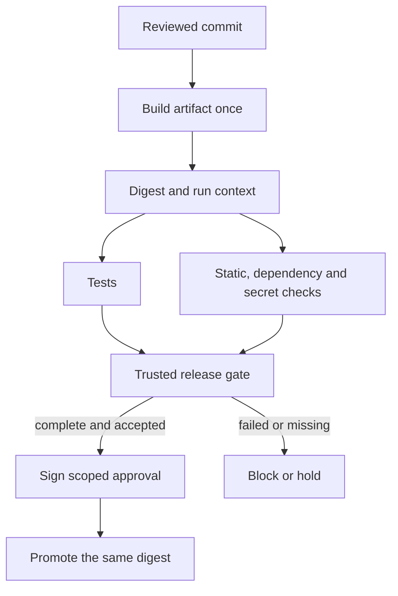

# 32. CI checks and release evidence

Three jobs are green, and the fourth never ran. May Casebook release the build? If every required check passes, how do you establish that the promoted bytes are the same bytes those checks were meant to cover?

This chapter turns those questions into an executable release decision. We will identify one Git commit, archive one artifact, collect results bound to that context and show what happens for passed, failed, missing and skipped checks. We will then sign an approval and verify the artifact digest before a local promotion.

You need chapter 12's tests, chapter 27's distinction between signatures and shared secrets, chapter 29's review decisions, chapter 30's verification boundaries and chapter 31's locked dependency/build evidence. Keep the earlier authorization correction: Mina may read Alpha only while she is an active member; Ravi belongs to Beta; Lee manages Alpha only; exports recheck current permission before release. A successful pipeline does not replace those application rules.

By the end, you will be able to:

- Define repeatable CI commands and explain what a clean environment contributes.
- Separate test execution from release credentials and trusted policy.
- Combine tests, static analysis, dependency and secret-check results without accepting a missing job.
- Bind results to a commit, artifact digest, run attempt and policy configuration.
- Scope an expiring exception and distinguish it from a passing check.
- Verify a signed approval and promote the approved bytes without rebuilding them.

The edition targets **CPython 3.12.14** and **Django 6.1.3**. This local laboratory ran on **CPython 3.12.14**, using **cryptography 50.0.2** and **packaging 26.4**. It does not start a hosted CI workflow or deploy Casebook.

**Evidence scope:** the contract tests and the comparison with chapter 31's fictional advisory really run. Static-analysis and secret-scan results are **authored teaching fixtures**, not recorded scanner runs. All approvals in the code carry `scope: local-training-only` and authorize only copying the sample ZIP to a local directory. A real Casebook release remains unapproved by these fixture results; its actual required checks would still need to run.

## Starting state and files

Start from chapter 31's fixed fictional dependency selection: `casebook-ch31-client==1.0.0` with `casebook-ch31-codec==1.0.1`. Keep its `after.lock`, retained wheels, installed inventory, advisory and contract test listing. The package names and `FICTIONAL-CH31-001` remain fictional exercise data.

The new demonstration creates a separate Git repository inside a new output directory. It commits the selected lock, root requirement, two wheels and public-client contract tests, then creates `release.zip` directly from that commit. It does not commit to or change the reader's book repository.

The artifact is a **source-and-wheel release bundle**, not a container image or an installed production service. A fresh test environment installs its locked wheels from the extracted bundle and runs its included tests. This gives a concrete commit/artifact/test relationship while keeping the exercise small.

Save the five Python listings below under `examples/ch32/`.

**Table T32-01. New files**

| File | Role |
| --- | --- |
| `gate.py` | Trusted training policy, binding checks, required-result evaluation and scoped exceptions |
| `fixtures.py` | Clearly labeled authored result fixtures and the fixed exercise clock |
| `promotion.py` | Ed25519 approval signing, verification and copying by digest |
| `demo.py` | Real fixture commit, archive, test execution, range comparison and six gate scenarios |
| `test_gate.py` | Fifteen regression methods for the gate and local promotion boundary |

Filename: `examples/ch32/requirements.txt`.

```text
cryptography==50.0.2
packaging==26.4
```

Use the builder environment from chapter 31, with its recorded pip/setuptools/wheel tools, and add these dependencies through your approved package source if needed. The sample itself uses no package index. The supplied runners use `bin/python` and target macOS/Linux.

After saving the chapter 31 and 32 listings, run from the repository root:

```shell
RUN_PARENT=$(mktemp -d)
DEPENDENCIES="$RUN_PARENT/dependencies"
python examples/ch31/build_lab.py "$DEPENDENCIES"
python examples/ch31/review_build.py "$DEPENDENCIES"
python examples/ch32/demo.py "$DEPENDENCIES" examples/ch31 "$RUN_PARENT/release"
python examples/ch32/test_gate.py -v
```

You may reuse an intact chapter 31 output by setting `DEPENDENCIES` to that path. The chapter 32 output directory must be new. Use `python3` if that is your environment's launcher.

## 1. Continuous integration, clean environments and reproducible commands

**Continuous integration**, or **CI**, runs agreed checks when changes are integrated or proposed. A **job** is a scheduled unit of work, often containing several commands. A **run** identifies one workflow execution. A rerun may have another **attempt**, which matters when old results are still available.

A **release gate** evaluates whether the required evidence is sufficient for a particular release decision. A test process returning zero is one piece of that evidence. It does not identify the reviewed commit, guarantee that every required job ran or establish which artifact a later deployment will use.

### Name the identities before reading the colors

**Table T32-02. Identities used by the gate**

| Field | Question it answers | Source of authority |
| --- | --- | --- |
| `commit` | Which exact source revision is being considered? | The trusted controller's reviewed revision, checked against the build input |
| `artifact_sha256` | Which exact release bytes were produced? | Digest computed from the actual artifact |
| `run_id` and `attempt` | Which execution produced these results? | CI/controller execution context |
| `policy_sha256` | Which required-check policy was applied? | Protected gate configuration |
| Per-check `config_sha256` | Which declared check recipe is expected? | Protected configuration for that check |
| Per-check `evidence_sha256` | Which retained evidence bytes support the result? | Trusted collector plus retained evidence storage |

A branch name or tag can move. A version label can refer to different files. A report named `latest.json` can be replaced. The identities above avoid making those mutable names the release authority.

For a real CI system, the expected revision must match the revision that the platform actually tested. A pull-request head, a generated merge revision and a release revision can differ. Choose the policy explicitly and collect results for that exact subject. Do not copy a green result from a different revision because the changed filenames look similar.

### Build once and test that artifact

**Figure F05. The path from reviewed commit to deployed artifact**



The important join is at the gate: every required result belongs to the expected context. The promotion step carries forward the same digest. The diagram describes the release relationship; the executable example stops at a local digest-named directory and does not deploy a service.

Git's [`archive` command](https://git-scm.com/docs/git-archive) can create an archive from a named revision. Our driver obtains the full commit ID, checks the fixture checkout is clean and archives that commit. Untracked output files and later working-tree changes are not silently included.

A real application build may also fetch dependencies, compile native code or use generated files. The commit alone does not identify those inputs. Chapter 31's hashes, lock records, builder identity and inventory remain necessary. This sample commits the two selected wheels as explicit fixture inputs so their relationship to the archived tree is inspectable.

### Use fresh state and record the command

The demonstration creates a new virtual environment and installs with `--no-index --require-hashes` from the bundle's `after.lock`. It runs the included `test_contract.py`, not a newer test file taken from another branch. It also checks the installed dependency graph and reads the installed codec version for the fictional advisory comparison.

Keep the command, tool versions, configuration, exit status and evidence file. An exit status is meaningful only under the tool's documented contract: some tools report findings through a special nonzero code, while another nonzero code means execution failed. A trusted adapter must preserve that distinction.

A fresh environment reduces hidden state from an earlier run. It does not prove a reproducible build or a safe runner. The local driver passes a small environment-variable allowlist to its child commands, but everything still runs under the same operating-system account. It is suitable for the authored fixtures; it is not a sandbox for untrusted pull-request code.

## 2. Jobs, artifacts, minimum token permissions and untrusted changes

A **workflow artifact** is retained output such as a release bundle or a report. A dependency cache helps speed up repeated work, but is not a reviewed release identity. GitHub's [artifact documentation](https://docs.github.com/en/actions/concepts/workflows-and-actions/workflow-artifacts) describes their different purposes. A later job should retrieve the exact expected output and verify its digest rather than assume a cache entry is the approved artifact.

The authority boundary matters as much as the data flow. Proposed source changes can contain code that runs during installation, tests or builds. Do not give that execution a release signing key merely because it is part of the same workflow.

**Table T32-03. Concrete job and authority separation**

| Role | Inputs it may read | Minimum authority for its job | Authority it should not inherit |
| --- | --- | --- | --- |
| Candidate builder/test worker | Proposed source, approved dependency inputs, its own temporary storage | Source read and job-scoped result/artifact upload | Release signing identity or deployment write access |
| Analysis workers | Defined source/artifact subject and their own approved rules/feed snapshot | Read subject; publish scoped reports | Permission to change gate policy or approve their own exception |
| Trusted collector/gate | Expected run metadata, required-check policy, authenticated result records and artifact bytes | Read the required evidence and protected exception ledger | Arbitrary execution of candidate-provided release scripts |
| Signer | Accepted decision and protected signing policy | Short-lived signing authority for that subject | General test/build execution on untrusted code |
| Promoter | Approved artifact, signed approval and independently trusted identity expectations | Write the intended destination; verify exact bytes | Ability to replace policy or select arbitrary unreviewed artifacts |

For an illustrative GitHub Actions setup, begin with `contents: read` where source read is sufficient. Grant extra scopes only to the jobs that need them. GitHub's [token guide](https://docs.github.com/en/actions/tutorials/authenticate-with-github_token) explains job-level permissions. Its [attestation guide](https://docs.github.com/en/actions/how-tos/secure-your-work/use-artifact-attestations/use-artifact-attestations) gives an example with `id-token: write`, `attestations: write` and `contents: read` for the attestation-producing job. Those permissions do not belong automatically on every test job.

An **OIDC identity token** can represent a job's identity to another service. It still needs a restricted trust policy: expected repository, workflow identity, source/ref and environment as appropriate. Possession of an identity token is not permission to sign any artifact. The local Ed25519 example does not implement OIDC, cloud identity or a hosted attestation service.

GitHub's [secure-use guidance](https://docs.github.com/en/actions/reference/security/secure-use) discusses untrusted checkout and third-party actions. Treat action code as part of the execution boundary and pin reviewed action revisions by full commit where that is the platform policy. A privileged trigger or a downstream privileged workflow does not make a candidate artifact safe to execute. Keep report parsing and release policy outside the candidate's authority.

In this sample the trusted gate files live outside the disposable candidate checkout. That illustrates policy ownership. It does not enforce separate OS accounts, filesystem permissions or hosted runner isolation. No real CI token or release credential is configured.

### Schedule the gate even when an upstream job fails

Some workflow systems skip dependent jobs when an upstream dependency fails or is skipped. The gate must be scheduled to observe that state and refuse approval. In GitHub Actions, an `always()` condition can be part of such scheduling, as described by the [workflow syntax](https://docs.github.com/en/actions/reference/workflows-and-actions/workflow-syntax) and [status-expression reference](https://docs.github.com/en/actions/reference/workflows-and-actions/expressions#status-check-functions).

A scheduling fragment, **not a complete or executed workflow**, might contain:

```yaml
needs: [tests, sast, sca, secrets]
if: ${{ always() }}
```

This schedules evaluation; it does not make missing results acceptable. The gate's own result must become the required release authority, and the promoter must require its authenticated approval. A path condition that silently skips the gate would defeat that design.

GitHub also documents that a conditionally [skipped job can report success](https://docs.github.com/en/actions/how-tos/write-workflows/choose-when-workflows-run/control-jobs-with-conditions) without preventing a merge as a required check. Therefore a dashboard's green summary is insufficient evidence that a specific security check completed. Our policy explicitly distinguishes execution state from result.

## 3. Combine tests, static analysis, dependency and secret-check results

A report must answer two separate questions:

1. Did the required check complete for this subject and configuration?
2. Did its result satisfy the release policy?

A completed scan can contain a blocking finding. A process can fail before it analyzes any files. A job can be skipped by a condition. None of those should be flattened into “no findings were reported.”

**Table T32-04. Check roles and evidence in this laboratory**

| Required name | Intended question | Actual evidence here |
| --- | --- | --- |
| `tests` | Does the included client preserve its contract and reject the oversized record? | Executed: chapter 31's four contract/regression methods against wheels installed from the release bundle |
| `sast` | Does the defined static-analysis policy accept the source subject? | Authored normalization fixture; no Bandit/Semgrep or other SAST scan executed |
| `sca` | Does the installed codec match the supplied affected range? | Executed range comparison against fictional FICTIONAL-CH31-001; not a complete live SCA scan |
| `secrets` | Does the defined secret-check policy accept its inspected scope? | Authored normalization fixture; no secret scanner or repository-history scan executed |

The fixture rows make the gate's decision branches reproducible. They do not close chapter 30's missing Django/Hypothesis results or establish production security. A real collector must retrieve actual completed runs from approved producers and retain their true coverage and tool configuration.

### Define a normalized result without hiding its provenance

A **normalized result** gives different tools a common shape while retaining their evidence. Here it contains the bound context, check name, execution state, policy result, tool version, configuration digest, evidence digest and exact blocking finding IDs.

The `result` field is `pass` or `fail` only after the adapter interprets the tool and policy. `blocking_findings` contains findings that block under that declared policy, not every informational observation. A passed result with a nonempty blocking list is contradictory and is held for investigation.

A real adapter must inspect parse errors, scan failures, excluded files, authentication failures, feed retrieval problems and coverage. It must not convert “the scanner never reached the route” into a clean policy result. Likewise, a secret-check report should retain its scope and rule/version identity without copying a detected secret value into ordinary logs or an approval payload.

The following helpers make the authored fixtures explicit. `NOW` is a fixed exercise clock. The unit tests use a clearly synthetic commit consisting of forty `1` characters; the integration demonstration obtains a real Git commit instead.

**Listing L32-01. Bound fixture records and a scoped exception example**

Filename: `examples/ch32/fixtures.py`.

```python
from gate import POLICY, canonical, policy_digest, sha256


NOW = 1795683600  # Fixed exercise clock, not the wall clock.


def context_for(commit, artifact):
    return {"commit": commit, "artifact_sha256": sha256(artifact), "run_id": "local-ch32-001",
            "attempt": 1, "policy_sha256": policy_digest(), "scope": POLICY["scope"]}


def report_for(context, name, raw, *, execution="completed", result="pass", findings=(),
               tool_version="authored-fixture/v1"):
    return {**context, "name": name, "execution": execution, "result": result,
            "blocking_findings": list(findings), "tool_version": tool_version,
            "config_sha256": POLICY["required"][name], "evidence_sha256": sha256(raw)}


def collection(context, overrides=None):
    # These are authored normalization fixtures, not assertions that scanners ran.
    reports, evidence = [], {}
    for name in POLICY["required"]:
        values = {"execution": "completed", "result": "pass", "findings": ()}
        values.update((overrides or {}).get(name, {}))
        raw = canonical({"origin": "authored check-result fixture", "check": name, **values})
        evidence[name] = raw
        reports.append(report_for(context, name, raw, **values))
    return reports, evidence


def exception_for(context, *, expires_at=NOW + 300):
    return {"id": "EX32-01", "check": "sast", "finding_id": "F32-DEMO-1",
            "commit": context["commit"], "artifact_sha256": context["artifact_sha256"],
            "policy_sha256": context["policy_sha256"], "owner": "Casebook security maintainer",
            "reason": "Fictional scoped risk acceptance for the gate exercise",
            "approved_by": "security-release-owner", "created_at": NOW - 10,
            "expires_at": expires_at}
```

These fields are claims, not authentication. A candidate could write JSON saying `completed` or `approved_by: security-release-owner`. Such a file must not become trusted evidence merely because it parses. The sample controller owns its inputs. A production collector must authenticate the expected CI repository/workflow/run and producer, and protect the exception ledger through an actual approval mechanism.

### Worked example 1: one required job never ran

Start from the following supplied pipeline summary for one commit/artifact context. The last two columns separate a platform summary from the gate's required evidence.

**Table T32-05. Read the skipped-job case precisely**

| Check | Actual scenario execution field | Scenario result | Gate interpretation |
| --- | --- | --- | --- |
| `tests` | `completed` | `pass` | Required result is present and accepted. |
| `sast` | `skipped` | `not_evaluated` | The static check did not run; no approval can be based on it. |
| `sca` | `completed` | `pass` | The fictional advisory comparison is accepted for its stated scope. |
| `secrets` | `completed` | `pass` | Supplied fixture result is accepted only by the training policy. |

The decision is **hold**, even if an interface calls the skipped job successful. A related missing-result case has no static report at all. That case also holds. The controller must investigate why the job/report is absent and obtain a matching result; it cannot assume success from the absence of a failure.

This predicate would be insufficient:

```python
def insufficient_gate(reports):
    return all(report["result"] == "pass" for report in reports)
```

It checks only supplied records. Three passing records still return true when the fourth is missing. An empty collection also returns true. Instead, start from the required check names, require exactly one valid result for each and then inspect execution and policy outcome.

## 4. Gate policy, expiring exceptions, signing and promotion by digest

The local policy has four outcomes:

- **approve:** every required result completed and passed for this context.
- **block:** a required completed result failed without an eligible exception.
- **hold:** evidence is missing, skipped, stale, malformed, ambiguous or otherwise incomplete.
- **approve_with_exception:** every required result completed, and exact eligible blocking findings have active trusted exceptions.

Block and hold both prohibit promotion. The distinction tells the owner whether the immediate problem is an unacceptable result or an evidence gap. If both exist, this policy reports block and retains both kinds of reasons.

**Table T32-06. Decision policy before implementation**

| Condition | Decision | What resolves it |
| --- | --- | --- |
| All four required results are valid, completed and passing | Approve local sample | Verify signed approval and the same artifact bytes at promotion. |
| Required result fails | Block | Correct the cause and rerun, or use an allowed finding-specific exception. |
| Result/report/evidence missing | Hold | Obtain the matching completed evidence. |
| Required job skipped, cancelled, pending, timed out or errored | Hold | Complete the required check under the approved recipe. |
| Duplicate result or wrong commit/artifact/run/attempt/configuration | Hold | Resolve the ambiguity; collect evidence for the intended context. |
| Eligible exact finding has an active scoped exception | Approve with exception | Preserve the finding, owner, justification, scope and expiry. |
| Exception expires or does not cover every blocking finding | Block | Remediate or obtain a new authorized decision. |

### Evaluate from the protected required set

**Listing L32-02. Explicit gate with default refusal for incomplete evidence**

Filename: `examples/ch32/gate.py`.

```python
import hashlib
import json
import re


def canonical(value):
    return json.dumps(value, sort_keys=True, separators=(",", ":"), ensure_ascii=False).encode("utf-8")


def sha256(data):
    return hashlib.sha256(data).hexdigest()


POLICY = {
    "id": "casebook-ch32-training-v1",
    "scope": "local-training-only",
    "required": {name: sha256(label.encode()) for name, label in (
        ("tests", "chapter31-public-client-contract-v1"),
        ("sast", "authored-static-result-fixture-v1"),
        ("sca", "FICTIONAL-CH31-001-range-check-v1"),
        ("secrets", "authored-secret-result-fixture-v1"),
    )},
    "waivable": ["sast", "sca"],
    "exception_approver": "security-release-owner",
    "approval_seconds": 600,
}
BINDINGS = ("commit", "artifact_sha256", "run_id", "attempt", "policy_sha256", "scope")


def policy_digest():
    return sha256(canonical(POLICY))


def matching_exception(context, check, finding, ledger, now):
    candidates = [item for item in ledger if isinstance(item, dict)
                  and item.get("check") == check and item.get("finding_id") == finding
                  and all(item.get(key) == context[key]
                          for key in ("commit", "artifact_sha256", "policy_sha256"))]
    if len(candidates) != 1:
        return None
    item = candidates[0]
    if (item.get("approved_by") != POLICY["exception_approver"]
            or not isinstance(item.get("owner"), str) or not item["owner"].strip()
            or not isinstance(item.get("reason"), str) or not item["reason"].strip()
            or not isinstance(item.get("id"), str) or not item["id"]
            or type(item.get("created_at")) is not int or type(item.get("expires_at")) is not int
            or not item["created_at"] <= now < item["expires_at"]):
        return None
    return item


def evaluate(context, reports, evidence, artifact, *, now, exceptions=()):
    # Context, policy, evidence storage and exception ledger belong to the trusted controller.
    holds, failures, checks, used = [], [], [], []
    if (not isinstance(context, dict) or type(now) is not int
            or not isinstance(context.get("commit"), str)
            or re.fullmatch(r"[0-9a-f]{40}", context["commit"]) is None
            or type(context.get("attempt")) is not int or context["attempt"] < 1
            or not isinstance(context.get("run_id"), str) or not context["run_id"]
            or context.get("policy_sha256") != policy_digest()
            or context.get("scope") != POLICY["scope"]
            or context.get("artifact_sha256") != sha256(artifact)):
        return {"decision": "hold", "reasons": ["invalid context or artifact"], "checks": []}
    if not isinstance(reports, list) or not isinstance(evidence, dict):
        return {"decision": "hold", "reasons": ["invalid report collection"], "checks": []}
    if any(not isinstance(row, dict) or row.get("name") not in POLICY["required"] for row in reports):
        holds.append("unknown or malformed report")
    for name, configuration in POLICY["required"].items():
        matches = [row for row in reports if isinstance(row, dict) and row.get("name") == name]
        if len(matches) != 1:
            holds.append(f"missing or duplicate: {name}")
            continue
        row = matches[0]
        if (any(type(row.get(key)) is not type(context[key]) or row.get(key) != context[key]
                for key in BINDINGS)
                or row.get("config_sha256") != configuration
                or not isinstance(row.get("tool_version"), str) or not row["tool_version"]
                or not isinstance(evidence.get(name), bytes)
                or row.get("evidence_sha256") != sha256(evidence[name])):
            holds.append(f"binding or evidence mismatch: {name}")
            continue
        checks.append({"name": name, "report_sha256": sha256(canonical(row)),
                       "evidence_sha256": row["evidence_sha256"], "exceptions": []})
        if row.get("execution") != "completed":
            holds.append(f"not completed: {name}")
            continue
        finding_ids = row.get("blocking_findings")
        if (not isinstance(finding_ids, list) or not all(isinstance(value, str) and value for value in finding_ids)
                or len(finding_ids) != len(set(finding_ids)) or row.get("result") not in ("pass", "fail")
                or (row["result"] == "pass" and finding_ids)):
            holds.append(f"invalid result: {name}")
            continue
        if row["result"] == "pass":
            continue
        waivers = [matching_exception(context, name, finding, exceptions, now) for finding in finding_ids]
        if name in POLICY["waivable"] and finding_ids and all(item is not None for item in waivers):
            used.extend(waivers)
            checks[-1]["exceptions"] = [item["id"] for item in waivers]
        else:
            failures.append(f"failed: {name}")
    decision = "block" if failures else "hold" if holds else "approve_with_exception" if used else "approve"
    expires_at = min([now + POLICY["approval_seconds"], *[item["expires_at"] for item in used]])
    return {**context, "decision": decision, "reasons": failures + holds, "checks": checks,
            "issued_at": now, "expires_at": expires_at,
            "exception_ledger_sha256": sha256(canonical(list(exceptions)))}
```

Read `evaluate` in layers. It first verifies the expected context and actual artifact digest. It then iterates over the protected required set. For each required check it requires one record, matching bindings, the expected configuration digest and retained evidence whose digest agrees with the record.

Only a completed result can be accepted. A failed result may be accepted under this sample policy only for exact finding IDs in a waivable check. Tests and secret-check failures are not waivable here. Missing execution is never waivable. Those are explicit training-policy choices, not universal rules for every organization.

`type(value) is int` prevents booleans from impersonating integer attempts or timestamps. The finding list must contain distinct nonempty string IDs. Unknown or contradictory states hold the result rather than quietly passing.

The `canonical` helper gives deterministic JSON bytes for this limited string/integer/list/dictionary payload. It is not a general standard canonical-JSON implementation. The report hash binds that normalized record, while the evidence hash binds retained supporting bytes. Neither hash authenticates its producer on its own.

The per-check configuration hashes identify the small training recipe declarations in `POLICY`. They are not measured hashes of installed scanner binaries or full production rule files. A real collector must bind its actual command, rules, exclusions, tool/feed versions and coverage to the trusted policy. This sample records a tool-version field but does not implement a production tool-version allowlist.

The policy digest covers the `POLICY` data, not the Python controller implementation. Production verification must also trust the gate/workflow revision that evaluates those inputs.

### Scope an exception without making a job disappear

`EX32-01` is authored risk-acceptance data for fictional finding `F32-DEMO-1`. It is restricted to one check, commit, artifact digest and policy. It has an accountable owner, reason, approver and validity interval. A different artifact or policy cannot inherit it by reusing the finding ID.

An exception changes how a known completed result is treated; it does not claim the finding was fixed or the check passed. This differs from a false-positive closure supported by code-path evidence, such as chapter 29's validated-integer SQL construction. Keep that review evidence and disposition explicit.

The code requires exactly one matching ledger entry. Expiry uses `created_at <= now < expires_at`, so the exact expiry boundary is invalid. Approval lifetime is the earliest of the ordinary 600-second limit and any used exception expiry. A signed approval therefore cannot outlive the accepted exception in this model.

The clock and ledger are trusted inputs here. The `approved_by` string is not an authentication protocol. A production service needs real authorization for ledger changes, an authoritative clock, review/revocation handling and an accountable exception process. None is created by copying the example JSON.

### Worked example 2: tie an approved artifact to its commit

The integration driver below creates a real fixture commit and archives it. It copies only wheels whose bytes agree with chapter 31's recorded inventory, retains the selected lock and then tests the release bundle's own inputs in a fresh environment.

**Listing L32-03. One commit, one artifact and six evidence scenarios**

Filename: `examples/ch32/demo.py`.

```python
from copy import deepcopy
import json
import os
from pathlib import Path
import shutil
import subprocess
import sys
import venv
from zipfile import ZipFile

from cryptography.hazmat.primitives.asymmetric.ed25519 import Ed25519PrivateKey
from packaging.specifiers import SpecifierSet
from packaging.version import Version

from fixtures import NOW, collection, context_for, exception_for, report_for
from gate import canonical, evaluate, sha256
from promotion import promote, sign_approval


HERE = Path(__file__).resolve().parent


def demonstrate(dependencies, chapter31_files, output):
    dependencies, chapter31_files = Path(dependencies).resolve(), Path(chapter31_files).resolve()
    output = Path(output).resolve()
    output.mkdir(parents=True, exist_ok=False)
    checkout = output / "checkout"
    checkout.mkdir()
    environment = {name: os.environ[name] for name in ("PATH", "TMPDIR", "LANG", "LC_ALL")
                   if name in os.environ}
    environment.update(PYTHONNOUSERSITE="1", GIT_CONFIG_NOSYSTEM="1", GIT_CONFIG_GLOBAL=os.devnull,
                       GIT_AUTHOR_DATE="2026-11-26T12:00:00+00:00", GIT_COMMITTER_DATE="2026-11-26T12:00:00+00:00")

    def run(arguments, *, cwd=output):
        return subprocess.run([str(value) for value in arguments], cwd=cwd, env=environment,
                              text=True, capture_output=True, check=True)

    def git(*arguments):
        return run(["git", "-c", "core.hooksPath=/dev/null", "-c", "commit.gpgsign=false",
                    "-c", "user.name=Casebook Fixture Builder", "-c", "user.email=builder@example.invalid",
                    "-C", checkout, *arguments])

    inventory = json.loads((dependencies / "inventory-after.json").read_text())
    (checkout / "wheelhouse").mkdir()
    for item in inventory["packages"]:
        if item["role"] == "application dependency":
            wheel = dependencies / item["wheel_file"]
            if sha256(wheel.read_bytes()) != item["wheel_sha256"]:
                raise ValueError("chapter 31 wheel no longer matches its inventory")
            shutil.copy2(wheel, checkout / "wheelhouse" / wheel.name)
    for name in ("after.lock", "requirements.in"):
        shutil.copy2(dependencies / name, checkout / name)
    shutil.copy2(chapter31_files / "test_contract.py", checkout / "test_contract.py")
    git("init", "--object-format=sha1", "--initial-branch=main")
    git("add", ".")
    git("commit", "-m", "Select fixed fictional codec and retain byte-boundary regression")
    commit = git("rev-parse", "HEAD").stdout.strip()
    if git("status", "--porcelain").stdout:
        raise ValueError("fixture checkout is not clean")
    artifact_path = output / "release.zip"
    git("archive", "--format=zip", f"--output={artifact_path}", commit)
    artifact = artifact_path.read_bytes()
    context = context_for(commit, artifact)
    (output / "context.json").write_bytes(canonical(context))

    unpacked = output / "artifact-under-test"
    unpacked.mkdir()
    # This archive was just produced from the authored fixture tree, not uploaded by a caller.
    with ZipFile(artifact_path) as archive:
        for item in archive.infolist():
            destination = (unpacked / item.filename).resolve()
            if not destination.is_relative_to(unpacked.resolve()):
                raise ValueError("archive member outside sample directory")
            if item.is_dir():
                destination.mkdir(parents=True, exist_ok=True)
            else:
                destination.parent.mkdir(parents=True, exist_ok=True)
                destination.write_bytes(archive.read(item))
    venv.EnvBuilder(with_pip=True).create(output / "test-environment")
    python = output / "test-environment/bin/python"  # macOS/Linux laboratory.
    installed = run([python, "-m", "pip", "--isolated", "--disable-pip-version-check", "install",
                     "--no-index", "--require-hashes", "--no-compile", "--no-cache-dir", "-r", "after.lock"],
                    cwd=unpacked)
    (output / "install.log").write_text(installed.stdout + installed.stderr)
    tests = run([python, "test_contract.py", "-v"], cwd=unpacked)
    tests_raw = (tests.stdout + tests.stderr).encode()
    checked = run([python, "-m", "pip", "--isolated", "--disable-pip-version-check", "check"])
    (output / "pip-check.log").write_text(checked.stdout + checked.stderr)
    runtime = json.loads(run([python, "-c", "from importlib.metadata import version; import json,sys; "
                             "print(json.dumps({'codec':version('casebook-ch31-codec'), 'python':sys.version.split()[0]}))"]).stdout)
    version = runtime["codec"]
    advisory = json.loads((chapter31_files / "advisory.json").read_text())
    if advisory.get("fictional") is not True:
        raise ValueError("only the fictional chapter 31 advisory is supported")
    affected = Version(version) in SpecifierSet(advisory["affected_specifier"])
    sca_raw = canonical({"origin": "executed fictional-advisory comparison", "version": version,
                         "advisory": advisory["id"], "affected": affected})
    reports, evidence = collection(context)
    for name, raw, tool in (("tests", tests_raw, "unittest/" + runtime["python"]),
                            ("sca", sca_raw, "packaging-range-check/v1")):
        evidence[name] = raw
        reports = [row for row in reports if row["name"] != name]
        reports.append(report_for(context, name, raw, tool_version=tool,
            result="fail" if name == "sca" and affected else "pass",
            findings=[advisory["id"]] if name == "sca" and affected else ()))

    def scenario(label, rows, raw_evidence, *, ledger=(), expected):
        folder = output / label
        folder.mkdir()
        for name, raw in raw_evidence.items():
            (folder / f"{name}.evidence").write_bytes(raw)
        (folder / "reports.json").write_bytes(canonical(rows))
        decision = evaluate(context, rows, raw_evidence, artifact, now=NOW, exceptions=ledger)
        (folder / "decision.json").write_bytes(canonical(decision))
        if decision["decision"] != expected:
            raise AssertionError((label, decision))
        print(label + ":", decision["decision"])
        return decision

    passed = scenario("passed", reports, evidence, expected="approve")
    failed, failed_evidence = deepcopy(reports), dict(evidence)
    failed_raw = canonical({"origin": "authored static-result failure scenario", "finding": "F32-DEMO-1"})
    failed_evidence["sast"] = failed_raw
    failed = [row for row in failed if row["name"] != "sast"]
    failed.append(report_for(context, "sast", failed_raw, result="fail", findings=["F32-DEMO-1"]))
    scenario("failed", failed, failed_evidence, expected="block")
    missing = [row for row in reports if row["name"] != "sast"]
    missing_evidence = {name: raw for name, raw in evidence.items() if name != "sast"}
    scenario("missing", missing, missing_evidence, expected="hold")
    skipped_raw = canonical({"origin": "authored skipped-job fixture", "reason": "path condition false"})
    skipped_evidence = evidence | {"sast": skipped_raw}
    skipped = [row for row in reports if row["name"] != "sast"]
    skipped.append(report_for(context, "sast", skipped_raw, execution="skipped", result="not_evaluated"))
    scenario("skipped", skipped, skipped_evidence, expected="hold")
    exception = exception_for(context)
    scenario("exception-active", failed, failed_evidence, ledger=[exception], expected="approve_with_exception")
    scenario("exception-expired", failed, failed_evidence,
             ledger=[exception | {"expires_at": NOW}], expected="block")

    private_key = Ed25519PrivateKey.generate()  # Disposable signing key, never written or logged.
    public_key = private_key.public_key()
    envelope = sign_approval(passed, private_key)
    (output / "approval-envelope.json").write_bytes(canonical(envelope))
    (output / "public-key.bin").write_bytes(public_key.public_bytes_raw())
    receipt = promote(envelope, public_key, artifact, context, output / "promoted", now=NOW + 1)
    (output / "promotion-receipt.json").write_bytes(canonical(receipt))
    try:
        promote(envelope, public_key, artifact + b"changed", context, output / "rejected", now=NOW + 1)
    except ValueError:
        if (output / "rejected").exists():
            raise AssertionError("refusal created promotion state")
    else:
        raise AssertionError("changed bytes were promoted")
    print("commit:", commit)
    print("artifact SHA-256:", context["artifact_sha256"])
    print("signed promotion: same bytes; changed artifact refused without a destination")


if __name__ == "__main__":
    if len(sys.argv) != 4:
        raise SystemExit("usage: python demo.py CH31_BUILD CH31_LISTING_DIRECTORY NEW_OUTPUT_DIRECTORY")
    demonstrate(*sys.argv[1:])
```

The driver explicitly chooses Git's SHA-1 object format so this exercise uses a forty-character commit ID. Release artifact identity uses SHA-256. A platform using another Git object format needs an appropriately validated source-ID format; do not truncate its revision into this example's field.

The fixture commit contains five files: the root input, after lock, contract tests and two wheels. The archive is built directly from that revision. Tests run from its extracted copy; they do not modify the original artifact bytes. The later signer and promoter do not rebuild it.

The authored fixture stands in for a reviewed input. No hosted review approval is collected. A production controller must enforce its actual review policy before selecting the expected commit.

`demo.py` retains evidence for each scenario. Missing means there is no static normalized report or static evidence in that scenario. Skipped carries an explicit authored skipped-job record. The failed static scenario is another authored input mutation, not an observed vulnerability in the committed source. The same real artifact is used to isolate the gate's policy branches.

If an actual integration command unexpectedly fails, the driver stops without producing its final signed approval. This local harness expects the fixed positive fixture. A hosted collector should still record failed/error states and schedule the gate so the release has an explicit block/hold record rather than silently losing the result.

The complete signing/promotion helper is in the next listing. Save it before running the driver.

### Verify authority and bytes before copying

A **digital signature** lets a holder of a trusted public key verify the signed bytes without receiving the private signing key. The signature does not decide whether the signed claim is justified. That remains the responsibility of the trusted gate and signing policy.

This demonstration generates a disposable Ed25519 key after the checks. The private key stays in memory and is never written or printed. The public key is saved separately. The local verifier receives the expected public key and context from the controller, not from an untrusted approval envelope.

**Listing L32-04. Sign a scoped approval and promote its exact digest**

Filename: `examples/ch32/promotion.py`.

```python
import base64
import json
from pathlib import Path

from gate import BINDINGS, POLICY, canonical, policy_digest, sha256


APPROVALS = ("approve", "approve_with_exception")


def sign_approval(decision, private_key):
    if decision.get("decision") not in APPROVALS:
        raise ValueError("refusing to sign a non-approval")
    payload = canonical(decision)
    return {"payload": base64.b64encode(payload).decode("ascii"),
            "signature": base64.b64encode(private_key.sign(payload)).decode("ascii")}


def promote(envelope, public_key, artifact, expected, store, *, now):
    # The expected context and trusted public key come from the controller, not the envelope.
    payload = base64.b64decode(envelope["payload"], validate=True)
    signature = base64.b64decode(envelope["signature"], validate=True)
    public_key.verify(signature, payload)
    approval = json.loads(payload)
    if (approval.get("decision") not in APPROVALS
            or any(type(approval.get(key)) is not type(expected[key]) or approval.get(key) != expected[key]
                   for key in BINDINGS)
            or approval.get("scope") != POLICY["scope"]
            or approval.get("policy_sha256") != policy_digest()
            or type(now) is not int or type(approval.get("issued_at")) is not int
            or type(approval.get("expires_at")) is not int
            or not approval["issued_at"] <= now < approval["expires_at"]
            or sha256(artifact) != expected["artifact_sha256"]):
        raise ValueError("approval does not authorize these bytes in this context")
    # Promotion copies verified bytes; it never rebuilds or follows a mutable tag.
    directory = Path(store) / expected["artifact_sha256"]
    directory.mkdir(parents=True, exist_ok=True)
    target = directory / "release.zip"
    if target.exists():
        if target.read_bytes() != artifact:
            raise ValueError("existing digest location contains different bytes")
    else:
        with target.open("xb") as output:
            output.write(artifact)
    if sha256(target.read_bytes()) != expected["artifact_sha256"]:
        raise ValueError("promoted copy failed digest verification")
    return {"scope": POLICY["scope"], "commit": expected["commit"],
            "artifact_sha256": expected["artifact_sha256"], "destination": str(target),
            "approval_sha256": sha256(payload), "decision": approval["decision"]}
```

The [cryptography Ed25519 reference](https://cryptography.io/en/50.0.2/hazmat/primitives/asymmetric/ed25519/) documents `sign` and `verify`; verification raises `InvalidSignature` when the signed bytes do not match. Here the signed payload includes the source/artifact/run/policy bindings, result-record and evidence digests, exception-ledger digest and expiry.

`sign_approval` refuses block/hold decisions. It must be called only by the trusted controller on a decision it actually evaluated. A caller who controls the private key could sign a fabricated `approve` object; a status string is not a separate security boundary. Production signing authority must therefore be isolated from untrusted candidate execution and verify its decision inputs.

The promoter verifies the signature, expected context, current policy, validity interval and actual artifact bytes before creating destination state. It copies the verified bytes to a digest-named directory and rechecks the stored digest. An existing identical copy is accepted idempotently. An existing different copy is refused and not overwritten.

This is a local copying model. It does not implement a registry, immutable storage policy, concurrent writer protocol, atomic crash recovery, approval revocation service or deployment authorization. Interrupted writes could require recovery; no crash-safety guarantee is claimed. Tests below inspect state after the refusal cases that are actually modeled.

For hosted releases, verify the expected signer/builder/workflow identity as well as a signature and subject digest. SLSA's [artifact verification guidance](https://slsa.dev/spec/v1.2/verifying-artifacts) describes those expectation checks. A public key supplied beside an arbitrary artifact is not automatically a trusted identity. Likewise, a valid build-provenance attestation does not by itself assert that this release gate passed.

### Inspect the recorded release decisions

Run the demonstration using the commands at the start. Expected output, also recorded locally for the provided chapter 31 inputs:

```text
passed: approve
failed: block
missing: hold
skipped: hold
exception-active: approve_with_exception
exception-expired: block
commit: 03c2e09dd9f57a2381b8e7164b173e9a42c940ab
artifact SHA-256: e24d37c630ddfabcdd1f6ff1650a3f8bceee77bd2664dd3a4495d3f4b390bc1d
signed promotion: same bytes; changed artifact refused without a destination
```

The commit and artifact digest above identify the recorded fixture build. Other Git/build input versions may produce other values. The driver computes and uses the values from its own run; do not substitute the printed book example as authority for another artifact.

**Table T32-07. Passed, failed and incomplete cases for that same subject**

| Scenario | Required evidence that differs | Recorded gate result | Release action |
| --- | --- | --- | --- |
| `passed` | All four training-policy records complete and accepted | `approve` | Sign and copy the same digest to the local sample destination. |
| `failed` | Completed static fixture contains `F32-DEMO-1` and fails | `block` | No ordinary approval; correct/review the finding or evaluate an eligible exception. |
| `missing` | No required static report/evidence | `hold` | Obtain matching evidence; three passing results do not suffice. |
| `skipped` | Required static job did not execute | `hold` | Run it; a platform's success-colored skip does not qualify. |
| `exception-active` | Same fictional static failure, with active scoped EX32-01 | `approve_with_exception` | A distinct conditional decision is recorded; demo does not promote this scenario. |
| `exception-expired` | The exception expires exactly at the evaluation time | `block` | Expired acceptance does not authorize release. |

Only the ordinary `passed` scenario is signed and promoted by this driver. The active-exception case demonstrates evaluation and capped approval lifetime. The signature on the passed decision is real; it is still only a local training approval with supplied static/secret evidence.

The driver then attempts promotion with an extra byte appended to the artifact. The expected context still names the original digest. Verification refuses it, and the `rejected` destination is absent. That shows the difference between approving an identifier and actually checking the bytes at the release boundary.

## Repeatable verification

The tests below exercise policy outcomes and stored-state effects. They use a synthetic unit-test commit only; the integration driver above supplies the real commit-to-ZIP trace.

**Listing L32-05. Gate and signed-promotion regression tests**

Filename: `examples/ch32/test_gate.py`.

```python
import base64
from copy import deepcopy
from pathlib import Path
from tempfile import TemporaryDirectory
import unittest

from cryptography.exceptions import InvalidSignature
from cryptography.hazmat.primitives.asymmetric.ed25519 import Ed25519PrivateKey

from fixtures import NOW, collection, context_for, exception_for
from gate import POLICY, canonical, evaluate
from promotion import promote, sign_approval


class GateTests(unittest.TestCase):
    def setUp(self):
        self.artifact = b"authored release-byte fixture"
        self.context = context_for("1" * 40, self.artifact)  # Synthetic unit-test commit only.
        self.reports, self.evidence = collection(self.context)

    def decide(self, reports=None, evidence=None, *, exceptions=(), now=NOW):
        return evaluate(self.context, self.reports if reports is None else reports,
                        self.evidence if evidence is None else evidence, self.artifact,
                        now=now, exceptions=exceptions)

    def failed_static(self):
        return collection(self.context, {"sast": {"result": "fail", "findings": ["F32-DEMO-1"]}})

    def test_all_required_results_approve_the_bound_artifact(self):
        result = self.decide()
        self.assertEqual(result["decision"], "approve")
        self.assertEqual(result["artifact_sha256"], self.context["artifact_sha256"])
        self.assertEqual(len(result["checks"]), 4)
        self.assertEqual(result["expires_at"], NOW + 600)

    def test_missing_empty_and_duplicate_results_never_approve(self):
        variants = ([], self.reports[:-1], self.reports + [deepcopy(self.reports[0])])
        for rows in variants:
            with self.subTest(count=len(rows)):
                self.assertEqual(self.decide(rows)["decision"], "hold")

    def test_skipped_and_other_noncompleted_states_never_approve(self):
        for state in ("skipped", "pending", "error", "cancelled", "timed_out", "neutral"):
            with self.subTest(state=state):
                rows, evidence = collection(self.context, {"sast": {"execution": state}})
                self.assertEqual(self.decide(rows, evidence)["decision"], "hold")

    def test_stale_or_different_binding_and_configuration_are_held(self):
        changes = {"commit": "2" * 40, "artifact_sha256": "0" * 64, "run_id": "old-run",
                   "attempt": 2, "policy_sha256": "0" * 64, "scope": "production",
                   "config_sha256": "0" * 64}
        for key, value in changes.items():
            with self.subTest(field=key):
                rows = deepcopy(self.reports)
                rows[0][key] = value
                self.assertEqual(self.decide(rows)["decision"], "hold")
        rows = deepcopy(self.reports)
        rows[0]["attempt"] = True  # True must not impersonate integer attempt 1.
        self.assertEqual(self.decide(rows)["decision"], "hold")

    def test_missing_or_changed_evidence_is_held(self):
        for raw in ({}, self.evidence | {"tests": b"changed log"}):
            self.assertEqual(self.decide(evidence=raw)["decision"], "hold")
        self.assertEqual(evaluate(self.context, self.reports, self.evidence,
                                  self.artifact + b"changed", now=NOW)["decision"], "hold")

    def test_test_and_secret_failures_cannot_be_waived(self):
        for name in ("tests", "secrets"):
            rows, evidence = collection(self.context, {name: {"result": "fail", "findings": ["F32-DEMO-1"]}})
            exception = exception_for(self.context) | {"check": name}
            self.assertEqual(self.decide(rows, evidence, exceptions=[exception])["decision"], "block")

    def test_scoped_exception_works_only_before_expiry_and_caps_approval(self):
        rows, evidence = self.failed_static()
        exception = exception_for(self.context)
        active = self.decide(rows, evidence, exceptions=[exception])
        self.assertEqual(active["decision"], "approve_with_exception")
        self.assertEqual(active["expires_at"], exception["expires_at"])
        self.assertEqual(self.decide(rows, evidence, exceptions=[exception],
                                    now=exception["expires_at"])["decision"], "block")

    def test_exception_cannot_cover_missing_execution_or_unlisted_findings(self):
        rows, evidence = self.failed_static()
        exception = exception_for(self.context)
        rows[1]["execution"] = "skipped"  # Policy order makes row 1 the static result.
        self.assertEqual(self.decide(rows, evidence, exceptions=[exception])["decision"], "hold")
        rows, evidence = collection(self.context, {"sast": {"result": "fail", "findings": ["F32-DEMO-1", "F32-DEMO-2"]}})
        self.assertEqual(self.decide(rows, evidence, exceptions=[exception])["decision"], "block")

    def test_wrong_or_ambiguous_exception_is_not_acceptance(self):
        rows, evidence = self.failed_static()
        base = exception_for(self.context)
        for change in ({"artifact_sha256": "0" * 64}, {"approved_by": "candidate-author"},
                       {"owner": ""}, {"reason": ""}, {"expires_at": True}):
            self.assertEqual(self.decide(rows, evidence, exceptions=[base | change])["decision"], "block")
        self.assertEqual(self.decide(rows, evidence, exceptions=[base, base])["decision"], "block")

    def test_malformed_and_contradictory_results_are_held(self):
        variants = ([None], self.reports + [{"name": "unknown"}],)
        for rows in variants:
            self.assertEqual(self.decide(rows)["decision"], "hold")
        rows, evidence = collection(self.context, {"sast": {"result": "pass", "findings": ["F32-DEMO-1"]}})
        self.assertEqual(self.decide(rows, evidence)["decision"], "hold")

    def test_signing_a_block_or_hold_is_refused(self):
        key = Ed25519PrivateKey.generate()
        for decision in ("block", "hold"):
            with self.assertRaises(ValueError):
                sign_approval({"decision": decision}, key)

    def test_signed_promotion_copies_exact_bytes_and_is_idempotent(self):
        key = Ed25519PrivateKey.generate()
        envelope = sign_approval(self.decide(), key)
        with TemporaryDirectory() as folder:
            store = Path(folder) / "store"
            first = promote(envelope, key.public_key(), self.artifact, self.context, store, now=NOW + 1)
            self.assertEqual(Path(first["destination"]).read_bytes(), self.artifact)
            self.assertEqual(promote(envelope, key.public_key(), self.artifact, self.context, store,
                                     now=NOW + 2), first)
            self.assertEqual(len(list(store.rglob("release.zip"))), 1)

    def test_tampered_signature_payload_and_wrong_key_create_no_destination(self):
        key = Ed25519PrivateKey.generate()
        envelope = sign_approval(self.decide(), key)
        changed = envelope | {"payload": base64.b64encode(base64.b64decode(envelope["payload"]) + b" ").decode()}
        with TemporaryDirectory() as folder:
            for candidate, public_key in ((changed, key.public_key()),
                                          (envelope, Ed25519PrivateKey.generate().public_key())):
                store = Path(folder) / "store"
                with self.assertRaises(InvalidSignature):
                    promote(candidate, public_key, self.artifact, self.context, store, now=NOW + 1)
                self.assertFalse(store.exists())

    def test_different_artifact_context_and_exact_expiry_create_no_destination(self):
        key = Ed25519PrivateKey.generate()
        approval = self.decide()
        envelope = sign_approval(approval, key)
        cases = ((self.artifact + b"x", self.context, NOW + 1),
                 (self.artifact, self.context | {"run_id": "another-run"}, NOW + 1),
                 (self.artifact, self.context, approval["expires_at"]))
        with TemporaryDirectory() as folder:
            for artifact, expected, now in cases:
                store = Path(folder) / "store"
                with self.assertRaises(ValueError):
                    promote(envelope, key.public_key(), artifact, expected, store, now=now)
                self.assertFalse(store.exists())

    def test_existing_corrupt_digest_location_is_not_overwritten(self):
        key = Ed25519PrivateKey.generate()
        envelope = sign_approval(self.decide(), key)
        with TemporaryDirectory() as folder:
            store = Path(folder) / "store"
            target = store / self.context["artifact_sha256"] / "release.zip"
            target.parent.mkdir(parents=True)
            target.write_bytes(b"already corrupt")
            with self.assertRaises(ValueError):
                promote(envelope, key.public_key(), self.artifact, self.context, store, now=NOW + 1)
            self.assertEqual(target.read_bytes(), b"already corrupt")
            self.assertEqual(list(store.rglob("release.zip")), [target])


if __name__ == "__main__":
    unittest.main()
```

Run:

```shell
python examples/ch32/test_gate.py -v
```

Expected and recorded locally: **15 passing test methods**, ending in `OK`.

The cases cover empty/missing/duplicate records, skipped and other incomplete states, stale run attempts, different commit/artifact/configuration bindings, changed evidence and contradictory results. A test or secret-check failure cannot be waived under this policy. An exception cannot supply missing execution or cover an unlisted finding.

The promotion checks use real signatures. They reject a changed signed payload, wrong verification key, changed artifact, another run context and exact expiry. Rejected requests create no destination. Successful repeated promotion leaves one identical artifact. A deliberately corrupt existing digest location is refused without changing its bytes.

These checks verify the local policy and copy boundary. They do not prove that an external scanner ran, that a hosted token has correct permissions or that a production runner is isolated. Those are independent integration and configuration checks.

## Part checkpoint: finding, correction, regression and gate

**Table T32-08. Follow one finding through the release evidence**

| Step | Evidence carried forward |
| --- | --- |
| Finding | FICTIONAL-CH31-001 describes a missing pre-parse byte bound in the fictional codec `1.0.0`. Its affected range and precondition are explicit. |
| Correction | Codec `1.0.1` checks `len(raw) > 256` before parsing. The selected lock and new wheel hash identify that release. |
| Commit | The recorded fixture commit includes the after lock, selected wheels and public-client regression script. |
| Regression | Chapter 31's 257-byte test fails on the old codec and passes on the fixed codec. The release-bundle test job repeats the fixed four-method suite. |
| Dependency evidence | The installed codec version in the artifact test environment falls outside the supplied fictional affected range. |
| Gate | Required records must all complete for the expected commit, artifact, run and recipe. Failed, missing and skipped branches cannot produce ordinary approval. |
| Promotion | The signed payload authorizes the original SHA-256 only; copying changed bytes is refused before destination creation. |

The checkpoint links a concrete regression to a decision rather than merely requiring a job with a reassuring name. The training evidence remains narrower than a real Casebook release: static and secret results are supplied fixtures, and the full web/worker suites are not covered by this artifact's four client tests.

## Guided lab: establish the release subject and decision

1. Keep chapter 31's fixed selection and save the new listings. Record Python, Git, cryptography and packaging versions. Create fresh dependency/release output paths or reuse an intact chapter 31 output.
2. Predict the result of three passing reports with the static job absent. Explain why `all(...)` over supplied records is insufficient.
3. Inspect POLICY before running the code. Identify the four required names, trusted recipe hashes, waiver restrictions, approval lifetime and training-only scope.
4. Run `demo.py`. Read `context.json` and the fixture repository's commit ID. List the five tracked artifact files and compare the actual archive digest with the context.
5. Read the real contract evidence and fictional advisory comparison. Identify the authored static/secret records separately. Do not describe them as recorded scanner completions.
6. Compare `passed`, `failed`, `missing` and `skipped` decision files. Locate the precise reason for block or hold. Explain which state must change before reevaluation can approve.
7. Inspect EX32-01's target, owner, approver, reason and expiry. Explain why an active exception cannot authorize a skipped job, and why approval lifetime is capped by exception expiry.
8. Read the signed approval envelope and promotion receipt without printing a private key. Verify that the receipt retains both commit and artifact digest. Identify the trust source for the verifier's expected public key and context.
9. Run the 15 gate tests. Inspect the final stored-state assertions for rejected requests, idempotent success and a corrupt existing location.
10. Write a production integration checklist limited to the gaps actually present: authenticated CI collection, real required scanner/test results, protected policy/ledger, isolated signing authority and the destination's own promotion semantics.

## Independent practice

### Exercise 1: three green records

A required set contains `tests`, `sast`, `sca` and `secrets`. The result list contains only three completed passes. State the decision and the exact missing evidence. Now give the decision if the fourth record exists but says `skipped`.

### Exercise 2: a green result from another attempt

The artifact digest and commit match, but the static result came from run attempt 1 and the controller is evaluating attempt 2. Why does this policy hold it? What must a real collector establish before using a result from a rerun?

### Exercise 3: an exception for a missing job

A manager adds a record saying “ignore SAST until Friday.” The job never ran, and the record names no finding, artifact or owner. Explain why this cannot satisfy the sample policy. Contrast a missing execution with an active exception for a known completed finding.

### Exercise 4: sign, then rebuild

The candidate passes, its digest is signed, and the deployment job rebuilds from the same version label. The resulting bytes have a different digest. What must happen? Specify the identities the promoter needs to verify and why a matching version string is insufficient.

### Exercise 5: untrusted policy and trusted key

A proposed change edits `gate.py` to require no checks. The same job runs that candidate gate with a production signing key. What authority boundary has failed? Describe a job/permission separation that prevents this design from making candidate-authored policy authoritative.

### Practice check

Design a release gate with pass, fail and missing-result cases. Demonstrate that a skipped required job cannot produce an approval.

Retain a commit/artifact/run identity for every case. Include the expected required set, normalized execution state, policy outcome and release decision. State which results actually ran and which are supplied fixtures. An exception must not supply evidence for a check that never completed.

## Hints

- Start from the required set, then find its evidence.
- A dashboard conclusion and the execution record are different inputs.
- Artifact bytes, source revision, run attempt and recipe all belong to the binding.
- A report field does not authenticate the actor who wrote it.
- A signed approval is only as justified as the trusted signer and decision process.
- Promotion uses the approved bytes; a rebuild creates a new subject that needs evidence.
- Expiry and revocation are different lifecycle questions.

## Worked answers

### Exercise 1

Hold: one of the four required results is absent, so the controller cannot establish completion and acceptance for that check. Identify the missing name and collect evidence for the expected context. If the record instead says skipped, hold for noncompletion. A success-colored platform summary or three other passes does not replace the required execution.

### Exercise 2

This policy binds all required results to one selected run and attempt. Reusing another attempt without an explicit policy could mix stale configuration or coverage with current results. The collector must authenticate the producer, exact subject, recipe and execution identity and apply the organization's deliberate rerun policy. The local model chooses strict matching; silently dropping the attempt field is not that policy.

### Exercise 3

The proposed record lacks finding, artifact, policy, accountable owner and precise expiry/authorization evidence. More fundamentally, it attempts to replace missing execution. The sample accepts exceptions only for exact blocking IDs from a completed eligible check and only while the scoped authorized ledger record is active. The skipped job still has to run.

### Exercise 4

Refuse promotion of the rebuilt bytes under the old approval. The promoter must verify its independently trusted signer/context, signature, commit/artifact/run/policy bindings, validity interval and the actual digest of the bytes being copied. A mutable version label does not make two different digests the same release subject. Promote the originally approved artifact, or evaluate the new artifact under an explicit new evidence context.

### Exercise 5

Untrusted candidate execution controls both the policy and signing authority. It can approve itself. Keep gate/collector policy in a protected trusted execution path, run candidate builds/tests without release credentials and allow the signer/promoter to act only on authenticated matching evidence for the reviewed subject. Do not execute candidate-provided release scripts in that privileged path. The local demonstration illustrates external policy placement but does not enforce production OS/runner isolation.

### Practice check

T32-06 defines the policy and T32-07 records the required scenarios. The executable missing case holds; the skipped case holds even with other accepted results. The failed case blocks. The passed training case produces a signed approval and copies only its original digest. Fifteen regression methods preserve those outcomes and refusal-state checks.

The approval remains scoped to the local exercise. A production record would require actual executed static/secret checks and all other release requirements, not the authored fixture records accepted by this training policy.

## Verification record

The integration driver and all **15 gate/promotion test methods** ran on macOS with **CPython 3.12.14**, **Git 2.54.0 (Apple Git-157)**, **cryptography 50.0.2** and **packaging 26.4**. The fresh artifact-test environment bootstrapped pip 25.0.1, installed the two locked local wheels and passed `pip check`. No hosted CI, registry or live deployment was contacted.

Recorded integration results:

- A real separate Git repository produced the recorded commit and release ZIP. Its clean committed tree contained the after lock, root requirement, contract test script and two fictional package wheels.
- The artifact's own four-method client contract/regression suite passed in a fresh environment installed from that bundle. The installed codec `1.0.1` did not match the fictional advisory range.
- The same context produced approve, block, hold-for-missing and hold-for-skipped outcomes. The active scoped fictional exception produced a distinct conditional approval; exact-expiry evaluation blocked it.
- A real Ed25519 signature verified the ordinary training approval. The promoted file matched the approved artifact digest. Changed bytes were refused without creating the rejected destination.
- The regression suite covered missing/duplicate/invalid evidence, incomplete execution states, different bindings/configuration, scoped and expired exceptions, nonwaivable failures, signature and key changes, exact approval expiry, idempotent copying and refusal to overwrite corrupt existing bytes.
- All five complete Python listings were syntax-checked and compared with the executed files. Recorded context and decision JSON parsed successfully.

**Supplied rather than executed:** all static-analysis and secret-check results, including the hypothetical failed/skipped static scenarios. The dependency result is a real comparison with fictional advisory data, not a full SCA feed scan. Synthetic unit-test IDs are separate from the real integration commit.

**Not executed:** Django/Hypothesis integration, a hosted CI workflow or YAML fragment, actual SAST/secret tools, real external advisory feeds, CI API authentication, fork/runner isolation, hosted token/OIDC policy, production key custody, attestation identity verification, immutable registry controls, crash/concurrent promotion behavior, approval revocation or a live deployment. The locally saved public key is not an externally anchored trust system. These limits prevent the exercise's signed copying approval from being described as production release assurance.

## What you can now explain

A release decision starts with an expected subject and required evidence. Complete passing records, an explicit failure and a missing or skipped job lead to different decisions. None can be inferred safely from a count of green rows alone.

A signed approval binds a decision to bytes and context. The verifier still needs a trusted identity, matching expectations and a valid policy. Promoting the same digest preserves that relationship; rebuilding or following a mutable tag does not.

Keep the artifact, full commit ID, context, report/evidence files, policy identity, decision, signed envelope and local promotion receipt. Chapter 33 begins the operations part of the book. Carry forward those correlation identities and the rule that logs and audit records should explain an action without exposing tokens, private keys or note bodies. Its new examples will apply that discipline to service and worker events.

## Primary sources

- Git's [`archive` reference](https://git-scm.com/docs/git-archive) documents archives produced from a named revision. GitHub's [workflow artifacts guide](https://docs.github.com/en/actions/concepts/workflows-and-actions/workflow-artifacts) distinguishes retained outputs from dependency caches.
- GitHub's [workflow syntax](https://docs.github.com/en/actions/reference/workflows-and-actions/workflow-syntax), [status expressions](https://docs.github.com/en/actions/reference/workflows-and-actions/expressions#status-check-functions) and [job-condition guide](https://docs.github.com/en/actions/how-tos/write-workflows/choose-when-workflows-run/control-jobs-with-conditions) describe dependency scheduling, conditions and skipped-job status behavior.
- GitHub's [token guide](https://docs.github.com/en/actions/tutorials/authenticate-with-github_token) and [secure-use reference](https://docs.github.com/en/actions/reference/security/secure-use) discuss permissions and untrusted workflow execution. Its [artifact attestation guide](https://docs.github.com/en/actions/how-tos/secure-your-work/use-artifact-attestations/use-artifact-attestations) documents hosted attestation generation and verification; those integrations were not executed here.
- The cryptography project's [Ed25519 reference for 50.0.2](https://cryptography.io/en/50.0.2/hazmat/primitives/asymmetric/ed25519/) documents the signing/verification API used in the local example. SLSA's [artifact verification guidance](https://slsa.dev/spec/v1.2/verifying-artifacts) describes checking provenance against trusted identities and expected values. The local envelope is not a SLSA attestation or level claim.
