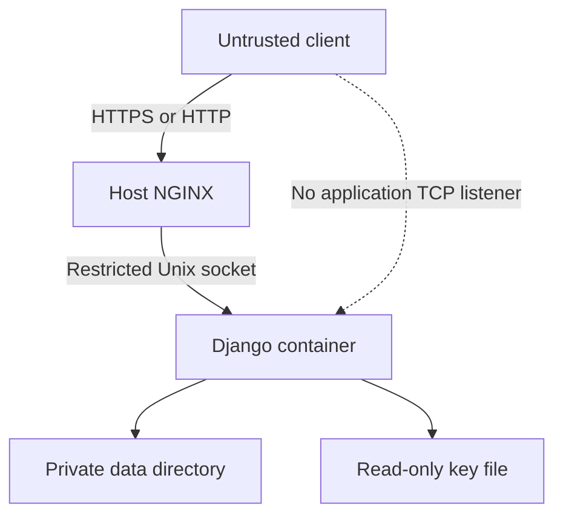

# 35. Deployment, containers and infrastructure settings

<!-- book:header:start -->
[← Chapter 34](34.md) · [Contents](../README.md#contents) · [Repository](../../README.md) · [Chapter 36 →](36.md)

<details>
<summary>In this chapter</summary>

- [Starting state and scope](#starting-state-and-scope)
- [1. Build and runtime separation, immutable artifacts and non-root execution](#1-build-and-runtime-separation-immutable-artifacts-and-non-root-execution)
- [2. Reverse proxies, forwarded headers, trusted hosts and TLS termination](#2-reverse-proxies-forwarded-headers-trusted-hosts-and-tls-termination)
- [3. Filesystem permissions, secret injection and network policy](#3-filesystem-permissions-secret-injection-and-network-policy)
- [4. Infrastructure as code, drift and a Django deployment review](#4-infrastructure-as-code-drift-and-a-django-deployment-review)
- [Guided lab](#guided-lab)
- [Independent practice](#independent-practice)
- [Hints and worked answers](#hints-and-worked-answers)
- [Verification record and limits](#verification-record-and-limits)
- [What you can now explain](#what-you-can-now-explain)
- [Primary sources](#primary-sources)

</details>
<!-- book:header:end -->

The image says `USER 10001`, but the deployment starts it with `user: "0:0"`. The application trusts `X-Forwarded-Proto`, but an outside client can send that header. Which evidence tells you who is actually running Casebook and who may describe the original connection?

This chapter reviews a small application container and its reverse proxy. You will separate build inputs from runtime privileges, follow host and scheme information across a trust boundary, and annotate a deployment with checks that can pass, fail or remain missing.

You need chapter 19's Django health/ORM fixture, chapter 23's workspace permission rule, chapter 32's artifact identity and chapter 33's required audit boundary. Chapter 34 added a useful discipline: record the source and freshness of evidence before deciding that a condition is healthy.

By the end, you will be able to:

- Distinguish an image's declared user, a deployment override and the serving process's effective identity.
- Explain why a trusted-header setting requires a protected proxy-to-application path.
- Check host validation independently at the proxy and application.
- Assign writable paths, secrets and network access to explicit needs.
- Compare reviewed infrastructure definitions with rendered configuration and observed runtime state.

The edition targets **CPython 3.12.14** and **Django 6.1.3**. The offline examples here ran with **CPython 3.12.14**, **Docker CLI 29.8.1** and **Docker Compose v5.5.1**. The Docker daemon, Gunicorn and NGINX were unavailable. Django 6.1.3 is tested in the local service chapters; this deployment chapter did not run a built application image. The manifest was rendered and checked, and ten standard-library test methods passed. Container builds, Django integration checks and live proxy/network checks below are explicitly **not executed**.

The result is a complete review exercise with a runnable offline portion and a concrete deployment validation plan. It is not a claim that this configuration has already passed a production deployment review.

## Starting state and scope

Keep `examples/ch19/casebook/`, `examples/ch19/notes/` and their fixtures unchanged. Chapter 19 exposes only `/health/` and supplies the ORM learning model. We add a production-settings module and a WSGI entry point alongside a disposable copy of that project. A **WSGI server** runs the Django application and exchanges requests with a proxy; the example uses Gunicorn.

The health fixture is a small deployment target, not the finished private-note service. It does not acquire authentication, a worker, recovery, complete audit instrumentation or release authorization merely because we package it. When those features are integrated later, their storage, identity and network needs require their own reviewed configuration.

Casebook's application policy remains the same: Mina may read Alpha while her membership is active; Ravi, a Beta member, may not read the same Alpha note. Lee manages Alpha only. Host validation and HTTPS do not decide these workspace permissions. A permitted read and a forbidden read must still be exercised through the application after deployment.

The example topology is deliberately small: a **host-installed NGINX** terminates TLS and talks HTTP to the application over a filesystem Unix socket. A Unix socket is a local communication endpoint addressed by a path rather than an IP address and port. The application container has no external IP network. This design is suitable for the chapter's single-host, SQLite-backed target; it is not a distributed worker topology.

**Figure F35-01. The boundaries that make the scheme claim meaningful**



The dotted relationship is a forbidden direct path. The client can reach NGINX, which controls forwarding headers. Filesystem permissions limit who can connect to the application socket. Host administrators and the application account remain trusted; the socket is not a protection from a compromised host administrator.

## 1. Build and runtime separation, immutable artifacts and non-root execution

### Separate two kinds of authority

A **build** creates an artifact from source, dependencies and tools. A **runtime** executes that artifact with configured privileges, mounts, secrets and network access. The builder may need package downloads or compiler tools that the running application does not need.

An **immutable artifact** is selected by content identity and replaced by another artifact when code changes. A mutable tag such as `latest` is a name whose target can change. A registry digest identifies content, but does not establish that the content is safe or approved. Keep chapter 32's evidence tying reviewed source and checks to the exact output, then extend that record to the image build.

The chapter 32 sample archive hash is not an OCI image digest. An image build adds a base image, runtime packages and filesystem metadata. Record the new build inputs and output identity. For multiple CPU platforms, record the approved index/manifest identity and selected platform, then its relationship to the local image configuration ID. Do not compare different kinds of digest as if they were the same object.

Docker's [build guidance](https://docs.docker.com/build/building/best-practices/) describes multi-stage builds and digest selection. The following Dockerfile uses a preparation stage to install an already reviewed wheel set without network downloads. Its runtime stage copies the virtual environment and selected source files. Build-only wheel inputs are not copied into the final stage.

### A parameterized build, with explicit external inputs

Save the chapter's listings under `examples/ch35/`. The build context is the repository root. Before building, provide:

- A verified, compatible `PYTHON_IMAGE` digest reference for the edition's Python baseline and target platform. Do not invent a digest from the version number.
- `vendor/requirements.lock`, containing **all** runtime requirements pinned with hashes, including Django `6.1.3`, the reviewed Gunicorn version and transitive requirements.
- `vendor/wheels/`, containing the corresponding compatible wheels. The offline install must fail when a required wheel or hash is missing.

These are trusted build inputs to obtain through the dependency/release process, not omitted secret values to paste into this chapter. No image or wheel lock was generated here. The sample registry digest used later is explicitly fictional and is only for parser tests. An actual build/release remains blocked until real compatible inputs are supplied and verified.

Filename: `examples/ch35/Dockerfile`.

```dockerfile
# Supply a reviewed python:<version>-slim@sha256:<digest> build argument.
ARG PYTHON_IMAGE
FROM ${PYTHON_IMAGE} AS assemble
RUN python -m venv /opt/venv
COPY vendor/requirements.lock /build/requirements.lock
COPY vendor/wheels/ /build/wheels/
RUN /opt/venv/bin/python -m pip install --no-index \
    --find-links=/build/wheels --only-binary=:all: \
    --require-hashes -r /build/requirements.lock

FROM ${PYTHON_IMAGE} AS runtime
ENV PATH="/opt/venv/bin:$PATH" \
    PYTHONDONTWRITEBYTECODE=1 PYTHONUNBUFFERED=1 \
    DJANGO_SETTINGS_MODULE=casebook.settings_production
WORKDIR /app
COPY --from=assemble /opt/venv /opt/venv
COPY examples/ch19/casebook/ /app/casebook/
COPY examples/ch19/notes/ /app/notes/
COPY examples/ch35/deployment.py /app/casebook/deployment.py
COPY examples/ch35/settings_production.py /app/casebook/settings_production.py
COPY examples/ch35/wsgi.py /app/casebook/wsgi.py
COPY examples/ch35/gunicorn.conf.py /app/gunicorn.conf.py
COPY examples/ch35/check_django.py /app/check_django.py
COPY examples/ch35/probe_egress.py /app/probe_egress.py
RUN chown -R 0:0 /app /opt/venv && chmod -R go-w /app /opt/venv
USER 10001:20000
CMD ["python", "-m", "gunicorn", "casebook.wsgi:application", "--config", "/app/gunicorn.conf.py"]
```

The two `FROM` instructions use the same supplied base, so copying its virtual environment does not intentionally cross Python/platform boundaries. The runtime tree is root-owned and not writable by the application user. The final `USER` changes subsequent execution to numeric UID `10001`, primary GID `20000`. A UID identifies an operating-system account; a GID identifies a group. These are not Mina's or Ravi's application user IDs.

The builder still needs appropriate isolation and input verification. A multi-stage file does not remove a malicious dependency, validate a base digest or hide a secret copied into an earlier layer. Our Dockerfile does not copy the whole repository or a secrets directory. Keep the build context itself free of secrets; an exclusion file is another useful control, but not a reason to store secrets beside source.

The exec-form `CMD` supplies arguments directly to the process. It uses the WSGI entry point below, not Django's development server. Gunicorn, its dependencies and this configuration must be validated together at the pinned versions selected in the lock.

Filename: `examples/ch35/wsgi.py`.

```python
import os
from django.core.wsgi import get_wsgi_application

os.environ.setdefault("DJANGO_SETTINGS_MODULE", "casebook.settings_production")
application = get_wsgi_application()
```

### Worked example 1: which user wins?

Consider this **incomplete, intentionally unsafe review excerpt**, not a file to deploy:

```yaml
services:
  app:
    image: casebook:latest
    user: "0:0"
    ports: ["8000:8000"]
    volumes: ["./:/app"]
    environment:
      DEBUG: "false"
```

Predict the result: if the Dockerfile ends with `USER 10001:20000`, which identity does this service request?

The deployment override requests UID `0`, GID `0`: root inside the container. The image's default does not win against an explicit runtime user. Root inside a container is not automatically host root, but it grants unnecessary authority within the container and increases the consequences of other weaknesses. The source bind mount also replaces the reviewed image's `/app` tree with local files. The tag alone cannot identify the reviewed artifact.

The `DEBUG` environment text proves nothing about Django until its settings loader is inspected. In Python, `bool("false")` is `True`; an environment variable does not automatically set a Django option. Our production settings fix `DEBUG = False` and do not parse this variable.

**Table T35-01. Evidence layers for runtime identity**

| Evidence | What it establishes | Remaining question |
| --- | --- | --- |
| Dockerfile `USER 10001:20000` | Intended image default | Did the build use this Dockerfile? |
| Image configuration user | Default stored in the selected image | Does deployment override it? |
| Rendered Compose `user` | Intended final service override | Was this rendered configuration started? |
| Container inspection `Config.User` | Created container's configured identity | Did serving processes change identity or privileges? |
| Effective UID/GID of master and worker processes | Actual process identity at observation time | Are the artifact, capabilities, mounts and isolation also correct? |

Running `id` through an exec command only identifies that new diagnostic process. Pair it with process evidence for the actual server. With the `init` option enabled, PID 1 may be a small init process, so checking only PID 1 is also insufficient.

### The reviewed container manifest

Compose supports JSON as well as YAML; see its [format FAQ](https://docs.docker.com/compose/support-and-feedback/faq/). JSON keeps this chapter's offline reader in the standard library. The following definition has one application service. NGINX is managed separately on the host, and no application port is published.

Filename: `examples/ch35/compose.json`.

```json
{
  "name": "casebook-ch35",
  "services": {
    "app": {
      "image": "${CASEBOOK_IMAGE:?provide the reviewed image digest}",
      "user": "10001:20000",
      "read_only": true,
      "network_mode": "none",
      "cap_drop": ["ALL"],
      "security_opt": ["no-new-privileges:true"],
      "init": true,
      "pids_limit": 64,
      "environment": {
        "DJANGO_SETTINGS_MODULE": "casebook.settings_production"
      },
      "tmpfs": ["/tmp:rw,noexec,nosuid,nodev,size=16m,mode=1777"],
      "volumes": [
        {
          "type": "bind",
          "source": "/srv/casebook-state/data",
          "target": "/var/lib/casebook",
          "bind": {"create_host_path": false}
        },
        {
          "type": "bind",
          "source": "/srv/casebook-state/socket",
          "target": "/run/casebook",
          "bind": {"create_host_path": false}
        },
        {
          "type": "bind",
          "source": "/srv/casebook-secrets/django.key",
          "target": "/run/secrets/casebook_key",
          "read_only": true,
          "bind": {"create_host_path": false}
        }
      ]
    }
  }
}
```

`CASEBOOK_IMAGE` must be the reviewed digest reference, not the base image reference. `PYTHON_IMAGE` selects a build input; `CASEBOOK_IMAGE` selects the finished application image. The runtime manifest does not build or install dependencies on startup.

The selected restrictions are explicit: non-root user, read-only root filesystem, no external IP network, all Linux capabilities dropped and no acquisition of new privileges through executable-file transitions. The PID limit bounds process count. These reduce authority but do not replace a patched host/kernel, daemon isolation or the application's authorization rules.

## 2. Reverse proxies, forwarded headers, trusted hosts and TLS termination

### Host, scheme and identity are different claims

The request **host** names the service, such as `notes.casebook.test`. Its **scheme** says whether the original request used `http` or `https`. **TLS termination** means a proxy accepts the client's TLS connection, then starts a separate connection to the application.

After termination, the backend HTTP connection does not itself prove that the client used TLS. The proxy can report that fact in a forwarding header. That report is trustworthy only when an authorized proxy overwrites client input and an untrusted caller cannot bypass it.

`ALLOWED_HOSTS` validates the host when Django's `request.get_host()` is called. Reading `request.META["HTTP_HOST"]` directly bypasses that check. A simple view may never ask for the host, so this chapter adds an early middleware boundary. Django's [host-setting reference](https://docs.djangoproject.com/en/6.1/ref/settings/#allowed-hosts) defines the behavior; the explicit middleware ensures this health target exercises it.

Filename: `examples/ch35/deployment.py`.

```python
from pathlib import Path
import re


def read_key(filename):
    # The deployment contract is exactly 64 lower-case hex bytes, plus an
    # optional final LF. Do not print the bytes in errors or diagnostics.
    try:
        with Path(filename).open("rb") as source:
            value = source.read(66)
    except OSError:
        raise RuntimeError("deployment_secret_unavailable") from None
    if re.fullmatch(rb"[0-9a-f]{64}\n?", value) is None:
        raise RuntimeError("deployment_secret_invalid")
    return value.removesuffix(b"\n").decode("ascii")


class RequireKnownHost:
    def __init__(self, get_response):
        self.get_response = get_response

    def __call__(self, request):
        request.get_host()  # Validate even when the view never reads Host.
        return self.get_response(request)
```

`RequireKnownHost` delegates to Django's validator before a view runs. It does not implement a second domain parser. A validation exception must remain a refusal; the middleware does not catch it and continue.

`read_key` implements a separate, small file contract: exactly sixty-four lower-case hexadecimal bytes, optionally followed by one LF. It returns a key but never includes it in a diagnostic. Missing or malformed input prevents settings initialization. File ownership and read access still have to be established outside this parser.

Filename: `examples/ch35/settings_production.py`.

```python
# Extend the unchanged chapter 19 health/ORM fixture.
from .settings import *
from .deployment import read_key


SECRET_KEY = read_key("/run/secrets/casebook_key")
DEBUG = False
ALLOWED_HOSTS = ["notes.casebook.test"]
USE_X_FORWARDED_HOST = False
USE_X_FORWARDED_PORT = False
SECURE_PROXY_SSL_HEADER = ("HTTP_X_FORWARDED_PROTO", "https")
SECURE_SSL_REDIRECT = True
SESSION_COOKIE_SECURE = True
SESSION_COOKIE_HTTPONLY = True
CSRF_COOKIE_SECURE = True
CSRF_TRUSTED_ORIGINS = ["https://notes.casebook.test"]
# Stage HSTS separately after validating the real TLS/domain policy.
SECURE_HSTS_SECONDS = 0
MIDDLEWARE = [
    "casebook.deployment.RequireKnownHost",
    *MIDDLEWARE,
    "django.middleware.csrf.CsrfViewMiddleware",
    "django.middleware.clickjacking.XFrameOptionsMiddleware",
]
DATABASES = {
    "default": {
        "ENGINE": "django.db.backends.sqlite3",
        "NAME": "/var/lib/casebook/casebook.sqlite3",
    }
}
```

The settings extend the chapter 19 fixture without changing its original file. The earlier local-only key is replaced before the module finishes loading. The production host is explicit, and the `X-Forwarded-Host`/port alternatives are disabled. Cookie settings are stated for later integrated features; setting them does not install sessions or authenticate anyone. The added CSRF and frame middleware also do not constitute a finished browser application.

HSTS is staged at zero here. **HTTP Strict Transport Security** asks browsers to use HTTPS for a host over a specified period. Set its duration, subdomain scope and any preload choice only after validating the real domain/TLS rollout. An unresolved deployment warning needs an owner and disposition; it is not silently a passed production checklist.

### Worked example 2: who supplied `https`?

Start with the smallest input: an outside client sends an HTTPS request for `/health/` and adds `X-Forwarded-Proto: http`. Predict what Django should see after the authorized proxy.

It should see `https`, because NGINX observes its own incoming TLS connection and **replaces** the supplied header with `$scheme`. Copying `$http_x_forwarded_proto` would reuse client input. Appending to a chain without a defined parser/trust model is also unsafe here. Django's [proxy SSL setting](https://docs.djangoproject.com/en/6.1/ref/settings/#secure-proxy-ssl-header) can accept the leftmost value of a comma-separated header, so a list is not a built-in defense against spoofing.

Filename: `examples/ch35/nginx.conf`.

```nginx
# Standalone review config for a host-installed NGINX.
# The service manager starts a privileged master; workers use this account.
user nginx;
worker_processes 1;
pid /run/nginx-casebook.pid;
error_log /var/log/nginx/casebook-error.log warn;
events { worker_connections 128; }
http {
    access_log off;  # Select a minimized operational log before real use.
    ssl_protocols TLSv1.2 TLSv1.3;
    upstream casebook_app {
        server unix:/srv/casebook-state/socket/app.sock;
    }
    server {
        listen 80 default_server;
        server_name _;
        return 400;
    }
    server {
        listen 80;
        server_name notes.casebook.test;
        if ($host != notes.casebook.test) { return 400; }
        return 308 https://notes.casebook.test$request_uri;
    }
    server {
        listen 443 ssl default_server;
        server_name _;
        ssl_certificate /etc/casebook-tls/server.crt;
        ssl_certificate_key /etc/casebook-tls/server.key;
        return 400;
    }
    server {
        listen 443 ssl;
        server_name notes.casebook.test;
        ssl_certificate /etc/casebook-tls/server.crt;
        ssl_certificate_key /etc/casebook-tls/server.key;
        if ($host != notes.casebook.test) { return 400; }
        client_max_body_size 64k;
        location / {
            proxy_pass http://casebook_app;
            proxy_http_version 1.1;
            proxy_set_header Host $host;
            proxy_set_header X-Forwarded-Proto $scheme;
            proxy_set_header X-Forwarded-Host "";
            proxy_set_header X-Forwarded-Port "";
            proxy_set_header X-Forwarded-For "";
            proxy_set_header X-Real-IP "";
            proxy_set_header Forwarded "";
            proxy_set_header Connection "";
            proxy_connect_timeout 2s;
            proxy_read_timeout 10s;
        }
    }
}
```

This is a standalone host NGINX review file with no included virtual-host files. It assumes an installed service account named `nginx`, configured certificate paths and the host directories described below. `.test` is a lab domain; use a lab CA and a certificate containing the lab hostname. Do not disable certificate verification to obtain a passing test.

The default virtual hosts reject unknown hosts. The named HTTP listener redirects to a fixed HTTPS origin and never sends cleartext requests to Django. The named HTTPS server checks the effective host before forwarding. NGINX's [request selection documentation](https://nginx.org/en/docs/http/request_processing.html) explains default/named server behavior; a matching `server_name` alone should not be treated as a universal host check across every added listener.

The application receives the validated effective host in `Host`. It receives one scheme value derived from the proxy connection. Alternative forwarding headers and client-address claims are removed because this target has no reviewed use for them. If client-IP attribution is later needed, define a separate trusted chain and tests. Do not start trusting a client-address header just because it is present.

The file's small request-size and timeout values are teaching limits for `/health/`; they are not measured production export/upload limits. Access logging is off to avoid installing a default raw-URL log in this small fixture. Before real use, supply minimized operational logging, retention and monitoring appropriate to chapters 33–34. Required audit recording is an application boundary and cannot be replaced by proxy access logs.

**Table T35-02. Original scheme through the reviewed path**

| Input/path | Proxy action | Backend evidence and expected decision |
| --- | --- | --- |
| HTTPS, valid host, no forwarding header | Set `X-Forwarded-Proto: https` | Django `is_secure()` true; health `200` |
| HTTPS, valid host, client header says `http` | Replace with `https` | Same secure result; no redirect loop |
| HTTP, valid host, client header says `https` | Fixed-origin `308` redirect; do not forward | No application scheme decision for this request |
| TLS with an unknown HTTP host | Reject at proxy | `400`; no application forwarding |
| Trusted socket caller, unknown host | Django host guard rejects | Application `400`, independently of proxy routing |
| Unauthorized local account attempts socket connection | Directory/socket permissions deny access | No trusted header claim reaches Django |
| Authorized socket caller claims `https` | Django accepts the configured header | Caller is trusted by the local boundary, not authenticated by Django's header option |

The last row is the critical limit. `SECURE_PROXY_SSL_HEADER` does not select a proxy by peer IP or verify its certificate. It interprets a header on every request that reaches that Django application. If an attacker gains access to the backend, the setting cannot distinguish their claim from NGINX's claim.

We also make the WSGI server's behavior explicit, rather than relying on multiple independently configured scheme detectors:

Filename: `examples/ch35/gunicorn.conf.py`.

```python
bind = "unix:/run/casebook/app.sock"
workers = 1
threads = 1
umask = 0o007
timeout = 30
worker_tmp_dir = "/tmp"
# Make Django's explicitly reviewed header the scheme decision point.
# This does not authenticate peers; the socket directory permissions do.
secure_scheme_headers = {}
forwarded_allow_ips = ""
forwarder_headers = []
accesslog = None
errorlog = "-"
```

The [Gunicorn settings reference](https://gunicorn.org/reference/settings/) documents its scheme headers, forwarded trust and Unix-socket behavior. Here `secure_scheme_headers = {}` leaves Django's reviewed header as the scheme decision point, and `forwarder_headers = []` avoids additional forwarded WSGI-path overrides. An IP allowlist is not the security boundary for a Unix socket. The socket's filesystem access is.

This topology has no CDN or second proxy. Adding a TLS-terminating load balancer changes the evidence: NGINX's `$scheme` would describe the load-balancer-to-NGINX leg, which might be HTTP. Revisit network admission, header stripping, authenticated upstream identity and the original-scheme contract before adding that hop. Do not paste a wider trusted-header rule into the application to make redirect loops disappear.

## 3. Filesystem permissions, secret injection and network policy

### Give each writable path a reason

A read-only root filesystem does not make every mount read-only. Our data and socket binds are writable. Protecting code while making `/app` a writable source bind would defeat the design.

**Table T35-03. Host preparation contract for this Linux deployment**

| Host path | Owner/group and mode | Container path and reason |
| --- | --- | --- |
| `/srv/casebook-state/data` | `10001:20000`, directory `0700` | `/var/lib/casebook`; SQLite database and journal files |
| `/srv/casebook-state/socket` | `10001:20000`, directory `2750` | `/run/casebook`; application creates/removes its socket |
| `/srv/casebook-secrets/django.key` | Owner `10001`, file `0400`; protected parent | `/run/secrets/casebook_key`, read-only; startup key |
| `/etc/casebook-tls/server.key` | Restricted to the host TLS service's required identity | Not mounted in application; proxy owns TLS termination |
| Application `/tmp` | Bounded private tmpfs | Worker temporary files; not durable storage |

The leading `2` in directory mode `2750` sets the group-inheritance bit. The application can create its socket; the `20000` group can traverse/read the directory but cannot replace entries there. Gunicorn's `007` umask makes its Unix socket accessible to its owner/group, not other accounts. Verify the actual socket type, owner, group and mode after startup rather than inferring them solely from the directory. Linux's [Unix-socket manual](https://man7.org/linux/man-pages/man7/unix.7.html) documents pathname permissions; do not substitute an abstract socket and assume the same filesystem boundary.

Give the host NGINX **worker account** supplementary group `20000`, and restart it through the service manager so the new membership applies. Verify that account's effective groups. Do not add unrelated host users to this group. The parent directories must allow the proxy to traverse the socket path without granting access to private data or the key file.

Numeric host/container ownership mapping can differ with user namespaces, rootless engines and desktop VM bind mounts. T35-03 is a Linux host contract to verify on the deployment engine, not a promise that `chown` on a laptop gives identical behavior inside a VM. Do not fix a mismatch with `chmod 777`.

SQLite needs write access to its directory, not only its main file. Put migrations and any fixture initialization into an explicit maintenance step using the same reviewed image and intended database path. Back up and verify state around real migrations. Startup should not quietly create a new empty database at a different path because the intended bind was missing. The manifest sets `create_host_path: false` so a missing host source is an error instead of automatic directory creation.

The application can still modify its own database, read its own key and run Python against data in `/tmp`. A `noexec` mount is not a guarantee that an interpreter cannot read and execute a script. These are narrow filesystem controls, not replacements for safe code or authorization.

### Inject secrets at runtime

The Django key is injected as a protected read-only file. It is not a Dockerfile `ARG`, an image `ENV`, a command-line value, a committed manifest value or a value printed by the review. Generate a disposable 64-hex-character key for the lab, and use the deployment's secret-management process for an actual service.

A bind-mounted secret file does not become encrypted at rest, automatically rotated or hidden from host/daemon administrators. It is also not protected from the application that needs to read it. Enforce ownership, exclude it from source/build context, control backups and define rotation/restart behavior. For file-backed Compose secrets, consult the [secret reference](https://docs.docker.com/reference/compose-file/secrets/) rather than assuming declared UID/mode changes are implemented for every source; this example uses an explicit host-file ownership contract.

Changing a secret file does not guarantee that an existing process rereads it. This settings module reads at initialization. Rotation therefore needs a coordinated restart and checks for dependent sessions/signatures or other key uses. Do not confuse the Django key with chapter 27's export encryption keyring or the proxy's TLS private key; they have different roles and owners.

### Block an unnecessary connection with evidence

The health/SQLite target needs no IP egress. `network_mode: "none"` removes ordinary IP connectivity except the container's loopback interface, as described by Docker's [none network driver](https://docs.docker.com/engine/network/drivers/none/). Local Unix-socket communication still works through the authorized bind.

This is stronger and easier to inspect than claiming that an unpublished port blocks outbound traffic. `ports` controls publication, not general egress. A container on a default network may still initiate connections even when no port is published.

To test one blocked unnecessary connection, use a **controlled non-loopback IPv4 canary** in the lab. First show that the same canary IP/port accepts a connection from the authorized control host, and that its listener is still healthy after the denied attempt. Then attempt that exact address from the application container. Save target, times, positive controls, error classification and the inspected network mode. Use an endpoint you operate; no public scan is needed.

Filename: `examples/ch35/probe_egress.py`.

```python
"""Attempt only the operator's controlled IPv4 canary, inside the app."""
import argparse
import errno
import ipaddress
import json
import socket

parser = argparse.ArgumentParser()
parser.add_argument("canary_ipv4")
parser.add_argument("port", type=int)
args = parser.parse_args()
address = ipaddress.IPv4Address(args.canary_ipv4)
if address.is_loopback or address.is_multicast or address.is_unspecified:
    raise SystemExit("use_a_controlled_nonloopback_canary")
if not 1 <= args.port <= 65535:
    raise SystemExit("invalid_port")
with socket.socket(socket.AF_INET, socket.SOCK_STREAM) as connection:
    connection.settimeout(2)
    try:
        connection.connect((str(address), args.port))
    except OSError as error:
        code = error.errno
    else:
        code = 0
blocked = code in {errno.ENETUNREACH, errno.EACCES, errno.EPERM}
print(json.dumps({"connected": code == 0, "errno": code,
                  "policy_consistent_block": blocked}, sort_keys=True))
# Refusal and timeout do not establish the selected policy boundary.
raise SystemExit(0 if blocked else 1)
```

Expected on the described Linux `none` network: connection fails with `ENETUNREACH`, and the tool prints `policy_consistent_block: true`. A firewall might instead return a permission error. A timeout or connection refusal is inconclusive for this selected boundary: the listener might be absent, the address wrong or routing broken for another reason. A successful connection fails the check.

This tool has not made a connection in the authoring environment. Its syntax was checked. Even a valid observed denial proves only the selected destination/protocol/path at that time; IPv6, Unix sockets, inherited descriptors and host-administrator actions need separate consideration. In the full Casebook service, remote database/queue/integration requirements would require a different network policy and tests, not an unreviewed change to the default network.

## 4. Infrastructure as code, drift and a Django deployment review

**Infrastructure as code (IaC)** records deployment intent in reviewable definitions. **Drift** is a difference between the reviewed intent and the system actually running. A Compose file, host service configuration and ownership policy can all be part of that intent. An administrator's manual port mapping, changed file permissions or added NGINX include can create drift without changing Python code.

Keep three records: source definition, fully rendered configuration and observed runtime state. Compose interpolation, override files and service-manager environment may change what the source appears to mean. Rendering is a useful intermediate check; it does not contact the running application or prove enforcement.

### Reproduce the offline review

The following checker accepts a rendered Compose JSON document and an independently selected expected image reference. It checks eleven selected static controls. It does not parse NGINX, authenticate evidence, inspect the host or certify that the digest was approved.

Filename: `examples/ch35/review_manifest.py`.

```python
"""Review selected static controls; never report live runtime verification."""
import argparse
import json
import re
from pathlib import Path


def review(document, expected_image):
    if re.fullmatch(r"[^\s@]+@sha256:[0-9a-f]{64}", expected_image) is None:
        raise ValueError("expected_image_must_be_digest_reference")
    service = document["services"]["app"]
    mounts = {item["target"]: item for item in service.get("volumes", [])}
    expected_mounts = {
        "/var/lib/casebook": ("/srv/casebook-state/data", False),
        "/run/casebook": ("/srv/casebook-state/socket", False),
        "/run/secrets/casebook_key": ("/srv/casebook-secrets/django.key", True),
    }
    mount_ok = len(service.get("volumes", [])) == 3 and set(mounts) == set(expected_mounts)
    for target, (source, read_only) in expected_mounts.items():
        item = mounts.get(target, {})
        mount_ok &= (item.get("type") == "bind" and item.get("source") == source
                     and item.get("read_only", False) is read_only
                     and item.get("bind", {}).get("create_host_path") is False)
    return {
        "approved_image_reference": service.get("image") == expected_image,
        "numeric_runtime_user": service.get("user") == "10001:20000",
        "read_only_root": service.get("read_only") is True,
        "no_external_ip_network": service.get("network_mode") == "none",
        "no_published_ports": not service.get("ports"),
        "no_runtime_build": not service.get("build"),
        "no_command_override": not service.get("command") and not service.get("entrypoint"),
        "drop_capabilities": service.get("cap_drop") == ["ALL"]
                             and service.get("privileged", False) is False,
        "no_new_privileges": "no-new-privileges:true" in service.get("security_opt", []),
        "settings_module": service.get("environment", {}).get("DJANGO_SETTINGS_MODULE")
                           == "casebook.settings_production",
        "reviewed_mounts": mount_ok,
    }


def main():
    parser = argparse.ArgumentParser()
    parser.add_argument("manifest", type=Path)
    parser.add_argument("--expected-image", required=True)
    args = parser.parse_args()
    checks = review(json.loads(args.manifest.read_text()), args.expected_image)
    for name, passed in checks.items():
        print(f"{'PASS' if passed else 'FAIL'} {name}")
    print("Runtime identity, Django, proxy and connection evidence: REQUIRED")
    raise SystemExit(0 if all(checks.values()) else 1)


if __name__ == "__main__":
    main()
```

For a copyable **offline parser exercise**, use this fictional reference. It has valid digest syntax and no claimed registry object or release approval:

```bash
export CASEBOOK_IMAGE='registry.casebook.test/casebook@sha256:1111111111111111111111111111111111111111111111111111111111111111'
docker compose -f examples/ch35/compose.json config --format json --output /tmp/ch35-rendered.json
python examples/ch35/review_manifest.py /tmp/ch35-rendered.json --expected-image "$CASEBOOK_IMAGE"
```

Recorded output:

```text
PASS approved_image_reference
PASS numeric_runtime_user
PASS read_only_root
PASS no_external_ip_network
PASS no_published_ports
PASS no_runtime_build
PASS no_command_override
PASS drop_capabilities
PASS no_new_privileges
PASS settings_module
PASS reviewed_mounts
Runtime identity, Django, proxy and connection evidence: REQUIRED
```

Here `approved_image_reference` means equality with the reference supplied to the checker. In this run that reference was fictional. The name does not transform test data into an approval. In deployment, obtain the expected identity from the reviewed release record, independently of the running container's self-description.

The rendering and checker ran without a Docker daemon and without fetching an image. Do not add `up`, `pull` or `build` to this parser exercise. For an actual deployment, replace the fictional reference with the verified application digest, record the build inputs, and complete the runtime checks below.

### Tests of the offline boundary

These tests reject a root override, changed image, network/public-port drift, writable or wrong-source secret mounts, missing controls and runtime build/command/privilege overrides. They also test the small key reader and that the middleware calls a host validator before a view. The fake request object tests call ordering; it does not claim to test Django's host parser.

Filename: `examples/ch35/test_review.py`.

```python
import copy
import json
import tempfile
import unittest
from pathlib import Path

from deployment import RequireKnownHost, read_key
from review_manifest import review


# Fictional parser/test identity; no such image was built or approved.
TEST_IMAGE = "registry.casebook.test/casebook@sha256:" + "1" * 64
TEMPLATE = json.loads(Path(__file__).with_name("compose.json").read_text())


def resolved():
    document = copy.deepcopy(TEMPLATE)
    document["services"]["app"]["image"] = TEST_IMAGE
    return document


class ReviewTests(unittest.TestCase):
    def test_selected_static_controls(self):
        self.assertTrue(all(review(resolved(), TEST_IMAGE).values()))

    def test_root_override_is_not_the_image_user(self):
        document = resolved()
        document["services"]["app"]["user"] = "0:0"
        self.assertFalse(review(document, TEST_IMAGE)["numeric_runtime_user"])

    def test_changed_artifact_is_refused(self):
        document = resolved()
        document["services"]["app"]["image"] = TEST_IMAGE.replace("1", "2")
        self.assertFalse(review(document, TEST_IMAGE)["approved_image_reference"])
        with self.assertRaises(ValueError):
            review(document, "registry.casebook.test/casebook:latest")

    def test_network_and_port_drift(self):
        document = resolved()
        document["services"]["app"].update(network_mode="host", ports=["8000:8000"])
        checks = review(document, TEST_IMAGE)
        self.assertFalse(checks["no_external_ip_network"])
        self.assertFalse(checks["no_published_ports"])

    def test_secret_mount_cannot_be_writable_or_implicit(self):
        document = resolved()
        secret = document["services"]["app"]["volumes"][2]
        for field, value in [("read_only", False), ("source", "/tmp/other")]:
            changed = copy.deepcopy(document)
            changed["services"]["app"]["volumes"][2][field] = value
            self.assertFalse(review(changed, TEST_IMAGE)["reviewed_mounts"])
        secret["bind"]["create_host_path"] = True
        self.assertFalse(review(document, TEST_IMAGE)["reviewed_mounts"])

    def test_runtime_build_command_and_privilege_overrides(self):
        document = resolved()
        document["services"]["app"].update(build=".", command=["sh"], privileged=True)
        checks = review(document, TEST_IMAGE)
        for name in ("no_runtime_build", "no_command_override", "drop_capabilities"):
            self.assertFalse(checks[name])

    def test_missing_control_does_not_pass(self):
        document = resolved()
        del document["services"]["app"]["read_only"]
        self.assertFalse(review(document, TEST_IMAGE)["read_only_root"])

    def test_secret_contract_and_safe_failure(self):
        with tempfile.TemporaryDirectory() as directory:
            path = Path(directory) / "key"
            path.write_bytes(b"a" * 64 + b"\n")
            self.assertEqual(read_key(path), "a" * 64)
            for value in (b"", b"private-marker", b"a" * 100, b"a" * 64 + b"\n\n"):
                path.write_bytes(value)
                with self.assertRaisesRegex(RuntimeError, "^deployment_secret_invalid$"):
                    read_key(path)
            path.unlink()
            with self.assertRaisesRegex(RuntimeError, "^deployment_secret_unavailable$"):
                read_key(path)

    def test_host_guard_validates_before_view(self):
        calls = []
        class Request:
            def get_host(self):
                calls.append("host")
                return "notes.casebook.test"
        guard = RequireKnownHost(lambda request: calls.append("view") or "ok")
        self.assertEqual(guard(Request()), "ok")
        self.assertEqual(calls, ["host", "view"])

    def test_host_guard_stops_on_validation_error(self):
        class Request:
            def get_host(self):
                raise ValueError("simulated_validator_refusal")
        calls = []
        guard = RequireKnownHost(lambda request: calls.append("view"))
        with self.assertRaises(ValueError):
            guard(Request())
        self.assertEqual(calls, [])


if __name__ == "__main__":
    unittest.main()
```

Run from the repository root:

```bash
python -m unittest discover -s examples/ch35 -p 'test_review.py' -v
```

The recorded run executed **10 test methods**, all passing. Expected final status is `OK`; timings vary. Mutated fixtures remain temporary Python objects. No serving system or persistent database was changed.

### Establish the runtime identity and loaded settings

On a prepared lab deployment, record the actual engine, Python, Django, Gunicorn and NGINX versions. Validate the base/image/lock inputs and certificate chain. Use the service's approved launch procedure and protected host directories. The following commands are a **validation plan**, not recorded successful executions.

```bash
docker compose -f examples/ch35/compose.json ps -q app
```

Assign its single returned container ID to `APP_ID` in the operator's shell. If it returns nothing or more than the intended service instance, stop and identify the target. Do not silently inspect another container.

```bash
docker inspect --format '{{.Config.Image}} {{.Config.User}} {{.HostConfig.ReadonlyRootfs}} {{.HostConfig.NetworkMode}}' "$APP_ID"
docker top "$APP_ID" -eo pid,euid,egid,args
docker compose -f examples/ch35/compose.json exec -T app python /app/check_django.py
docker compose -f examples/ch35/compose.json exec -T app python -m django check --deploy --settings=casebook.settings_production
```

Container inspection should name the approved image reference, `10001:20000`, a read-only root and network mode `none`. Check the local image-ID/platform mapping as described earlier, plus actual mounts, capabilities, security options and absence of published application ports. In `docker top`, identify the serving master/worker and confirm their effective UID/GID. Do not equate an init-process row or a diagnostic exec process with the worker.

`check_django.py` reads selected loaded settings and exercises actual Django host/scheme behavior when the dependencies are present:

Filename: `examples/ch35/check_django.py`.

```python
"""Run inside the built image, after mounting a disposable valid key."""
import os

os.environ.setdefault("DJANGO_SETTINGS_MODULE", "casebook.settings_production")
import django
django.setup()

from django.conf import settings
from django.test import Client, RequestFactory

assert settings.DEBUG is False
assert settings.ALLOWED_HOSTS == ["notes.casebook.test"]
assert settings.USE_X_FORWARDED_HOST is False
assert settings.SECURE_PROXY_SSL_HEADER == ("HTTP_X_FORWARDED_PROTO", "https")
client = Client()
valid = {"HTTP_HOST": "notes.casebook.test", "HTTP_X_FORWARDED_PROTO": "https"}
assert client.get("/health/", **valid).status_code == 200
invalid = dict(valid, HTTP_HOST="evil.invalid")
assert client.get("/health/", **invalid).status_code == 400
forwarded = dict(valid, HTTP_X_FORWARDED_HOST="evil.invalid")
assert client.get("/health/", **forwarded).status_code == 200
plain = dict(valid, HTTP_X_FORWARDED_PROTO="http")
response = client.get("/health/", **plain)
assert response.status_code == 301
assert response["Location"] == "https://notes.casebook.test/health/"
request = RequestFactory().get("/health/", **valid)
assert request.is_secure() is True
request = RequestFactory().get("/health/", **dict(valid, HTTP_X_FORWARDED_PROTO="http"))
assert request.is_secure() is False
# Demonstrate the trust precondition: Django does not check the sender here.
claimed = RequestFactory().get("/health/", REMOTE_ADDR="192.0.2.44", **valid)
assert claimed.is_secure() is True
print("Django settings/host/scheme checks passed; proxy isolation remains external")
```

Expected final line if these checks pass:

```text
Django settings/host/scheme checks passed; proxy isolation remains external
```

This remains an **unexecuted built-image check**. Local Django tests elsewhere do not establish that this image or its production settings were loaded. The artificial `REMOTE_ADDR` case is intentional: it shows that Django accepts a matching scheme header without proving who supplied it. A test-client request bypasses NGINX and filesystem admission entirely. Only the live boundary checks can establish that untrusted callers cannot reach this interpretation point.

The deployment check command may report warnings, including the intentionally staged HSTS policy. Record and resolve or explicitly assign each finding before a real release. The command cannot prove certificate validity, proxy header replacement, effective process identity, secret permissions or network isolation. Do not print the complete settings module or environment to attach evidence; report only the selected safe values.

### Establish the proxy's behavior

Have the authorized operator validate the exact file used by the host service with `nginx -t`, confirm the service's launch path and perform the supervised reload/start. Record the configuration identity and effective worker groups. Validating a different file with `-c` does not prove the running service loaded it.

With the lab CA certificate saved as `lab-ca.pem`, these are conditional probes against the local lab proxy. They contact only that proxy. Expected codes are shown in T35-02:

```bash
curl --cacert lab-ca.pem --resolve notes.casebook.test:443:127.0.0.1 \
  -H 'X-Forwarded-Proto: http' -o /dev/null -sS -w '%{http_code}\n' \
  https://notes.casebook.test/health/
curl --cacert lab-ca.pem --resolve notes.casebook.test:443:127.0.0.1 \
  -H 'Host: evil.invalid' -o /dev/null -sS -w '%{http_code}\n' \
  https://notes.casebook.test/health/
curl --resolve notes.casebook.test:80:127.0.0.1 \
  -H 'X-Forwarded-Proto: https' -o /dev/null -sS -w '%{http_code}\n' \
  http://notes.casebook.test/health/
```

Expect `200`, `400` and `308`, respectively. Retain the redirect's `Location` in the HTTP case and verify the fixed approved origin. Do not follow redirects automatically when evaluating the first response.

To distinguish proxy refusal from Django refusal, an authorized socket operator can issue the unknown-host request directly through the Unix socket:

```bash
curl --unix-socket /srv/casebook-state/socket/app.sock \
  -H 'Host: evil.invalid' -H 'X-Forwarded-Proto: https' \
  -o /dev/null -sS -w '%{http_code}\n' http://localhost/health/
```

Expect application `400`. Use a known-host positive control on that same socket and identity. Separately, attempt socket access as an unrelated account and record an OS permission refusal. A failed request caused by a missing socket or stopped server does not prove the access boundary. These checks require the service to be running and are unexecuted here.

An HTTPS spoof probe returning `200` is useful because `http` reaching Django would trigger its HTTPS redirect under the loaded settings. Pair that observation with the actual replacement directive and Gunicorn scheme configuration. It does not establish every duplicate-header/parser behavior or any untested alternate listener.

### Attach evidence for one blocked connection

On the prepared lab, set `CANARY_IP` and `CANARY_PORT` to an endpoint the operator controls. Verify its accepting listener from the control host immediately before and after the attempt. Then run:

```bash
docker compose -f examples/ch35/compose.json exec -T app \
  python /app/probe_egress.py "$CANARY_IP" "$CANARY_PORT"
```

Save the printed result and exit status with the positive-control records. Do not label a timeout as a firewall denial. Pair the result with inspected `network_mode: none` and the actual container identity. The manifest's intent and an observed failed connection support different parts of the conclusion.

**Table T35-04. Filled-in review record for the authoring run**

| Required claim | Attached evidence | Decision |
| --- | --- | --- |
| Selected static container controls | Compose v5.5.1 rendered the supplied JSON; eleven checker results passed using a fictional digest reference | Static exercise passes; no artifact approval established |
| Debug mode | Source explicitly fixes `DEBUG = False`; live settings checker supplied but unexecuted | Runtime evidence missing |
| Process identity | Source/manifest request `10001:20000`; root-override test fails as intended | Serving-process evidence missing |
| Host validation | Early `get_host()` guard, exact allowed host, proxy refusal config; ordering tests pass | Django/proxy HTTP evidence missing |
| Original scheme | Proxy replaces header, alternate headers removed; application/WSGI settings explicit | Live TLS/spoof and bypass checks missing |
| Blocked unnecessary connection | `network_mode: none`, canary probe and positive-control procedure supplied | Connection evidence missing |
| Release decision | Docker daemon and deployment dependencies unavailable; real image inputs not supplied | **Hold deployment approval pending the named runtime and artifact evidence** |

This is the correct result for this environment. Passing static tests does not fill missing runtime evidence. A review can be complete and still conclude that deployment approval must wait for specific observations.

## Guided lab

1. Annotate the unsafe excerpt. Mark the root override, mutable image identity, source bind and published application port. Explain why the text `DEBUG: "false"` is not a loaded-settings observation.
2. Save the supplied files and run the offline rendering/checker and ten tests. Record the fictional digest as a parser fixture, not an artifact you may deploy.
3. In a temporary manifest copy, change only the user to `0:0`. Render and review that copy. Expect `FAIL numeric_runtime_user` and a nonzero checker exit. Restore the original input and compare the rendered records.
4. Trace the valid HTTPS spoof case from client to proxy to WSGI to Django. Write the value and authority at each step. Identify the path whose exposure would invalidate the scheme setting.
5. Build an evidence plan using T35-04. Mark what you actually ran and what remains missing. If a prepared Docker/NGINX lab is available, collect the runtime observations with disposable data/keys and the controlled canary. Otherwise keep the missing status; do not fill it with invented successful output.
6. State a review decision with an owner for each gap. Keep the original workspace files unchanged; perform mutations only in disposable copies. Preserve any actual configuration/error evidence without secret contents.

## Independent practice

Complete these before reading the worked answers.

1. The image default is UID `10001`, the rendered service requests UID `10001`, and the running worker's effective UID is `0`. Which evidence takes priority, and what do you inspect next?
2. Replace `proxy_set_header X-Forwarded-Proto $scheme` with `$http_x_forwarded_proto` in a review copy. Predict the valid-TLS request carrying `X-Forwarded-Proto: http`, and explain a more dangerous direct-backend or cleartext-forwarding case.
3. A colleague sees a proxy `400` for an unknown host and marks Django's `ALLOWED_HOSTS` verified. Design the additional check that separates the two boundaries.
4. The canary probe times out, while the control host also cannot reach the listener. Write the evidence status. Then state what would make a policy-consistent failure credible.
5. A release adds an external database and a remote audit collector. Identify which assumptions of this topology change, which network flows need review and why disabling all audit requirements would not be a deployment fix.

**Practice check.** Annotate a deployment manifest. Attach evidence for debug mode, process identity, host validation and one blocked unnecessary connection.

## Hints and worked answers

### Guided lab answers

The final deployment request overrides the image default. `0:0` therefore fails the selected static identity rule. The original source bind replaces code selected by image identity; removing it allows the image to determine `/app`. The manifest's lack of published ports is only one part of backend isolation. In this design, no application TCP listener, no external IP network and restricted Unix-socket permissions work together.

For the valid HTTPS spoof request, the client's `http` claim is untrusted. NGINX observes TLS and supplies `https`. Gunicorn forwards the request without making a second forwarded-header scheme decision. Django interprets its configured header and considers the request secure. Only callers admitted through the protected socket boundary are allowed to make that backend claim.

The offline run supports the static record in T35-04 and the ten local test results. It does not supply serving-process identity, runtime `DEBUG`, actual Django host behavior, working TLS or a blocked canary connection. The proper completed annotation records those gaps and holds deployment approval until the responsible operator supplies the missing observations.

### Independent practice answers

**1. A root worker.** The observed effective UID describes the process actually serving at that time. Stop treating the source/rendered identity as proof of the live system. Confirm the container and image/platform identity, actual launch arguments, entry point, runtime override files and process lineage. Check whether the observation belongs to another instance or an old deployment. A deliberate privilege transition also needs investigation. Do not clear it by showing that a new exec command runs as `10001`.

**2. Reusing the client's scheme.** With a client-supplied `http` value forwarded unchanged, Django may consider a genuine TLS request insecure and redirect it back to HTTPS repeatedly. In an expanded design that forwards cleartext requests, a client's `https` value could make an insecure original request appear secure. Direct access to the backend has the same trust problem. Restore proxy replacement and verify admission isolation; do not solve the loop by trusting every possible header or disabling security controls without understanding the path.

**3. Separate host checks.** The proxy's `400` establishes its own refusal for that request. It does not show Django received anything. Use an authorized Unix-socket client with the wrong Host and the expected scheme header, and verify application `400`. Add a valid-host `200` control from the same identity. The live Django test also exercises this boundary without NGINX, but it does not prove network isolation. Keep those claims separate in the annotation.

**4. Inconclusive failure.** Neither attempt shows a healthy destination, so the timeout cannot establish the selected block. Record missing/inconclusive evidence and repair the controlled test setup. A credible result includes a fresh accepting canary before/after, the exact endpoint, inspected application network mode and a policy-consistent error from the intended container. Do not turn a connection refusal into proof of firewall enforcement.

**5. New flows.** `network_mode: none` no longer fits a service that must reach an external database or collector directly. Specify destinations, ports, DNS needs, TLS verification, credentials and the components allowed to initiate each flow. A separate delivery process could need different permissions from the web process. Preserve chapter 33's required local audit commit; collector delivery failure has its own bounded retry/parking behavior. Network changes must not make private reads, export expiry or current-membership checks optional.

## Verification record and limits

The supplied Compose JSON was rendered and schema-checked by **Docker Compose v5.5.1**, using **Docker CLI 29.8.1**, without a daemon. The selected eleven static checks passed on that rendered document with an explicitly fictional image reference. All **10 standard-library test methods** passed on **CPython 3.12.14**. The complete Python listings were syntax-checked and compared with the files used for those offline checks. Tests exercised policy mutations, key-file parsing and middleware call ordering, not a simulated replacement for Django or NGINX.

The source Dockerfile, manifest and settings describe a concrete Linux deployment target. Their review does not establish that the runtime exists. The Docker socket was absent, so no image was built, pulled or started. Gunicorn and NGINX were unavailable; the configured deployment was not launched. The live Django checker and egress probe were syntax-checked only. Expected HTTP/connection outputs are labeled as conditional expectations.

**Not executed:** the built-image Django deployment check, an installed pinned Gunicorn build, NGINX configuration validation/reload, real image/lock verification, effective process inspection, bind/secret ownership under the target engine, TLS/certificate and spoof probes, unauthorized socket access, a controlled blocked connection, migrations, backup restoration, worker/audit integration or permission tests against a deployed private-note service. No actual secret was embedded or printed, and no deployed service was changed.

For an actual release, preserve the artifact/runtime/configuration observations with collection times and owners. The selected checker is not an exhaustive Compose security policy: it does not evaluate every possible namespace, device, resource, daemon or host setting. Extend review when the topology or requirements change.

## What you can now explain

A Dockerfile user is a default; the rendered deployment can override it, and the serving process needs its own observation. A host/scheme setting is meaningful only together with the path that supplies its input. The reviewed proxy replaces the client's scheme claim, while filesystem admission protects the Unix backend.

Writable data, secrets and network access need specific purposes and tests. Source intent, rendered configuration and observed runtime state are separate evidence. A missing live check remains missing after a static test passes.

For chapter 36, retain the reviewed artifact and configuration identities, effective process/account evidence, proxy admission model, secret owners and explicit verification gaps. They become useful intake and containment facts when building an incident timeline and checking recovery.

## Primary sources

- Docker, [Build best practices](https://docs.docker.com/build/building/best-practices/): build stages and artifact selection. The chapter's external lock/base inputs remain required, not fabricated.
- Docker, [Compose services](https://docs.docker.com/reference/compose-file/services/) and [JSON-format FAQ](https://docs.docker.com/compose/support-and-feedback/faq/): service settings and accepted manifest format. Rendering is not a runtime enforcement test.
- Docker, [None network driver](https://docs.docker.com/engine/network/drivers/none/) and [Compose secrets](https://docs.docker.com/reference/compose-file/secrets/): network isolation and source-dependent secret behavior.
- Django, [Deployment checklist](https://docs.djangoproject.com/en/6.1/howto/deployment/checklist/), [`ALLOWED_HOSTS`](https://docs.djangoproject.com/en/6.1/ref/settings/#allowed-hosts) and [`SECURE_PROXY_SSL_HEADER`](https://docs.djangoproject.com/en/6.1/ref/settings/#secure-proxy-ssl-header): selected settings and their trust preconditions.
- NGINX, [Request processing](https://nginx.org/en/docs/http/request_processing.html) and [`proxy_set_header`](https://nginx.org/en/docs/http/ngx_http_proxy_module.html#proxy_set_header): virtual-server selection and upstream header replacement.
- Gunicorn, [Settings reference](https://gunicorn.org/reference/settings/): bind paths, umask, forwarded headers and scheme handling. Record and test the actual pinned runtime version used in a deployment.
- Linux man-pages, [`unix(7)`](https://man7.org/linux/man-pages/man7/unix.7.html) and [`network_namespaces(7)`](https://man7.org/linux/man-pages/man7/network_namespaces.7.html): pathname socket access and the distinct abstract-socket namespace.

<!-- book:footer:start -->
---

[← Chapter 34](34.md) · [Contents](../README.md#contents) · [Repository](../../README.md) · [Chapter 36 →](36.md)

[Back to top](#35-deployment-containers-and-infrastructure-settings)
<!-- book:footer:end -->
