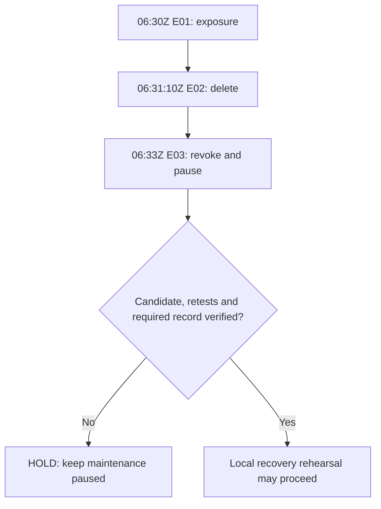

# 36. Incident response, disclosure and recovery

A maintenance credential appears in a build log. A note is then deleted under that credential. You have a backup, but how will you show that containment worked, that restoration recovered the right data and that reopening will not restore the exposed credential's power?

This chapter takes a synthetic Casebook incident from a credible report to a tested local recovery. We will reconstruct a UTC timeline from three redacted records, compare a restored database with a known backup manifest and refuse activation when a required recovery record cannot be stored.

You need chapter 8's JSON, chapter 12's tests, chapter 15's transactions and chapter 23's workspace-scoped service. Chapters 27–28 separated key custody and background work from user intent. Chapters 32–35 added artifact identity, required audit facts, evidence freshness and deployment review. The same ideas matter during an incident: a confident description is not a substitute for a checked state.

By the end, you will be able to:

- Receive a report without spreading the credential or claiming more impact than the evidence supports.
- Normalize timestamps to UTC while preserving their original form and uncertainty.
- Distinguish credential revocation, replacement and restoration.
- Verify backup identity, note counts, logical content and workspace permissions.
- Make a recovery decision that includes negative tests and a required local record.
- Hand over unresolved questions and corrective actions with owners.

The edition targets **CPython 3.12.14** and **Django 6.1.3**. These standalone examples ran with **CPython 3.12.14** and **SQLite 3.53.1**. All **17 test methods** passed. The incident, event times, credentials and roles are fictional. The databases and recovery operations are real local executions against synthetic data. No provider credential was revoked, no live service was restored and no notification was sent.

## Scenario and laboratory boundary

The incident is `INC-CH36-001`. An Alpha note-inventory helper should need only a count operation. Its older maintenance credential, `maint-v1`, has an unnecessary delete action as well. The tabletop inject says a build step exposed the credential while printing environment information. A report identifies the exposed build log. An unexpected deletion of Alpha note `102` is confirmed under that credential.

The credential represents a maintenance principal, not Mina's password, Django's secret key, an export encryption key or a proxy TLS key. These credentials have different consumers and rotation consequences. Do not disable Mina's account merely because a separate maintenance credential leaked.

Mina is user `1`, active in Alpha `1`. Ravi is user `2`, active in Beta `2`. Lee is user `3` and manages Alpha only. We reuse the unchanged chapter 23 service and add one Alpha note with a non-English title. Before the incident there are three notes: Alpha `101` and `102`, and Beta `202`.

The laboratory has two databases:

**Table T36-01. State with different recovery responsibilities**

| Store | Contents | Recovery rule |
| --- | --- | --- |
| Note database | Chapter 23 users, workspaces, memberships and notes | Restore into a fresh quarantined candidate and verify it |
| Local control registry | Synthetic credential states, maintenance pause flag, active database pointer and required recovery records | Keep current containment state; do not replace it with the older note backup |

The maintenance gateway and control changes acquire the same SQLite control lock. This serializes the modeled maintenance calls around pause and revocation. The laboratory has no HTTP endpoint, provider token cache, remote replica or distributed worker. A pause here blocks **this maintenance gateway**, not every possible production writer. A real recovery must inventory and quiesce all relevant writers, consumers and in-flight work before switching data.

The registry contains hashes of public, clearly marked teaching strings. It is an executable credential-state model, not a production authentication service or password-hashing design. Its replacement credential is also a fixed teaching string. Real replacement credentials must be newly generated through the appropriate issuer and securely delivered to their intended consumers.

## 1. Intake channels, triage, roles and severity

### Accept the report without making another exposure

An **incident** is a security condition requiring a coordinated response. A **vulnerability** is a weakness that may contribute to one. Here the exposed credential and unexpected successful deletion justify incident handling. The exposure mechanism still needs investigation; the three event records alone do not prove the complete build pipeline's root cause.

Use an organization's approved security intake channel and restricted case record. Ask for a reference to the affected artifact, a time, the credential's identifier if available and the observed effect. Do not ask a reporter to paste an active secret into a general ticket, chat room or email thread. Preserve necessary original evidence through the restricted evidence process, and share a minimized derivative for normal investigation.

**Table T36-02. Filled-in intake record**

| Field | Synthetic case entry |
| --- | --- |
| Incident ID | `INC-CH36-001` |
| Report received | `2026-11-26T06:32:00Z` |
| Subject | Maintenance credential reference `maint-v1` in the training build log |
| Confirmed effect | Note `102` deleted by a successful maintenance operation; stored total fell from three to two |
| Known scope | Credential is scoped to Alpha in the model; Beta access is tested separately |
| Unknowns | Full artifact audience, earliest exposure, copied credentials, reads, other operations and any derived credentials |
| Initial priority | High under this authored exercise policy: usable credential plus confirmed integrity loss |
| Immediate owner | Response lead, with application owner and credential custodian |

The initial priority is a decision based on potential authority and observed impact, not a universal numeric severity label. A different organization may use different names. Increase urgency for ongoing destructive use, broader grants, critical dependencies or verified disclosure. Reduce uncertainty by gathering evidence rather than guessing a low severity from a small event count.

The successful operation proves use of a credential. It does not prove the human identity or intent of the caller. Call it an unexpected operation under `maint-v1` until attribution has evidence. Absence of another event in a limited log export does not establish absence of other activity.

### Assign authority before making changes

**Table T36-03. Roles and concrete decisions**

| Role | Responsibility in this case |
| --- | --- |
| Response lead | Own severity, scope, coordination, action log, handovers and reopening decision |
| Application/data owner | Quiesce writers, identify affected state, restore a candidate and run service checks |
| Credential custodian | Revoke the old credential, identify consumers/derived access and provision a replacement |
| Evidence custodian | Preserve originals and derivatives, record hashes, times, access and transfers |
| Communications/privacy owner | Coordinate reporter updates and assess any required notifications using the actual facts and obligations |
| Reviewer | Independently inspect recovery evidence and unresolved risks before real reopening |

These are organizational response roles. Lee's Alpha manager permission does not automatically make Lee a host administrator or incident lead. Keep operational authority separate from application authorization.

NIST's [SP 800-61 Rev. 3](https://csrc.nist.gov/pubs/sp/800/61/r3/final) connects incident response with preparation and wider cybersecurity risk management. The case records and severity choices here are authored exercises. Preparation includes knowing who may revoke a credential, who can restore data and where the relevant evidence resides before an emergency occurs.

## 2. Evidence preservation, timelines, minimization and handover

### Preserve what a later reviewer needs

**Evidence preservation** retains relevant material with enough context to assess it later. A useful inventory states who collected it, from which source, when, by which method, where it is held, its content hash and its access/retention restrictions. Record subsequent transfers and any transformations.

Preserve the affected build-log object or version and its access controls through the restricted process. Create a redacted derivative for routine collaboration. Record the relationship between original and derivative; their hashes will differ. Removing a secret from the current view may reduce further exposure, but it does not revoke copies or erase earlier use. Containment should not wait for a perfect forensic collection when harm is continuing; record the reason for urgent action and capture what is safely available.

Our laboratory preserves a SQLite snapshot of the damaged note database before restoration, and records its hash in `evidence-inventory.json`. This is a database-level evidence artifact, not a forensic disk/memory image. The notes and their synthetic bodies remain in the private work directory. Normal console output contains counts and controlled status values, not note contents or credential strings.

A SHA-256 digest helps detect a change relative to a known record. It does not prove who collected the file, whether the source was honest or whether an attacker changed both the file and the inventory. Keep the authoritative inventory and backups under custody outside the affected writer's authority. This local exercise uses one operator account and does not implement independent or tamper-resistant custody.

### Worked example 1: three redacted records become a UTC timeline

An **event time** describes when the source says something occurred. An **observation time** describes when the selected collector or reporting path received it. They need not match. Preserve both, plus the original timestamp and source.

The supplied records are redacted **investigation projections**, not full chapter 33 audit documents or raw build logs. They contain credential identifiers, not credential values. They deliberately arrive out of order. `E01` reports that the exposure occurred at publication time, and was confirmed through the report at `06:32Z`; it does not say the response team noticed it at publication.

Filename: `examples/ch36/timeline.json`.

```json
[
  {
    "event_id": "E02",
    "occurred_at": "2026-11-26T06:31:10Z",
    "observed_at": "2026-11-26T06:31:12Z",
    "uncertainty_seconds": 1,
    "source": "maintenance-gateway",
    "kind": "note_delete_committed",
    "credential_id": "maint-v1",
    "request_id": "aaaaaaaaaaaaaaaaaaaaaaaaaaaaaaaa",
    "note_id": 102
  },
  {
    "event_id": "E01",
    "occurred_at": "2026-11-26T10:00:00+03:30",
    "observed_at": "2026-11-26T06:32:00Z",
    "uncertainty_seconds": 1,
    "source": "build-log-review",
    "kind": "credential_exposure_confirmed",
    "credential_id": "maint-v1",
    "request_id": null,
    "note_id": null
  },
  {
    "event_id": "E03",
    "occurred_at": "2026-11-26T06:33:00+00:00",
    "observed_at": "2026-11-26T06:33:01Z",
    "uncertainty_seconds": 1,
    "source": "local-control-registry",
    "kind": "credential_revoked_and_gateway_paused",
    "credential_id": "maint-v1",
    "request_id": null,
    "note_id": null
  }
]
```

Predict which event happened first. Do not sort the timestamp strings without conversion. `10:00:00+03:30` is `06:30:00Z`, earlier than `06:31:10Z`. A timezone offset changes the displayed clock, not the instant.

An **aware datetime** includes timezone information. The parser refuses a timestamp without an offset rather than assuming the operator's local timezone. The fixture uses whole seconds and assigns one second of uncertainty to each source. These bounds are authored assumptions, not measured clock-synchronization evidence. The parser also rejects an unexpected extra field, such as a raw token, rather than copying it into its derivative.

Filename: `examples/ch36/timeline.py`.

```python
"""Normalize the redacted teaching projections, not arbitrary raw logs."""
import argparse
import json
from datetime import datetime, timezone
from pathlib import Path


KINDS = {"credential_exposure_confirmed", "note_delete_committed",
         "credential_revoked_and_gateway_paused"}
FIELDS = {"event_id", "occurred_at", "observed_at", "uncertainty_seconds",
          "source", "kind", "credential_id", "request_id", "note_id"}


def utc(value):
    instant = datetime.fromisoformat(value)
    if instant.tzinfo is None or instant.utcoffset() is None:
        raise ValueError("timestamp_requires_offset")
    if instant.microsecond:
        raise ValueError("fixture_requires_whole_seconds")
    return instant.astimezone(timezone.utc)


def zulu(value):
    return value.isoformat(timespec="seconds").replace("+00:00", "Z")


def reconstruct(records):
    seen = set()
    timeline = []
    for record in records:
        if set(record) != FIELDS:
            raise ValueError("unexpected_projection_fields")
        if record["event_id"] in seen or record["kind"] not in KINDS:
            raise ValueError("duplicate_or_unknown_event")
        seen.add(record["event_id"])
        event_time, observed = utc(record["occurred_at"]), utc(record["observed_at"])
        uncertainty = record["uncertainty_seconds"]
        if type(uncertainty) is not int or uncertainty < 0:
            raise ValueError("invalid_uncertainty")
        if observed < event_time:
            raise ValueError("observation_precedes_event")
        timeline.append({**record, "utc": event_time})
    timeline.sort(key=lambda record: (record["utc"], record["event_id"]))
    return timeline


def overlapping_pairs(timeline):
    pairs = []
    for index, first in enumerate(timeline):
        for second in timeline[index + 1:]:
            gap = (second["utc"] - first["utc"]).total_seconds()
            if gap <= first["uncertainty_seconds"] + second["uncertainty_seconds"]:
                pairs.append((first["event_id"], second["event_id"]))
    return pairs


def main():
    parser = argparse.ArgumentParser()
    parser.add_argument("records", type=Path)
    args = parser.parse_args()
    timeline = reconstruct(json.loads(args.records.read_text()))
    for event in timeline:
        print(f"{event['event_id']} {zulu(event['utc'])} {event['kind']}")
    overlaps = overlapping_pairs(timeline)
    print(f"overlapping uncertainty intervals: {len(overlaps)}")


if __name__ == "__main__":
    main()
```

Run from the repository root:

```bash
python -m examples.ch36.timeline examples/ch36/timeline.json
```

Recorded output:

```text
E01 2026-11-26T06:30:00Z credential_exposure_confirmed
E02 2026-11-26T06:31:10Z note_delete_committed
E03 2026-11-26T06:33:00Z credential_revoked_and_gateway_paused
overlapping uncertainty intervals: 0
```

**Table T36-04. Interpreted timeline, with claims kept separate**

| Record | Normalized event time | Observation time | Supported statement |
| --- | --- | --- | --- |
| `E01` | `2026-11-26T06:30:00Z` | `06:32:00Z` | The supplied report identifies exposure at this publication time |
| `E02` | `2026-11-26T06:31:10Z` | `06:31:12Z` | A delete committed under `maint-v1`, request `aaaaaaaaaaaaaaaaaaaaaaaaaaaaaaaa`, note `102` |
| `E03` | `2026-11-26T06:33:00Z` | `06:33:01Z` | The modeled registry recorded revocation and pause |

There are seventy seconds between the reported exposure and deletion, and 180 seconds between exposure and containment. These are differences between supplied event timestamps, not measurements of the author's execution time or proof of the entire compromise window. Earlier copies or alternate consumers remain questions.

The uncertainty intervals do not overlap in this fixture. If two events are one second apart and each has one second of uncertainty, their intervals overlap. The tool flags that pair. Its deterministic display order is then only a sorting convenience. Use request/event links or other evidence to establish causality; do not invent subsecond precision.

**Figure F06. The events that establish the recovery timeline**



The first three nodes summarize authored event evidence. The branch is the tested recovery decision, not another inferred source event. In particular, a correct restored count cannot choose the successful branch when a required recording check fails.

### A handover should survive a shift change

Keep a concise decision log: action, actor/role, UTC time, reason, expected effect, observed result and evidence reference. Separate facts, hypotheses and unresolved questions. A handover that says only “rotated and restored” omits whether the old credential still works or whether restoration reintroduced a revoked permission.

For this case, the incoming reviewer needs the three-record timeline, the damaged snapshot's inventory, the backup manifest, current registry state, the candidate comparison, negative/positive tests and the failed-record decision. They also need the next owner and update time. Use restricted references instead of copying the exposed value or private note body into the summary.

## 3. Containment, credential rotation, restoration and backups

### Make containment observable

**Containment** limits further harm. **Revocation** removes the old credential's authority. **Rotation** provisions and adopts replacement credentials. Deleting a log line or changing a file on disk does not establish revocation at the verifier.

The local exercise atomically pauses maintenance and marks `maint-v1` inactive in the control registry. It then inserts `maint-v2` with count-only authority. A request using the old value must be refused specifically because the credential is rejected. A request using the replacement remains paused until recovery. The decision reason matters: a paused service refusing both values alone would not prove that the old credential had been revoked.

For a real credential, identify all consumers, active versions, caches, existing sessions, delegated/derived credentials and long-running requests. Revocation at one issuer or process may not invalidate every derived capability. Preserve service continuity where possible, but do not leave an exposed credential valid just to avoid collecting the consumer inventory. Define a controlled exception if the chosen containment has operational consequences.

OWASP's [Secrets Management guidance](https://cheatsheetseries.owasp.org/cheatsheets/Secrets_Management_Cheat_Sheet.html) discusses secret lifecycle and compromise handling. Our local registry models selected transitions only. It does not call a cloud identity provider, invalidate JWTs or rotate chapter 27 encryption keys.

### Worked example 2: compare the candidate with the known backup

A **backup manifest** records what the selected backup is expected to contain. The backup used here was created at the fictional scenario time `06:20Z`, before the reported exposure. The laboratory creates it through SQLite's backup API rather than copying only an active main database file and ignoring its journal state.

Python's [`Connection.backup()`](https://docs.python.org/3.12/library/sqlite3.html#sqlite3.Connection.backup) and SQLite's [backup API description](https://www.sqlite.org/backup.html) document the mechanism. The exercise also tests a committed row while the source uses write-ahead logging (WAL), so the backup path is checked against more than a closed main-file copy.

Predict the minimum result: after deletion there are two notes. Restoring the selected backup should produce three, with two in Alpha and one in Beta. Would that count alone prove the bodies and permissions were restored correctly?

The following is the **recorded manifest from this run**, not a universal expected file hash. Save it as a reference if useful; the executable lab generates a fresh `backup-manifest.json` for its own local backup.

Filename: `examples/ch36/known-backup-manifest.json`.

```json
{
  "schema_version": 1,
  "backup_id": "BK-CH36-001",
  "created_at": "2026-11-26T06:20:00Z",
  "database_sha256": "7b446e6e051105bd918e45d9179721dcaf3059ff755411040e5ebc1899c4ce63",
  "notes_total": 3,
  "workspace_notes": {
    "1": 2,
    "2": 1
  },
  "logical_sha256": "f419cff819be10174e29582c0a2f71160eed48f97a289d8d70adc084c74bfe03",
  "integrity_ok": true,
  "foreign_keys_ok": true
}
```

`database_sha256` identifies the recorded backup file bytes. `logical_sha256` covers canonical JSON containing the schema definitions and all four chapter 23 tables, including note contents, users and memberships. The hash allows comparison without printing those contents. It is an integrity comparison, not encryption or evidence of absence of disclosure.

The logical format uses UTF-8, sorted JSON keys, fixed separators and deterministic row order. SQLite's physical bytes or schema representation may differ across versions, so a fresh lab run uses its own generated manifest. Do not “repair” a mismatching real backup by editing the authoritative expected hash to match the suspect file.

**Table T36-05. Before deletion, damaged state and restored candidate**

| State | Total notes | Alpha | Beta | Interpretation |
| --- | ---: | ---: | ---: | --- |
| Known backup | 3 | 2 | 1 | Expected selected snapshot |
| Damaged database | 2 | 1 | 1 | Note `102` absent |
| Restored candidate | 3 | 2 | 1 | Counts match; still check content, constraints and access |
| Candidate with an altered body | 3 | 2 | 1 | Counts match, logical digest fails: hold recovery |

A restore checks the backup's physical digest before creating a candidate. It refuses to overwrite an existing destination. It then compares counts, canonical content, SQLite integrity and foreign-key checks. The serving database is not overwritten; the damaged snapshot remains available for investigation.

Full-snapshot restoration can discard valid work after the backup. A **recovery point objective (RPO)** describes the tolerated data-loss interval; a **recovery time objective (RTO)** describes the intended time to restore the required service. Agree on those objectives before selecting a recovery method. In this fixture there are no legitimate post-backup writes to reconcile; that is a known scenario condition. It would be unsafe to assume the same in production. Selective restoration or replay from a trusted change history may be necessary.

Do not restore older authentication or authorization state blindly. Keeping the credential registry outside this note backup preserves its revocation. The note backup itself includes users and memberships, so a real incident still requires reconciliation of security changes since the snapshot, including membership revocations. Our fixture has none. Its tests verify the intended Mina/Alpha, Ravi/Beta and forbidden Ravi/Alpha boundaries; they do not establish that an arbitrary old membership snapshot is current.

### Run the local response and recovery

Keep `examples/ch23/authorization_service.py` available. It supplies the original schema, transactions and permission-scoped reads. Save the following complete listing under `examples/ch36/`. It does not change the earlier module.

The fixed event/backup/recovery timestamps represent the scenario clock. The code does not measure a real RTO, and test duration is not a production recovery metric. All operations run in a controlled local rehearsal directory with no concurrent outside writers.

Filename: `examples/ch36/incident_lab.py`.

```python
"""Local synthetic incident rehearsal; not an HTTP credential service."""
import argparse
from contextlib import closing
import hashlib
import json
import os
from pathlib import Path
import sqlite3
import tempfile

from examples.ch23.authorization_service import (
    AccessDenied, detail_for_user, seed, snapshot, unit,
)


OLD = "SYNTHETIC-CH36-OLD-NOT-A-REAL-CREDENTIAL"
NEW = "SYNTHETIC-CH36-REPLACEMENT-NOT-A-REAL-CREDENTIAL"
INCIDENT = "INC-CH36-001"


class CredentialDenied(PermissionError):
    pass


def canonical(value):
    return json.dumps(value, ensure_ascii=False, sort_keys=True,
                      separators=(",", ":")).encode("utf-8")


def file_digest(path):
    return hashlib.sha256(Path(path).read_bytes()).hexdigest()


def inventory(path):
    if not Path(path).is_file():
        raise ValueError("database_missing")
    rows = snapshot(path)
    with unit(path) as db:
        schema = [list(row) for row in db.execute(
            "SELECT name,sql FROM sqlite_master WHERE type='table' "
            "AND name NOT LIKE 'sqlite_%' ORDER BY name")]
        integrity = [row[0] for row in db.execute("PRAGMA integrity_check")] == ["ok"]
        foreign_keys = not list(db.execute("PRAGMA foreign_key_check"))
    counts = {}
    for note in rows["notes"]:
        key = str(note["workspace_id"])
        counts[key] = counts.get(key, 0) + 1
    return {"notes_total": len(rows["notes"]), "workspace_notes": counts,
            "logical_sha256": hashlib.sha256(canonical({"schema": schema, "rows": rows})).hexdigest(),
            "integrity_ok": integrity, "foreign_keys_ok": foreign_keys}


def copy_database(source, destination):
    source, destination = Path(source), Path(destination)
    if not source.is_file():
        raise ValueError("backup_source_missing")
    # Reserve a fresh destination; never overwrite a serving database.
    descriptor = os.open(destination, os.O_CREAT | os.O_EXCL | os.O_WRONLY, 0o600)
    os.close(descriptor)
    try:
        with closing(sqlite3.connect(source.resolve().as_uri() + "?mode=ro", uri=True)) as src:
            with closing(sqlite3.connect(destination)) as target:
                src.backup(target)
    except BaseException:
        destination.unlink(missing_ok=True)
        raise


def make_backup(source, backup):
    copy_database(source, backup)
    return {"schema_version": 1, "backup_id": "BK-CH36-001",
            "created_at": "2026-11-26T06:20:00Z",
            "database_sha256": file_digest(backup), **inventory(backup)}


def compare(path, manifest):
    observed = inventory(path)
    return {"note_counts": observed["notes_total"] == manifest["notes_total"]
            and observed["workspace_notes"] == manifest["workspace_notes"],
            "logical_content": observed["logical_sha256"] == manifest["logical_sha256"],
            "integrity": observed["integrity_ok"],
            "foreign_keys": observed["foreign_keys_ok"]}


def restore(backup, candidate, manifest):
    if manifest["schema_version"] != 1 or file_digest(backup) != manifest["database_sha256"]:
        raise ValueError("backup_identity_mismatch")
    copy_database(backup, candidate)
    if not all(compare(candidate, manifest).values()):
        raise ValueError("restored_content_mismatch")


def fingerprint(token):
    # Fixture lookup only. These public strings are not production secrets
    # and this function is not a password hashing design.
    return hashlib.sha256(token.encode("ascii")).hexdigest()


def initialize_control(control, notes):
    with unit(control, write=True) as db:
        db.execute("CREATE TABLE gate (id INTEGER PRIMARY KEY CHECK(id=1), paused INTEGER, active_database TEXT)")
        db.execute("INSERT INTO gate VALUES (1,0,?)", (str(notes),))
        db.execute("""CREATE TABLE credentials (
            id TEXT PRIMARY KEY, fingerprint TEXT UNIQUE, active INTEGER,
            workspace_id INTEGER, actions TEXT)""")
        db.execute("INSERT INTO credentials VALUES ('maint-v1',?,1,1,?)",
                   (fingerprint(OLD), json.dumps(["count", "delete"])))
        db.execute("""CREATE TABLE recovery_records (
            id TEXT PRIMARY KEY, incident_id TEXT, backup_id TEXT,
            verified_at TEXT, logical_sha256 TEXT, outcome TEXT)""")


def credential(db, token, workspace_id, action):
    row = db.execute("SELECT * FROM credentials WHERE fingerprint=? AND active=1",
                     (fingerprint(token),)).fetchone()
    if row is None:
        raise CredentialDenied("credential_rejected")
    if row["workspace_id"] != workspace_id or action not in json.loads(row["actions"]):
        raise CredentialDenied("scope_denied")


def maintenance(control, *, token, workspace_id, action, note_id=None):
    # All modeled maintenance and control actions acquire this lock first.
    with unit(control, write=True) as authority:
        credential(authority, token, workspace_id, action)
        gate = authority.execute("SELECT * FROM gate WHERE id=1").fetchone()
        if gate["paused"]:
            raise CredentialDenied("service_paused")
        with unit(gate["active_database"], write=action == "delete") as db:
            if action == "count":
                return db.execute("SELECT count(*) FROM notes WHERE workspace_id=?",
                                  (workspace_id,)).fetchone()[0]
            changed = db.execute("DELETE FROM notes WHERE id=? AND workspace_id=?",
                                 (note_id, workspace_id)).rowcount
            if changed != 1:
                raise ValueError("note_not_found")
            return changed


def contain(control):
    with unit(control, write=True) as db:
        db.execute("UPDATE gate SET paused=1 WHERE id=1")
        db.execute("UPDATE credentials SET active=0 WHERE id='maint-v1'")


def rotate(control):
    with unit(control, write=True) as db:
        if not db.execute("SELECT paused FROM gate WHERE id=1").fetchone()[0]:
            raise ValueError("contain_first")
        db.execute("INSERT INTO credentials VALUES ('maint-v2',?,1,1,?)",
                   (fingerprint(NEW), json.dumps(["count"])))


def control_state(control):
    with unit(control) as db:
        gate = db.execute("SELECT * FROM gate WHERE id=1").fetchone()
        credentials = [dict(row) for row in db.execute(
            "SELECT id,active,workspace_id,actions FROM credentials ORDER BY id")]
        return {"paused": bool(gate["paused"]),
                "active_database": Path(gate["active_database"]).name,
                "credentials": credentials,
                "recovery_records": db.execute("SELECT count(*) FROM recovery_records").fetchone()[0]}


def retest(authority, candidate, manifest):
    checks = compare(candidate, manifest)
    try:
        credential(authority, OLD, 1, "count")
        checks["old_credential_rejected"] = False
    except CredentialDenied as error:
        checks["old_credential_rejected"] = str(error) == "credential_rejected"
    try:
        credential(authority, NEW, 1, "count")
        checks["replacement_read_allowed"] = True
    except CredentialDenied:
        checks["replacement_read_allowed"] = False
    try:
        credential(authority, NEW, 1, "delete")
        checks["replacement_delete_denied"] = False
    except CredentialDenied as error:
        checks["replacement_delete_denied"] = str(error) == "scope_denied"
    checks["mina_alpha_allowed"] = detail_for_user(
        candidate, user_id=1, workspace_id=1, note_id=101)["id"] == 101
    checks["ravi_beta_allowed"] = detail_for_user(
        candidate, user_id=2, workspace_id=2, note_id=202)["id"] == 202
    try:
        detail_for_user(candidate, user_id=2, workspace_id=1, note_id=101)
        checks["ravi_alpha_denied"] = False
    except AccessDenied:
        checks["ravi_alpha_denied"] = True
    return checks


def promote(control, candidate, manifest):
    with unit(control, write=True) as db:
        if not db.execute("SELECT paused FROM gate WHERE id=1").fetchone()[0]:
            raise ValueError("promotion_requires_pause")
        checks = retest(db, candidate, manifest)
        if not all(checks.values()):
            raise ValueError("recovery_check_failed")
        db.execute("UPDATE gate SET active_database=?,paused=0 WHERE id=1", (str(Path(candidate).resolve()),))
        # A required local recovery record shares the pointer/gate transaction.
        db.execute("INSERT INTO recovery_records VALUES (?,?,?,?,?,?)",
                   ("REC-CH36-001", INCIDENT, manifest["backup_id"],
                    "2026-11-26T06:39:00Z", manifest["logical_sha256"], "verified"))
    return checks


def setup(directory):
    directory = Path(directory).resolve()
    notes, control = directory / "incident.sqlite", directory / "control.sqlite"
    seed(notes)
    with unit(notes, write=True) as db:
        db.execute("INSERT INTO notes VALUES (102,1,1,?,?,'open',1,1)",
                   ("یادداشت بازیابی", "Alpha synthetic recovery fixture"))
    initialize_control(control, notes)
    backup = directory / "backup.sqlite"
    manifest = make_backup(notes, backup)
    (directory / "backup-manifest.json").write_text(json.dumps(manifest, indent=2) + "\n")
    return notes, control, backup, manifest


def demo(directory):
    notes, control, backup, manifest = setup(directory)
    print("backup:", manifest["notes_total"], "notes; workspaces:", manifest["workspace_notes"])
    maintenance(control, token=OLD, workspace_id=1, action="delete", note_id=102)
    print("after unexpected delete:", inventory(notes)["notes_total"], "notes")
    evidence = Path(directory) / "preserved-incident.sqlite"
    copy_database(notes, evidence)
    (Path(directory) / "evidence-inventory.json").write_text(json.dumps({
        "incident_id": INCIDENT, "artifact": evidence.name,
        "captured_at": "2026-11-26T06:32:00Z",
        "sha256": file_digest(evidence), "notes_total": inventory(evidence)["notes_total"],
    }, indent=2) + "\n")
    contain(control)
    rotate(control)
    before = control_state(control)
    try:
        maintenance(control, token=OLD, workspace_id=1, action="count")
    except CredentialDenied as error:
        print("old credential after containment:", str(error))
    candidate = Path(directory) / "candidate.sqlite"
    restore(backup, candidate, manifest)
    print("restored:", inventory(candidate)["notes_total"], "notes; compare:", compare(candidate, manifest))
    with unit(control, write=True) as db:
        db.execute("""CREATE TRIGGER fail_required_record BEFORE INSERT ON recovery_records
            BEGIN SELECT RAISE(ABORT,'synthetic_required_record_failure'); END""")
    try:
        promote(control, candidate, manifest)
    except sqlite3.DatabaseError:
        print("required recovery record: failed; decision: HOLD")
    assert control_state(control) == before
    print("after failed promotion: paused=True; active=incident.sqlite; recovery_records=0")
    with unit(control, write=True) as db:
        db.execute("DROP TRIGGER fail_required_record")
    checks = promote(control, candidate, manifest)
    print("retests:", sum(checks.values()), "/", len(checks), "passed")
    print("replacement count:", maintenance(control, token=NEW, workspace_id=1, action="count"))
    print("final: paused=False; active=candidate.sqlite; recovery_records=1")
    print("decision: GO for local rehearsal only")


def main():
    parser = argparse.ArgumentParser()
    parser.add_argument("--output-dir", type=Path)
    args = parser.parse_args()
    if args.output_dir:
        args.output_dir.mkdir(mode=0o700, parents=True, exist_ok=False)
        demo(args.output_dir)
    else:
        with tempfile.TemporaryDirectory(prefix="casebook-ch36-") as directory:
            demo(directory)


if __name__ == "__main__":
    main()
```

Run from the repository root in the chosen Python environment:

```bash
python -m examples.ch36.incident_lab
```

This default run uses a temporary directory and cleans it up. To retain only synthetic evidence for the guided lab, choose a **new** directory:

```bash
python -m examples.ch36.incident_lab --output-dir ./ch36-rehearsal
```

It refuses an existing output directory. Preserve its artifacts before cleanup if you need them for the exercise. Do not point this tool at a real database, credential store or production mount.

Recorded console output:

```text
backup: 3 notes; workspaces: {'1': 2, '2': 1}
after unexpected delete: 2 notes
old credential after containment: credential_rejected
restored: 3 notes; compare: {'note_counts': True, 'logical_content': True, 'integrity': True, 'foreign_keys': True}
required recovery record: failed; decision: HOLD
after failed promotion: paused=True; active=incident.sqlite; recovery_records=0
retests: 10 / 10 passed
replacement count: 2
final: paused=False; active=candidate.sqlite; recovery_records=1
decision: GO for local rehearsal only
```

### Inspect the failure state, not just the message

The demonstration deliberately installs a trigger that makes the required recovery-record insert fail. `promote` updates the selected database pointer and pause flag, then inserts the record **inside the same control transaction**. When the insert fails, both changes roll back. A maintenance caller cannot observe an intermediate open gate through the modeled locking path.

**Table T36-06. Stored-state evidence around promotion**

| Check | Failed required-record attempt | Successful later attempt |
| --- | --- | --- |
| Maintenance pause | `True` | `False` |
| Selected note database | `incident.sqlite` | `candidate.sqlite` |
| Selected database note count | 2 | 3 |
| Candidate note count | 3, retained in quarantine | 3, selected |
| Old credential active | `0` | `0` |
| Replacement authority | Alpha count only; maintenance paused | Alpha count only; count returns `2` |
| Required recovery rows | `0` | `1` |
| Decision | **HOLD** | **GO for this local rehearsal only** |

The test compares the complete selected control snapshot before and after the failed transaction, plus both database inventories. It also retries the old credential and confirms rejection. The candidate is not discarded merely because activation failed; it remains available for inspection. Removing the synthetic trigger repairs the injected recording fault, after which a new promotion attempt performs the checks again.

This table also completes the part's release-decision question: **a failed required audit/recovery check blocks reopening even when restored data checks pass**. Do not mark it waived because the demonstration's next attempt succeeds. A real repair needs its own evidence.

The required row here is a local `recovery_records` entry, not the full chapter 33 export audit schema or an independently delivered central event. Its transaction models the same selected recording boundary. Remote delivery, dispatcher failure and independent retention remain separate requirements. The registry/pointer commit does not atomically commit every external system or both databases; no such distributed transaction is claimed.

## 4. Coordinated disclosure, root cause, corrective actions and retesting

### Coordinate facts and audiences

**Coordinated disclosure** manages sharing between relevant finders, owners and affected parties so they can understand and address a weakness. It is distinct from the operational act of revoking this credential. Not every leaked credential implies a public product vulnerability; the exposure channel may be an internal process failure. Identify who needs which information.

Use the [CERT Guide to Coordinated Vulnerability Disclosure](https://certcc.github.io/CERT-Guide-to-CVD/) for the roles and coordination questions. Assign a communications owner and assess actual notification obligations with the appropriate organizational specialists. Do not invent a universal deadline or claim there was no reportable impact because a local test passed.

A draft internal update for the fictional case could read:

> `INC-CH36-001`: A maintenance credential was identified in a training build-log artifact. We confirmed one unexpected Alpha note deletion under that credential. The old credential has been disabled in the modeled verifier and maintenance remains paused while recovery checks run. Wider use and the artifact audience are still under review. Evidence is held in the restricted case record. The next update will include the candidate restore comparison and credential/permission retests.

This is a draft artifact, not a message sent to anyone. It identifies confirmed impact and uncertainty without including the credential, a private note body or an unsupported attribution. A later update should say which checks actually passed and which production checks remain open.

### Separate cause, contributing authority and proof of repair

The tabletop inject attributes exposure to a full-environment dump in a build step. That is a **scenario assumption**. The three projections support exposure, subsequent use and containment; they do not by themselves demonstrate the exact source line responsible. In a real investigation, preserve the pipeline definition, relevant artifact version, job identity and a safe reproduction before finalizing root cause.

The unnecessary delete grant is a separate contributing condition. Redacting logs would reduce exposure, but would not reduce the authority of a later stolen credential. Rotation with the same broad grant would preserve that weakness. The replacement in this lab has only the required count action.

Use a correction that does not copy an entire environment into build output. This candidate helper emits only two validated metadata values. It is a local proposed correction, not a claim that an existing hosted build pipeline has already been changed.

Filename: `examples/ch36/build_metadata.py`.

```python
"""Candidate fix for the tabletop's assumed environment-dump exposure."""
import re


def build_record(environment):
    build_id = environment.get("BUILD_ID", "")
    commit = environment.get("COMMIT_ID", "")
    if (re.fullmatch(r"build-[0-9]{1,8}", build_id) is None
            or re.fullmatch(r"[0-9a-f]{40}", commit) is None):
        raise ValueError("invalid_build_metadata")
    return {"build_id": build_id, "commit_id": commit}
```

Its regression test supplies both marked teaching credentials as unrelated environment values and asserts they are absent from the serialized result. It also rejects a newline in the metadata identifier. This checks the candidate helper's output. Pipeline integration must additionally verify that shell tracing, exception handlers, other tools and uploaded artifacts do not serialize the original environment elsewhere.

**Table T36-07. Corrective actions with an acceptance check**

| Action | Owner | Completion evidence |
| --- | --- | --- |
| Revoke `maint-v1` and inventory consumers | Credential custodian | Verifier state plus old-credential negative test at each actual consumer |
| Replace broad maintenance authority | Application/credential owners | Needed count succeeds; delete and wrong-workspace operations fail |
| Remove environment-dump exposure path | Build maintainer | Safe metadata helper test and end-to-end sanitized artifact inspection in the real pipeline |
| Verify recoverability | Data owner | Trusted backup identity, counts/content/constraints, permission tests and required recovery record |
| Improve detection | AppSec/operations | Controlled canary or fixture exercise produces the intended signal without exposing its value |
| Review impact and communication | Response/privacy owner | Assessed artifact audience/use scope, approved updates and documented unresolved questions |

The target for these prevention items is before the next affected production release unless the response lead records a justified alternative. This is an exercise acceptance condition, not a scheduled automation. Assign actual owners and dates in a real incident record.

### Run regression checks that can change the decision

The suite tests the timeline, containment, recovery and prevention helper. It covers a valid read and an invalid workspace read, an old credential after rotation, reduced replacement authority, a failed rotation, a wrong backup hash, equal counts with modified content and an activation rollback after required recording fails.

Filename: `examples/ch36/test_incident.py`.

```python
import copy
from contextlib import closing
import json
from pathlib import Path
import sqlite3
import tempfile
import unittest

from incident_lab import (
    CredentialDenied, NEW, OLD, compare, contain, control_state, copy_database,
    inventory, maintenance, make_backup, promote, restore, rotate, setup,
)
from timeline import overlapping_pairs, reconstruct, utc, zulu
from build_metadata import build_record
from examples.ch23.authorization_service import unit


RECORDS = json.loads(Path(__file__).with_name("timeline.json").read_text())


class PreventionTests(unittest.TestCase):
    def test_allowlisted_build_record_omits_the_credential(self):
        environment = {"BUILD_ID": "build-17", "COMMIT_ID": "b" * 40,
                       "MAINTENANCE_TOKEN": OLD, "OTHER_PRIVATE_VALUE": NEW}
        record = build_record(environment)
        self.assertEqual(set(record), {"build_id", "commit_id"})
        rendered = json.dumps(record)
        self.assertNotIn(OLD, rendered)
        self.assertNotIn(NEW, rendered)
        self.assertNotIn("MAINTENANCE_TOKEN", rendered)

    def test_invalid_build_metadata_is_refused(self):
        with self.assertRaisesRegex(ValueError, "invalid_build_metadata"):
            build_record({"BUILD_ID": "build-17\nprivate-marker", "COMMIT_ID": "b" * 40})


class TimelineTests(unittest.TestCase):
    def test_projection_with_raw_secret_field_is_refused(self):
        records = copy.deepcopy(RECORDS)
        records[0]["raw_token"] = OLD
        with self.assertRaisesRegex(ValueError, "unexpected_projection_fields"):
            reconstruct(records)

    def test_offset_conversion_and_order(self):
        result = reconstruct(RECORDS)
        self.assertEqual([row["event_id"] for row in result], ["E01", "E02", "E03"])
        self.assertEqual(zulu(result[0]["utc"]), "2026-11-26T06:30:00Z")
        self.assertEqual((result[2]["utc"] - result[0]["utc"]).total_seconds(), 180)
        self.assertEqual(overlapping_pairs(result), [])

    def test_naive_future_and_duplicate_evidence_is_not_silently_sorted(self):
        with self.assertRaises(ValueError):
            utc("2026-11-26T06:30:00")
        with self.assertRaises(ValueError):
            reconstruct(RECORDS + [RECORDS[0]])
        records = copy.deepcopy(RECORDS)
        records[0]["observed_at"] = "2026-11-26T06:00:00Z"
        with self.assertRaises(ValueError):
            reconstruct(records)

    def test_uncertainty_overlap_is_reported(self):
        records = copy.deepcopy(RECORDS)
        records[0]["occurred_at"] = "2026-11-26T06:30:01Z"
        self.assertEqual(overlapping_pairs(reconstruct(records)), [("E01", "E02")])


class RecoveryTests(unittest.TestCase):
    def setUp(self):
        self.temporary = tempfile.TemporaryDirectory()
        self.directory = Path(self.temporary.name)
        self.notes, self.control, self.backup, self.manifest = setup(self.directory)
        self.candidate = self.directory / "candidate.sqlite"

    def tearDown(self):
        self.temporary.cleanup()

    def damaged_and_contained(self):
        maintenance(self.control, token=OLD, workspace_id=1, action="delete", note_id=102)
        contain(self.control)
        rotate(self.control)

    def test_known_backup_counts_and_logical_content(self):
        self.assertEqual(self.manifest["notes_total"], 3)
        self.assertEqual(self.manifest["workspace_notes"], {"1": 2, "2": 1})
        self.assertTrue(all(compare(self.backup, self.manifest).values()))

    def test_scoped_credential_cannot_delete_beta_note(self):
        before = inventory(self.notes)
        with self.assertRaisesRegex(CredentialDenied, "scope_denied"):
            maintenance(self.control, token=OLD, workspace_id=2, action="delete", note_id=202)
        self.assertEqual(inventory(self.notes), before)

    def test_containment_rejects_old_and_pauses_replacement(self):
        self.damaged_and_contained()
        before = control_state(self.control)
        for token, reason in [(OLD, "credential_rejected"), (NEW, "service_paused")]:
            with self.assertRaisesRegex(CredentialDenied, reason):
                maintenance(self.control, token=token, workspace_id=1, action="count")
        self.assertEqual(control_state(self.control), before)
        self.assertEqual(inventory(self.notes)["notes_total"], 2)

    def test_restore_does_not_restore_the_credential_registry(self):
        self.damaged_and_contained()
        before = control_state(self.control)
        restore(self.backup, self.candidate, self.manifest)
        self.assertEqual(inventory(self.candidate)["notes_total"], 3)
        self.assertEqual(inventory(self.notes)["notes_total"], 2)
        self.assertEqual(control_state(self.control), before)

    def test_wrong_backup_hash_is_refused_before_candidate_creation(self):
        manifest = dict(self.manifest, database_sha256="0" * 64)
        with self.assertRaisesRegex(ValueError, "backup_identity_mismatch"):
            restore(self.backup, self.candidate, manifest)
        self.assertFalse(self.candidate.exists())

    def test_copy_never_overwrites_an_existing_database(self):
        before = self.backup.read_bytes()
        with self.assertRaises(FileExistsError):
            copy_database(self.notes, self.backup)
        self.assertEqual(self.backup.read_bytes(), before)

    def test_equal_counts_with_changed_body_do_not_pass_recovery(self):
        self.damaged_and_contained()
        restore(self.backup, self.candidate, self.manifest)
        with unit(self.candidate, write=True) as db:
            db.execute("UPDATE notes SET body='altered synthetic body' WHERE id=102")
        result = compare(self.candidate, self.manifest)
        self.assertTrue(result["note_counts"])
        self.assertFalse(result["logical_content"])
        before = control_state(self.control)
        with self.assertRaisesRegex(ValueError, "recovery_check_failed"):
            promote(self.control, self.candidate, self.manifest)
        self.assertEqual(control_state(self.control), before)
        self.assertEqual(inventory(self.candidate)["notes_total"], 3)

    def test_failed_required_record_rolls_back_activation(self):
        self.damaged_and_contained()
        restore(self.backup, self.candidate, self.manifest)
        before = control_state(self.control)
        with unit(self.control, write=True) as db:
            db.execute("""CREATE TRIGGER fail_record BEFORE INSERT ON recovery_records
                BEGIN SELECT RAISE(ABORT,'synthetic_failure'); END""")
        with self.assertRaises(sqlite3.DatabaseError):
            promote(self.control, self.candidate, self.manifest)
        self.assertEqual(control_state(self.control), before)
        self.assertEqual(inventory(self.notes)["notes_total"], 2)
        self.assertEqual(inventory(self.candidate)["notes_total"], 3)
        with self.assertRaisesRegex(CredentialDenied, "credential_rejected"):
            maintenance(self.control, token=OLD, workspace_id=1, action="count")

    def test_successful_recovery_keeps_revocation_and_reduced_scope(self):
        self.damaged_and_contained()
        restore(self.backup, self.candidate, self.manifest)
        checks = promote(self.control, self.candidate, self.manifest)
        self.assertEqual(len(checks), 10)
        self.assertTrue(all(checks.values()))
        self.assertEqual(maintenance(self.control, token=NEW, workspace_id=1, action="count"), 2)
        before = (control_state(self.control), inventory(self.candidate))
        for token, action, reason in [(OLD, "count", "credential_rejected"),
                                      (NEW, "delete", "scope_denied")]:
            with self.assertRaisesRegex(CredentialDenied, reason):
                maintenance(self.control, token=token, workspace_id=1, action=action, note_id=102)
        self.assertEqual((control_state(self.control), inventory(self.candidate)), before)
        self.assertFalse(before[0]["paused"])
        self.assertEqual(before[0]["recovery_records"], 1)

    def test_failed_rotation_leaves_containment_in_place(self):
        contain(self.control)
        before = control_state(self.control)
        with unit(self.control, write=True) as db:
            db.execute("""CREATE TRIGGER fail_rotation BEFORE INSERT ON credentials
                BEGIN SELECT RAISE(ABORT,'synthetic_failure'); END""")
        with self.assertRaises(sqlite3.DatabaseError):
            rotate(self.control)
        self.assertEqual(control_state(self.control), before)
        self.assertTrue(before["paused"])

    def test_backup_api_includes_committed_wal_content(self):
        with closing(sqlite3.connect(self.notes)) as writer:
            writer.execute("PRAGMA journal_mode=WAL")
            writer.execute("INSERT INTO notes SELECT 103,workspace_id,owner_id,title,body,state,version,updated_by FROM notes WHERE id=101")
            writer.commit()
            manifest = make_backup(self.notes, self.directory / "wal-backup.sqlite")
            self.assertEqual(manifest["notes_total"], 4)
            self.assertEqual(manifest["workspace_notes"], {"1": 3, "2": 1})


if __name__ == "__main__":
    unittest.main()
```

Run from the repository root:

```bash
python -m unittest discover -s examples/ch36 -p 'test_incident.py' -v
```

The recorded run executed **17 test methods**, all passing. Expected final status is `OK`; elapsed time varies. These are not seventeen independent proofs of incident closure. They are checks of explicit local properties, including negative cases that a count-only recovery would miss.

### A concrete recovery handover

**Table T36-08. Filled-in local handover**

| Field | Handover entry |
| --- | --- |
| Timeline | `E01` exposure `06:30Z`, `E02` deletion `06:31:10Z`, `E03` pause/revoke `06:33Z`; original offsets and observation times retained |
| Containment | Old registry entry inactive; old credential rejected; replacement count-only. This models one local verifier. |
| Preserved evidence | Damaged snapshot has two notes; artifact hash and scenario capture time retained in `evidence-inventory.json` |
| Restore | Fresh candidate matches backup identity, total `3`, Alpha `2`, Beta `1`, logical digest and SQLite checks |
| Retesting | Ten promotion checks pass; broader 17-method suite passes; old credential/delete/cross-workspace negative checks remain in force |
| Required-record failure | Initial activation rolled back; pause/pointer/credential state preserved; recording fault repaired and checks repeated |
| Local decision | Candidate selected and one recovery record committed; local rehearsal may proceed |
| Production decision | Not assessed by this rehearsal; provider/consumer, deployment, complete writer inventory, impact and build-pipeline integration evidence remain open |
| Next owner | Response lead collects those gaps and assigns reviewer/communications follow-up before real reopening |

A recovery decision should not silently clear earlier gaps. Chapter 35's live container/proxy checks remain unexecuted; this SQLite exercise does not establish those controls. Likewise, a restored note count does not settle disclosure, prove every log was collected or verify the absence of earlier unauthorized reads.

## Guided lab

1. Read the scenario and T36-02. Name the confirmed integrity effect and two unknowns. Decide who may authorize revocation and who owns recovery evidence.
2. Convert `E01` to UTC by hand. Order the three events by event time, then by observation time. Explain why those orders differ. Calculate exposure-to-delete and exposure-to-containment intervals.
3. Run the timeline tool and local incident demonstration. Use a new output directory if retaining artifacts. Confirm that the old credential is rejected before recovery and that the replacement remains paused until promotion.
4. Inspect the generated manifest and damaged evidence inventory. Compare total/per-workspace counts without printing note bodies. Identify which digest refers to file bytes and which to logical content.
5. Inspect the failed-promotion evidence in T36-06 and its test. Explain why a candidate with three good notes still cannot be selected when the required record insert fails. Confirm the selected database remains the damaged one while maintenance is paused.
6. Run all seventeen tests. Find the test where counts match but a body is altered. Find the test that checks a committed WAL row. Explain what each adds beyond a happy-path restore.
7. Write a handover using T36-08, changing any claim you did not execute to missing/unverified. Submit a prevention task with an owner, acceptance check and a clear integration gap.

## Independent practice

Complete these before reading the worked answers.

1. Suppose `E02` is timestamped `06:30:01Z` with one second of uncertainty. State which pair has overlapping intervals and what can still be claimed about the request ID and deletion.
2. Suppose restoring an old full-machine snapshot would also replace the credential registry. Give a containment-preserving plan and an old-credential retest that cannot be satisfied merely by a paused service.
3. A candidate contains three notes, but both workspaces' counts changed to Alpha `1`, Beta `2`. Another candidate has the correct workspace counts but an altered body. Explain which comparisons reject each one and why a total alone is insufficient.
4. A valid user created note `103` after the backup and before containment. State the recovery question that must be answered before replacing the damaged database with the whole backup.
5. All note and permission checks pass, but required recovery recording fails. Write the release decision, expected stored state and next evidence to collect.
6. Write a two-sentence reporter update and one prevention task. Include an unresolved impact question without exposing the credential or claiming that a successful rehearsal closes a real incident.

**Practice check.** Run a tabletop exercise for an exposed synthetic credential. Submit a timeline, containment decision, restoration check and a prevention task.

**Part checkpoint.** Hand over an incident timeline with a tested recovery step.

## Hints and worked answers

### Guided lab answers

The confirmed synthetic integrity effect is removal of note `102`: three notes become two. The credential's broader use and the build-log audience are unknown. Its Alpha scope and Beta refusal in the model do not prove that every real consumer enforces the same scope. The response lead coordinates; the custodian owns revocation, and the data owner verifies recovery.

`10:00+03:30` becomes `06:30Z`. Event order is `E01`, `E02`, `E03`. Observation order is `E02`, `E01`, `E03`, because the report reached its selected channel later than the gateway event reached its collector. The supplied event-time intervals are seventy and 180 seconds. They do not define the earliest possible exposure or establish clock accuracy outside the fixture.

The known backup has three notes; the damaged snapshot has two; the candidate again has three. The physical digest checks the chosen backup artifact before restore. The logical digest and per-workspace comparison check more than its total count. SQLite integrity and foreign-key checks add structural checks; application reads add authorization behavior. No one check substitutes for the others.

The failed required record leaves maintenance paused, the old credential inactive, the original active pointer unchanged and zero recovery rows. This is why inspection of stored state matters. The later successful transaction commits the candidate pointer, open maintenance gate and one required record together.

### Independent practice answers

**1. Overlap.** `E01` and the changed `E02` have overlapping intervals. The tool reports that pair. Their display order cannot establish a precise causal sequence from clocks alone. The gateway record still associates a committed deletion with its credential and request reference, subject to source trust. Collect artifact publication/access evidence and any causal/request links needed to refine the order.

**2. Avoid reviving access.** Keep the restored system isolated from service traffic. Preserve current revocations through an independently trusted authority or reapply them before allowing consumers to authenticate. Reconcile derived credentials and caches. Test the old credential against the actual verifier and require `credential_rejected`, not just a generic service-unavailable response. Test the replacement's permitted operation and forbidden scope as separate checks. Do not reconnect a restored snapshot while its credential state is still old.

**3. Equal totals do not mean equal data.** The first candidate fails per-workspace counts and logical content. The second passes note counts but fails the logical digest. Neither should be promoted. Correcting an expected manifest to match the unexpected result would destroy the comparison rather than repair recovery. Investigate the trusted backup, restore process and intervening changes.

**4. Reconcile valid work.** Determine how note `103` and any other legitimate post-backup updates will be recovered without replaying the harmful deletion or restoring obsolete permissions. Use a trusted change history or selective repair if available. Record any accepted loss with the data owner and response lead. The local fixture's assumption of no legitimate later writes no longer applies, and a three-note result may be incomplete even though it matches its backup.

**5. Hold.** Do not reopen the selected boundary. Expected local state is paused maintenance, unchanged active database, old credential still inactive, quarantined candidate retained and no committed required recovery row. Collect the bounded recording failure classification, storage/transaction health and a fresh control/candidate inventory. Repair the cause, then rerun the required checks and record insertion. Do not mark a missing recovery record as present or bypass it because the data looks correct.

**6. Update and task.** A suitable draft says: “We have disabled the identified maintenance credential in the tested verifier and confirmed recovery checks on an isolated candidate. We are still assessing the artifact audience and any additional use; the response owner will provide the next verified update through this channel.” A prevention task can assign the build maintainer to replace full-environment output with validated metadata before the next affected release, with an acceptance test that neither marked credential appears in the final uploaded artifact. The local helper test is useful evidence but does not complete that pipeline-level acceptance check.

## Verification record and limits

The three-record timeline tool, local incident/recovery demonstration and all **17 test methods** ran on **CPython 3.12.14** with **SQLite 3.53.1**. The recorded outputs came from the supplied projections and executable database operations. All four complete Python listings were syntax-checked and compared with their executed files. Both JSON listings parsed successfully.

Executed evidence includes UTC conversion and uncertainty overlap handling; refusal of naive, duplicate and unexpected-field projections; a scoped unexpected delete; preservation of a damaged snapshot; old-credential rejection; a paused replacement; reduced scope; a fresh candidate restore; physical/hash refusal; counts and logical-content comparison; foreign-key/integrity checks; permitted Mina/Alpha and Ravi/Beta reads; forbidden Ravi/Alpha access; no-overwrite behavior; a committed WAL backup; failed rotation; and required-record rollback before successful later activation. The prevention helper omitted the marked credentials and rejected malformed metadata.

The event times, backup creation time, recovery verification time, root-cause inject and credentials are authored fictional data. The damaged/restored database states and test outcomes were actually produced locally. The generated inventory hashes identify these exercise artifacts; one local account controlled both data and inventories, so no independent evidence custody is established.

**Not executed:** Django/HTTP authentication, a real credential issuer or every consumer/cache, derived-token invalidation, distributed in-flight work, full private-note/worker/audit integration, encrypted backup/key restoration, hostile or remote backup ingestion, production artifact/deployment verification, independent retention/custody, live build-log correction, end-to-end notifications, real RPO/RTO measurement or recovery under concurrent production writers. No actual legal notification decision or incident closure follows from this rehearsal.

## What you can now explain

An incident timeline preserves source timestamps, UTC conversion, observation time and uncertainty. A credential leak needs a verifier-level negative test; deleting its visible copy is not revocation. A restore needs both data comparisons and permission checks, while current containment must survive the older snapshot.

The recovery decision includes failure states. When a required record cannot commit, the tested gate stays closed even with a good candidate. A useful handover states what passed, what remains unknown and who owns the next action.

For chapter 37, keep these source-review targets in view: unsafe environment serialization, configuration values and the limits of inferring runtime behavior from syntax. An AST tool can locate suspicious code, but the behavioral and recovery evidence in this chapter shows why a source finding still needs a path, a test and a bounded claim.

## Primary sources

- NIST, [SP 800-61 Rev. 3](https://csrc.nist.gov/pubs/sp/800/61/r3/final): incident response within cybersecurity risk management. The roles, priority and case decisions here are authored teaching records.
- OWASP, [Secrets Management Cheat Sheet](https://cheatsheetseries.owasp.org/cheatsheets/Secrets_Management_Cheat_Sheet.html): secret lifecycle, compromise response and operational considerations. The public teaching-string registry is not a production credential implementation.
- CERT/CC, [Guide to Coordinated Vulnerability Disclosure](https://certcc.github.io/CERT-Guide-to-CVD/): stakeholder coordination and disclosure concepts. This chapter supplies drafts only and sends no messages.
- Python, [`sqlite3.Connection.backup`](https://docs.python.org/3.12/library/sqlite3.html#sqlite3.Connection.backup), and SQLite, [Online Backup API](https://www.sqlite.org/backup.html): database backup behavior. The experiment's manifest and activation gate are authored controls.
- Python, [`datetime`](https://docs.python.org/3.12/library/datetime.html): aware timestamps and timezone conversion. The fixture's uncertainty bounds remain assumptions requiring real clock evidence in a deployment.
