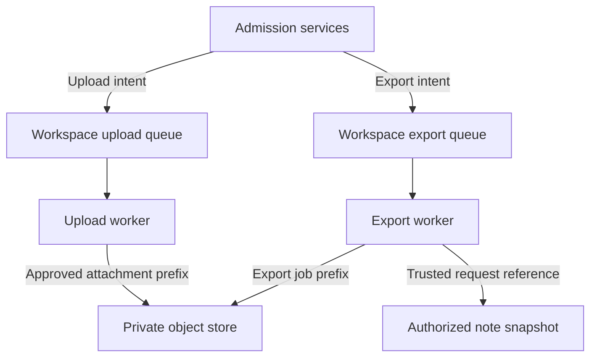

# 39. Cloud identity and service boundaries

An upload worker and an export worker both handle files. Should they have the same storage permissions? Mina receives a private download grant, then Lee revokes her membership. Which component can still release the bytes, and for how long?

This chapter compares the permissions of the two workers and traces a private attachment grant through issue, use, revocation and expiry. We will distinguish a direct bearer capability from an application-mediated grant, then test why current membership must be checked before a cached response is released.

You need chapter 23's workspace authorization, chapter 25's private attachment service, chapter 27's encryption boundary and chapter 28's queued export. Chapters 33–35 established audit, observation and deployment evidence. Chapter 38 showed that an asset's exposure and owner are separate facts from a source finding. Here we ask which human or workload may cross each service boundary.

By the end, you will be able to:

- Separate human identity, workload identity and the user's authorized request.
- Give upload and export workers different queue, object and key permissions.
- Explain the lifetime and revocation limits of a private bearer download.
- Preserve Casebook's current-membership rule through an application gateway.
- Review managed-secret, egress, message and cache boundaries with explicit verification evidence.

The edition targets **CPython 3.12.14** and **Django 6.1.3**. The local examples ran on **CPython 3.12.14** with **SQLite 3.53.1**. All **16 test methods** passed. The cloud policy and provider are **provider-neutral teaching models**. No cloud credentials, SDK, account, bucket, queue or IAM policy was used. AWS documentation supplies concrete examples of real service behavior, not a claim that this model implements AWS.

## Starting state and the privacy requirement

Mina is user `1`, active in Alpha `1`. Ravi is user `2`, active in Beta `2`. Lee is user `3` and manages Alpha only. A visitor is anonymous. Note `101` belongs to Alpha; note `202` belongs to Beta.

Keep these earlier modules unchanged:

- `examples/ch23/authorization_service.py`: trusted memberships, scoped reads, transactions and revocation.
- `examples/ch25/attachments.py`: bounded text uploads, opaque storage keys, metadata and current permission checks at retrieval.

The new laboratory uses those actual local modules. It adds cloud-object metadata and an application download-grant registry alongside the existing tables. A small in-memory object provider mirrors the same synthetic attachment bytes for the bearer-grant comparison. That mirror is a test device, not a recommendation to keep two production storage copies.

Casebook's requirement is precise: a reader must be an active member of the attachment's note workspace when a new read is authorized. An export also rechecks permission before release. A reusable direct provider grant that survives application membership revocation would violate that requirement for new reads during its remaining validity. We demonstrate that weaker alternative, then keep the application-mediated path for the required behavior.

Revocation cannot erase bytes already delivered to a client. A request already authorized and in flight also needs a separately defined interruption policy. Our tests concern **new calls after a committed revocation**, not cancellation of every network stream or recall of downloaded data.

## 1. Human and workload identities, short-lived credentials and scoped permissions

### A service has an identity of its own

A **human identity** represents a person. A **workload identity** represents a running application or process. A **principal** is the identity making a particular access request.

When Mina asks for an export, several identities matter:

**Table T39-01. Identity and authority at different boundaries**

| Boundary | Principal or reference | Required decision |
| --- | --- | --- |
| Mina to Casebook | Authenticated user `1` | May this active member request these Alpha notes? |
| Casebook to queue | Export admission workload | May this service publish to this queue? |
| Worker to queue/storage | Export workload session | May this process receive this job and write its result scope? |
| Worker to note source | Trusted stored request reference | Is the original requester still allowed to read the selected notes? |
| Gateway to object store | Release workload session | May this service read this exact object/version? |
| Gateway to Mina | Authenticated user plus current grant/membership | May this person receive these bytes now? |

The worker's cloud role does not prove Mina's membership. Mina's membership does not grant her direct cloud administration. A service call needs its own authenticated peer identity and an application operation authorized for the right user and tenant.

The process UID from chapter 35 is another separate identity. UID `10001` does not mean application user `1`, an Alpha membership or a particular cloud role. Review the binding between the running process and its workload credential instead of equating those identifiers.

AWS's [IAM guidance](https://docs.aws.amazon.com/IAM/latest/UserGuide/best-practices.html) recommends temporary role credentials for workloads and federated temporary access for people. These are useful concrete patterns: avoid distributing an operator's long-lived credentials to every worker. Still verify the issuer, audience, permitted role, expiry and scope for the actual platform. TLS server validation and any client/workload authentication must both match the intended peer.

Our Python `Session` is a trusted test record, not a wire token. Constructing it does not perform federation, signature verification or an assume-role operation. In deployment, its tenant/job fields must come from an issuer and trusted request records. A caller must not select Beta merely by supplying `workspace_id=2` or choosing its own session tag.

### Worked example 1: two workers, two permission sets

Predict the minimum permissions before reading the table. The upload worker validates an incoming attachment. The export worker produces a private note export. The current chapter 28 export includes notes, not attachments. Does that export worker need attachment-read permission just because it produces a file?

It does not. Grant a new attachment read only if a reviewed product requirement actually adds attachments to exports. Otherwise it expands authority without supporting the existing operation.

**Table T39-02. Least-privilege comparison for the selected worker design**

| Capability | Upload worker | Export worker | Reason |
| --- | --- | --- | --- |
| Receive, acknowledge and renew visibility | Own workspace's upload queue | Own workspace's export queue | Separate workflows and failure ownership |
| Send ordinary new jobs | Deny | Deny | Admission roles publish the approved intent |
| Read quarantined upload | Own accepted job prefix | Deny | Validation needs incoming bytes |
| Write approved attachment | Own accepted job prefix | Deny | Upload publishes validated content |
| Read approved attachment | Deny in this worker's cloud role | Deny for the current notes-only export | A release gateway serves authorized readers |
| Read notes | Deny | Request-bound authorized snapshot | Export needs selected note data, with current permission |
| Write export object | Deny | Own accepted job prefix | The result belongs to this export request |
| Use export encryption operation | Deny | Selected workspace key operation | Export encryption is a separate authority |
| Issue human download grants | Deny | Deny | Release authority stays with the gateway |
| List/delete buckets, change policy, read all secrets | Deny | Deny | Neither job requires administrative authority |

Cleanup, retention and recovery may need other operations. Assign them to explicit roles and procedures. Do not give every worker a broad delete permission in case a future cleanup task might need it.

This design uses logical **per-workspace queues** to make tenant scope visible. On a provider, they would need real queue resources and policies. If you instead use a shared physical queue, an IAM permission to receive a message does not by itself filter messages by a JSON tenant field. The consumer still needs trusted job lookup and tenant authorization.

### A synthetic policy you can inspect

The following JSON is an authored allowlist language. Action names such as `object.write` and `key.encrypt` are abstractions. They are not deployable IAM actions, ARNs or KMS permissions. A trailing slash denotes a prefix; other resources are exact matches. Unlisted actions are denied.

Filename: `examples/ch39/policy.json`.

```json
{
  "schema_version": 1,
  "synthetic": true,
  "roles": {
    "upload-api": {
      "queue.send": ["queues/{workspace_id}/uploads"]
    },
    "export-api": {
      "queue.send": ["queues/{workspace_id}/exports"]
    },
    "upload-worker": {
      "queue.receive": ["queues/{workspace_id}/uploads"],
      "queue.ack": ["queues/{workspace_id}/uploads"],
      "queue.renew": ["queues/{workspace_id}/uploads"],
      "object.read": ["quarantine/{workspace_id}/{job_id}/"],
      "object.write": ["attachments/{workspace_id}/{job_id}/"]
    },
    "export-worker": {
      "queue.receive": ["queues/{workspace_id}/exports"],
      "queue.ack": ["queues/{workspace_id}/exports"],
      "queue.renew": ["queues/{workspace_id}/exports"],
      "notes.snapshot": ["note-requests/{workspace_id}/{job_id}"],
      "object.write": ["exports/{workspace_id}/{job_id}/"],
      "key.encrypt": ["export-keys/{workspace_id}"]
    },
    "release-gateway": {
      "object.read": ["attachments/{workspace_id}/"],
      "grant.issue": ["attachments/{workspace_id}/"]
    }
  }
}
```

The two API roles may send to their own workflow, while each worker may consume only its matching queue. Object writes also require its workspace and accepted job prefix. The release gateway may read/issue attachment grants within its tenant scope, but the application must narrow each call to the authorized object.

`grant.issue` names an application capability in this teaching language. It is not a provider IAM signing permission. A real SDK may construct a signed URL locally while the later object request still fails for lack of underlying read authority. Successful URL generation is therefore not a positive access test. Our provider model checks both modeled grant authority and object-read authority at issue time.

A real provider's effective authority can combine identity, resource, key, organization and boundary policies. AWS's [policy evaluation reference](https://docs.aws.amazon.com/IAM/latest/UserGuide/reference_policies_evaluation-logic.html) documents that interaction. Passing the small allowlist model below is not evidence that all of those policies permit or deny a live request.

Filename: `examples/ch39/workload_policy.py`.

```python
"""Provider-neutral allowlist model; not AWS IAM evaluation."""
from dataclasses import dataclass
import json
from pathlib import Path
import re


@dataclass(frozen=True)
class Session:
    # Trusted test identity. A browser/message must not construct this.
    role: str
    workspace_id: int
    job_id: str
    expires_at: int
    session_id: str


def load_policy():
    policy = json.loads(Path(__file__).with_name("policy.json").read_text())
    if policy["schema_version"] != 1 or policy["synthetic"] is not True:
        raise ValueError("unsupported_policy")
    return policy


def permitted(policy, session, action, resource, *, now):
    if (type(now) is not int or type(session.expires_at) is not int
            or now >= session.expires_at or type(session.workspace_id) is not int
            or session.workspace_id < 1 or re.fullmatch(r"[a-z0-9-]{1,40}", session.job_id) is None):
        return False
    if (not isinstance(resource, str) or resource.startswith("/")
            or any(part in ("", ".", "..") for part in resource.split("/"))):
        return False
    scopes = policy["roles"].get(session.role, {}).get(action, [])
    for template in scopes:
        scope = template.format(workspace_id=session.workspace_id, job_id=session.job_id)
        if resource == scope or scope.endswith("/") and resource.startswith(scope):
            return True
    return False


def message_id(payload):
    # Only a reference. The worker still loads the trusted request/tenant.
    if (type(payload) is not dict or set(payload) != {"request_id"}
            or type(payload["request_id"]) is not int or payload["request_id"] < 1):
        raise ValueError("invalid_job_envelope")
    return payload["request_id"]
```

The session expires at the exact boundary: `now >= expires_at` denies. Workspace IDs and job names are checked before formatting resource scopes. Prefixes include separators, so workspace `1` does not match workspace `10`, and job `upload-17` does not match `upload-170`. The model rejects empty/dot path segments rather than normalizing them into a different scope.

`message_id` accepts only a positive integer reference in a one-field envelope. It does not authorize the job. The worker must still load the trusted requester, tenant and selection from storage, verify the intended workflow and request deadline, and obtain the permitted workload scope.

## 2. Object storage policies, private objects and expiring download grants

### A private object still needs a release policy

Object storage separates the bytes from the application request that needs them. Store a trusted association among workspace, note, opaque attachment key and immutable object identity/version. Do not let a browser choose another tenant's prefix merely by sending an object key.

A private bucket/object policy prevents one kind of broad access, but an authorized service can delegate access. AWS documents [Block Public Access](https://docs.aws.amazon.com/AmazonS3/latest/userguide/access-control-block-public-access.html) separately from [presigned URLs](https://docs.aws.amazon.com/AmazonS3/latest/userguide/using-presigned-url.html). A signed request can act under the signing principal without being a public ACL grant. The object store does not automatically understand Mina's Casebook membership.

A **bearer grant** authorizes its holder by possession. If copied, it can be used by another holder unless another enforced boundary prevents that use. AWS's [SDK guide](https://docs.aws.amazon.com/boto3/latest/guide/s3-presigned-urls.html) describes delegating access through presigned URLs. This differs from an application grant that also requires the authenticated recipient and current application authorization.

Bind a download to the intended read method and object identity. Use immutable keys or an explicit object version, rather than assuming the same mutable key always names the same bytes. The [S3 GetObject API](https://docs.aws.amazon.com/AmazonS3/latest/API/API_GetObject.html) distinguishes a specific version from the current object and its permissions. Our model uses a content digest as its version label; it is not an S3 `versionId` implementation.

### Worked example 2: follow the private grant's lifetime

At the scenario clock `2026-11-26T12:00:00Z`, Mina is an active Alpha member. The service issues two comparison grants for her private Alpha attachment:

- A direct provider-model bearer, requested for sixty seconds, signed by a workload session that expires after forty seconds.
- A user-bound application gateway grant, with a sixty-second application deadline.

The direct grant's modeled effective expiry is the earlier of its requested expiry and signer-session expiry:

```text
min(12:01:00Z, 12:00:40Z) = 12:00:40Z
```

AWS likewise documents that a presigned URL cannot outlive the temporary credentials used to create it. Its service checks expiry when a request begins; an already started transfer may continue beyond expiry. Provider policy or credential changes can also end validity earlier. Those real controls need provider-specific verification; our local model implements only the stated time/object behavior.

Predict the result after Lee revokes Mina at scenario time `12:00:10Z`. Will a copied direct bearer start another read at `12:00:11Z`? What should the gateway do with a warm data cache?

**Table T39-03. UTC grant trace**

| Scenario time | Event or check | Direct bearer model | Application gateway |
| --- | --- | --- | --- |
| `12:00:00Z` | Issue after current Alpha authorization | Valid until `12:00:40Z` | Bound to Mina, attachment/version and `12:01:00Z` |
| `12:00:01Z` | Authorized download | Allowed | Allowed; private data cache becomes warm |
| `12:00:10Z` | Lee commits Mina's membership revocation | Application change does not modify the provider capability | The next authorization check sees inactive membership |
| `12:00:11Z` | New request using an existing grant | Holder still receives bytes in the weaker model | Denied before cache release |
| `12:00:40Z` | Exact direct-grant expiry | New request denied | Membership revocation already blocks Mina |
| `12:01:00Z` | Exact application-grant expiry | Already expired | Denied by grant deadline even if otherwise authorized |

The times are injected fixture values, not observations from a cloud account. The membership table does not itself record the scenario's UTC action time. The test controls the call order and verifies stored revocation before the later read.

At revocation, the direct capability has up to thirty seconds left for new requests under these assumptions. Shortening that interval reduces exposure but does not meet a requirement for a current membership check on every newly authorized read. A membership change in the application is not automatically a provider credential revocation.

### Which grant fits Casebook?

The application-mediated grant is the selected path. It requires the authenticated recipient, checks the stored grant and current permission, then releases bytes. It also supports explicit grant revocation without deleting the attachment or revoking the person's entire membership.

A gateway that authorizes once and redirects to a reusable provider URL still delegates access for the URL's remaining lifetime. To enforce Casebook's chosen rule, the gateway must mediate subsequent releases rather than simply hide a direct link behind an initial authorization check.

The direct provider model below is deliberately included as a **counterexample**. Its `open` method has no human identity or membership argument. A Beta user who obtains that bearer is indistinguishable from its original recipient to that model. This behavior is not presented as compliant Casebook retrieval.

### Complete local laboratory

The setup calls the original chapter 25 upload service, creating validated local files and attachment metadata. A side table adds modeled cloud key/version associations. The provider mirror receives the same synthetic bytes through an allowed upload-worker call. The gateway continues to retrieve from chapter 25's local store after its modeled workload check; it does not call a cloud SDK.

The opaque tokens are generated with [`secrets`](https://docs.python.org/3.12/library/secrets.html). Registries keep token hashes rather than raw values. Tokens are never printed. This is an executable lifecycle demonstration, not an HTTP authentication service or a custom replacement for provider URL signing.

Filename: `examples/ch39/grant_lab.py`.

```python
"""Local attachment/grant comparison with a deliberately weaker bearer path."""
from dataclasses import dataclass
import hashlib
import io
from pathlib import Path
import secrets
import tempfile

from examples.ch23.authorization_service import AccessDenied, require_member, revoke_member, unit
from examples.ch25.attachments import authorize, initialize, retrieve, upload
from examples.ch39.workload_policy import Session, load_policy, permitted


NOW = 1795694400  # 2026-11-26T12:00:00Z; injected scenario clock.
MAX_TTL = 60
MAX_CACHE_ENTRIES = 4


def ttl(value):
    if type(value) is not int or not 1 <= value <= MAX_TTL:
        raise ValueError("ttl_out_of_range")
    return value


def token_digest(token):
    if not isinstance(token, str) or not 1 <= len(token) <= 100:
        raise AccessDenied()
    return hashlib.sha256(token.encode("utf-8")).hexdigest()


def attachment(db, key):
    row = db.execute("""SELECT a.*,c.object_key,c.version FROM attachments AS a
        JOIN cloud_attachments AS c ON c.attachment_key=a.key WHERE a.key=?""", (key,)).fetchone()
    if row is None or row["version"] != row["sha256"]:
        raise AccessDenied()
    return row


@dataclass(frozen=True)
class ProviderGrant:
    object_key: str
    version: str
    created_at: int
    expires_at: int


class ProviderModel:
    """Opaque in-memory capabilities, not URL signing or an S3 emulator."""
    def __init__(self, policy):
        self.policy = policy
        self.objects = {}
        self.grants = {}

    def put(self, session, object_key, version, body, *, now):
        if not permitted(self.policy, session, "object.write", object_key, now=now):
            raise AccessDenied()
        identity = (object_key, version)
        if identity in self.objects:
            raise ValueError("immutable_object_exists")
        if not isinstance(body, bytes) or hashlib.sha256(body).hexdigest() != version:
            raise ValueError("invalid_object_version")
        self.objects[identity] = body

    def issue(self, session, object_key, version, *, now, lifetime):
        ttl(lifetime)
        if not all(permitted(self.policy, session, action, object_key, now=now)
                   for action in ("grant.issue", "object.read")):
            raise AccessDenied()
        if (object_key, version) not in self.objects:
            raise AccessDenied()
        raw = secrets.token_urlsafe(32)
        self.grants[token_digest(raw)] = ProviderGrant(object_key, version, now,
                                                      min(now + lifetime, session.expires_at))
        return raw

    def open(self, raw, *, now):
        grant = self.grants.get(token_digest(raw))
        if grant is None or now < grant.created_at or now >= grant.expires_at:
            raise AccessDenied()
        # Deliberate contrast: the object service has no Casebook user or
        # membership lookup. Possession is the modeled authority.
        try:
            return self.objects[(grant.object_key, grant.version)]
        except KeyError:
            raise AccessDenied() from None


def issue_direct(database, provider, session, *, user_id, key, now, lifetime=60):
    with unit(database) as db:
        row = attachment(db, key)
        authorize(db, user_id, row["workspace_id"], row["note_id"])
        return provider.issue(session, row["object_key"], row["version"],
                              now=now, lifetime=lifetime)


def issue_gateway(database, policy, session, *, user_id, key, now, lifetime=60):
    ttl(lifetime)
    raw = secrets.token_urlsafe(32)
    with unit(database, write=True) as db:
        row = attachment(db, key)
        authorize(db, user_id, row["workspace_id"], row["note_id"])
        if not permitted(policy, session, "grant.issue", row["object_key"], now=now):
            raise AccessDenied()
        db.execute("INSERT INTO download_grants VALUES (?,?,?,?,?,?,0)",
                   (token_digest(raw), user_id, key, row["version"], now, now + lifetime))
    return raw


def cache_key(workspace_id, user_id, key, version):
    return (workspace_id, user_id, key, version)


def open_gateway(database, root, policy, session, cache, *, user_id, raw, now):
    with unit(database) as db:
        grant = db.execute("SELECT * FROM download_grants WHERE token_hash=?",
                           (token_digest(raw),)).fetchone()
        if (grant is None or user_id is None or grant["requested_by"] != user_id
                or grant["revoked"] or now < grant["created_at"] or now >= grant["expires_at"]):
            raise AccessDenied()
        row = attachment(db, grant["attachment_key"])
        if row["version"] != grant["version"]:
            raise AccessDenied()
        authorize(db, user_id, row["workspace_id"], row["note_id"])
        if not permitted(policy, session, "object.read", row["object_key"], now=now):
            raise AccessDenied()
        identity = cache_key(row["workspace_id"], user_id, row["key"], row["version"])
        # Auth and grant checks precede every cache hit.
        if identity not in cache:
            _, body = retrieve(database, root, user_id=user_id, key=row["key"])
            if len(cache) >= MAX_CACHE_ENTRIES:
                cache.pop(next(iter(cache)))
            cache[identity] = body
        return cache[identity]


def revoke_gateway(database, *, actor_id, raw):
    with unit(database, write=True) as db:
        grant = db.execute("SELECT * FROM download_grants WHERE token_hash=?",
                           (token_digest(raw),)).fetchone()
        if grant is None:
            raise AccessDenied()
        row = attachment(db, grant["attachment_key"])
        role = require_member(db, actor_id, row["workspace_id"])
        if actor_id != grant["requested_by"] and role != "manager":
            raise AccessDenied()
        db.execute("UPDATE download_grants SET revoked=1 WHERE token_hash=?", (grant["token_hash"],))


def counts(database):
    with unit(database) as db:
        return {name: db.execute(f"SELECT count(*) FROM {name}").fetchone()[0]
                for name in ("attachments", "cloud_attachments", "download_grants")}


def setup(directory):
    directory = Path(directory)
    database, root = directory / "casebook.sqlite", directory / "files"
    initialize(database, root)
    policy = load_policy()
    provider = ProviderModel(policy)
    with unit(database, write=True) as db:
        db.execute("""CREATE TABLE cloud_attachments (
            attachment_key TEXT PRIMARY KEY REFERENCES attachments(key),
            object_key TEXT UNIQUE NOT NULL, version TEXT NOT NULL)""")
        db.execute("""CREATE TABLE download_grants (
            token_hash TEXT PRIMARY KEY, requested_by INTEGER NOT NULL REFERENCES users(id),
            attachment_key TEXT NOT NULL REFERENCES attachments(key),
            version TEXT NOT NULL,
            created_at INTEGER NOT NULL, expires_at INTEGER NOT NULL,
            revoked INTEGER NOT NULL CHECK(revoked IN (0,1)))""")
    keys = {}
    for workspace_id, user_id, note_id, job_id, body in (
        (1, 1, 101, "upload-17", "Alpha private attachment".encode()),
        (2, 2, 202, "upload-18", "یادداشت بتا".encode()),
    ):
        key = upload(database, root, user_id=user_id, workspace_id=workspace_id,
                     note_id=note_id, display_name="یادداشت.txt", media_type="text/plain",
                     stream=io.BytesIO(body))
        version = hashlib.sha256(body).hexdigest()
        object_key = f"attachments/{workspace_id}/{job_id}/{key}"
        worker = Session("upload-worker", workspace_id, job_id, NOW + 120, f"upload-{workspace_id}")
        provider.put(worker, object_key, version, body, now=NOW)
        with unit(database, write=True) as db:
            db.execute("INSERT INTO cloud_attachments VALUES (?,?,?)", (key, object_key, version))
        keys[workspace_id] = key
    return database, root, policy, provider, keys


def demo():
    with tempfile.TemporaryDirectory(prefix="casebook-ch39-") as directory:
        database, root, policy, provider, keys = setup(directory)
        upload_worker = Session("upload-worker", 1, "upload-17", NOW + 120, "up-1")
        export_worker = Session("export-worker", 1, "export-17", NOW + 120, "ex-1")
        print("upload may write own attachment:", permitted(policy, upload_worker, "object.write",
              "attachments/1/upload-17/object", now=NOW))
        print("upload may read exports:", permitted(policy, upload_worker, "object.read",
              "exports/1/export-17/object", now=NOW))
        print("export may write own export:", permitted(policy, export_worker, "object.write",
              "exports/1/export-17/object", now=NOW))
        print("export may acknowledge upload queue:", permitted(policy, export_worker, "queue.ack",
              "queues/1/uploads", now=NOW))
        signer = Session("release-gateway", 1, "release-1", NOW + 40, "signer-1")
        direct = issue_direct(database, provider, signer, user_id=1, key=keys[1], now=NOW)
        gateway = issue_gateway(database, policy, signer, user_id=1, key=keys[1], now=NOW)
        cache = {}
        open_gateway(database, root, policy, signer, cache, user_id=1, raw=gateway, now=NOW + 1)
        print("before revocation: gateway allowed; cached entries:", len(cache))
        revoke_member(database, actor_id=3, workspace_id=1, target_user_id=1)
        try:
            open_gateway(database, root, policy, signer, cache, user_id=1, raw=gateway, now=NOW + 11)
        except AccessDenied:
            print("after membership revocation: gateway denied despite warm cache")
        provider.open(direct, now=NOW + 11)
        print("copied direct bearer: still allowed at +11s; expiry at +40s")
        try:
            provider.open(direct, now=NOW + 40)
        except AccessDenied:
            print("direct bearer at +40s: denied")
        print("stored rows:", counts(database))


if __name__ == "__main__":
    demo()
```

Run from the repository root with the earlier chapter 23/25 modules present:

```bash
python -m examples.ch39.grant_lab
```

Recorded output:

```text
upload may write own attachment: True
upload may read exports: False
export may write own export: True
export may acknowledge upload queue: False
before revocation: gateway allowed; cached entries: 1
after membership revocation: gateway denied despite warm cache
copied direct bearer: still allowed at +11s; expiry at +40s
direct bearer at +40s: denied
stored rows: {'attachments': 2, 'cloud_attachments': 2, 'download_grants': 1}
```

The direct record stores an object/version and a deadline, while the application record also binds the recipient and can be revoked locally. A gateway grant does not automatically expire when the particular issuing workload session ends: a freshly authenticated gateway session may serve it if the grant and membership remain valid. The test distinguishes that from a provider bearer tied to its original signer credentials.

Both paths deny before their issue time and at their exact expiry in this model. `now`, `user_id` and `Session` are trusted test inputs. In a web service, use the trusted server clock and authenticated request context; do not accept these authority values from a browser payload.

### Revocation changes access, not necessarily stored data

After Mina's membership is revoked, the original gateway row can still have `revoked=0` and an unexpired deadline. Access is nevertheless denied because current membership fails. Conversely, Lee can revoke that individual gateway row while Mina remains active, and that token then fails while a separate authorized attachment retrieval still succeeds.

**Table T39-04. Stored state and the decision it supports**

| Condition | Stored/cached state | Release decision |
| --- | --- | --- |
| Membership revoked | Attachment and grant rows remain; cache may still hold bytes | Deny a new Mina read before cache lookup |
| Individual grant revoked | Membership and attachment remain | Deny that grant; other independently authorized reads are unaffected |
| Grant expired | Registry row may remain for cleanup/audit policy | Deny at the deadline; row deletion is not required for expiry enforcement |
| Object version association changed | Old gateway grant retains its issued version | Deny rather than substitute new bytes under an old grant |
| Grant registration insert fails | Transaction rolls back; no new grant row | Do not return an issued grant or claim success |

The registration failure test compares counts and the full selected attachment/file inventory before and after failure. No attachment or cloud mapping is created by grant issuance. A real object upload followed by a failed database write is a different distributed failure; a SQL rollback does not undo a remote PUT. Keep staged objects private and define reconciliation/cleanup before allowing publication.

## 3. Shared responsibility, managed secrets and egress controls

### Managed infrastructure does not choose the tenant

The provider's responsibilities and the customer's responsibilities depend on the service. AWS's [shared responsibility model](https://aws.amazon.com/compliance/shared-responsibility-model/) describes the distinction. Using managed object storage does not transfer Casebook's workspace authorization, data classification or release decision to that provider.

**Table T39-05. Responsibilities to assign in the design review**

| Area | Casebook/platform responsibility |
| --- | --- |
| Data and object exposure | Keep private defaults, review public/cross-account access and map object ownership/version to trusted metadata |
| Workload trust | Restrict which process/account may obtain each role and tenant/job scope |
| Secrets and keys | Define necessary operations, consumers, rotation and recovery; protect transport and stored values |
| Application authorization | Repeat current membership/selection checks at the release boundary |
| Network paths | Permit required service endpoints, verify TLS and constrain unnecessary egress |
| Audit and recovery | Record required decisions durably, monitor failures and verify restoration of protections |

Provider encryption at rest does not decide whether Ravi may read Alpha. A private endpoint does not establish the human user. A valid workload credential does not authorize every message or database row.

### Give a secret permission only when there is a secret to read

The upload fixture validates bounded text and needs no general managed-secret read. The synthetic policy grants none. The export role has an abstract encryption operation, not permission to list every secret or export all plaintext keys.

Map an abstract operation to actual provider API calls and key/resource conditions before deployment. Some designs need data-key generation, decryption of envelope keys or a verification operation. Determine those needs from the real client and data flow rather than granting all key operations to make a test pass.

Chapter 27's local worker holds a raw symmetric key in a keyring. That possession is not made “encrypt only” by naming an application function `encrypt`. A provider-enforced operation boundary is a different architecture. This chapter does not reconfigure that earlier keyring or establish a real KMS separation.

For a managed application secret that is genuinely needed, scope retrieval to the selected identity and version. Keep it out of images, source, command lines, queue bodies, report output and grant URLs. Define refresh and failure behavior. Rotating a stored secret does not establish that every consumer discarded cached credentials, as chapter 36 showed.

### Egress and service identity work together

Chapter 35's isolated health target had no external IP network. A workload that must use a cloud queue/object/key service needs a reviewed network change. Identify required destinations, DNS, TLS verification, endpoint policies and any credential issuer. Avoid replacing that explicit decision with unrestricted networking.

Network admission and workload authorization answer different questions. A process reaching the correct endpoint still needs the correct identity and operation scope. A process with a powerful credential can misuse allowed endpoints if resource policy is too broad. Test both an allowed required operation and a denied unnecessary destination/action.

Object and queue encryption may introduce key-policy requirements. Cross-account access introduces trust and resource-owner decisions. The allowlist interpreter deliberately does not simulate these interactions. Validate the real effective policies and collect service-side access evidence with a restricted test role before declaring the design enforced.

## 4. Service-to-service identity, queue permissions and tenant-specific cache keys

### Trace the job without trusting its payload as authority

**Figure F39-01. Separate admission, queues and worker destinations**



The admission node groups two logical services for readability; the policy gives them separate roles. Each workspace queue is an explicit synthetic resource. The diagram does not imply that a single broad service role may impersonate both workers.

A minimal message is `{"request_id": 17}`. That reference identifies an accepted request, not an arbitrary object to release. The worker loads its requester, workspace, selection, state and deadline from trusted records, as chapter 28 does. A message-supplied role, tenant, URL or object key must not bypass that lookup.

Authenticating the producer or broker does not make every body field safe. Check the expected workflow and service audience as well as the reference. If a service provides a note snapshot, it must derive the requester from its trusted request record and enforce current permission, rather than accept a freely chosen user ID from any export-role caller.

For a provider implementation, map receive, acknowledgement and visibility operations separately. The [SQS permission reference](https://docs.aws.amazon.com/AWSSimpleQueueService/latest/SQSDeveloperGuide/sqs-api-permissions-reference.html) distinguishes these actions. Actual clients may also need selected discovery/attribute calls; verify the client instead of adding administration rights by default.

### Keep the clocks separate

**Table T39-06. Different clocks govern different decisions**

| Clock | Meaning | What renewal does not grant |
| --- | --- | --- |
| Workload credential expiry | Time until the service credential stops authorizing its cloud calls | More tenant scope or a longer application request deadline |
| Queue visibility period | When a received message may become available for another attempt | Exactly-once processing or renewed user permission |
| Export request deadline | Chapter 28's original accepted intent lifetime | Extra lifetime from a duplicate delivery or visibility renewal |
| Provider bearer expiry | New requests under this delegated provider capability | A current Casebook membership check |
| Application grant deadline | Time bound for the stored user-bound grant | Permission after revocation or access under another user |

The [SQS visibility guide](https://docs.aws.amazon.com/AWSSimpleQueueService/latest/SQSDeveloperGuide/sqs-visibility-timeout.html) explains delivery visibility and redelivery. Keep idempotency and the required audit boundary from chapters 28 and 33: acknowledge only after the intended durable outcome, not simply after receiving a message. A failure to store the required outcome must not become a successful acknowledgement.

The sample workload sessions may last 120 seconds, while the earlier export request lifetime remains sixty. Role validity is not permission to process an expired request. The attachment-grant lesson also uses a sixty-second bound, but it is a different record and clock.

### A tenant-aware cache key is necessary but insufficient

The data cache key is:

```text
(workspace_id, authenticated_user_id, attachment_key, immutable_version)
```

The user and workspace prevent reuse under a different authorization context. The object/version prevents unrelated or replaced content from sharing a slot. The cache contains data, not a cached assertion that membership is still valid.

In `open_gateway`, the order is deliberate: authenticate the recipient through trusted caller context; check grant identity, revocation, issue/expiry bounds and version; check current note/workspace permission; check the gateway workload scope; only then consult the data cache. The warm-cache test verifies that a committed membership revocation wins even though the bytes remain cached.

A shared downstream HTTP/CDN cache can bypass that path if it serves a private response without reaching authorization. For the intended private download endpoint, use an appropriate no-store policy and verify the actual proxy/CDN configuration. A possible response policy is:

```http
Cache-Control: private, no-store
Referrer-Policy: no-referrer
```

These headers do not authorize a request or stop a recipient saving bytes. Prevent full grant URLs/tokens from appearing in proxy query logs, analytics, traces, browser referrers or ordinary support records. Record controlled actor/workload references, outcome and expiry instead. A provider event may identify the signer without identifying the human holder of a copied capability.

The sample cache is bounded to four entries with simple eviction. It has no independent retention service or revocation-time data purge. The authorization check prevents a new unauthorized release; an operational retention policy still needs an owner. SQLite's local transaction behavior is not proof of instantaneous cross-region revocation or cancellation of in-flight downloads.

### Test the boundaries

Filename: `examples/ch39/test_cloud.py`.

```python
from dataclasses import replace
import hashlib
from pathlib import Path
import sqlite3
import tempfile
import unittest

from examples.ch23.authorization_service import AccessDenied, revoke_member, unit
from examples.ch25.attachments import inventory, retrieve
from examples.ch39.grant_lab import (
    NOW, cache_key, counts, issue_direct, issue_gateway, open_gateway,
    revoke_gateway, setup, token_digest,
)
from examples.ch39.workload_policy import Session, message_id, permitted


class CloudBoundaryTests(unittest.TestCase):
    def setUp(self):
        self.temporary = tempfile.TemporaryDirectory()
        self.database, self.root, self.policy, self.provider, self.keys = setup(self.temporary.name)
        self.signer = Session("release-gateway", 1, "release-1", NOW + 40, "signer-1")
        self.cache = {}

    def tearDown(self):
        self.temporary.cleanup()

    def gateway(self, lifetime=60):
        return issue_gateway(self.database, self.policy, self.signer,
                             user_id=1, key=self.keys[1], now=NOW, lifetime=lifetime)

    def open(self, raw, user_id=1, now=NOW + 1, session=None):
        return open_gateway(self.database, self.root, self.policy, session or self.signer,
                            self.cache, user_id=user_id, raw=raw, now=now)

    def test_worker_permissions_match_separate_jobs(self):
        upload = Session("upload-worker", 1, "upload-17", NOW + 120, "up-1")
        export = Session("export-worker", 1, "export-17", NOW + 120, "ex-1")
        cases = [
            (upload, "queue.receive", "queues/1/uploads", True),
            (upload, "object.read", "quarantine/1/upload-17/input", True),
            (upload, "object.write", "attachments/1/upload-17/output", True),
            (upload, "object.read", "exports/1/export-17/output", False),
            (upload, "key.encrypt", "export-keys/1", False),
            (export, "queue.ack", "queues/1/exports", True),
            (export, "notes.snapshot", "note-requests/1/export-17", True),
            (export, "object.write", "exports/1/export-17/output", True),
            (export, "key.encrypt", "export-keys/1", True),
            (export, "queue.ack", "queues/1/uploads", False),
            (export, "object.read", "attachments/1/upload-17/output", False),
            (export, "grant.issue", "exports/1/export-17/output", False),
            (export, "secret.read", "all-secrets", False),
        ]
        for session, action, resource, expected in cases:
            with self.subTest(role=session.role, action=action):
                self.assertEqual(permitted(self.policy, session, action, resource, now=NOW), expected)

    def test_session_scope_expiry_and_prefix_boundaries(self):
        worker = Session("upload-worker", 1, "upload-17", NOW + 120, "up-1")
        for resource in ("attachments/2/upload-17/out", "attachments/10/upload-17/out",
                         "attachments/1/upload-170/out", "attachments/1/upload-17/../other"):
            self.assertFalse(permitted(self.policy, worker, "object.write", resource, now=NOW))
        self.assertFalse(permitted(self.policy, worker, "queue.receive", "queues/1/uploads", now=NOW + 120))
        self.assertFalse(permitted(self.policy, replace(worker, job_id="../escape"), "object.write",
                                   "attachments/1/upload-17/out", now=NOW))

    def test_message_is_a_reference_not_a_tenant_assertion(self):
        self.assertEqual(message_id({"request_id": 17}), 17)
        for payload in ({"request_id": 17, "workspace_id": 2}, {"request_id": True},
                        {"request_id": "17"}, {"request_id": -1}):
            with self.assertRaises(ValueError):
                message_id(payload)

    def test_gateway_permits_owner_and_rejects_other_humans(self):
        raw = self.gateway()
        expected = retrieve(self.database, self.root, user_id=1, key=self.keys[1])[1]
        self.assertEqual(self.open(raw), expected)
        for user in (None, 2, 3):
            with self.subTest(user=user):
                with self.assertRaises(AccessDenied):
                    self.open(raw, user_id=user)

    def test_beta_reader_has_a_separate_valid_grant(self):
        session = replace(self.signer, workspace_id=2, session_id="signer-2")
        raw = issue_gateway(self.database, self.policy, session, user_id=2,
                            key=self.keys[2], now=NOW)
        result = self.open(raw, user_id=2, session=session)
        self.assertEqual(result.decode(), "یادداشت بتا")
        with self.assertRaises(AccessDenied):
            self.open(raw, user_id=1)

    def test_membership_revocation_wins_over_warm_cache(self):
        raw = self.gateway()
        self.open(raw)
        self.assertEqual(len(self.cache), 1)
        before = inventory(self.database, self.root)
        revoke_member(self.database, actor_id=3, workspace_id=1, target_user_id=1)
        with self.assertRaises(AccessDenied):
            self.open(raw, now=NOW + 11)
        self.assertEqual(len(self.cache), 1)  # Data is present but cannot bypass auth.
        self.assertEqual(inventory(self.database, self.root), before)
        with unit(self.database) as db:
            self.assertEqual(db.execute("SELECT revoked FROM download_grants").fetchone()[0], 0)

    def test_no_new_grant_after_revocation_or_for_wrong_workspace(self):
        before = counts(self.database)
        with self.assertRaises(AccessDenied):
            issue_gateway(self.database, self.policy, replace(self.signer, workspace_id=2),
                          user_id=1, key=self.keys[1], now=NOW)
        revoke_member(self.database, actor_id=3, workspace_id=1, target_user_id=1)
        for issuer in ("gateway", "direct"):
            with self.assertRaises(AccessDenied):
                if issuer == "gateway":
                    self.gateway()
                else:
                    issue_direct(self.database, self.provider, self.signer,
                                 user_id=1, key=self.keys[1], now=NOW + 11)
        self.assertEqual(counts(self.database), before)
        self.assertEqual(len(self.provider.grants), 0)

    def test_copied_bearer_survives_application_revocation_until_its_boundary(self):
        direct = issue_direct(self.database, self.provider, self.signer,
                              user_id=1, key=self.keys[1], now=NOW)
        expected = self.provider.open(direct, now=NOW + 1)
        revoke_member(self.database, actor_id=3, workspace_id=1, target_user_id=1)
        self.assertEqual(self.provider.open(direct, now=NOW + 11), expected)
        self.assertEqual(self.provider.open(direct, now=NOW + 39), expected)
        for instant in (NOW - 1, NOW + 40):
            with self.assertRaises(AccessDenied):
                self.provider.open(direct, now=instant)

    def test_direct_issue_requires_underlying_read_authority(self):
        self.policy["roles"]["release-gateway"]["object.read"] = []
        with self.assertRaises(AccessDenied):
            issue_direct(self.database, self.provider, self.signer,
                         user_id=1, key=self.keys[1], now=NOW)
        self.assertEqual(self.provider.grants, {})

    def test_individual_grant_revocation_does_not_need_membership_change(self):
        raw = self.gateway()
        self.open(raw)
        before = counts(self.database)
        with self.assertRaises(AccessDenied):
            revoke_gateway(self.database, actor_id=2, raw=raw)
        revoke_gateway(self.database, actor_id=3, raw=raw)
        with self.assertRaises(AccessDenied):
            self.open(raw)
        self.assertEqual(counts(self.database), before)
        self.assertEqual(retrieve(self.database, self.root, user_id=1, key=self.keys[1])[1],
                         b"Alpha private attachment")

    def test_gateway_grant_and_workload_credential_lifetimes_are_distinct(self):
        raw = self.gateway()
        with self.assertRaises(AccessDenied):
            self.open(raw, now=NOW + 45)
        renewed = replace(self.signer, expires_at=NOW + 120, session_id="signer-new")
        self.assertEqual(self.open(raw, now=NOW + 45, session=renewed), b"Alpha private attachment")
        with self.assertRaises(AccessDenied):
            self.open(raw, now=NOW + 60, session=renewed)

    def test_ttl_boundaries_and_hash_only_registry(self):
        before = counts(self.database)
        for value in (0, -1, 61, True):
            with self.assertRaises(ValueError):
                self.gateway(value)
        self.assertEqual(counts(self.database), before)
        raw = self.gateway(10)
        with unit(self.database) as db:
            stored = db.execute("SELECT token_hash FROM download_grants").fetchone()[0]
        self.assertNotEqual(stored, raw)
        self.assertEqual(stored, token_digest(raw))
        self.assertEqual(self.open(raw, now=NOW + 9), b"Alpha private attachment")
        for instant in (NOW - 1, NOW + 10):
            with self.assertRaises(AccessDenied):
                self.open(raw, now=instant)

    def test_cache_identity_includes_tenant_user_object_and_version(self):
        base = cache_key(1, 1, "same-object", "v1")
        for other in (cache_key(2, 1, "same-object", "v1"), cache_key(1, 2, "same-object", "v1"),
                      cache_key(1, 1, "different-object", "v1"), cache_key(1, 1, "same-object", "v2")):
            self.assertNotEqual(base, other)

    def test_gateway_version_change_is_refused_before_cached_release(self):
        raw = self.gateway()
        self.open(raw)
        with unit(self.database, write=True) as db:
            db.execute("UPDATE attachments SET sha256=? WHERE key=?", ("0" * 64, self.keys[1]))
            db.execute("UPDATE cloud_attachments SET version=? WHERE attachment_key=?", ("0" * 64, self.keys[1]))
        with self.assertRaises(AccessDenied):
            self.open(raw)
        self.assertEqual(len(self.cache), 1)

    def test_failed_registration_leaves_no_grant_or_object_change(self):
        before = (counts(self.database), inventory(self.database, self.root))
        with unit(self.database, write=True) as db:
            db.execute("""CREATE TRIGGER fail_grant BEFORE INSERT ON download_grants
                BEGIN SELECT RAISE(ABORT,'synthetic_failure'); END""")
        with self.assertRaises(sqlite3.DatabaseError):
            self.gateway()
        self.assertEqual((counts(self.database), inventory(self.database, self.root)), before)
        self.assertEqual(self.cache, {})

    def test_object_version_is_bound_and_not_overwritten(self):
        direct = issue_direct(self.database, self.provider, self.signer,
                              user_id=1, key=self.keys[1], now=NOW)
        grant = self.provider.grants[token_digest(direct)]
        worker = Session("upload-worker", 1, "upload-17", NOW + 120, "up-1")
        new_body = b"new synthetic version"
        self.provider.put(worker, grant.object_key, hashlib.sha256(new_body).hexdigest(), new_body, now=NOW)
        self.assertEqual(self.provider.open(direct, now=NOW + 1), b"Alpha private attachment")
        with self.assertRaises(ValueError):
            self.provider.put(worker, grant.object_key, grant.version, new_body, now=NOW)


if __name__ == "__main__":
    unittest.main()
```

Run from the repository root:

```bash
python -m unittest discover -s examples/ch39 -p 'test_cloud.py' -v
```

The recorded run executed **16 test methods**, all passing. Expected final status is `OK`; elapsed time varies. They include a permitted Mina/Alpha read, a separate valid Ravi/Beta grant, denied use of Mina's token by Ravi/Lee/anonymous callers, tenant/job/queue separation and exact time boundaries.

They also distinguish membership revocation from individual-grant revocation, check version binding before a warm-cache release, preserve row/file state after failed registration, and demonstrate that the weaker bearer path still works after application revocation until its modeled expiry.

### Evidence needed to approve a real policy

**Table T39-07. Review artifact and required verification evidence**

| Claim | Positive control | Negative/failure control and evidence |
| --- | --- | --- |
| Worker identity is constrained | Observe the actual issuer, account, role, audience, session scope and expiry | An unrelated workload cannot assume the role or choose a foreign tenant/job tag |
| Upload/export queues are separate | Correct role receives/acknowledges its intended queue | Wrong worker and wrong workspace receive/ack requests are denied |
| Object access is scoped | Authorized role writes its accepted destination | Read/write outside prefix, policy changes and public exposure operations are denied |
| Application permission remains current | Active member receives intended object/version | Post-commit revocation and cross-workspace attempts fail, including warm caches |
| Grant lifetime is understood | Before-boundary request succeeds | Exact-expiry, copied-grant, signer-expiry and provider-policy changes are exercised safely |
| Secret/key access is justified | Needed operation succeeds on selected resource | Unneeded secret reads/key operations fail; rotation/refresh behavior is recorded |
| Failure does not publish success | Completed object/metadata/audit state is correlated | Partial object/DB/audit failure retains private staged state and does not acknowledge/release |

Collect actual policy/resource versions, test principal identity, UTC time, request IDs and controlled outcomes. Do not attach raw credentials, URLs or private payloads. The cloud-model tests are one preparation step; they do not fill this table with observed provider evidence.

## Guided lab

1. Read T39-02 and the policy. For each worker, identify its queue, read source, write destination and forbidden capability. Explain why the notes-only export does not receive attachment-read permission.
2. Run the demonstration and sixteen tests. Confirm that the original chapter 23/25 modules are used unchanged and that the fixture includes both Alpha and Beta attachments.
3. Trace the direct grant: requested sixty seconds, signer forty seconds, effective expiry forty seconds. Predict the calls at `+39` and `+40`, then compare the tests.
4. Trace the gateway grant after a warm-cache read and committed membership revocation. Inspect the retained grant/cache/attachment state. Explain why deletion of these records is not required for the next call to be denied.
5. In a disposable policy copy, consider granting the export worker upload-queue acknowledgement or `grant.issue`. Explain which boundary this crosses and what additional product requirement/evidence would be needed. Keep the supplied policy unchanged for its regression expectations.
6. Submit an access matrix and annotated F39-01 diagram. For each claimed cloud permission, name the real API/resource mapping and one positive/negative provider test still needed. Mark provider tests unexecuted when no isolated account is available.

## Independent practice

Complete these before reading the worked answers.

1. A copied provider grant expires in thirty seconds. Mina's membership was just revoked. Explain whether shortening the TTL alone satisfies Casebook's current-membership requirement.
2. The signer credential expires, but the gateway obtains a fresh workload session. State which existing grant can remain usable, under which checks, and which old provider bearer remains expired.
3. A queue message includes `workspace_id=2` and `request_id=17`, but the trusted request row belongs to Alpha. State the envelope/lookup decision and why a valid broker signature does not choose the tenant.
4. A cache key contains the tenant but the handler returns a hit before checking grant expiry and membership. Explain the remaining failure and the required order.
5. A proposed export now includes approved attachments. Extend the permission matrix narrowly and name the integrity, authorization, egress and provider checks needed before enabling it.
6. A private object is overwritten under the same mutable name. Explain why an existing unversioned direct link might release different bytes and how a version/immutable-key design changes the review.

**Practice check.** Review a synthetic cloud policy and queue diagram. Produce a least-privilege access matrix and record the evidence needed to verify it.

## Hints and worked answers

### Guided lab answers

The upload worker reads its quarantined input and writes validated attachments in its accepted workspace/job prefix. The export worker reads a request-bound authorized note snapshot, writes its export prefix and uses the selected encryption operation. Neither receives the other's queue permissions or download-grant authority. Prefix boundaries and temporary role expiry are checked by the model, while actual identity issuance remains external evidence.

The direct bearer expires at `+40`, because its signer expires earlier than the requested `+60`. It remains usable by a holder at `+11` after the application membership change. That is the counterexample, not a compliant Casebook release. The gateway rejects new reads through the current permission check before consulting its still-warm cache.

The final demonstration has two attachment rows, two cloud-mapping rows and one application-grant row. Revoking membership did not delete the attachment or mark that grant individually revoked. The decision changed because the active-membership predicate changed. A failed grant insert leaves the prior rows/files unchanged and returns no successful token.

### Independent practice answers

**1. Remaining bearer lifetime.** A thirty-second residual interval still permits a new read after application revocation if no other provider control blocks it. A shorter TTL reduces that exposure window but does not supply a current membership check. Use the application-mediated release path for the selected requirement; investigate provider-side revocation/denial separately when containing an already leaked direct grant.

**2. Different lifetimes.** An existing application grant may remain usable until its own deadline if its authenticated recipient, membership, version, revocation flag and the gateway's current workload scope all pass. The old provider bearer tied to expired signer credentials does not gain new life merely because the gateway refreshed its credentials. A new provider grant would be a new issuance decision with fresh application authorization.

**3. Untrusted tenant claim.** The supplied strict envelope validator rejects the extra field. More broadly, load the request's tenant and original requester from the trusted record and verify the intended workflow. Authentication of a sender or broker establishes who delivered a message, not that every tenant/user value inside it is authorized. Do not mint Beta scope from that message field.

**4. Cache order.** Tenant separation prevents one class of collision, but a former member can still obtain cached bytes if a hit skips authorization. Check the grant, authenticated recipient, time, current membership/visibility and workload permission before release on every hit. Keep the version in the data identity and verify the actual downstream caching policy as well.

**5. A changed export requirement.** Add only the approved attachment reads needed by the stored export selection, using trusted metadata and immutable versions. Do not add quarantine, arbitrary workspace or whole-bucket reads. Recheck current user permission before snapshot and release, verify stored content identity, review object/key/network operations and test allowed/denied paths with the actual workload role. Update the application and audit contract as well as the cloud policy.

**6. Mutable names.** A capability naming only the current object at a mutable key can refer to content different from what was reviewed at issue time. Use an immutable key or bind an explicit version, then grant the correct version-specific operation. The local model pins the provider grant to a version and refuses a gateway grant whose metadata version changes. Real deletion, versioning, policy changes and already transferred data need their own provider tests.

## Verification record and limits

The demonstration and all **16 test methods** ran on **CPython 3.12.14** with **SQLite 3.53.1**, using standard-library code and the unchanged chapter 23/25 modules. The recorded output came from actual local fixture uploads, database checks, model decisions and file reads. All three complete Python listings were syntax-checked and compared with their executed files; the policy JSON parsed successfully.

Executed evidence includes separated worker actions/queues, workspace/job prefix boundaries, workload expiry, strict reference envelopes, current user/workspace checks, valid Alpha/Beta paths, rejection of copied user-bound grants, warm-cache revocation, individual token revocation, requested/signer expiry distinction, refreshed gateway identity, hash-only grant records, version binding, immutable model versions and failed registration rollback with unchanged file/row inventory.

The `Session` records and policy semantics are trusted fixture inputs. `ProviderModel` is an in-memory bearer registry, not a signing algorithm, IAM engine or object-storage emulator. The gateway uses local chapter 25 retrieval after a modeled role check. No real cloud API, key operation, broker acknowledgement, URL signature or managed secret was exercised.

**Not executed:** Django/HTTP authentication, federation or workload-token verification, cloud policy evaluation/propagation, cross-account trust, KMS/managed-secret calls, TLS/egress enforcement, real private-bucket access, provider URL revocation, streaming/range requests, distributed cache/replica revocation, concurrent request cancellation, CDN behavior, required audit integration for these new grant operations or remote object/database reconciliation. Tokens and private fixture payloads were not printed by the demonstration.

For actual integration, inventory grant issue/use/deny/revoke audit requirements and apply the required recording policy where specified. The local grant transaction does not claim to implement chapter 33's full outbox/delivery system. Chapter 28's current-permission and original-deadline rules remain in force for exports.

## What you can now explain

Upload and export workers need different authorities even though both produce files. Bind temporary workload scope to a trusted accepted request, and keep that scope separate from current human permission. A queue reference or a storage prefix alone does not establish both.

A direct bearer can remain useful after application revocation until another enforced boundary ends it. Casebook's application gateway checks current access before every new release, including cache hits. Grant deadlines, credential lifetimes and queue visibility are different clocks.

For chapter 40, retain the access matrix, role/asset owners, grant-revocation requirement and the provider tests still missing. They become concrete design triggers, release checks and time-bounded exception conditions in the security program.

## Primary sources

- AWS, [IAM best practices](https://docs.aws.amazon.com/IAM/latest/UserGuide/best-practices.html) and [policy evaluation](https://docs.aws.amazon.com/IAM/latest/UserGuide/reference_policies_evaluation-logic.html): temporary identities and effective authorization layers. The JSON allowlist here is a separate teaching language.
- AWS, [S3 presigned URLs](https://docs.aws.amazon.com/AmazonS3/latest/userguide/using-presigned-url.html) and [Boto3 presigned URL guide](https://docs.aws.amazon.com/boto3/latest/guide/s3-presigned-urls.html): delegated access, lifetime and holder behavior. No SDK URL was generated in the lab.
- AWS, [GetObject](https://docs.aws.amazon.com/AmazonS3/latest/API/API_GetObject.html) and [Block Public Access](https://docs.aws.amazon.com/AmazonS3/latest/userguide/access-control-block-public-access.html): object/version access and public exposure controls.
- AWS, [Shared responsibility model](https://aws.amazon.com/compliance/shared-responsibility-model/): provider/customer responsibilities.
- AWS, [SQS action/resource reference](https://docs.aws.amazon.com/AWSSimpleQueueService/latest/SQSDeveloperGuide/sqs-api-permissions-reference.html) and [visibility timeout](https://docs.aws.amazon.com/AWSSimpleQueueService/latest/SQSDeveloperGuide/sqs-visibility-timeout.html): queue operation boundaries and delivery visibility.
- Python, [`secrets`](https://docs.python.org/3.12/library/secrets.html): generation of opaque random token material. The local lifecycle model is authored for this chapter.
