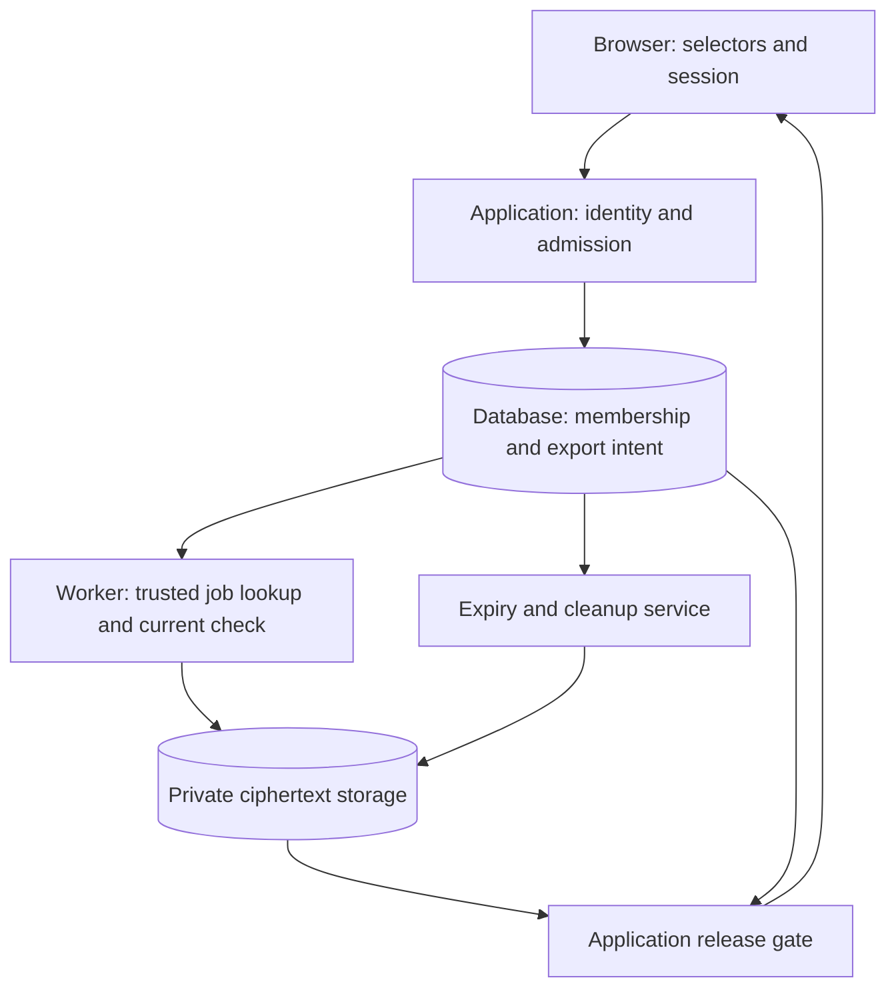

# 41. Capstone I. Define a private export

Mina requests an Alpha export before leaving the workspace. The file is ready after Lee revokes her membership. May she collect it? May Lee collect it instead? Who may end its availability, and how will anyone know that the stored copy was removed?

The capstone begins with decisions, not a download button. First you will receive a learner's brief. Then a worked design will turn that brief into an access matrix, a data flow, retention rules and acceptance cases that another engineer can implement.

You need the privacy and retention requirements from chapters 17–18, the request contract from chapter 20, current membership and requester-bound exports from chapter 23, browser protections from chapter 24, encrypted storage from chapter 27 and the coordinated-worker example from chapter 28. Chapters 33–36 and 39–40 supply audit, recovery, workload authority and evidence ownership.

By the end, you will be able to:

- State what this export contains and when its contents are chosen.
- Decide who may request, collect and expire it in Alpha and Beta.
- Trace private data through admission, background work, storage and release.
- Separate access expiry, payload deletion and evidence retention.
- Link a requirement to a positive case, a refusal case and an observable result.

The edition targets **CPython 3.15.2** and **Django 6.1.3**. This is a **design chapter**. Its tables, JSON and timelines are authored specifications, not results from a running capstone. Chapter 42 implements the selected design in runnable increments. No proposed HTTP route, cleanup service or deployment control becomes implemented merely by appearing here.

## The learner's private-export brief

### Your assignment

Casebook stores private workspace notes. An active member needs a small JSON copy of selected notes for a short personal task. Generation may run in the background. Work can be delivered twice. Membership may change while work waits or after a result is ready. An authorized person must also be able to end an export's availability early.

Design the smallest feature that preserves Casebook's existing privacy rule:

> A reader must be an active member of the note's workspace when a new read is authorized. Export collection also belongs to the requester. A queued request is not a permanent permission grant.

Use these fictional records. Do not add an implied global administrator or an unnamed Beta manager to solve a case.

**Table T41-01. Learner fixture**

| Identity or object | Stored fact |
| --- | --- |
| Mina, user `1` | Active Alpha member |
| Ravi, user `2` | Active Beta member |
| Lee, user `3` | Active Alpha manager; no Beta membership |
| Visitor | No authenticated account |
| Alpha, workspace `1` | Contains note `101`, title `Release plan`, body `Alpha private fixture` |
| Beta, workspace `2` | Contains note `202`, title `Pricing review`, body `Beta private fixture` |

Your design must answer these questions:

1. What may the client select, and which fields must the server supply?
2. Can one request combine notes from both workspaces?
3. Does a manager collect another requester's artifact, or only expire it?
4. What happens after revocation, account deactivation or a note becoming inaccessible?
5. What happens if the same request key or queue delivery appears twice?
6. When does access end? What happens if deletion fails?
7. Which workload may read notes, write ciphertext, release plaintext and delete copies?
8. Which stored facts and observations would let a reviewer check each answer?

### Deliverables

Write a product brief, a filled Alpha/Beta access matrix, a compact data-flow diagram, a threat/response table and numbered requirements with planned evidence. Include an expiry/deletion policy and a list of deliberate exclusions. Give one permitted trace, one cross-workspace refusal and one departure/revocation trace.

Use the established 1–10-note selection and small encrypted-record model as your starting point. Give every newly introduced permission a reason. Distinguish an application role from an operator or workload role. Identify proposed changes to earlier examples rather than silently assuming that they already exist.

Try the brief before reading the worked design. Compare decisions by their consequences, not by whether they use identical wording. A design that allows a new read after committed revocation fails the book's required privacy rule.

## 1. Product brief, users and required behavior

### Worked design: `CB-EXPORT-41`, revision 1

**Purpose.** Let an active workspace member collect a small, requester-bound JSON snapshot of selected private notes. The copy supports a short task without leaving a reusable public download capability.

**Users.** Members request and collect their own exports. A manager has the same own-export rights within the managed workspace and may end another requester's export there. Service identities perform bounded preparation, delivery and cleanup; they are not additional human members.

**Meaning of the verbs.** To **request** is to create validated durable intent. To **collect** is to receive private artifact bytes through the application. To **expire** is to end availability, either by the clock or an authorized early-expiry operation. To **delete** is to remove the managed payload copies. Expiry and deletion are separate outcomes.

**Core decision.** Collection requires current authorization, even when the request was valid and the ciphertext remains intact. Management authority can stop an artifact's availability without granting a right to receive that artifact.

**Table T41-02. Filled product decisions**

| Question | Decision for revision 1 |
| --- | --- |
| Selection | 1–10 distinct positive note IDs from one workspace; normalize IDs into ascending order |
| Contents | Workspace ID plus each selected note's ID, stored workspace ID, title and body; no attachments, credentials, memberships or internal storage metadata |
| Snapshot time | Read current visible contents during the worker's authorized database snapshot; request time records IDs, not historical bodies |
| Partial selection | Refuse the entire operation if any selected note is missing or inaccessible; no partial export |
| Requester | Validated server-side user identity; never a JSON or queue-supplied impersonation field |
| Collection | Original requester only, active account, active membership, all selected notes still visible, result ready, access not ended |
| Early expiry | Active requester for their own export, or an active manager of that export's workspace |
| Normal access lifetime | 60 seconds from accepted request creation; queue delay consumes that time |
| Mutation of source | Export generation and cleanup do not update or delete original notes |
| Collection count | Repeated permitted collection is allowed until access ends; this is not a one-use download |
| Transport | Application-mediated authenticated collection; no public bucket, emailed file or reusable direct object grant |

The 60-second value is inherited from chapter 28's small laboratory, not a general recommendation for a production product. A larger export or longer user task needs an explicit revision, including queue budgets, privacy exposure and cleanup tests. Chapter 18's **24-hour diagnostic bundle** is a different data class and policy; it does not silently set this export's lifetime.

A snapshot can contain content that was later edited. This design checks that the selected notes are still visible, not that every revision still equals the exported revision. A requirement to invalidate exports on every content edit would require version binding and additional tests. It is not assumed here.

### Client-owned and server-owned values

A **selector** identifies a candidate object. It does not authorize access. A client may choose a workspace path and note IDs, but the application must compare them with stored workspace associations and current memberships.

**Table T41-03. Input and ownership contract**

| Value | Source | Rule |
| --- | --- | --- |
| `workspace_id` | Route selector | Resolve and authorize against stored facts; cannot move a note between workspaces |
| `note_ids` | JSON request | Only accepted body field; exact integer IDs, distinct, 1–10, normalized for retry comparison |
| `Idempotency-Key` | Client header | Project-defined ASCII letters/digits/underscore/hyphen, 1–40 characters; scoped to requester and workspace |
| `requested_by` | Validated session | Server-owned; reject a body field attempting to set it |
| `job_id`, state, timestamps | Service | Server-owned; never accept client expiry, ready state or job ownership |
| Ciphertext location, key ID, nonce, format and generation | Storage/worker configuration and records | Internal metadata; never caller-selected paths, secrets or download authority |
| Current account, role and membership | Trusted database | Evaluate at the relevant boundary; do not reuse a browser or queue `allowed=true` claim |

For example, Mina's proposed request is:

```http
POST /api/v1/workspaces/1/exports/ HTTP/1.1
Host: casebook.example
Content-Type: application/json
Idempotency-Key: mina-export-001

{"note_ids":[101]}
```

This is an **authored contract exhibit**, not an executable request against an existing route. Cookie-authenticated state changes require chapter 24's CSRF protection. A raw `X-User-ID: 1` header is not authentication.

Keep chapter 20's initial acceptance shape:

```json
{"job_id":501,"workspace_id":1,"state":"queued"}
```

The response is `202` and represents acceptance, not generation or authorization to collect. Replaying the same accepted intent returns that original receipt without extending its deadline or creating work again. Its `queued` value is the acceptance snapshot, not a current progress report. A separate authorized status read reports current effective state.

**Table T41-04. Proposed route inventory**

| Operation | Input | Success and permitted effect |
| --- | --- | --- |
| POST `/api/v1/workspaces/{workspace_id}/exports/` | Only `note_ids`; required retry key | `202`, original three-field acceptance receipt; one request or replay |
| GET `/api/v1/workspaces/{workspace_id}/exports/{job_id}/` | Authenticated selector | `200`, exactly job ID, workspace ID, effective state and original `expires_at`; requester/current-workspace checks required |
| GET `/api/v1/workspaces/{workspace_id}/exports/{job_id}/content/` | Authenticated selector | `200`, permitted JSON bytes; no state-changing collection receipt that would imply single use |
| POST `/api/v1/workspaces/{workspace_id}/exports/{job_id}/expire/` | Empty JSON object | `204`, authorized early expiry or idempotent confirmation; no content or object locator |

`job_id=501` is symbolic in this design. A job ID is not a bearer secret. Collection uses a server-generated attachment name such as `export-501.json`, JSON media type and private `Cache-Control: no-store` responses. Do not render note text as HTML or let a submitted title become a filesystem path.

The initial Alpha artifact contains exactly this structure, encoded as UTF-8 JSON:

```json
{
  "workspace_id":1,
  "notes":[
    {"id":101,"workspace_id":1,"title":"Release plan","body":"Alpha private fixture"}
  ]
}
```

Whitespace in this display is explanatory. The implementation uses the established compact serialization and ascending note order, and measures the resulting bytes. The artifact contains neither `requested_by` nor expiry metadata: those remain in the trusted server record. Beta's equivalent contains only note `202` and workspace `2`.

### Observable refusals

Follow chapter 23's identity and disclosure boundary. An anonymous fixture caller receives `403 access_denied`; an authenticated caller without the required workspace/object authority receives generic `404 not_found`. The HTTP adapter must retain the selected authentication/session behavior and safe error representation.

After identity and object authority have been established, malformed fields receive `400`, a changed selection under the same retry key receives `409`, a queued own export receives `409 export_not_ready`, and an own terminal denied/failed/expired or deleted export receives `410 export_unavailable`. Lack of membership takes precedence over disclosing those private states. An unauthorized expire call receives the same opaque object denial, with no mutation.

Capacity refusal is `429` under this authored contract. Unsupported methods receive `405`. A failed authorization dependency, integrity check or mandatory local audit write is a service failure with no private-byte response; it is not a successful empty export. Detailed internal errors are not returned to callers.

## 2. Data-flow and threat model for export creation and delivery

A **data flow** describes where information moves and which component can act on it. A **trust boundary** separates sources with different authority. A validated browser identity, an authenticated worker identity and a stored membership are three different facts.

**Figure F41-01. Private-export boundaries and data stores**



The browser does not write the durable requester directly. Work delivery carries a job reference, not an authorization verdict. The release gate queries current membership and stored ownership before it decrypts or releases content. Cleanup has a separate service identity; the diagram's arrow to storage means a bounded cleanup operation, not a public read permission.

A local SQLite database may hold both intent and encrypted payload rows, as chapter 28 does. The separate stores in the diagram represent responsibilities, not a mandatory cloud deployment. Moving payloads to object storage changes the atomicity and cleanup problem and requires new evidence.

### Trace one accepted request

1. The application validates identity, bounds the input and checks every selected note through the workspace scope. It stores requester, workspace, normalized IDs, creation time, immutable expiry, retry identity and policy version.
2. The worker loads that intent through its authenticated work boundary. It checks current account/membership and all selected notes. It never replaces the stored requester with the worker's own broad privileges.
3. The worker creates the compact payload, enforces the 4,096-byte limit, encrypts using chapter 27's AEAD record contract and publishes one linked ready result atomically in the local database model.
4. At collection, the application checks authenticated requester, route/workspace/job binding, current account/membership, full selected-note visibility, effective expiry and ready state. Only then may it verify/decrypt and return bytes.
5. At access end, the application refuses collection independently of cleanup health. The cleanup owner removes managed copies and records a minimal outcome.

The worker's source read and the final collection are separate privacy decisions. A ready flag means preparation completed; it is not a permission grant.

### Identify concrete failures before choosing a library

**Table T41-05. Threats, responses and planned observations**

| Threat or ordinary failure | Design response | Observation required in chapter 42 or deployment verification |
| --- | --- | --- |
| Ravi changes Alpha's workspace/job selector | Bind route, stored job and current membership; refuse by default | No Alpha fields/bytes and unchanged Alpha state |
| Mina mixes note `101` and Beta note `202` | Validate the entire selection in one workspace; no partial result | No accepted job or artifact for the invalid intent |
| Queue message changes requester or workspace | Accept only a validated reference; resolve authority from durable intent | Forged fields cannot become authority or publish an artifact |
| Membership changes during delay | Check at worker read and again at collection | Queued revocation creates no result; post-generation revocation releases no bytes |
| Ready result is cached or bypassed by a direct URL | Application-mediated path; authorize before any cached/private release | Warm-path revocation refusal; no alternate unguarded content route |
| Duplicate deliveries or worker failure | Unique request/result identity plus atomic publication; bounded retry | One result after two workers; rollback leaves no linked partial result |
| Ciphertext or record context is substituted | Chapter 27 AEAD verification and trusted record binding | No plaintext on wrong key/context or modified ciphertext; no silent repair |
| Early expiry races with publication | Serialize/CAS the state and artifact publication; terminal state cannot be overwritten | Coordinated expiry/publication test cannot end with a new collectible artifact |
| Deletion fails or storage retains a version | Independent expiry gate; retry/reconcile all copies; deadline remains fixed | Collection refused, deletion still pending, object/version inventory exposes the failure |
| Restored metadata revives a revoked member or expired export | Recovery must reconcile current revocations, expiry and deletion obligations before release | Post-restore negative collection checks and no reintroduced payload copies |
| Audit or authorization storage unavailable | Fail the required decision closed; retain an operational failure signal | No premature acknowledgement/private bytes or false successful deletion |

These are responses to specific paths, not proof that the paths are safe. The implementation and deployed storage configuration must supply the observations. A configuration string saying “private” does not demonstrate a denied read.

### Workloads and the publication boundary

Reuse chapter 39's separation. The export worker needs the selected job's note snapshot, its own accepted work context, bounded export writes and the configured encryption operation. It does not need attachment reads, human download-grant issuance or arbitrary storage deletion. The release application needs the selected export's decrypt/read path, but still applies the human access matrix.

The expiry service may find due trusted records and invalidate them; cleanup may remove only locators derived from those records or a controlled orphan inventory. Neither may treat a submitted object key or workspace field as a deletion instruction. Operators' maintenance access is a separate restricted procedure, not Lee's application role.

Chapter 28's short local transaction is the selected first implementation boundary. If chapter 42 instead introduces a separate object store, it must account for staged objects, failed publication, retries and orphan cleanup. A database transaction cannot atomically roll back an already completed external upload. That change requires a revised publication protocol before claiming the same invariant.

## 3. Roles, data classification, trust assumptions and retention

### Fill the access matrices

Assume active accounts, the stated memberships, ready artifacts, current selected-note visibility and a time before access ends. `M-A` is Mina's Alpha export of `[101]`; `L-A` is Lee's separate Alpha export of `[101]`; `R-B` is Ravi's Beta export of `[202]`. These are separate requests, not three names for the same file.

**Table T41-06. Alpha decisions**

| Actor | Request Alpha | Collect M-A | Collect L-A | Expire M-A | Expire L-A |
| --- | --- | --- | --- | --- | --- |
| Mina, active Alpha member | Allow | Allow | Deny | Allow | Deny |
| Ravi, active Beta member | Deny | Deny | Deny | Deny | Deny |
| Lee, active Alpha manager | Allow | Deny | Allow | Allow | Allow |
| Visitor | Deny | Deny | Deny | Deny | Deny |
| Mina after Alpha revocation | Deny | Deny | Deny | Deny | Deny |
| Mina account inactive, Alpha membership still active | Deny | Deny | Deny | Deny | Deny |

**Table T41-07. Beta decisions**

| Actor | Request Beta | Collect R-B | Expire R-B |
| --- | --- | --- | --- |
| Mina, active Alpha member | Deny | Deny | Deny |
| Ravi, active Beta member | Allow | Allow | Allow |
| Lee, active Alpha manager | Deny | Deny | Deny |
| Visitor | Deny | Deny | Deny |
| Ravi after Beta revocation or account deactivation | Deny | Deny | Deny |

Lee's Alpha manager role grants no Beta operation. No human Beta manager is present in the fixture. The absence of one does not disable Beta's timed expiry and cleanup service.

Management expiry is deliberately narrower than collection. Lee can end Mina's Alpha copy without receiving its bytes. Lee may request a new own Alpha export while authorized, because ordinary Alpha note-read policy permits that. That does not make Mina's artifact transferable.

For any additional member, apply the same rule: they may request within their current workspace, collect their own eligible export, and expire their own. They may not collect another member's artifact. They may expire another member's artifact only with current manager authority in that same workspace.

Early expiry requires current membership even for the requester. A departing Mina cannot keep an authenticated but revoked account as a cleanup-management capability. Lee or the service can end the Alpha copy; normal lifetime is not extended because Mina cannot call the route. Choosing post-departure self-expiry would be a different, narrowly defined capability and would need a revised matrix.

**Table T41-08. Service decisions**

| Service identity | Request as a human | Collect for personal use | End access | Remove payload |
| --- | --- | --- | --- | --- |
| Export worker | Deny | Deny | May record denied/failed/expired processing outcome for its trusted job | Only its owned transient preparation resources; no broad delete role |
| Release application | Only on an authenticated person's permitted request | Only mediate an allowed collection | Apply the clock gate on every collection | Deny unless separately assigned cleanup authority |
| Expiry/cleanup service | Deny | Deny; removal need not decrypt | Due records in Alpha and Beta; authenticated service scope | Only trusted managed-copy locators under the cleanup policy |

A service can legitimately process both workspaces without becoming a human member of both. Its workload authority and each job's human authorization remain separately constrained.

### Worked example 1: a departing member's old export

Predict the result before reading the final column. Every entry is an authored UTC scenario, not an observed execution.

**Table T41-09. Departure trace for M-A**

| Time on 2026-11-26 | Event | Stored/effective result |
| --- | --- | --- |
| `10:00:00Z` | Mina requests Alpha `[101]` while active | Job `501`, requester `1`, workspace `1`, queued; original expiry `10:01:00Z` |
| `10:00:08Z` | Worker checks current membership and publishes | Ready; one linked encrypted artifact |
| `10:00:12Z` | Lee commits Mina's Alpha revocation | Membership inactive; the ready artifact is not automatically deleted |
| `10:00:13Z` | Mina attempts a new collection | Deny with no bytes; ready artifact and nonce history unchanged |
| `10:00:14Z` | Lee tries to collect M-A | Deny: wrong requester, despite management authority |
| `10:00:20Z` | Lee expires M-A | State expired; first closure at `10:00:20Z`; access end is now earlier than the original expiry |
| `10:00:21Z` | Mina's expired job is delivered again | No new artifact, no fresh deadline and no resurrection |
| `10:01:00Z` | Cleanup is assumed successful in this design trace | Managed payload removed; deletion receipt records first completion; original notes unchanged |

Why refuse Mina? Membership at request time described a valid request then. It does not establish current permission to receive private note data now. Why refuse Lee's collection? The artifact is requester-bound, even though Lee can read Alpha notes by making an independently authorized request.

If revocation instead commits at `10:00:05Z`, before the worker's check, the worker records denied and creates no ready artifact. If the account is deactivated rather than the membership revoked, the same privacy boundary applies.

The requirement concerns new decisions after a committed revocation. It cannot recall an independent copy already downloaded or guarantee immediate interruption of a response authorized earlier and already in flight. The selected payload is small and buffered, not a long streaming export. A streamed feature would need its own release/interruption contract.

A later membership grant does not reopen a terminal denied, failed or expired request. A ready, unexpired request that was never closed may become collectible again if current membership and every other condition are restored. Revision 1 does not keep a permanent membership-history ban on that artifact. In this trace, Lee's explicit expiry prevents reopening even if Mina later rejoins.

### Classify every copy

**Data classification** names the sensitivity and handling obligations of a data class. Encryption changes how a copy is protected; it does not make private note content public data.

**Table T41-10. Export data inventory**

| Data | Classification and purpose | Location/recipient | Handling |
| --- | --- | --- | --- |
| Original note title/body | Private workspace content | Source database and authorized reads | Existing note lifecycle; unchanged by export cleanup |
| Serialized export and staging copy | Same private content, temporary user task | Worker memory, controlled temporary storage if used, private payload storage, eligible requester | Field allowlist, byte bound, authenticated encryption at rest, no logs/public grants |
| Request intent and ownership | Restricted metadata, authorization/retry purpose | Trusted database and authorized minimal status response | Requester/workspace binding; no cross-tenant enumeration |
| Key material and recovery credentials | Secret | Protected key/configuration service | Separate from payload, logs and client responses; scoped use |
| Required event/deletion receipt | Restricted metadata, accountability | Protected record store | Job/policy/outcome/time; no note bodies, secrets, raw session data or reusable locators in ordinary logs |
| User's collected copy | Private content beyond service storage control | User's own device | Explain that server expiry cannot erase it |

### Expiry and deletion clocks

Keep original `created_at` and `expires_at = created_at + 60 seconds` immutable. Record `closed_at` once for early expiry or a terminal denied/failed outcome. The effective access end is the earlier of original expiry and that first closure, when present. A repeated expiry call cannot move it later.

For an artifact that reaches normal expiry without another transition, access ends at `expires_at` even if a maintenance worker has not yet updated a stored ready state. The read gate must compare the clock itself. A status response may report effective expired state without pretending that cleanup has run.

**Table T41-11. Retention decision `CB-EXPORT-RET-41`**

| Decision | Revision 1 rule |
| --- | --- |
| Policy owner | Product data owner; proposed Nora role from chapter 40 |
| Access owner | Application lead; proposed Sam role |
| Cleanup/storage owner | Platform/storage maintainer; proposed Owen role |
| Access end | Earliest of original 60-second expiry and recorded terminal closure; membership can separately refuse an earlier collection |
| Early expiry effect | Queued work becomes terminal; ready copy becomes unavailable immediately at the committed decision |
| Removal deadline | Remove managed payload copies by `delete_by = access_end_at + 15 minutes`; attempt transient cleanup immediately on failure |
| Copies in scope | Live ciphertext, partial/staged copies, retained object versions, replicas and recoverable managed payload copies |
| Storage prerequisite | Exclude this temporary payload class from backups and longer version retention; verify provider-managed copies can meet the deadline |
| Deletion failure | Remain unavailable; preserve pending/retry-required outcome and original deadline; missing the deadline is a failed requirement |
| Receipt/intent retention | Retain minimal restricted receipt and needed retry/ownership metadata for seven days after first successful deletion; if no payload was ever made, seven days after first terminal outcome |
| Retry horizon | Within that metadata-retention interval, replay cannot create another request/result or extend deadlines; after purge, do not promise recognition of an old client key |
| Identity safety | Never reuse a purged job ID for a different request; stale work must fail lookup rather than target new data |
| Nonce/key history | Preserve chapter 27's safe key-use history independently of per-job cleanup; deletion of a job does not authorize nonce reuse |
| Review trigger | Before chapter 43 release review, and whenever fields, recipients, storage copies, lifetime or recovery policy change |

These are fictional product/storage requirements, not legal retention advice. The proposed owner roles are responsibilities to agree, not evidence that real people approved the policy.

The 15-minute deadline and seven-day receipt policy follow chapter 18's distinction between payload removal and accountable metadata. They are explicitly chosen for this data class; its start event and access lifetime differ from the diagnostic example.

If cleanup fails at `10:02:00Z` for an export whose access ended at `10:01:00Z`, collection is still refused. Its deletion deadline remains `10:16:00Z`. Retrying at `10:10:00Z` cannot reset it to `10:25:00Z`. Marking a job expired proves neither deletion nor storage-policy compliance.

For M-A's early closure at `10:00:20Z`, deletion is due by `10:15:20Z`. Under the trace's assumed successful deletion at `10:01:00Z`, receipt retention ends at `2026-12-03T10:01:00Z`. A repeated cleanup must not reset that first-deletion timestamp.

An API delete response or filesystem unlink is not proof of physical-media erasure. The claim is removal of retrievable service-managed copies under the specified storage contract. If backups or provider versions cannot meet it, the prerequisite fails: change storage or revise the promise before release. A whole-database backup containing the local encrypted-payload tables would also fail this prerequisite. Temporary SQLite runs do not prove a deployed backup exclusion; separate payload storage or a verified selective backup/restore design is needed before making the removal claim. Restore must not reintroduce deleted payloads, expired access or stale memberships as current authorization.

### Worked example 2: grant rights at request time or at collection time?

Compare two designs using the same revocation at `10:00:12Z` and new collection at `10:00:13Z`.

**Table T41-12. Grant decision comparison**

| Question | Request-time bearer capability | Selected application-mediated collection |
| --- | --- | --- |
| Who can use the returned locator? | Anyone holding it within the provider's capability rules | Authenticated original requester, subject to current checks |
| Where is current membership checked? | At issuance only, unless a separate revocation-aware gateway is added | Before every new private-byte release, including cache hits |
| Mina tries after committed revocation | May still succeed until capability expires; incompatible with this requirement | Refused immediately on that new authorization decision |
| Lee copies Mina's locator | Bearer possession may suffice | Wrong requester; refused |
| Early-expiry operation changes only the application row | Direct provider capability may remain usable | New collection observes terminal/expiry state and refuses |
| Operational cost | Fewer application delivery decisions, different exposure | Requires an available authorization/release path and its failure policy |

A short direct grant narrows exposure but does not satisfy a rule that requires current membership on each new read. A hard-to-guess ID does not solve this either. The selected collection route uses the ID only to locate a candidate; trusted state decides access.

Now test the boundary in the other direction. At `10:00:11Z`, Mina is still active and M-A is ready: collection may be allowed. At `10:01:00Z`, the original expiry has been reached: collection must fail even if membership remains active and no cleanup task has run. Authorization is a decision at a defined time, not a permanent label attached to the file.

## 4. Requirement IDs, test strategy and explicit exclusions

A requirement is useful when a reviewer can identify the behavior, owner and observation that would support it. A test plan is not a passing test report. Use the following IDs in chapter 42's patch, chapter 43's release index and chapter 44's recovery work.

**Table T41-13. Requirements and proposed responsibility**

| ID | Required behavior | Implementation owner | Planned acceptance cases |
| --- | --- | --- | --- |
| `EXP-01` | Bind authenticated requester, route workspace and all selected notes through stored active account/membership; deny whole invalid selection | Application | A41-01, A41-02, A41-03 |
| `EXP-02` | Accept only the bounded selection/retry fields and export exactly the allowlisted worker-time snapshot | Application/worker | A41-01, A41-03, A41-13 |
| `EXP-03` | Worker resolves trusted intent and rechecks current permission before source read/publication | Worker | A41-04, A41-12 |
| `EXP-04` | Collection is requester-bound, current, all-or-nothing and expiry-aware before plaintext/cached release | Release application | A41-02, A41-05, A41-06, A41-08 |
| `EXP-05` | Early expiry follows Alpha/Beta matrices, is idempotent and cannot be overwritten by a late worker | Application/worker | A41-07, A41-09, A41-11 |
| `EXP-06` | Access lifetime, deletion scope/deadline and minimal evidence retention follow T41-11 | Application/storage | A41-08, A41-10, A41-15 |
| `EXP-07` | Use chapter 27's authenticated encrypted-record/key policy; keep delivery private and workload permissions narrow | Storage/platform | A41-06, A41-12, A41-14 |
| `EXP-08` | Same requester/workspace/retry key and same normalized selection produce one intent; changed intent conflicts; two workers commit one linked result | Application/database | A41-03, A41-09 |
| `EXP-09` | Failure/expiry/cancellation leave no published partial result; cleanup is repeatable and cannot extend access | Worker/storage | A41-10, A41-11 |
| `EXP-10` | Required local mutation audit failure rolls back its unit; required collection decision recording failure releases no bytes | Application/recording | A41-14 |
| `EXP-11` | Enforce declared selection, byte, pending-work, worker and retained-payload reservation budgets | Application/platform | A41-13 |
| `EXP-12` | Proposed routes enforce session/CSRF/method/error/cache contracts without alternate private-content paths | Web/release application | A41-02, A41-06, A41-07, A41-14 |

Product owns the policy. Application and platform owners supply evidence. AppSec reviews adequacy. None of these organizational responsibilities grants a person Mina's collection rights. Missing owner acceptance or missing mandatory evidence remains a release gap.

### Limits to make the first implementation reviewable

Use the established 1–10 notes, 4,096 serialized UTF-8 bytes, one queued request per workspace, two queued globally and two local worker slots. Add a retained-payload reservation limit of two outstanding reservations per workspace and four globally. Each accepted request reserves one potential payload slot until successful deletion, or verified terminal completion with no payload.

This reservation includes queued preparation and retained ready/expired-but-not-deleted artifacts. A transition to ready or expired must not free it while bytes still exist. At most two maximum-size AES-GCM ciphertexts are 8,224 ciphertext/tag bytes per workspace, but this is not a total filesystem/database-byte claim: nonces, metadata, indexes and key-use history need separate operational budgets.

The retained-payload reservation is a **new requirement**, not an implemented property of chapter 28. Its count/reservation/release must be transactional or equivalently protected. Deletion failure keeps capacity occupied, making a storage failure visible rather than quietly permitting unlimited copies. An exhausted budget refuses new work; idempotent replay does not consume another reservation.

No requests-per-minute guarantee is claimed from pending-job counts. Deployment rate limiting, fair scheduling across more tenants and full disk/connection quotas need separate configuration and evidence. Request expiry is also not a preemptive execution timeout. Keep the selected worker unit short, bounded and free of external waits; any broader execution model needs cancellation and publication rules.

### State and failure decisions

Keep chapter 28's request states: queued, ready, denied, failed and expired. Track removal separately as pending or deleted, with first closure/deletion timestamps. Natural expiry is effective at its deadline even if a stored-state update lags. There is no transition from a terminal state back to queued/ready; a newly desired export needs a new intent.

The local publication transaction couples the result-slot constraint, encrypted row, nonce reservation, ready update and required local event. Unexpected failure rolls back all of them. An authorized early-expiry transaction records terminal closure and its event without decrypting or returning the payload. A competing worker must observe the terminal result or fail its conditional publication; it must not set ready after expiry wins.

The cleanup action spans removal and its receipt. If removal succeeds but the receipt write fails, do not claim a committed deletion receipt. A retry verifies absence and reconciles the first verifiable completion time without extending any existing deadline. If removal fails, preserve pending state and retry/error evidence. The release gate remains closed in either case.

Required collection recording means the authorization/release decision can be recorded before returning bytes. It is not evidence that the client received every byte. Minimal event fields are event ID, job ID, policy version, actor/service identity reference, workspace reference, outcome and UTC time. Redact credentials, note bodies and unnecessary object locators. Do not require logging every malformed attacker request synchronously as a new denial-of-service path; define bounded operational failure recording separately.

### Planned acceptance ledger

Every row below is **planned**, not executed by this chapter. Chapter 42 must attach actual method, runtime, result and protected state evidence. Use controlled clocks and barriers instead of sleeps to trigger the important boundaries. For changed-selection and 10/11-note cases, extend only the disposable test fixture with Alpha notes `102`–`111`, the same stored workspace/creator and synthetic bodies. Then `[101]` versus `[102]` is a valid changed selection, `101`–`110` is ten notes, and `101`–`111` is eleven. Include a title such as `یادداشت آلفا` in a byte-boundary case. This adds no Beta manager and does not alter the earlier saved seed.

**Table T41-14. Acceptance cases and final-state evidence**

| Case | Setup and action | Expected response/decision | Required final state or observation |
| --- | --- | --- | --- |
| A41-01 | Mina exports Alpha `[101]`; Ravi separately exports Beta `[202]`; each collects own ready result | Allow each | Separate requester/workspace bindings; exact allowlisted payload; originals unchanged |
| A41-02 | Visitor requests/collects/expires; Mina targets Beta; Ravi targets Alpha; Lee targets Beta | Deny under the disclosure contract | No private content/status leakage, no accepted unauthorized job or mutation |
| A41-03 | Mix `[101,202]` under Alpha; send forbidden requester/expiry; then retry a valid key with same and changed valid selections | Invalid intent refused; same intent replays; changed intent conflicts | No partial job; replay preserves original ID/expiry; no extra reservation |
| A41-04 | Queue Mina's request, commit revocation, then run worker | Denied | Terminal denied; no ready result or retained payload; transient resources reconciled |
| A41-05 | Generate M-A, revoke Mina, then collect; separately deactivate account or remove selected-note visibility | Deny before release | Ready ciphertext may remain, but zero response bytes; job/artifact not silently repaired |
| A41-06 | Lee collects M-A; warm a content cache then revoke Mina; try an alternate/direct storage path | Deny unauthorized collection/bypass | No requester bypass; cache cannot precede permission gate; no public/direct grant |
| A41-07 | Mina expires M-A; Lee expires M-A/L-A; Ravi expires R-B; repeat; try Mina expiring L-A and Lee expiring R-B | Allow only matrix cells | First closure/deadline unchanged on repeat; no original-note change or content release |
| A41-08 | Collect at one clock unit before original expiry and exactly at expiry; leave cleanup unavailable | Allow before if otherwise eligible; refuse at boundary | Deadline unchanged; ciphertext may still exist and deletion remains pending |
| A41-09 | Two workers observe no result before writing; redeliver after success; repeat client receipt | One committed result | One result slot/artifact, correct nonce history, original intent/expiry and reserved capacity unchanged on replay |
| A41-10 | Abort ready update; cancel controlled preparation; fail deletion; retry after a deadline breach | No partial publish; no false deletion pass | Rollback/transient cleanup evidence; unavailable payload with pending removal; breach visible even after later success |
| A41-11 | Coordinate early expiry before publication, and publication before expiry | Expiry wins availability in both orders | No collectible late result; terminal state cannot be overwritten; any managed bytes remain scheduled for deletion |
| A41-12 | Forge queue authority fields; try worker operations outside accepted job/workspace; replay after terminal closure | Refuse malformed/unauthorized work; terminal replay has no effect | No cross-workspace read/write or new artifact; workload-policy checks recorded separately from local simulation |
| A41-13 | Test 10/11 selections, 4,096/4,097 UTF-8 bytes, pending capacity and retained reservation exhaustion | Accept valid boundary where authorized; refuse overflow | No over-budget accepted work/artifact; no capacity release while failed deletion leaves bytes |
| A41-14 | Tamper with ciphertext/context; fail required mutation/release recording; omit CSRF on mutation or use wrong method | No plaintext/required mutation success on failure | Rollback or no release; safe error; method/cache/header contract observed in HTTP integration |
| A41-15 | Reconcile deletion/metadata retention; inspect versions/replicas; restore synthetic backup with stale state | No expired or deleted copy revived | Managed-copy inventory, current membership after recovery, seven-day metadata purge, no job-ID/nonce reuse |

Local tests can establish database and controlled filesystem behavior. They cannot establish provider permissions, managed-version removal, backup exclusions, HTTP/proxy behavior or restored production authorization unless those paths are actually exercised. Chapter 43 must preserve missing evidence as missing.

### Explicit assumptions and exclusions

**Table T41-15. Trust assumptions to verify or constrain**

| Assumption | Consequence if false / required response |
| --- | --- |
| Session validation supplies the real active caller; membership records are authoritative | Do not treat user-controlled identity fields as a substitute; validate the authentication integration |
| Work delivery and configuration are restricted to intended workloads | Authenticate delivery and constrain worker operations; a trusted key in a local fixture proves neither |
| Clocks and transaction boundaries support the expiry/revocation decisions | Sample trusted time at the actual gate; specify in-flight behavior and test exact boundaries |
| Private payload storage meets copy/backup/deletion policy | Verify inventory/restore behavior before release or revise the storage design |
| Encryption keys and key-use history remain protected and recoverable under policy | Carry chapter 27's custody, nonce, rotation and restore checks; ciphertext alone is insufficient |
| Required local audit can join the mutation transaction, or an equally specified protocol exists | Do not claim atomic recording through an unrelated log service without testing that boundary |

Excluded from revision 1 are attachments/archives, cross-workspace bundles, historical note reconstruction, downloads for a different recipient, emailed/private partner transfers, public/direct object grants, one-use collection, large streamed exports, a new cryptographic protocol, legal-retention determinations and a general cloud orchestration platform. Operator break-glass reads are not silently allowed; they would need a separate reviewed procedure and evidence.

Also excluded is recall of user-held copies or universal interruption of an in-flight response. These limits do not waive the required denial of a new collection after committed revocation or expiry. Total deployment rate/disk budgets and provider implementation are release prerequisites where applicable, not facts demonstrated by this design document.

## Guided lab: make the design reviewable

1. Fill T41-01 from the trusted fixture. Keep application memberships separate from organizational and workload roles.
2. Complete the learner brief in your own words. Define request, collect, expire and delete as separate actions.
3. Fill Alpha and Beta matrices before selecting routes. Explain Lee's different collection and expiry decisions and how Beta expires without a human manager.
4. Choose snapshot time and payload fields. Trace the invalid mixed-workspace selection and compare source rows before/after the proposed operation.
5. Walk the departure timeline at the worker and collection boundaries. Move revocation before generation and write the changed final state.
6. Calculate original expiry, early closure, removal deadline and receipt purge time. Repeat cleanup and confirm no deadline moves later.
7. Trace a duplicate request, two worker deliveries, a failed ready update and both orders of expiry/publication. Identify the database constraint, transaction and cleanup owner for each.
8. Map every row of T41-13 to planned observations. Mark a local simulation, real HTTP test and provider/storage test differently.
9. Review the new manual-expiry, retained-capacity and cleanup requirements against chapter 28. Carry those deltas into chapter 42 instead of claiming they already pass.
10. Prepare a handover containing revision ID, filled matrices, route/field inventory, lifecycle rules, requirement IDs, proposed owners and explicit gaps. A reviewer should be able to answer each permission question without running code.

## Independent practice

### Exercise 1: a manager is not every requester

Lee asks to collect Mina's ready Alpha export and expire Ravi's ready Beta export. Mina asks to expire Lee's Alpha export. Decide each request and name the stored relation that matters. What separate Alpha operation may Lee perform to obtain an own export of note `101`?

### Exercise 2: the next request

Mina has already collected a copy. Lee then revokes her membership. A new content request arrives, and a cached artifact is available. Decide that request, identify the check order and state what the service can promise about the earlier downloaded copy.

### Exercise 3: expire before the worker returns

A worker started preparing M-A. Lee's early-expiry transaction commits before publication. The worker later tries to mark ready. Specify the allowed stored outcome, any retained-copy obligation and the test coordination needed to distinguish it from the opposite order.

### Exercise 4: failed removal and an attractive status

Access ends at `10:01:00Z`. Removal fails at `10:03:00Z`. A dashboard changes the request label to deleted anyway, and a retry proposes `delete_by=10:23:00Z`. Identify both incorrect claims and specify the state/evidence that should remain.

### Exercise 5: a hidden storage-policy change

Platform enables 30-day version retention for the export payload store. The application still unlinks the current object within 15 minutes and passes its local test. Which design prerequisite is now false? What additional evidence or revised decision is needed before release?

### Practice check

Deliver a design brief and access matrix. A reviewer must be able to decide who can request, collect and expire an export in both workspaces.

## Hints

- Read a role together with its workspace scope and the selected action.
- Collection is both requester-bound and dependent on current permission.
- A ready artifact, a grant or a cache hit is not an authorization verdict.
- Compute cleanup from the original access end, not the last retry.
- Ask which copies remain retrievable, not only which task returned success.
- Keep authored expected results separate from observed test and deployment evidence.

## Worked answers

### Exercise 1

Lee cannot collect M-A because he is not its requester. He cannot expire R-B because he has no Beta authority. Mina cannot expire L-A because she is neither its requester nor an Alpha manager. Lee may create and later collect L-A, his own independently authorized Alpha export of `[101]`. The artifact-requester relation and the actor's current workspace role answer different questions.

### Exercise 2

Refuse the new request. Check authenticated identity, stored job/workspace/requester binding, current account/membership and selection visibility, effective expiry and readiness before any cached plaintext or ciphertext is released/decrypted. The previously collected independent copy cannot be recalled through server expiry or deletion. That limitation does not authorize another collection.

### Exercise 3

The worker must not overwrite expired with ready or publish a collectible result. Under the local single-database model, serialization/conditional state checks leave the request terminal. Any private preparation copy is cleaned up or remains explicitly pending under the fixed removal deadline. Use a barrier/event at a defined point to force expiry-first, then a separate publication-first case. In the latter, expiry still closes collection and schedules the committed artifact's deletion. Sleeping and hoping for the desired interleaving is insufficient evidence.

### Exercise 4

An expired request is not a deleted payload while a managed copy remains. Keep removal pending/retry-required, preserve the failure and refuse collection. The deletion deadline is `10:16:00Z`, not a new deadline based on the `10:03:00Z` attempt. A later success can finish removal but cannot erase a missed deadline or reset first-success evidence retention.

### Exercise 5

The temporary-payload storage prerequisite fails because recoverable managed versions outlive the promised removal deadline. Inspect actual versions, replicas, backup/restore behavior and the permission/configuration that controls them. Disable incompatible retention for this data class, change storage or explicitly revise and re-review the product promise and tests. A passing local unlink test does not establish managed-copy deletion.

### Practice check

The worked deliverable is revision `CB-EXPORT-41`, with T41-02's product decisions, T41-03/T41-04's field/route contracts, F41-01's flow, T41-06/T41-07's human matrices, T41-08's service scope, T41-11's retention rule and T41-13/T41-14's requirements/evidence plan.

Mina can request/collect/expire her own Alpha export while active. Ravi has the equivalent rights only in Beta. Lee can request and collect his own Alpha export and expire either Alpha artifact, but cannot collect Mina's artifact or act in Beta. Visitors and revoked/deactivated users receive no such human rights. The service enforces clock expiry and cleanup in both workspaces under separate workload authority. Those decisions are sufficient for a reviewer to implement positive and negative cases without inventing a manager bypass.

## Review record and implementation handover

This chapter supplies a complete **authored design**, including two worked decisions. The chapter title and four topics follow brief 41. The Alpha/Beta fixtures, requester-only collection, field allowlist, cryptographic format and queue semantics were checked against the earlier chapter contracts. The manual early-expiry route, deletion workflow, required export recording and retained-payload reservations are explicitly proposed capstone work.

The JSON examples were syntax-checked. The worked timestamp arithmetic and matrix completeness were checked as document consistency, not as an application test. No capstone implementation, permission integration test, provider operation or cleanup worker ran as part of this chapter. The earlier examples' test reports do not establish these new requirements.

Chapter 42 should start from `examples/ch23/authorization_service.py`, `examples/ch27/export_crypto.py` and `examples/ch28/export_queue.py`, preserving their existing signatures/fixtures unless a documented capstone adapter or migration is needed. Start in an isolated capstone directory and disposable database; do not silently change the learning examples or treat their initializers as production migrations. Carry revision 1, all `EXP-*` and `A41-*` IDs, the route/field contract, matrices, clocks, cleanup policy and explicit gaps into the patch.

Implement in observable increments: admission and exact payload, worker/current authorization and unique publication, guarded collection, early/natural expiry, cleanup/retention and fault/concurrency evidence. Record exact runtime and which paths actually ran. Chapter 43 makes a release decision for a bound build; chapter 44 verifies operation and recovery. Neither is replaced by a design marked complete.

## What you can now explain

An export is a new private copy with a requester, a workspace, a purpose and a lifecycle. Request-time permission can authorize durable intent without granting permanent collection rights. Current checks protect a new release; manager expiry stops availability without transferring the file. Access expiry, deletion and evidence retention need separate decisions and observations.

A useful capstone brief gives implementers concrete boundaries and lets reviewers identify missing proof. The matrices and final-state cases make those boundaries testable before the first route is added.

## Primary sources

- OWASP's [Authorization Cheat Sheet](https://cheatsheetseries.owasp.org/cheatsheets/Authorization_Cheat_Sheet.html) supports explicit permissions, least privilege, default denial and checks on each request. Casebook's requester binding and manager-expiry policy are authored product choices, not universal role rules.
- OWASP's [Insecure Direct Object Reference Prevention Cheat Sheet](https://cheatsheetseries.owasp.org/cheatsheets/Insecure_Direct_Object_Reference_Prevention_Cheat_Sheet.html) explains why changing or hiding identifiers does not replace object authorization. This design treats all route/job selectors as candidates, not grants.
- OWASP's [Threat Modeling Cheat Sheet](https://cheatsheetseries.owasp.org/cheatsheets/Threat_Modeling_Cheat_Sheet.html) describes modeling the system, identifying threats and checking responses throughout development. F41-01 and T41-05 are Casebook's own model and planned observations.
- The cryptography project's [AEAD documentation](https://cryptography.io/en/50.0.2/hazmat/primitives/aead/) documents the maintained encryption API inherited from chapter 27. Library correctness does not establish application access, copy retention or key custody. The 60-second lifetime, 15-minute removal deadline and seven-day metadata retention are explicitly fictional policy decisions in this chapter.
