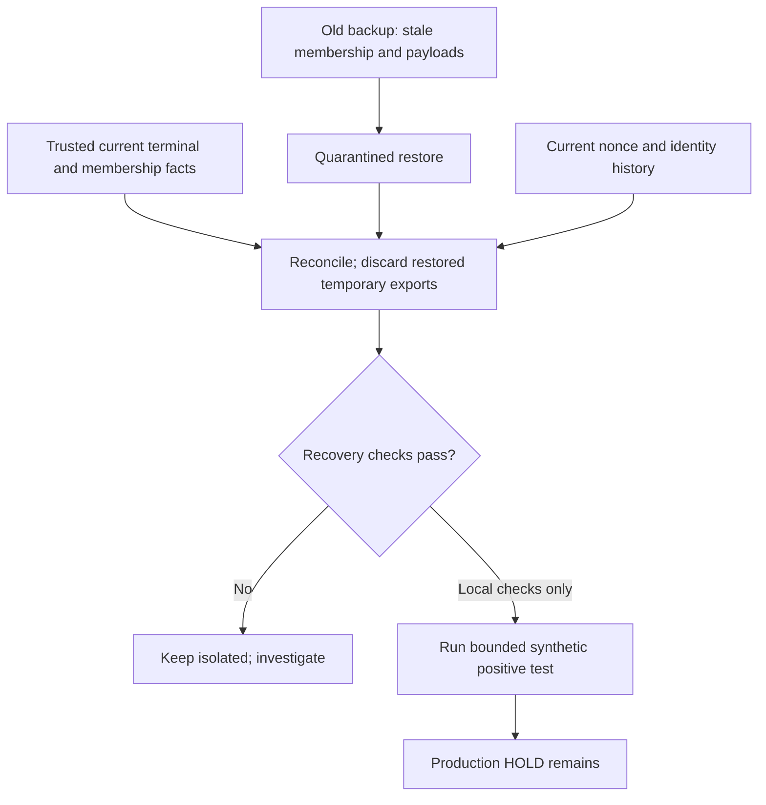

# 44. Capstone IV. Operate, respond and hand over

<!-- book:header:start -->
[← Chapter 43](43.md) · [Contents](../README.md#contents) · [Repository](../../README.md) · [Appendices →](../appendices.md)

[Runnable companion](../../examples/ch44/README.md)

<details>
<summary>In this chapter</summary>

- [1. Interpret events for a delayed or wrongly retained export](#1-interpret-events-for-a-delayed-or-wrongly-retained-export)
- [2. Make a containment decision with incomplete information](#2-make-a-containment-decision-with-incomplete-information)
- [3. Restore service and verify deletion and tenant boundaries](#3-restore-service-and-verify-deletion-and-tenant-boundaries)
- [4. Write a concise advisory, retrospective and maintenance handover](#4-write-a-concise-advisory-retrospective-and-maintenance-handover)
- [Guided lab: hand the exercise to someone else](#guided-lab-hand-the-exercise-to-someone-else)
- [Independent practice](#independent-practice)
- [Hints](#hints)
- [Worked answers](#worked-answers)
- [Verification record and capstone handover](#verification-record-and-capstone-handover)
- [What you can now explain](#what-you-can-now-explain)
- [Primary sources](#primary-sources)

</details>
<!-- book:header:end -->

An export is unavailable to its requester, but its encrypted copy still exists after the removal deadline. A backup also contains copies the live service already deleted. What should the next engineer contain, restore and verify before declaring recovery complete?

Chapter 43 left production promotion on **HOLD**. This chapter does not invent a deployment after that decision. We continue with the same held candidate in an isolated, synthetic retention-incident rehearsal. The runner creates real temporary SQLite state, induces controlled failures, performs a quarantined restore and records the resulting checks.

You need chapter 41's retention and access policy, chapter 42's service and state tests, chapter 43's identified candidate and unresolved gates, and chapters 33–36's distinction between audit evidence, observation, containment and recovery. Mina `1` belongs to Alpha `1` until Lee revokes her membership. Ravi `2` belongs to Beta `2`. Lee `3` manages Alpha only.

By the end, you will be able to:

- Reconstruct a UTC timeline while separating effective expiry from a later audit event.
- Contain new work without weakening current-permission or expiry checks.
- Reconcile restored data with current revocations, terminal outcomes and nonce history.
- Compare the old acceptance tests with those required by a retention-policy change.
- Hand another engineer a runnable check, a bounded conclusion and an owner for each unresolved risk.

The edition targets **CPython 3.12.14** and **Django 6.1.3**. This rehearsal and **nine recovery test methods** ran on **CPython 3.12.14**, **SQLite 3.53.1** and **cryptography 50.0.2**. No production service, provider account, user notification or real incident response was performed. The production hosting/provider/custody gaps from chapter 43 remain open.

### The subject and starting state

**Table T44-01. Identity carried forward from chapter 43**

| Item | Value |
| --- | --- |
| Candidate | `CB-EXPORT-RC43-01` |
| Source commit | `2c79fe0806a5a788e79afbd0adbc1c4a495a9a5d` |
| Source ZIP SHA-256 | `ed326bc772909f0dbe064d454488190927593bf18671e6a3c67ac7f017523a5f` |
| Policy | `CB-EXPORT-41-r1`: 60-second access lifetime; removal by another 900 seconds |
| Rehearsal | `INC44-SYNTH-001` |
| Production decision | HOLD before and after the exercise |
| Scenario clock | Begins `2026-11-26T10:00:00Z`; fixed fictional times, not a claim of discovery today |

Keep `examples/ch42/capstone.py`, its chapter 23/27/28 dependencies, and all chapter 43 candidate/evidence files unchanged. The new files live in `examples/ch44/`. The runner checks chapter 43's retained linkage and compares the current candidate Python files with their archived hashes before calling domain operations. It runs those matching workspace modules; it does not build or approve a new deployment.

The exercise creates a deliberately wrong full-backup fixture containing temporary payloads. That is a **negative control**, an intentionally unsafe example used to demonstrate what recovery must reject or reconcile. It exists only in a disposable directory, never as a retained book artifact. Keys stay in memory. Retained reports contain synthetic metadata, counts and outcomes, without ciphertext, note bodies or keys.

Filename: `examples/ch44/requirements.txt`.

```text
cryptography==50.0.2
```

From the repository root, in your learning environment:

```shell
python -m examples.ch43.check_evidence
python -m examples.ch44.rehearsal --out /tmp/casebook-ch44-new-evidence
python -m examples.ch44.timeline /tmp/casebook-ch44-new-evidence/audit-input.jsonl
python -m unittest -v examples.ch44.test_recovery
```

Use `python3` if that is your launcher. Choose an output directory that does not exist. The CLI accepts an evidence destination, not a database to repair. The saved manuscript run is under `examples/ch44/evidence/`.

## 1. Interpret events for a delayed or wrongly retained export

### Name the incident before interpreting it

There are two different obligations:

- **Access expiry:** a new collection must be refused when the access period ends, or earlier when membership/requester checks fail.
- **Removal:** all managed payload copies must be removed by the separately specified deadline.

An unavailable file can still be wrongly retained. Encryption does not remove its retention obligation. Likewise, a deletion receipt about the live SQL row is not evidence that a backup or restored copy has disappeared.

The setup creates Mina's Alpha export and Ravi's Beta export at `10:00:00Z`. Both originally expire at `10:01:00Z`, so both have a normal removal deadline of `10:16:00Z`. The actual fresh database assigns job IDs `1` and `2`; chapter 41's `501` was a symbolic design example.

Before interpreting the logs, predict three cases. Mina is revoked at `10:00:10Z`: a new Alpha collection must be denied. Active Ravi can collect Beta at `10:00:59Z` but not at expiry equality. If Alpha deletion then fails, should its original expiry or removal deadline move? Neither should move.

### Worked example 1: rebuild the UTC timeline

The saved `audit-input.jsonl` is deliberately not chronological. Each row labels its source as `application` or `harness`. Application rows come from the real local `export_events` table. Harness rows record controlled actions/probes, such as revocation and backup creation, that are not automatically export-audit events in the candidate.

**Table T44-02. Reconstructed synthetic timeline, all on 2026-11-26 UTC**

| Time | Evidence source | Event and bounded meaning |
| --- | --- | --- |
| `10:00:00Z` | Application | Alpha and Beta requests accepted; original deadlines fixed |
| `10:00:05Z`, `10:00:06Z` | Application | Alpha then Beta ready; two linked encrypted results |
| `10:00:07Z` | Harness | Wrong full-backup fixture made; it contains both temporary exports |
| `10:00:08Z` | Harness plus inspected nonce count | Dummy Alpha key rotation adds a committed nonce entry after the backup |
| `10:00:10Z` | Harness, through trusted membership operation | Lee commits Mina's Alpha revocation |
| `10:00:59Z` | Application and probe | Ravi's Beta collection authorized; controlled call receives Beta `[202]` |
| `10:01:00Z` | Clock and probes | Mina receives 404 because membership fails first; Ravi receives 410 at expiry |
| `10:01:01Z` | Application | Beta's live row is removed; its unsafe backup copy still exists |
| `10:01:02Z` | Application | Alpha is recorded expired and deletion fails; effective closure remains `10:01:00Z` |
| `10:16:01Z` | Read-only harness inventory | Alpha copy is overdue; stored `breached` still 0; unsafe backup holds two copies |
| `10:16:01Z` | Harness | New admission calls paused; existing release denial remains in force |
| `10:16:02Z` | Application | Another failed Alpha removal records the observed breach as 1 |
| `10:16:10Z` | Harness | Controlled SQL fault is removed; this is not repair of a real provider outage |
| `10:16:11Z` | Application | Alpha's live copy removed; first deletion time and breach preserved |
| `10:16:13Z` | Harness/quarantine inspection | Unsafe restore contains two payload rows, stale Mina membership and only two nonce entries |
| `10:16:14Z` | Harness and database checks | Current facts reconciled; restored payload rows removed; nonce history restored to three |
| `10:16:15Z` | Controlled recovery probes | Mina denied, old Beta export unavailable, fresh Beta export allowed; cross-workspace/anonymous probes denied |
| `10:16:16Z` | Harness | Known unsafe backup removed; wider copy scope explicitly addressed |
| `10:17:15Z` | Application | Fresh Beta retest copy reaches its original expiry and is cleaned up |

Notice the difference between **effective time** and **recording time**. Alpha's access end is `10:01:00Z`. Its expired event is written at `10:01:02Z`, when cleanup runs. Treating that event time as a fresh start would extend access or removal incorrectly.

The same distinction affects detection. The candidate sets a breach flag when cleanup observes a late outcome; it is not a continuously running monitor. A zero flag at `10:16:01Z` does not establish compliance. The read-only check compares the current clock, immutable access end, grace interval and actual copy presence.

**Listing L44-01. Read the bounded, synthetic timeline fixture**

Filename: `examples/ch44/timeline.py`.

```python
"""Reorder the bounded, synthetic incident fixture; not a general production log importer."""
import argparse
import json
from pathlib import Path


def main():
    parser = argparse.ArgumentParser()
    parser.add_argument("path",type=Path)
    args = parser.parse_args()
    with args.path.open("rb") as stream: raw = stream.read(1_000_001)
    if len(raw) > 1_000_000: raise ValueError("Fixture too large")
    rows = [json.loads(line) for line in raw.decode("utf-8").splitlines() if line]
    rows.sort(key=lambda row:(row["at"],0 if row["source"] == "application" else 1,row.get("event_id",0)))
    for row in rows:
        print(row["at_utc"],row["source"],row["outcome"])


if __name__ == "__main__":
    main()
```

Run it against the saved fixture:

```shell
python -m examples.ch44.timeline examples/ch44/evidence/audit-input.jsonl
```

The output is the ordered UTC/source/outcome list represented by T44-02, with additional application events and probe rows. It is not a new incident event generator. The reader is intentionally for the supplied bounded fixture, not a complete hostile-log importer.

Rows sharing a timestamp are displayed by source and local event ID. That tie-breaker is a presentation rule, not proof of global causal order across hosts. Here the single-process harness controls the relevant actions. In deployment, collect clock uncertainty, request/job correlation and independent storage observations rather than relying on file order alone.

### Separate confirmed facts from unknowns

**Table T44-03. Assessment at detection**

| Question | Confirmed in this rehearsal | Still not established |
| --- | --- | --- |
| Did the live Alpha payload miss its removal deadline? | Yes: present at `10:16:01Z`, deadline `10:16:00Z` | How a real fleet would detect/escalate the condition |
| Did access expiry fail? | The selected controlled reads were refused as required | Every historical read or alternate deployed path |
| Was Beta fully deleted at `10:01:01Z`? | Its live row was deleted | No: the known backup retained Beta too |
| Was the cause a provider outage? | No; a controlled SQL trigger caused the local refusal | Real provider behavior or root cause outside the model |
| Does `breached=0` prove on-time removal? | No; inventory comparison already shows lateness | Continuous monitoring is not implemented by the candidate |
| Is this a production data breach? | No production service/data is involved | No broader real-world disclosure conclusion is supported |

Do not report “no unauthorized access occurred” from absent export events. The candidate deliberately does not create a successful collection event for a refused call, and the exercise observes only named probes. Missing event data is not evidence that every possible access was denied.

## 2. Make a containment decision with incomplete information

### Keep the privacy gate while reducing work

**Containment** limits continuing harm while facts remain incomplete. Here the candidate is already held, so the exercise can stop new local admission/delivery without affecting real users. It must not disable membership, requester or expiry checks in the name of recovery.

**Table T44-04. Containment decision record**

| Action | Rehearsal behavior | Reason and limit |
| --- | --- | --- |
| Stop new export admission | Harness switch makes new calls return a paused-service error | Reduces new copies while investigating; not a tested fleet-wide traffic control |
| Avoid new work publication | Harness does not dispatch new work during quarantine | No real broker or autonomous worker is present to pause |
| Preserve release gates | Continue normal guarded collection probes | Revoked/expired copies must not become a recovery bypass |
| Inventory copies | Count live, unsafe-backup and restored rows separately | A live deletion receipt cannot stand for every location |
| Preserve minimal evidence | Retain metadata/outcomes, source identity and current-fact hash | Do not retain payload/key dumps as a convenient attachment |
| Restore only in quarantine | No HTTP listener or user traffic; keep local admission paused | A backup is not current authorization or deletion authority |
| Keep production HOLD | Chapter 43's record is unchanged | A local incident exercise does not satisfy its release gaps |

This is a deliberate decision under incomplete information. We know a managed copy is late and a bad backup violates the exclusion rule. We do not need a complete explanation of every possible cause before stopping new copies and preserving the existing denial boundary.

The paused-service switch is confined to the teaching harness. It does not prove that a reverse proxy, all application instances or a real queue consumer obeys the same control. A deployed runbook must identify and exercise those actual controls and their failure paths.

### Define copy scope before declaring removal complete

The known copy inventory evolves as follows:

**Table T44-05. Managed-copy observations**

| Stage | Live payload rows | Unsafe-backup payload rows | Quarantine payload rows | Conclusion |
| --- | --- | --- | --- | --- |
| Immediately after wrong backup | 2 | 2 | Not created | Backup prerequisite already violated |
| Beta live cleanup and Alpha failure | 1 | 2 | Not created | Beta's live receipt is narrower than full-copy removal |
| Live Alpha repair | 0 | 2 | Not created | Live service repaired; retained backup still violates scope |
| Raw restore in quarantine | 0 | 2 | 2 | Restore has reintroduced previously deleted temporary outputs |
| After reconciliation | 0 | 2 | 0 | Restored live view is safe for checks; backup still needs disposal |
| End of rehearsal | 0 | File absent | 0 | Known local SQL/file copies addressed under the stated interface scope |

The wrong backup is intentional and restricted to the temporary fixture. Its existence is not a recommended incident-preservation strategy. Original notes have a different backup purpose; the export-payload exclusion still applies even when both tables reside in one database.

Do not confuse deletion from a SQL interface or an unlinked test file with forensic erasure. Database free pages, journals, snapshots, storage versions, replicas and actual backup policy need separate evidence. This local inventory does not establish their production state.

### Preserve evidence without preserving the incident's forbidden copy

The retained report contains job/workspace references, times, outcomes, counts and a hash of the restricted current-fact manifest. It does not retain the manifest's nonce values, payload bytes, note bodies or dummy keys. The full wrong backup is removed inside the disposable exercise before the runner returns.

In a real incident, preservation must follow the authorized evidence scope, sensitivity, access and retention procedure. If full payload preservation conflicts with the stated deletion obligation, escalate that decision to the actual data/incident authority instead of silently creating another permanent copy. This chapter does not make a legal-hold or notification determination.

The proposed operational lead is Owen, with Sam for application checks, Dana for restore, Tess for review and Nora for data-policy decisions. These are the fictional roles carried from chapter 40. No message, accepted assignment, real approval or external advisory is sent.

## 3. Restore service and verify deletion and tenant boundaries

### Restore bytes, then reconcile authority

A **quarantine** is an isolated recovery environment that cannot serve ordinary user traffic. Restoring a database there is preparation, not permission to resume. The old backup contains Mina's formerly active membership, both temporary payloads and older nonce history.

The exercise retains the original expiry in that backup. At the real scenario recovery time, Mina's diagnostic core collection returns **410**, because the stale restored membership passes and the unchanged old expiry then refuses release. That is useful defense, but it is not a successful current-membership recovery check. After reconciliation the same request returns **404** from current revoked membership.

A new request could otherwise be authorized from stale membership. Do not conclude that “the restore is safe” merely because an old artifact happens to be expired. Check current authority itself while admission remains paused.

**Figure F44-01. Quarantine before any local positive-path recovery test**



The current manifest is a trusted in-memory fixture captured from the known live state after repair. Its hash identifies those facts; the hash does not authenticate them. In a real recovery, the authoritative revocation/deletion source must be protected and current. Do not accept a client-supplied manifest or use the suspect backup as its own source of authority.

### Reconcile the facts that must not roll back

**Table T44-06. Recovery inputs and resulting checks**

| Fact | Why the old backup is insufficient | Local recovery behavior |
| --- | --- | --- |
| Current account/membership | Mina was active when copied, then revoked | Reapply known current facts before new admission |
| Original expiry and closure | Recreating jobs could refresh time or reopen terminal state | Preserve current terminal job rows and original timestamps |
| Deletion outcomes | Backup contains both later-deleted exports | Discard all restored temporary outputs; preserve current receipt/retention facts |
| Job identity high-water mark | Old references must never target a different new request | Preserve current high-water mark; verify new job ID exceeds old accepted IDs |
| Committed nonce-use history | Alpha rotated after backup: backup has two entries, current state has three | Merge current and restored history; do not reset it to the backup's view |
| Key capability | Keys were not stored with the backup | Reuse in-memory dummy keys for this run only; no real key-recovery claim |
| Original notes | Source data can have a different recovery lifecycle | Fixture notes unchanged; no general content-recovery/RPO claim |

**Recovery point objective (RPO)** describes acceptable data loss, and **recovery time objective (RTO)** describes acceptable recovery time under the agreed scope. This exercise measures neither for a production system. Fixed clock advances are scenario inputs, not performance measurements.

The reconciliation deliberately discards every restored temporary export rather than trying to republish a restored ready artifact. Current terminal metadata remains, so old references cannot resurrect it. For this tiny schema, users/memberships, jobs/events and nonce history can be reconciled in a local transaction. This is not a general multi-tenant recovery importer or a migration for a live database.

### The complete rehearsal

**Listing L44-02. Retention detection, isolated restore and controlled retests**

Filename: `examples/ch44/rehearsal.py`.

```python
"""Synthetic retention incident on the held candidate. Writes only disposable databases."""
import argparse
from contextlib import closing, redirect_stdout
from datetime import datetime, timezone
import hashlib
import io
import json
from pathlib import Path
import sqlite3
from tempfile import TemporaryDirectory

from cryptography.hazmat.primitives.ciphers.aead import AESGCM
from examples.ch23.authorization_service import AccessDenied, require_member, revoke_member, unit
from examples.ch27.export_crypto import Keyring, rotate_export
from examples.ch42 import capstone as app
from examples.ch42.fixtures import dummy_keyrings
from examples.ch43.check_evidence import main as check_candidate

BASE = 1795687200  # 2026-11-26 10:00:00Z, controlled scenario time, not incident discovery today.
JOB_FIELDS = ("id","requested_by","workspace_id","client_key","note_ids","created_at","expires_at",
              "closed_at","state","reserved","deleted_at","retain_until","cleanup_error","breached")


def utc(value):
    return datetime.fromtimestamp(value,timezone.utc).isoformat().replace("+00:00","Z")


def overdue(job, *, now, grace, payload_present):
    # Read-only policy assessment. grace is a reviewed exercise input, never client authority.
    if type(grace) is not int or grace < 0: raise ValueError("invalid grace")
    return payload_present and now > app.access_end(job)+grace


def backup_to(source,destination):
    if Path(destination).exists(): raise ValueError("Use a fresh quarantine path")
    with closing(sqlite3.connect(source,autocommit=True)) as src:
        with closing(sqlite3.connect(destination,autocommit=True)) as dst:
            src.backup(dst)


def count_payloads(path):
    with unit(path) as db:
        return db.execute("SELECT count(*) FROM encrypted_exports").fetchone()[0]


def authority_manifest(database):
    # Restricted in-memory current facts. No keys or payload bytes. Not an untrusted import format.
    with unit(database) as db:
        assert db.execute("SELECT count(*) FROM encrypted_exports").fetchone()[0] == 0
        jobs = [dict(row) for row in db.execute("SELECT * FROM jobs ORDER BY id")]
        assert all(j["state"] in app.TERMINAL and j["reserved"] == 0 for j in jobs)
        high = db.execute("SELECT seq FROM sqlite_sequence WHERE name='jobs'").fetchone()[0]
        return {"users":[tuple(r) for r in db.execute("SELECT id,active FROM users ORDER BY id")],
            "memberships":[tuple(r) for r in db.execute("SELECT * FROM memberships ORDER BY 1,2")],
            "jobs":jobs,"events":[tuple(r) for r in db.execute("SELECT * FROM export_events ORDER BY id")],
            "nonces":[tuple(r) for r in db.execute("SELECT * FROM used_nonces ORDER BY 1,2")],"job_high_water":high}


def reconcile_quarantine(database,current):
    # Deliberately narrow recovery: discard ALL restored temporary exports, preserve current terminal facts.
    # Caller must keep admission/delivery paused and authenticate the authoritative manifest in deployment.
    with unit(database,write=True) as db:
        db.execute("DELETE FROM result_slots")
        db.execute("DELETE FROM encrypted_exports")
        db.execute("DELETE FROM export_events")
        db.execute("DELETE FROM jobs")
        for user_id,active in current["users"]:
            changed = db.execute("UPDATE users SET active=? WHERE id=?",(active,user_id)).rowcount
            if changed != 1: raise ValueError("Unknown current identity")
        db.execute("DELETE FROM memberships")
        db.executemany("INSERT INTO memberships VALUES (?,?,?,?)",current["memberships"])
        # Field/table names are fixed local constants, not manifest-supplied identifiers.
        sql = "INSERT INTO jobs ("+",".join(JOB_FIELDS)+") VALUES ("+",".join("?" for _ in JOB_FIELDS)+")"
        db.executemany(sql,[tuple(job[field] for field in JOB_FIELDS) for job in current["jobs"]])
        db.executemany("INSERT INTO export_events VALUES (?,?,?,?,?,?,?)",current["events"])
        db.executemany("INSERT OR IGNORE INTO used_nonces VALUES (?,?)",current["nonces"])
        db.execute("UPDATE sqlite_sequence SET seq=max(seq,?) WHERE name='jobs'",(current["job_high_water"],))


def verified_subject():
    root = Path(__file__).resolve().parents[2]
    with redirect_stdout(io.StringIO()): check_candidate()
    manifest = json.loads((root/"examples/ch43/evidence/candidate.json").read_text())
    # This rehearsal calls domain operations only after matching all committed candidate Python bytes.
    for name,digest in manifest["files_sha256"].items():
        if name.endswith(".py"):
            assert hashlib.sha256((root/name).read_bytes()).hexdigest() == digest,name
    decision = json.loads((root/"examples/ch43/release-decision.json").read_text())
    assert decision["decision"] == "HOLD"
    return {"source_commit":manifest["source_commit"],"artifact_sha256":manifest["artifact_sha256"],
            "production_decision":"HOLD"}


def run_scenario():
    subject = verified_subject()
    clock,keys = app.Clock(BASE),dummy_keyrings()
    observations,probes,states = [],[],{}
    controls = {"paused":False}
    def observe(outcome,**facts):
        observations.append({"source":"harness","at":clock(),"outcome":outcome,**facts})
    def record_probe(name,operation):
        try:
            payload = operation()
        except (AccessDenied,app.Problem) as exc:
            result = {"probe":name,"status":exc.status,"bytes_returned":0}
        else:
            document = json.loads(payload)
            result = {"probe":name,"status":200,"workspace_id":document["workspace_id"],
                      "note_ids":[r["id"] for r in document["notes"]]}
        probes.append(result)
        observe("controlled_collection",**result)
        return result
    def admit(database,**intent):
        if controls["paused"]: raise app.Problem(503,"rehearsal_paused")
        return app.request_export(database,clock=clock,**intent)
    def view(database):
        snapshot = app.snapshot(database)
        return {"jobs":[{f:j[f] for f in ("id","workspace_id","state","expires_at","closed_at","reserved",
                                        "deleted_at","retain_until","cleanup_error","breached")} for j in snapshot["jobs"]],
                "payload_rows":len(snapshot["encrypted_exports"]),"nonce_rows":len(snapshot["used_nonces"])}
    with TemporaryDirectory(prefix="casebook-ch44-") as folder:
        live,unsafe,restored = (Path(folder)/name for name in ("live.sqlite3","unsafe-backup.sqlite3","quarantine.sqlite3"))
        app.initialize(live)
        with unit(live) as db:
            originals = [tuple(r) for r in db.execute("SELECT * FROM notes ORDER BY id")]
        alpha = admit(live,user_id=1,workspace_id=1,body={"note_ids":[101]},client_key="alpha-incident")["job_id"]
        beta = admit(live,user_id=2,workspace_id=2,body={"note_ids":[202]},client_key="beta-control")["job_id"]
        clock.value = BASE+5
        app.work(live,workspace_id=1,job_id=alpha,keyrings=keys,clock=clock)
        clock.value = BASE+6
        app.work(live,workspace_id=2,job_id=beta,keyrings=keys,clock=clock)
        clock.value = BASE+7
        backup_to(live,unsafe)  # INTENTIONALLY WRONG policy fixture: includes temporary export payloads.
        observe("unsafe_backup_created",payload_rows=count_payloads(unsafe),backup_is_negative_control=True)
        clock.value = BASE+8
        old = keys[1]
        keys[1] = Keyring({**old.keys,"export-w1-rotation-demo":AESGCM.generate_key(bit_length=256)},"export-w1-rotation-demo")
        export_id = app.snapshot(live)["encrypted_exports"][0]["id"]
        rotate_export(live,export_id=export_id,keyring=keys[1])
        observe("dummy_key_rotation",nonce_rows=len(app.snapshot(live)["used_nonces"]))
        clock.value = BASE+10
        revoke_member(live,actor_id=3,workspace_id=1,target_user_id=1)
        observe("membership_revoked",workspace_id=1,user_id=1)
        clock.value = BASE+59
        record_probe("ravi_before_expiry",lambda:app.collect(live,user_id=2,workspace_id=2,job_id=beta,keyrings=keys,clock=clock))
        clock.value = BASE+60
        record_probe("mina_after_revocation",lambda:app.collect(live,user_id=1,workspace_id=1,job_id=alpha,keyrings=keys,clock=clock))
        record_probe("ravi_at_expiry",lambda:app.collect(live,user_id=2,workspace_id=2,job_id=beta,keyrings=keys,clock=clock))
        with unit(live,write=True) as db:
            db.execute("""CREATE TRIGGER fail_alpha_delete BEFORE DELETE ON encrypted_exports
                WHEN OLD.workspace_id=1 BEGIN SELECT RAISE(ABORT,'synthetic storage failure'); END""")
        clock.value = BASE+61
        assert app.cleanup(live,job_id=beta,clock=clock) == "deleted"
        clock.value = BASE+62
        assert app.cleanup(live,job_id=alpha,clock=clock) == "retry"
        states["first_cleanup_failure"] = view(live)
        clock.value = BASE+961  # One second beyond normal access end plus the 15-minute grace.
        alpha_row = app.snapshot(live)["jobs"][0]
        detection = {"overdue":overdue(alpha_row,now=clock(),grace=app.GRACE,payload_present=True),
                     "stored_breach_flag":alpha_row["breached"],"unsafe_backup_payloads":count_payloads(unsafe)}
        observe("retention_detected",**detection)
        controls["paused"] = True
        try: admit(live,user_id=2,workspace_id=2,body={"note_ids":[202]},client_key="paused")
        except app.Problem as exc: observe("admission_paused",status=exc.status)
        else: raise AssertionError("Containment harness did not stop admission")
        clock.value = BASE+962
        assert app.cleanup(live,job_id=alpha,clock=clock) == "retry"
        states["deadline_failure"] = view(live)
        clock.value = BASE+970
        with unit(live,write=True) as db: db.execute("DROP TRIGGER fail_alpha_delete")
        observe("synthetic_fault_removed")
        clock.value = BASE+971
        assert app.cleanup(live,job_id=alpha,clock=clock) == "deleted"
        states["live_repaired"] = view(live)
        clock.value = BASE+972
        current = authority_manifest(live)
        # Hash restricted current facts without retaining nonce values or private ownership rows in reports.
        normalized = {**current,"nonces":[[kid,nonce.hex()] for kid,nonce in current["nonces"]]}
        authority_digest = hashlib.sha256(json.dumps(normalized,sort_keys=True,separators=(",",":")).encode()).hexdigest()
        clock.value = BASE+973
        backup_to(unsafe,restored)
        with unit(restored) as db:
            stale_mina = require_member(db,1,1) == "member"
        states["quarantine_before_reconciliation"] = view(restored)
        observe("unsafe_restore_quarantined",stale_mina_active=stale_mina,restored_payload_rows=count_payloads(restored))
        # Diagnostic core probe only; there is no listener or user traffic on quarantine.
        record_probe("stale_restore_at_real_time",lambda:app.collect(restored,user_id=1,workspace_id=1,job_id=alpha,keyrings=keys,clock=clock))
        clock.value = BASE+974
        reconcile_quarantine(restored,current)
        states["quarantine_reconciled"] = view(restored)
        settled = app.snapshot(restored)
        assert app.cleanup(restored,job_id=alpha,clock=clock) == "deleted"
        assert app.snapshot(restored) == settled
        observe("current_facts_reconciled",restored_payload_rows=count_payloads(restored),nonce_rows=len(app.snapshot(restored)["used_nonces"]))
        clock.value = BASE+975
        record_probe("recovered_mina",lambda:app.collect(restored,user_id=1,workspace_id=1,job_id=alpha,keyrings=keys,clock=clock))
        record_probe("recovered_ravi_old_export",lambda:app.collect(restored,user_id=2,workspace_id=2,job_id=beta,keyrings=keys,clock=clock))
        record_probe("lee_beta",lambda:app.collect(restored,user_id=3,workspace_id=2,job_id=beta,keyrings=keys,clock=clock))
        record_probe("anonymous_alpha",lambda:app.collect(restored,user_id=None,workspace_id=1,job_id=alpha,keyrings=keys,clock=clock))
        controls["paused"] = False  # Limited local positive recovery test, NOT a production resume.
        fresh = admit(restored,user_id=2,workspace_id=2,body={"note_ids":[202]},client_key="fresh-beta")["job_id"]
        assert fresh > max(j["id"] for j in current["jobs"])
        assert app.work(restored,workspace_id=2,job_id=fresh,keyrings=keys,clock=clock) == "created"
        record_probe("recovered_ravi_fresh",lambda:app.collect(restored,user_id=2,workspace_id=2,job_id=fresh,keyrings=keys,clock=clock))
        record_probe("mina_beta_fresh",lambda:app.collect(restored,user_id=1,workspace_id=2,job_id=fresh,keyrings=keys,clock=clock))
        before = app.snapshot(restored)
        assert app.work(restored,workspace_id=2,job_id=fresh,keyrings=keys,clock=clock) == "duplicate"
        assert app.snapshot(restored) == before
        clock.value = BASE+976
        unsafe.unlink()  # Delete the known negative-control backup, not merely the restored live rows.
        observe("unsafe_backup_removed",backup_exists=unsafe.exists())
        clock.value = BASE+1035  # Fresh Beta result reaches its original 60-second lifetime.
        assert app.cleanup(restored,job_id=fresh,clock=clock) == "deleted"
        final = view(restored)
        with unit(restored) as db:
            assert [tuple(r) for r in db.execute("SELECT * FROM notes ORDER BY id")] == originals
            audit = [dict(r) for r in db.execute("SELECT * FROM export_events ORDER BY id")]
        copy_inventory = {"live_payload_rows":count_payloads(live),"restored_payload_rows":count_payloads(restored),
                          "unsafe_backup_exists":unsafe.exists()}
        timeline = [{"source":"application","at":row["at"],"event_id":row["id"],"job_id":row["job_id"],
                     "workspace_id":row["workspace_id"],"outcome":row["outcome"]} for row in audit] + observations
        timeline.sort(key=lambda row:(row["at"],0 if row["source"] == "application" else 1,row.get("event_id",0)))
        for row in timeline: row["at_utc"] = utc(row["at"])
        # Intentionally nonchronological fixture; readers must reconstruct UTC order, not trust file order.
        unsorted = timeline[::2]+timeline[1::2]
        proposal = {"proposal_only":True,"access_end":utc(BASE+60),"r1_grace_seconds":900,"proposed_grace_seconds":300,
                    "r1_delete_by":utc(BASE+960),"proposed_delete_by":utc(BASE+360),
                    "sample_at":utc(BASE+361),"r1_overdue":overdue(alpha_row,now=BASE+361,grace=900,payload_present=True),
                    "proposed_overdue":overdue(alpha_row,now=BASE+361,grace=300,payload_present=True)}
        return {"kind":"executed synthetic local rehearsal; no production incident or deployment",**subject,
                "scenario_origin_utc":utc(BASE),"detection":detection,"states":states,"probes":probes,
                "current_authority_manifest_sha256":authority_digest,"copy_inventory":copy_inventory,
                "final":final,"duplicate_unchanged":True,"cleanup_replay_unchanged":True,"source_notes_unchanged":True,
                "policy_change":proposal,"timeline_input":unsorted,"production_resume":False}


def main():
    parser = argparse.ArgumentParser()
    parser.add_argument("--out",type=Path)
    args = parser.parse_args()
    if args.out is not None and args.out.exists(): raise ValueError("Use a new evidence directory")
    result = run_scenario()
    if args.out is not None:
        args.out.mkdir(parents=True,exist_ok=False)
        (args.out/"incident-evidence.json").write_text(json.dumps(result,indent=2)+"\n")
        (args.out/"audit-input.jsonl").write_text("".join(json.dumps(row)+"\n" for row in result["timeline_input"]))
    print("production decision:",result["production_decision"])
    print("overdue at detection; stored breach flag:",result["detection"]["overdue"],result["detection"]["stored_breach_flag"])
    print("unsafe backup payload rows:",result["detection"]["unsafe_backup_payloads"])
    print("live Alpha breach retained:",result["states"]["live_repaired"]["jobs"][0]["breached"])
    print("restored payloads before/after reconciliation:",result["states"]["quarantine_before_reconciliation"]["payload_rows"],result["states"]["quarantine_reconciled"]["payload_rows"])
    print("nonce history before/after reconciliation:",result["states"]["quarantine_before_reconciliation"]["nonce_rows"],result["states"]["quarantine_reconciled"]["nonce_rows"])
    print("recovery probes:",[(p["probe"],p["status"]) for p in result["probes"] if p["probe"].startswith("recovered_")])
    print("final managed payload rows:",result["copy_inventory"]["live_payload_rows"],result["copy_inventory"]["restored_payload_rows"])
    print("unsafe backup removed:",not result["copy_inventory"]["unsafe_backup_exists"])
    print("duplicate state unchanged:",result["duplicate_unchanged"])
    print("retention proposal only:",result["policy_change"]["proposal_only"])
    print("production resume:",result["production_resume"])


if __name__ == "__main__":
    main()
```

`backup_to` uses SQLite's backup API with fresh destination paths, not a blind copy of a possibly active database file. The full copy is intentionally wrong for the payload policy. It demonstrates a recoverable snapshot, not an approved backup exclusion strategy.

The dummy Alpha rotation is a controlled maintenance operation from chapter 27. It adds committed nonce history after the bad backup. Keys never leave the process. This makes the “merge current history” recovery check observable instead of assuming that yesterday's history is complete.

The local reconciler has fixed table/field names and receives only the runner's current in-memory fixture. It does not implement untrusted manifest parsing, real directory authentication, durable key recovery or general schema/content reconciliation. Candidate/hash checks and safety assertions are teaching checks; run ordinary Python, not `python -O`, which disables assertions. They are not production recovery authorization.

The program calls actual domain operations after verifying candidate bytes, but its containment switch applies only to its own calls. It does not interrupt an already running process or recall bytes already delivered. The synthetic fault removal drops only the trigger this fixture created in its own temporary database; it is not an operational command to run against a service.

Run:

```shell
python -m examples.ch44.rehearsal --out /tmp/casebook-ch44-new-evidence
```

Expected output, also observed locally:

```text
production decision: HOLD
overdue at detection; stored breach flag: True 0
unsafe backup payload rows: 2
live Alpha breach retained: 1
restored payloads before/after reconciliation: 2 0
nonce history before/after reconciliation: 2 3
recovery probes: [('recovered_mina', 404), ('recovered_ravi_old_export', 410), ('recovered_ravi_fresh', 200)]
final managed payload rows: 0 0
unsafe backup removed: True
duplicate state unchanged: True
retention proposal only: True
production resume: False
```

A different random key or nonce changes evidence hashes, not the expected business outcomes. The first and restored databases remain separate. Final payload-row counts exclude forensic recovery of storage pages. Before the runner returns, it removes its temporary directory and all exercise databases; only the payload-free report and shuffled timeline can persist.

### Verify recovery with both allowed and denied paths

If every request fails because keys or authentication are broken, a denial alone is weak evidence of correct authorization. The runner therefore creates a **fresh** permitted Beta request after local reconciliation. Ravi collects only Beta note `202`; Mina and Lee do not gain Beta authority. It then checks duplicate work and cleans up this retest copy at its own unchanged expiry.

**Table T44-07. Executed recovery probes**

| Probe | Actual local result | What it establishes |
| --- | --- | --- |
| Mina before reconciliation, old restored state | 410, zero bytes | Original expiry survived; stale membership is still a defect |
| Mina after current authority applied | 404, zero bytes | Revoked Alpha membership restored correctly for this probe |
| Ravi collecting old Beta export | 410, zero bytes | Terminal/expired artifact not reopened |
| Ravi collecting fresh Beta export | 200, workspace `2`, note `[202]` | Authorized positive path works with the scoped dummy key |
| Mina or Lee targeting Beta | 404, zero bytes | No cross-workspace/Alpha-manager bypass |
| Anonymous Alpha collection | 403, zero bytes | No anonymous release |
| Fresh Beta work delivered again | Duplicate; full stored snapshot unchanged | Recovery did not break local idempotent publication |
| Repeated old Alpha cleanup | Already deleted; full stored snapshot unchanged | Restore/retry did not reset first completion or metadata retention |

The final nonce count is four: the original two encryptions, the Alpha rotation and the fresh Beta test encryption. The restored pre-reconciliation database had only the original two. Removing payloads does not authorize forgetting those uses while their keys can still be used.

### Worked example 2: compare tests after a retention change

Suppose Nora proposes reducing the removal grace from 15 minutes to five minutes for **new-policy jobs**. Access lifetime stays 60 seconds; seven-day minimal receipt retention stays unchanged. This is a proposal, not an implemented policy revision or a real approval.

For an access end of `10:01:00Z`, the current deadline is `10:16:00Z`. The proposed deadline is `10:06:00Z`. A remaining copy sampled at `10:06:01Z` is within the old grace but late under the proposed one. The read-only `overdue` helper exercises that arithmetic without changing the held candidate's `GRACE=900`.

**Table T44-08. Original acceptance checks and required additions**

| Original case or rule | Still required | What the five-minute proposal adds |
| --- | --- | --- |
| A41-08, access expiry at 60 seconds | Same before/equality tests and current membership | Do not confuse earlier removal with a changed access lifetime |
| A41-10, deletion failure and breach | No false completion; reservation held while bytes remain | Remove by access end +300; successful completion exactly at deadline may be on time; remaining copy at the next sample is late |
| A41-15, backup/version/replica scope | No deleted output revived; no hidden managed copy | Verify the actual storage platform can satisfy the shorter deadline across all copies |
| Fixed first closure and deletion time | Retry cannot extend deadlines or reset receipt retention | Earlier attempts/budgets must be derived from original access end, not last retry |
| Policy identity | Candidate records revision 1 globally in its event policy | Design a per-job policy/version transition; reject unknown policies and verify old/new cohorts separately |
| Capacity and monitoring | Retained copies keep reservations; independent inventory observes overdue copies | Prove maintenance cadence/escalation and backlog budgets can meet five minutes under failure |
| Restore | Preserve current revocations, terminal facts and nonce history | Restore each job's applicable policy/deadline rather than applying one new global constant blindly |

Existing revision-1 jobs keep their reviewed original contract unless an authorized, explicit migration changes it. The candidate currently has a fixed revision; it does not implement that mixed-policy scheme. Editing `GRACE` alone would not supply the required policy history or transition evidence.

The proposed shorter grace would not fix the SQL failure or an incompatible backup policy. It makes the removal obligation earlier. The arithmetic test is actual; adoption, scheduling, per-job versioning and provider compliance remain planned. Passing the old suite or this arithmetic check cannot authorize the new retention promise.

### Repeatable recovery tests

**Listing L44-03. State, timeline, boundary and recovery assertions**

Filename: `examples/ch44/test_recovery.py`.

```python
from datetime import datetime
import unittest

from examples.ch42 import capstone as app
from examples.ch44.rehearsal import BASE, overdue, run_scenario


class RecoveryTests(unittest.TestCase):
    @classmethod
    def setUpClass(cls):
        cls.report = run_scenario()  # One disposable incident; tests inspect its recorded results only.

    def test_held_subject_is_not_promoted_by_recovery(self):
        self.assertEqual(self.report["production_decision"],"HOLD")
        self.assertFalse(self.report["production_resume"])
        self.assertEqual(len(self.report["artifact_sha256"]),64)

    def test_timeline_distinguishes_effective_expiry_and_later_event(self):
        rows = self.report["timeline_input"]
        self.assertNotEqual([r["at"] for r in rows],sorted(r["at"] for r in rows))
        alpha_expired = [r for r in rows if r["source"] == "application" and r["job_id"] == 1 and r["outcome"] == "expired"]
        self.assertEqual(alpha_expired[0]["at"],BASE+62)
        self.assertEqual(self.report["states"]["first_cleanup_failure"]["jobs"][0]["closed_at"],BASE+60)
        for row in rows:
            self.assertEqual(int(datetime.fromisoformat(row["at_utc"].replace("Z","+00:00")).timestamp()),row["at"])

    def test_detector_does_not_trust_stale_breach_flag(self):
        self.assertEqual(self.report["detection"],{"overdue":True,"stored_breach_flag":0,"unsafe_backup_payloads":2})

    def test_failed_removal_keeps_copy_capacity_and_breach_survives_success(self):
        failed = self.report["states"]["deadline_failure"]
        repaired = self.report["states"]["live_repaired"]
        self.assertEqual((failed["payload_rows"],failed["jobs"][0]["reserved"]),(1,1))
        self.assertIsNone(failed["jobs"][0]["deleted_at"])
        self.assertEqual((repaired["payload_rows"],repaired["jobs"][0]["reserved"]),(0,0))
        self.assertEqual(repaired["jobs"][0]["breached"],1)
        self.assertEqual(repaired["jobs"][0]["deleted_at"],BASE+971)
        self.assertEqual(repaired["jobs"][0]["expires_at"],BASE+60)

    def test_backup_restore_is_quarantined_and_history_reconciled(self):
        before = self.report["states"]["quarantine_before_reconciliation"]
        after = self.report["states"]["quarantine_reconciled"]
        self.assertEqual((before["payload_rows"],before["nonce_rows"]),(2,2))
        self.assertEqual((after["payload_rows"],after["nonce_rows"]),(0,3))
        stale = next(r for r in self.report["timeline_input"] if r["outcome"] == "unsafe_restore_quarantined")
        self.assertTrue(stale["stale_mina_active"])
        self.assertEqual([j["deleted_at"] for j in after["jobs"]],[BASE+971,BASE+61])
        self.assertTrue(self.report["cleanup_replay_unchanged"])

    def test_recovery_checks_positive_tenant_path_and_negative_paths(self):
        probes = {r["probe"]:r for r in self.report["probes"]}
        expected = {"ravi_before_expiry":200,"mina_after_revocation":404,"ravi_at_expiry":410,
                    "stale_restore_at_real_time":410,"recovered_mina":404,"recovered_ravi_old_export":410,
                    "lee_beta":404,"anonymous_alpha":403,"recovered_ravi_fresh":200,"mina_beta_fresh":404}
        self.assertEqual({name:r["status"] for name,r in probes.items()},expected)
        self.assertEqual((probes["recovered_ravi_fresh"]["workspace_id"],probes["recovered_ravi_fresh"]["note_ids"]),(2,[202]))
        for name,row in probes.items():
            if row["status"] != 200: self.assertEqual(row["bytes_returned"],0,name)

    def test_duplicate_replay_and_local_copy_inventory(self):
        self.assertTrue(self.report["duplicate_unchanged"])
        self.assertTrue(self.report["source_notes_unchanged"])
        self.assertEqual(self.report["copy_inventory"],{"live_payload_rows":0,"restored_payload_rows":0,"unsafe_backup_exists":False})
        self.assertEqual(self.report["final"]["nonce_rows"],4)
        self.assertEqual([j["id"] for j in self.report["final"]["jobs"]],[1,2,3])

    def test_metadata_retention_is_not_reset_by_restore_or_retry(self):
        alpha,beta,_ = self.report["final"]["jobs"]
        self.assertEqual(alpha["retain_until"],BASE+971+app.RETENTION)
        self.assertEqual(beta["retain_until"],BASE+61+app.RETENTION)

    def test_shorter_retention_proposal_requires_earlier_detection(self):
        proposal = self.report["policy_change"]
        self.assertTrue(proposal["proposal_only"])
        self.assertFalse(proposal["r1_overdue"])
        self.assertTrue(proposal["proposed_overdue"])
        self.assertEqual(app.GRACE,900)  # The held candidate was NOT silently changed.
        job = self.report["states"]["first_cleanup_failure"]["jobs"][0]
        self.assertFalse(overdue(job,now=BASE+360,grace=300,payload_present=True))
        self.assertTrue(overdue(job,now=BASE+361,grace=300,payload_present=True))
        self.assertFalse(overdue(job,now=BASE+361,grace=300,payload_present=False))
        with self.assertRaises(ValueError): overdue(job,now=BASE+361,grace=True,payload_present=True)


if __name__ == "__main__":
    unittest.main()
```

Run `python -m unittest -v examples.ch44.test_recovery`.

Expected and observed locally: **nine passing test methods**, ending in `OK`. The class creates one fresh incident and its tests inspect the recorded outcomes. Assertions cover the timeline's epoch/UTC consistency, stale breach flag, retained reservation, preserved late deletion, quarantined stale authority, restored nonce history, allowed/denied tenant paths, unchanged replays, original notes and independent metadata retention.

The five-minute test proves only read-only policy comparison and that the original candidate constant remains unchanged. None of these methods tests a real object-store version policy, backup service, KMS recovery, global pause control or browser/HTTP path.

## 4. Write a concise advisory, retrospective and maintenance handover

### Incident note for the next reviewer

A useful note states the affected subject, evidence, scope, uncertainty, containment, validation and next decision. It does not turn a controlled retention failure into a claim of production compromise.

**Record D44-01. Saved incident note**

Filename: `examples/ch44/incident-note.md`.

**Incident record: `INC44-SYNTH-001` — executed synthetic rehearsal only.**

**Subject and status.** The chapter 43 held source candidate remains on production HOLD. This is not a production incident, deployment or notification. The source commit is `2c79fe0806a5a788e79afbd0adbc1c4a495a9a5d`; the candidate source ZIP SHA-256 is `ed326bc772909f0dbe064d454488190927593bf18671e6a3c67ac7f017523a5f`.

**Detection.** At the controlled scenario time `2026-11-26T10:16:01Z`, a read-only inventory found an Alpha payload past its `10:16:00Z` removal deadline. Its stored breach flag was still zero. An intentionally unsafe full-backup fixture held two temporary exports, including Beta's otherwise timely deleted live copy.

**Cause and scope.** A synthetic SQL trigger refused Alpha row deletion. The negative-control backup violated the temporary-payload exclusion rule. This demonstrates both a local removal failure and a wider copy-inventory failure; it is not evidence of a real storage outage. The candidate also has no automatic maintenance dispatcher.

**Containment and recovery.** The harness stopped new admission calls and did not dispatch new work while reconciling. The existing release gate remained in force. Removing the synthetic trigger allowed Alpha's live deletion at `10:16:11Z`, with breach history retained. A deliberately stale backup was restored only in quarantine. Current membership/terminal facts were reapplied, restored temporary payloads discarded, and nonce history merged. The unsafe backup was removed at `10:16:16Z`.

**Validation.** Mina was refused after revocation; old exports remained unavailable. Ravi could collect a fresh Beta export, while Alpha/anonymous callers could not cross the intended boundary. Duplicate work left state unchanged. Final live/restored payload-row counts were zero; the known unsafe backup was absent. Nine recovery methods passed on the recorded local runtime.

**Limits and next decision.** Controlled probes do not establish absence of all historical disclosure. Keys stayed in one process; no provider restore, key custody, HTTP, physical erasure or fleet-wide containment was verified. The local rehearsal completed; production HOLD and chapter 43's outstanding gates remain. Proposed operational lead: Owen; recovery: Dana; application: Sam; review: Tess; data-policy decision: Nora. No real assignment or approval is asserted.

This is a saved exercise record, not a message sent to users, a disclosure determination or an authenticated approval. If a real incident requires communications, use the actual authorized audience, evidence and process.

### A short advisory and retrospective

**Example advisory, not sent:**

> The private-export rehearsal found that live access expiry can succeed while managed copies remain beyond removal deadlines. A deliberately unsafe backup retained Alpha and Beta export copies and could reintroduce stale membership and payloads on restore. The local recovery removed restored temporary outputs and reapplied current authority/history before positive-path retests. Controlled unauthorized/expired probes returned no private bytes. Provider copy inventories, real backup/key recovery and HTTP integration remain unverified. Production promotion remains on hold.

This advisory gives an action and a limit without copying note content, keys or unnecessary locators. It does not say that every possible historical access was investigated.

**Table T44-09. Retrospective actions, proposed fictional owners**

| Observation | Improvement | Next owner / closure evidence |
| --- | --- | --- |
| Flag remained zero until a cleanup attempt | Add independent due-copy inventory and alerting under reviewed scope | Owen; actual scheduled detection and escalation result |
| Live Beta receipt missed the backup's scope | Verify temporary-payload exclusions and every managed copy location | Owen / Dana; backup/version inventory and restore evidence |
| Raw restore revived stale membership/history | Require quarantine and current authoritative reconciliation | Dana / Sam; authenticated current-fact source and negative/positive reads |
| Dummy keys survived only because one process stayed alive | Implement protected persistent key and nonce-history recovery | Owen; scoped restart/restore tests |
| Local repair could be mistaken for permission to ship | Keep incident closure and release eligibility separate | Tess; bound control ledger and explicit authorized decision |
| Shorter proposed grace lacks version transition/cadence proof | Review product promise before changing a constant | Nora with Sam/Owen; revised policy and new cohort/failure tests |

The observed synthetic trigger explains the local failed deletion; the backup setup explains the copy-scope failure. Do not present either as an unknown real root cause. The broader candidate gaps—no automatic dispatcher and unverified deployment storage—were already known in chapter 43 and remain visible.

### Handover another engineer can run

**Record D44-02. Saved maintenance handover**

Filename: `examples/ch44/handover.md`.

**Handover: `HAND44-01`, for a second engineer.**

**Starting point.** Production remains HOLD for `CB-EXPORT-RC43-01`. Use the chapter 43 commit/digest and evidence index. The chapter 44 incident is a controlled local rehearsal on matching candidate Python bytes; the implementation and release decision were not edited. Application keys, test databases and the intentionally unsafe backup are disposable.

**Prerequisites.** Run from the repository root in a Python 3.12+ learning environment with `cryptography==50.0.2`. Preserve chapter 23, 27, 28, 42 and 43 files and the Git repository containing the recorded candidate commit. A copied source folder without that commit object cannot satisfy the candidate check. The local Python/Django checks are recorded in the current verification report; deployment integration still needs its own evidence. Do not pass a production database path to these helpers; the CLI creates its own temporary databases and accepts only an output path for payload-free evidence.

**Repeat the checks.** Use a new output directory:

```shell
python -m examples.ch43.check_evidence
python -m examples.ch44.rehearsal --out /tmp/casebook-ch44-handover
python -m examples.ch44.timeline /tmp/casebook-ch44-handover/audit-input.jsonl
python -m unittest -v examples.ch44.test_recovery
```

If the output directory exists, choose a new path. If candidate/hash checks fail, stop and determine which subject changed; do not rewrite evidence hashes to make it pass. If the dependency is absent, install from your approved learning source before repeating. No network or provider action belongs to this rehearsal.

**Expected observations.** The held decision stays HOLD. At detection, overdue is true while the stored flag is zero. The negative backup contains two export rows. Quarantine starts with two payload rows and two nonce entries; reconciliation produces zero payload rows and three nonce entries. Mina's recovered request is 404; Ravi's old export is 410; Ravi's fresh Beta export is 200. Duplicate work is unchanged. Final live and restored payload-row counts are zero; the unsafe backup is absent. All nine recovery methods should pass.

**Evidence to read.** `incident-evidence.json` contains scenario facts, safe state summaries and probes; `audit-input.jsonl` deliberately interleaves application and harness evidence out of time order. The timeline tool orders their UTC display. `verification.json` records the actual method results/runtime and source hashes. These are unsigned synthetic local records, not production forensic custody or approval.

**Stop conditions.** Do not resume even the local positive-path rehearsal until restored temporary exports are removed and current authority is reconciled. Investigate changed expiry/closure/deletion times, missing nonce history, reused job identities, a cross-workspace response, unexpected payload copies or a failed required event. Keep deployment paused/held until its actual incident/release authority has adequate evidence. A successful source-hash check alone does not establish that authority.

**Ownership and closure criteria.** Names below are proposed fictional roles, not messages or accepted tickets.

| Open item | Next responsible role | Required closure evidence |
| --- | --- | --- |
| Scheduled deletion and independent overdue detection | Owen, platform | Actual dispatcher/monitor coverage and fixed-deadline failure/escalation test |
| Backup/version/replica exclusion | Owen, storage; Dana, recovery | Managed-copy inventory and restore drill proving temporary outputs are not revived |
| Trusted current authority during restore | Dana with Sam | Authenticated current membership/terminal source; reconciliation under quarantine and negative reads |
| Persistent scoped keys and nonce/history recovery | Owen | Restart/restore decryption and denied-scope tests with protected key custody |
| Deployed identity/TLS/proxy and private release paths | Sam | Actual hosting/configuration evidence, with deployed revoked/expired and alternate-path denial |
| Final dependency/configuration/build review | Owen with Tess | Actual final-subject inventory, advisory/configuration evidence and applicable dispositions |
| Five-minute removal proposal | Nora, data policy; Sam/Owen implement | Reviewed policy/version transition and new boundary/copy/restore tests before adoption |
| Incident/release reassessment | Tess with the actual authorized release roles | Current bound evidence, remaining risk and an explicit decision; production HOLD is not silently lifted |

**Record lifecycle.** Treat incident metadata as restricted evidence with an approved incident purpose/retention, separate from application receipts' seven days. This fixture does not choose a real incident-record retention period. Do not preserve payload backups or key dumps as a convenient incident attachment. Do not call row removal physical-media erasure. Attach the actual subject, method, result, time and next owner when handing this record onward.

### Separate three decisions

**Table T44-10. Completion is scoped**

| Decision | Result here |
| --- | --- |
| Did this controlled local incident/recovery rehearsal finish with its asserted copy/tenant state? | Yes; nine recovery methods passed and the specified temporary copies were addressed |
| Was the proposed five-minute policy implemented and verified for deployment? | No; arithmetic and an acceptance-test delta only |
| May the private-export candidate ship to production? | Still HOLD; chapter 43's missing and unsuitable environment controls remain |

The new local restore check improves the evidence for a narrowly defined fixture. It does not close the production backup-exclusion/key-custody/provider/HTTP gaps by implication. Carry both the original failed state and later recovery evidence forward.

Application receipts' seven-day retention is not automatically the retention period for an incident report. Incident records need their own approved purpose, audience, sensitivity and retention. This exercise does not choose an organizational or legal retention term. Restrict evidence access and avoid retaining private payloads under the label “only incident data.”

## Guided lab: hand the exercise to someone else

1. Verify chapter 43's commit/archive/decision linkage and confirm production HOLD. Preserve the candidate rather than editing it to change the outcome.
2. Run the rehearsal into a fresh evidence directory. Locate the source labels and separate simulated scenario times from actual report-collection time.
3. Reorder the shuffled audit fixture. Identify original access end, later expired event, detection, late live deletion and disposal of the known backup.
4. Calculate access end +900 seconds independently. Explain why `breached=0` and a Beta deleted event do not establish all-copy compliance.
5. Review containment. State which effects are actually modeled by the harness and which fleet/provider controls remain unexecuted.
6. Inspect the raw quarantined restore. Confirm stale Mina membership, two payload rows and missing post-backup nonce history before reconciliation.
7. Compare current and restored facts. Verify membership, terminal timestamps, absence of restored temporary outputs, history union and non-reused job identity.
8. Run both denied and allowed recovery paths. A fresh Ravi/Beta success is necessary to distinguish correct denial from a broken service that rejects everything.
9. Run the nine recovery methods. Inspect unchanged duplicate/cleanup state and the final known-copy inventory, not just the final test count.
10. Compare the five-minute proposal with original acceptance tests. Keep policy adoption/versioning and provider evidence marked planned.
11. Give the saved incident note, handover, evidence index and owner/closure table to a second reader. Ask them to identify the held subject and next checks without relying on your memory.

## Independent practice

### Exercise 1: an expired flag and a late event

Alpha's expiry is `10:01:00Z`; the expired event arrives at `10:01:02Z`. A cleanup retry proposes measuring its removal deadline from that event. Another dashboard treats zero breach flag as compliant at `10:16:01Z`. Correct both interpretations and name the independent facts required.

### Exercise 2: Beta is deleted

Beta's live row was removed at `10:01:01Z`. The unsafe backup still contains Beta. An engineer closes the incident because Beta's `deleted_at` is set. Explain the mismatch between the receipt and the promised copy scope.

### Exercise 3: the restored request is denied

Before reconciliation, Mina's restored collection returns 410 at `10:16:13Z`. The engineer concludes that revocation was recovered correctly and enables new requests. What did that probe actually prove? Which check and state must precede new admission?

### Exercise 4: five minutes sounds safer

A reviewer changes the global removal grace from 900 to 300 seconds and reruns only the original release tests. Write the missing policy, scheduling, copy-scope and restore tests. State what remains unchanged about the original 60-second access period and seven-day receipt retention.

### Exercise 5: declare recovery and release together

All nine local recovery tests pass. The chapter 43 local web suite passed all three methods and production keys/managed-copy restore are not verified. Write two separate conclusions: one for this rehearsal and one for production promotion. Name the proposed next owners.

### Practice check

Deliver an incident note, retest evidence and a handover. A second reader should be able to run the checks and identify the next owner of every open risk.

### Part checkpoint

Hand another engineer a design, implementation, release decision and incident record they can verify.

## Hints

- Access end, event-write time, deletion time and detection time answer different questions.
- Follow the payload into every known managed copy, not only the active row.
- A refusal caused by old expiry does not establish current revocation recovery.
- Preserve current facts without granting restored ready flags new authority.
- Keep raw restored stores away from user traffic until the actual scope is reconciled.
- A policy proposal and a local recovery pass do not waive a held release's mandatory gaps.

## Worked answers

### Exercise 1

Use original access end `10:01:00Z`; its revision-1 removal deadline is `10:16:00Z`. The later expired event does not reset either. At `10:16:01Z`, confirm actual copy presence and compare the trusted clock with the fixed deadline. A zero flag only says no recorded attempt has set it yet. Detection must not depend solely on that delayed update.

### Exercise 2

The local receipt covers the live row removed by that operation. The backup is another managed payload copy and violates the exclusion/deletion promise. Keep the broader retention failure open until the known backup is removed or the authorized storage/policy decision is revised, with appropriate evidence. Do not rewrite the live receipt's time to hide the wider failure.

### Exercise 3

The stale backup restored Mina's formerly active membership. At the diagnostic time the unchanged original expiry blocks the old export, producing 410. That proves expiry survived, not that current revocation was recovered. Keep quarantine/admission paused, validate current authoritative membership/terminal facts, reconcile them, and require the post-reconciliation membership denial. Also verify a fresh authorized Beta path and no restored deleted outputs before even a bounded local resume test.

### Exercise 4

Version the policy and specify the treatment of existing revision-1 jobs. Test before/at/after the new removal deadline, failed/repeated cleanup without time extension, retained capacity while copies remain, actual scheduler/escalation cadence, every backup/version/replica copy, and restoration using each job's applicable policy/history. Unknown policies must not become permissive defaults. Access still ends after 60 seconds; minimal receipt retention remains seven days after the defined first completion/terminal event. A global constant change does not implement this transition.

### Exercise 5

“The isolated synthetic recovery completed with the stated known-copy and tenant assertions; nine methods passed.” Separately: “Production remains HOLD because mandatory integration, custody, storage/recovery and other chapter 43 gates are not established.” Sam owns HTTP/identity integration, Owen key/storage/scheduling evidence, Dana recovery validation, Tess review, and Nora the retention-policy decision under the proposed fictional roster. No real owner acceptance or release approval is implied.

### Practice and part checkpoints

The deliverable consists of `incident-note.md`, `handover.md`, the payload-free incident/timeline evidence, `test_recovery.py` and its verification report, alongside chapter 41's design, chapter 42's implementation and chapter 43's held decision/subject identity. The second engineer can verify source linkage, repeat the fresh rehearsal, inspect final state and find a next owner/closure criterion for every listed gap.

The purpose is a traceable handover, not a collection of reassuring labels. A new policy, actual environment or changed implementation needs its own applicable evidence and decision.

## Verification record and capstone handover

The complete rehearsal, timeline reader and **nine recovery methods** ran on macOS with **CPython 3.12.14**, **SQLite 3.53.1** and **cryptography 50.0.2**. All recovery methods passed. The runner's output matched the printed block. Python listings were syntax-checked and matched their companion sources; retained JSON/JSONL records parsed and their UTC values matched their epoch fields.

Actual operations used synthetic temporary databases, a controlled service clock, disposable keys, a targeted SQL failure trigger, a deliberately unsafe backup and quarantined reconciliation. Reports preserve the original failed/late states and later local recovery. No ciphertext/key/payload backup is retained as a manuscript artifact. Chapter 43's candidate and production HOLD record remain unchanged.

`examples/ch44/evidence/verification.json` records the local method results, runtime and source/evidence hashes. The restricted current manifest is represented by a digest in the report; that digest is not an authenticated authority assertion. The records are unsigned local teaching evidence, not production forensic custody.

**Not executed:** Django/HTTP/browser paths, real authentication/provider permissions, fleet-wide pause/resume, automatic maintenance/alert delivery, distributed clock/log correlation, actual KMS or lost-process key recovery, production backup exclusions/content restoration, provider versions/replicas, physical erasure, hard-crash recovery, real RPO/RTO measurement, external communications, legal/organizational notification decisions or production release. The proposed five-minute policy was not implemented. The original candidate's nonce/restore and environment limitations still apply.

The capstone now has an inspectable design, implementation, release review and incident/recovery handover. The source candidate remains held for the named production gaps. The appendices can reference these stable files, requirement IDs, commands and limits; an independent engineer should not need an earlier chat to repeat the local checks or identify the next decision owner.

## What you can now explain

A retention incident can exist even when collection authorization works. Recovery must reconcile current permission and lifecycle history, not simply restore an old database and see whether a read fails. Copy inventories, immutable deadlines and both allowed/denied probes make a bounded conclusion possible.

A usable handover states what happened, which facts were observed, what changed, what still has not been proved and who acts next. Incident completion, retention-policy adoption and production release remain separate decisions.

## Primary sources

- NIST's [SP 800-61 Rev. 3](https://csrc.nist.gov/pubs/sp/800/61/r3/final) places preparation, detection, response, recovery and improvement within cybersecurity risk management. The incident, clock, owners and decisions here are authored Casebook exercise facts.
- Python's [`sqlite3` documentation](https://docs.python.org/3.12/library/sqlite3.html) and SQLite's [Backup API](https://www.sqlite.org/backup.html) document the local snapshot mechanism. A technically valid database copy does not establish correct retention, current authority or payload backup exclusions.
- OWASP's [Logging Cheat Sheet](https://cheatsheetseries.owasp.org/cheatsheets/Logging_Cheat_Sheet.html) discusses useful event context, sensitive-data handling and protected records. Casebook's source labels and evidence boundaries are specific to this synthetic rehearsal.
- OWASP's [Authorization Cheat Sheet](https://cheatsheetseries.owasp.org/cheatsheets/Authorization_Cheat_Sheet.html) and [Key Management Cheat Sheet](https://cheatsheetseries.owasp.org/cheatsheets/Key_Management_Cheat_Sheet.html) provide context for current access decisions and key lifecycle/recovery. They do not supply the missing provider or production evidence in this capstone.

<!-- book:footer:start -->
---

[← Chapter 43](43.md) · [Contents](../README.md#contents) · [Repository](../../README.md) · [Appendices →](../appendices.md)

[Back to top](#44-capstone-iv-operate-respond-and-hand-over)
<!-- book:footer:end -->
